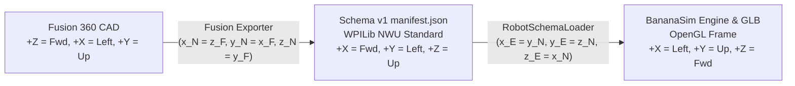

# FRCBananaSim Robot Configuration & Calibration Guide

> [!NOTE]
> **Status:** Block 2 & Block 3 Verified — 6-DOF Analytic Swerve Dynamics, Jolt Rigid Body Chassis, Tire Contact Model, Battery Electromechanics, Robot Data Schema v1.0.0 (`manifest.json`, `sidecar.json`, `materials.json`), Multi-Stage Elevators, Rotational Arms & Wrists, Closed-Loop Four-Bar Linkages, High-RPM Flywheels, Full Sensor Suite (`CANcoder`, 6-Axis `Pigeon 2` IMU, Limit Switches, Beam Breaks, Analog Inputs), CTRE Phoenix 6 / REVLib HALSim WebSocket Lockstep Bridge, and Fusion 360 Exporter Standards.
>
> This document is the living reference guide for modeling, measuring, configuring, and calibrating robots in **FRCBananaSim**. It covers the complete modeling pipeline from **Fusion 360 CAD authoring**, to physical workbench measurements, to configuration file dictionaries for **Block 2 Standalone Swerve (`robot_swerve.json`)** and **Block 3 Full-Robot Schema v1 (`manifest.json`, `sidecar.json`, `materials.json`)**.

---

## 1. System Overview & Configuration Architecture

**FRCBananaSim** supports two configuration and simulation tiers:

### A. Block 2 Standalone Swerve Configuration (`robot_swerve.json`)
All standalone swerve drivetrain configuration data resides in:  
📁 [`FRCBananaSim/Resources/Robots/robot_swerve.json`](file:///C:/Game%20Dev/C++/Projects/FRCBananaSim/FRCBananaSim/Resources/Robots/robot_swerve.json)

When launched in standalone swerve mode, `RobotSpawner::SpawnFromJsonFile` and `SwerveDrivetrainConfig::LoadFromJsonString` parse this JSON file into physical entities:
1. **Chassis Rigid Body**: A single dynamic Jolt physics body with 6 degrees of freedom (surge, sway, heave, roll, pitch, yaw), custom mass, and custom $3 \times 3$ inertia tensor.
2. **Analytic Swerve Drivetrain**: 4 module contact points evaluating tire brush friction, Stribeck transitions, and normal force load transfers.
3. **Electromechanical Actuation**: DC motor torque curves, gear ratios, drivetrain friction, and buck-converter battery sag models.
4. **HALSim WebSocket Bridge**: Translates CTRE Phoenix 6 network packets to and from your robot code.

```
┌────────────────────────────────────────────────────────┐
│                   robot_swerve.json                    │
└───────────────────────────┬────────────────────────────┘
                            │
            ┌───────────────┴───────────────┐
            ▼                               ▼
  [RobotSpawner.cpp]               [SwerveParams.cpp]
  • Chassis Jolt Rigid Body        • 6-DOF Analytic Dynamics
  • Battery Component              • Motor Torque/Back-EMF
  • Visual Scene Hierarchy         • Tire Brush Friction Model
            │                               │
            └───────────────┬───────────────┘
                            ▼
              [HALSimWebSocketServer.cpp]
              • CAN 0,2,4,6  Drive Motors
              • CAN 1,3,5,7  Steer Motors
              • CAN 20..23   Steer CANcoders
              • CAN 24       Pigeon 2 IMU
```

### B. Block 3 Full-Robot Schema v1.0.0 (`manifest.json`, `sidecar.json`, `materials.json`)
For complete multi-mechanism robots, configuration data is partitioned into three modular JSON files loaded by `RobotSchemaLoader` and assembled by `RobotAssembler::AssembleFromFiles`:
* 📁 [`FRCBananaSim/Resources/Robots/Reference2026/manifest.json`](file:///C:/Game%20Dev/C++/Projects/FRCBananaSim/FRCBananaSim/Resources/Robots/Reference2026/manifest.json) — Physical CAD hierarchy (links, masses, CoMs, full $3 \times 3$ inertia tensors, colliders, joints, and sensor contact zones).
* 📁 [`FRCBananaSim/Resources/Robots/Reference2026/sidecar.json`](file:///C:/Game%20Dev/C++/Projects/FRCBananaSim/FRCBananaSim/Resources/Robots/Reference2026/sidecar.json) — Electromechanical actuation, swerve parameters, mechanism controllers, kinematic couplings, and hardware sensors.
* 📁 [`FRCBananaSim/Resources/Config/materials.json`](file:///C:/Game%20Dev/C++/Projects/FRCBananaSim/FRCBananaSim/Resources/Config/materials.json) — Surface friction, restitution, density, and pairwise contact overrides.
* 📁 [`FRCBananaSim/Resources/Config/simdevice_keymap.json`](file:///C:/Game%20Dev/C++/Projects/FRCBananaSim/FRCBananaSim/Resources/Config/simdevice_keymap.json) — Configurable vendor property key aliases for `SimDeviceDispatcher`.

```
┌───────────────────────────┐   ┌───────────────────────────┐   ┌───────────────────────────┐
│       manifest.json       │   │       sidecar.json        │   │      materials.json       │
└─────────────┬─────────────┘   └─────────────┬─────────────┘   └─────────────┬─────────────┘
              └───────────────────────────────┼───────────────────────────────┘
                                              ▼
                                 [RobotSchemaLoader.cpp]
                          NWU (+X Fwd, +Y Left, +Z Up) ──► Engine (+X Left, +Y Up, +Z Fwd)
                                              │
                                              ▼
                                   [RobotAssembler.cpp]
                                              │
       ┌──────────────────────────────────────┴──────────────────────────────────────┐
       ▼                                                                             ▼
  [8-Stage 200 Hz FixedUpdate Pipeline]                                 [HALSim Bridge & Lockstep]
  1. ElectricalSystem     (Buck-converter supply current & V_bus sag)   • HALSimWebSocketServer (:3300)
  2. ElevatorSystem       (Slider forces, reflected mass, cascade)      • SimDeviceDispatcher
  3. MechanismSystem      (Arms, wrists, 4-bar PD sync, couplings)      • LockstepCoordinator (20 ms)
  4. FlywheelSystem       (800 Hz 1D ODE, parent recoil, wrist mount)   • OnControllerPIDModel (1 kHz)
  5. CompositeMassSystem  (Dynamic CG & Parallel Axis inertia -> Swerve)
  6. SwerveDriveSystem    (6-DOF analytic swerve + Jolt terrain probe)
  7. PhysicsSystem        (Jolt 5 ms step + CoM-to-origin sync)
  8. SensorSystem         (Encoders, 6-axis IMU, DIO limits & beams)
```

---

## 2. CAD Authoring & Fusion 360 Standards (The CADder's Guide)

> [!IMPORTANT]
> **Why CAD accuracy matters:**  
> BananaSim does not guess mass or balance. It calculates total weight, center of gravity ($X, Y, Z$), and tip resistance directly from Fusion 360. If parts are left on default materials, your aluminum robot will weigh 350 lbs in the sim. If joints have no limits, your elevator will shoot through the ceiling. Follow this contract strictly during CAD authoring.

### A. The 3 Golden Rules for CADders
1. **Always assign Physical Materials, not just Appearances.** (Appearances are only paint; Physical Materials give parts real weight).
2. **Use real Joints with Limits for moving mechanisms.** (Elevators need Slider joints with max travel; arms need Revolute joints with min/max angles).
3. **Names in CAD must match `sidecar.json`.** (If you name an arm joint `arm_shoulder_hinge` in Fusion, use the exact same name in your config).

---

### B. Our Team's Coordinate System in Fusion 360

Our team models robots using this exact orientation in Fusion 360:

| Direction | Fusion 360 Axis | Robot Meaning |
| :--- | :--- | :--- |
| **Front / Intake** | **$+Z$** | Front of the robot (intake side) |
| **Left Side** | **$+X$** | Left side of the robot (Fusion's "Right" ViewCube face) |
| **Top / Up** | **$+Y$** | Top of the robot (pointing up to the ceiling) |

```
               +Y (Up / Ceiling)
               ▲
               │
               │   ▲ +Z (Forward / Intake)
               │  /
               │ /
               └────────► +X (Robot Left Side)
```



> [!TIP]
> **The Free Alignment:**  
> Notice that our team's Fusion coordinate frame ($+X$ Left, $+Y$ Up, $+Z$ Forward) is **identical to BananaSim's Engine OpenGL coordinate frame**! The exporter maps Fusion into standard WPILib NWU for `manifest.json`, and the engine converts NWU back to Engine space, preserving 100% orientation fidelity without any axis inversion.

---

### C. Setting Up the Robot Origin & Grounding
1. **Floor Origin:**
   * Model your robot so that the CAD origin `(0, 0, 0)` is located at the **geometric center of your drivetrain frame rails, on the carpet floor plane ($Y = 0$)**.
   * **If your origin is somewhere else:** Create a Construction Point in your top-level assembly at frame center on the floor and name it **`ROBOT_ORIGIN`**. The exporter will detect this point and offset all coordinates automatically.
2. **Ground the Chassis Base:**
   * Right-click your main drivetrain / bellypan component in the browser tree $\to$ **Ground**.
   * Exactly **one** component must be grounded. This marks the root chassis (`base_link`) in the simulation kinematic tree.

---

### D. Assigning Physical Materials (Don't Make a 350 lb Robot!)

> [!WARNING]
> In Fusion 360, **Appearance** (`A`) is only visual color. A part painted with "Anodized Blue Aluminum" that has no physical material defaults to **Structural Steel**, making your robot nearly three times heavier than reality!

#### How to Assign Physical Materials:
1. In Fusion 360, go to **Modify $\to$ Physical Material** (or right-click any body/component in the browser $\to$ **Physical Material**).
2. Drag and drop the physical material onto your parts:
   * **Aluminum 6061:** Box tubing, gussets, plate brackets, standoffs, planetary gearboxes.
   * **Polycarbonate:** Lexan panels, intake guide plates, bellypan covers.
   * **HDPE / Delrin:** Slide bearing blocks, wear pads.
   * **Steel 4140:** Hex shafts, sprockets, steel gears, large hardware.
3. **What to Assign to Motors:**
   * Real motors (Kraken X60, Falcon 500, NEO) are dense assemblies of copper windings, steel rotors, neodymium magnets, and aluminum casings.
   * Assign motor bodies **Steel 4140** (or create a custom material with density $\approx 4800\ \text{kg/m}^3$).
   * *Rule of thumb check:* A Kraken X60 or Falcon 500 should weigh about **$1.1\ \text{lbs}$ ($0.50\ \text{kg}$)** in Fusion, and a NEO should weigh about **$0.9\ \text{lbs}$ ($0.41\ \text{kg}$)**.
4. **Custom FRC Materials (Treads, Bumpers, Foam):**
   * If you need custom densities, duplicate any material in Fusion and name it:
     * `colson_performa` $\to 1100\ \text{kg/m}^3$ (Tread rubber)
     * `bumper_fabric` $\to 500\ \text{kg/m}^3$ (Bumper wood + foam + Cordura fabric)
     * `game_piece_foam` $\to 80\ \text{kg/m}^3$ (Foam notes/balls)

---

### E. Assembling Moving Mechanisms & Rigid Groups

`FRCBananaSim` combines parts bolted together into single moving links.

1. **Moving Joints (Must Have Limits):**
   * **Revolute Joint (`Hinge`):** For arms, wrists, four-bar links, and intake pivots.
   * **Slider Joint (`Prismatic`):** For elevator stages and linear climbers.
   * **Always check "Edit Joint Limits":** Set the real physical stops (e.g. Min: $0.0\text{ m}$, Max: $0.65\text{ m}$ for an elevator carriage; Min: $-10^\circ$, Max: $+95^\circ$ for an arm).
2. **Bolted / Fastened Parts (Rigid Groups):**
   * Do not put joints on parts that don't move relative to each other (motor brackets, gearbox plates, cross-braces).
   * Group them using **Assemble $\to$ Rigid Group** (or rigid joints). The exporter will merge them into one solid link with combined weight and inertia.

---

### F. Joint & Link Naming: How to Match `sidecar.json`

You do **not** have to memorize hardcoded names. You can name your joints anything descriptive, as long as the name in Fusion matches `sidecar.json`:

```
Fusion 360 Joint Name                       sidecar.json Field
─────────────────────────────────────────────────────────────────────────────
"arm_shoulder_hinge"         ◄──────────►   "targetJoint": "arm_shoulder_hinge"
"elevator_stage1_slider"     ◄──────────►   "targetJoint": "elevator_stage1_slider"
"intake_fourbar_crank"       ◄──────────►   "crankJoint":  "intake_fourbar_crank"
"intake_fourbar_coupler"     ◄──────────►   "couplerJoint":"intake_fourbar_coupler"
```

* **Best Practice:** Use lower `snake_case` without spaces (`subsystem_part_type`).
* **Swerve Modules:** Name the 4 module component instances in your CAD tree `fl`, `fr`, `bl`, `br`. The exporter automatically folds their steer/drive joints into the chassis so our high-speed analytic swerve solver can run them.

---

### G. Custom Colliders (`COL_*`) & Curved Ramps / Half-Pipes

By default, the exporter creates a simple bounding box around each moving link. If a link has a complex shape (like a bumper frame, curved intake plate, or shooter ramp):

1. Inside that component, model a simplified solid body for collisions.
2. Name the body starting with **`COL_`** (e.g. `COL_bumper_box`, `COL_intake_guard`).
3. The exporter will use this shape for physics, and **automatically exclude it from the robot's mass and visual rendering** so it won't double-count weight.
4. **How to handle curved ramps and half-pipes:**
   * In 3D physics engines, moving collision bodies must be **convex** (no hollow bowls or indented curves in a single piece).
   * To model a curved ramp or half-pipe: create **2 to 4 flat tangent boxes** along the curve (like facets of an arc) named `COL_ramp_seg1`, `COL_ramp_seg2`, `COL_ramp_seg3`.
   * Game pieces will roll smoothly along the faceted boxes without physics lag or glitches.

```
       Curved Intake / Shooter Ramp:
       
             Segment 3 ┌──────┐
                      /      /
          Segment 2  ┌──────┐
                    /      /
        Segment 1  ┌──────┐
                   │      │
       ────────────┴──────┴──────────── Floor
       (Approximated with 3 simple convex boxes)
```

---

### H. Sensor & Trigger Zones (`ZONE_<role>_*`)

To define where a game piece gets detected or grabbed:

1. In the component that holds the sensor (e.g. intake roller plate or shooter tunnel), create a simple box covering the trigger area.
2. Name the solid body starting with **`ZONE_<role>_<name>`**:
   * `ZONE_intake_capture_zone`: Area where rollers grab a game piece.
   * `ZONE_shooter_engagement_zone`: Tunnel where flywheel compresses the piece.
   * `ZONE_indexer_beam_break`: Optical beam-break laser path.
3. The exporter turns these into non-colliding trigger zones (`ObjectLayers::SENSOR`). They do not add any mass or visual clutter.

---

### I. Fast Flywheels & Shooter Rollers (Why They Are Special)

* **Why we don't simulate 6,000 RPM wheels as raw physics bodies:**  
  A shooter wheel turns 100 times every second. In a 200 Hz physics simulation ($5\text{ ms}$ steps), the wheel jumps 180 degrees between two frames. If standard physics tries to bounce a ball off something jumping 180° instantaneously, the ball violently glitches through the wheel or gets launched at infinite speed.
* **How BananaSim handles it:**  
  BananaSim uses continuous mathematical differential equations (running at 800 Hz) to calculate motor torque, RPM sag, and compression grip smoothly.
* **What the CADder does:**  
  Model the flywheel on its axle joint normally! The exporter extracts its 3D visual mesh so you can see it spin on screen, while leaving the high-speed physics to the specialized math solver.

---

### J. Closed-Loop Mechanisms (Four-Bar Intakes)

When modeling a four-bar linkage:
1. Model all 4 joints in CAD:
   * Crank ground pivot on chassis (e.g. `intake_crank_pivot`)
   * Follower ground pivot on chassis (e.g. `intake_follower_pivot`)
   * Coupler joint between crank and intake plate (e.g. `intake_coupler_joint`)
   * Loop closure joint between follower and intake plate
2. **Avoid Flat Singularity at Stow:**  
   Do not align all 4 pivots in a dead-straight flat line at $0^\circ$ stow. Keep a slight vertical or horizontal offset (e.g. $1\text{--}2\text{ cm}$) between the crank and follower pivot heights so the linkage never gets stuck in a geometric dead-center lock.

---

### K. Pre-Export CAD Checklist

Before exporting your assembly for simulation:
- [ ] **Timeline Clean:** No red or yellow warning markers in the Fusion 360 timeline.
- [ ] **Home / Zero Position:** Mechanism joints set to their resting/stowed position (Elevator down at $0.0\text{ m}$, Arm at $0^\circ$).
- [ ] **No Pending Movement:** Click **Capture Position** or **Revert** in Fusion so no floating parts are active.
- [ ] **Hardware Suppressed / Hidden:** Hide or suppress small screws, nuts, washers, and zip ties (they bloat 3D mesh polygon counts without helping physics).
- [ ] **Total Mass Sanity Check:** Check assembly **Properties $\to$ Mass**. If a 125 lb robot shows 300+ lbs, find which parts were left on default Steel and change them to Aluminum!

---

## 3. Parameter Extraction from CAD (Block 2 Swerve & Chassis)

Extract these values directly from your robot CAD assembly. Every value listed here maps directly into [`robot_swerve.json`](file:///C:/Game%20Dev/C++/Projects/FRCBananaSim/FRCBananaSim/Resources/Robots/robot_swerve.json) (and into `"base_link"` / `"swerve"` in Schema v1).

### A. Chassis Frame Geometry
* **Where to find it in CAD:** Measure the outer frame perimeter and module centers with the CAD tape/measure tool.
* **Exact JSON Targets in `robot_swerve.json` (`"chassis"` object):**
  * `"trackwidth_m"`: Distance between the center of the left wheels and right wheels along the robot's lateral axis (e.g. `0.56`).
  * `"wheelbase_m"`: Distance between the center of the front wheels and back wheels along the robot's longitudinal axis (e.g. `0.56`).
  * `"width_m"`: Outer bumper/frame width along the lateral axis (e.g. `0.70`).
  * `"length_m"`: Outer bumper/frame length along the longitudinal axis (e.g. `0.70`).
  * `"height_m"`: Height of the chassis frame box (e.g. `0.15`).
* **Config Snippet:**
  ```json
  "chassis": {
    "width_m": 0.70,
    "height_m": 0.15,
    "length_m": 0.70,
    "wheelbase_m": 0.56,
    "trackwidth_m": 0.56
  }
  ```

### B. Center of Mass & Inertia Tensor
* **Where to find it in CAD:** Select the top-level robot assembly (with battery, electronics, and bumpers modeled or mass-overridden) and open the CAD **Mass Properties** tool.
* **Exact JSON Targets in `robot_swerve.json` (`"chassis"` object):**
  * `"cgHeight_m"`: Vertical distance ($Z$) from the ground plane to the Center of Mass (e.g. `0.20`).
  * `"cgOffset_m"`: `[ dx, dy ]` horizontal offset of the Center of Mass from the geometric center of the drive base (e.g. `[ 0.0, 0.0 ]`).
  * `"inertiaTensor_kgm2"`: The $3 \times 3$ principal moments of inertia taken at the Center of Mass ($I_{xx}, I_{yy}, I_{zz}$).
* **Config Snippet:**
  ```json
  "chassis": {
    "cgHeight_m": 0.20,
    "cgOffset_m": [ 0.0, 0.0 ],
    "inertiaTensor_kgm2": [
      [ 2.1354, 0.0, 0.0 ],
      [ 0.0, 2.1354, 0.0 ],
      [ 0.0, 0.0, 4.0833 ]
    ]
  }
  ```

### C. Swerve Module Locations
* **Where to find it in CAD:** Measure the $(X, Y)$ coordinates of the steering axis of each module relative to the robot's center origin.
* **Exact JSON Targets in `robot_swerve.json` (`"modules"` array):**
  * `modules[i].location_m`: `[ X, Y ]` in meters.
* **Config Snippet:**
  ```json
  "modules": [
    { "index": 0, "name": "FrontLeft",  "location_m": [  0.28,  0.28 ] },
    { "index": 1, "name": "FrontRight", "location_m": [ -0.28,  0.28 ] },
    { "index": 2, "name": "BackLeft",   "location_m": [  0.28, -0.28 ] },
    { "index": 3, "name": "BackRight",  "location_m": [ -0.28, -0.28 ] }
  ]
  ```

### D. Module Gearing & Steer Column Geometry
* **Where to find it in CAD:** Inspect the gear tooth counts or module assembly models:
  * Motor shaft pinion $\to$ intermediate gears $\to$ wheel / azimuth ring gear.
* **Exact JSON Targets in `robot_swerve.json`:**
  * `"motors.drive.gearRatio"`: Total reduction from drive motor to wheel (e.g. `5.27` for MK4n / MK5n L3).
  * `"motors.steer.gearRatio"`: Total reduction from steer motor to azimuth ring (e.g. `26.0909` for MK4n / MK5n).
  * `"steerHousing.mass_kg"`: Mass of the turning steer assembly column (e.g. `0.45`).
  * `"steerHousing.radius_m"`: Radius of the turning steer column (e.g. `0.04`).
* **Config Snippet:**
  ```json
  "motors": {
    "steer": {
      "type": "KrakenX44",
      "gearRatio": 26.0909
    },
    "drive": {
      "type": "KrakenX60",
      "gearRatio": 5.27
    }
  },
  "steerHousing": {
    "mass_kg": 0.45,
    "radius_m": 0.04
  }
  ```

---

## 4. Physical Hardware Measurements & Calibration

Perform these physical checks on the real robot to calibrate parameters that differ from pure theoretical CAD.

### A. Total Mass Calibration
* **Tool:** Scale (or 4 corner scales summed together).
* **Condition:** Robot must be weighed with battery installed, main breaker on, and bumpers mounted.
* **JSON Fields:** `chassis.mass_kg` (in `robot_swerve.json`) or `links[i].mass_kg` and `massSummary.totalMass_kg` (in `manifest.json`).

### B. Wheel Radius (Tread Wear)
* **Tool:** Digital calipers.
* **Procedure:** Measure the outer diameter across the tread on all four wheels while mounted. Standard 4-inch wheels with fresh tread measure $101.6\text{ mm}$ ($r = 0.0508\text{ m}$), but worn nitrile/billet tread frequently wears down to $96 - 98\text{ mm}$ ($r = 0.0480 - 0.0490\text{ m}$).
* **JSON Fields:** `wheel.radius_m` (in `robot_swerve.json`) or `swerve.wheelRadius_m` (in `sidecar.json`).

### C. Battery Internal Resistance & Voltage
* **Tool:** Battery Beak or 12V battery analyzer.
* **Procedure:** Measure a fresh competition battery:
  * Open-circuit voltage ($V_{\text{nominal}}$, typically $12.60\text{ V} - 12.80\text{ V}$).
  * Internal resistance ($R_{\text{int}}$, typically $0.018 - 0.024\ \Omega$).
* **JSON Fields:**
  * `battery.nominalVoltage_V` / `electrical.openCircuitVoltage_V`
  * `battery.internalResistance_ohm` / `electrical.internalResistance_Ohm`

### D. Drivetrain & Mechanism Mechanical Friction Calibration
* **Setup:** Place the robot on blocks with wheels (or mechanism) unloaded in the air.
* **Procedure:** Command the motors to full speed ($12\text{ V}$) via Phoenix Tuner X or manual test code.
  * Measure steady-state velocity ($\text{RPS}$).
  * A Kraken X60 has a theoretical free speed of $\sim 6000\text{ RPM}$ ($100\text{ RPS}$). If the rotor reaches $94\text{ RPS}$ in the air, the drivetrain consumes $\sim 6\%$ in friction.
  * Measure the minimum breakaway voltage $V_{\text{break}}$ required to initiate motion from rest: $\tau_{\text{coulomb}} \approx G \eta \tau_{\text{stall}} (V_{\text{break}} / 12.0)$.
* **JSON Fields:**
  * `motors.drive.efficiency` / `mechanisms[i].efficiency` (typically $0.90 - 0.97$)
  * `driveModule.coulombFriction_Nm` / `mechanisms[i].coulombFriction` (typically $1.5 - 2.0\text{ Nm}$ for drive, $0.3 - 0.8\text{ Nm}$ for arms, $10 - 15\text{ N}$ for elevators)
  * `mechanisms[i].springAssist.force_N`: Measure constant-force spring pull on the elevator carriage with a fish/luggage scale (e.g. $45.0\text{ N}$).

---

## 5. Electronics, CAN Bus & Sensor Configuration

BananaSim's network bridge communicates directly with CTRE Phoenix 6 and REVLib devices over the WPILib HALSim WebSocket protocol.

### A. Swerve & Reference 2026 CAN Bus ID Mapping
Verify that the CAN IDs in [`robot_swerve.json`](file:///C:/Game%20Dev/C++/Projects/FRCBananaSim/FRCBananaSim/Resources/Robots/robot_swerve.json) or [`sidecar.json`](file:///C:/Game%20Dev/C++/Projects/FRCBananaSim/FRCBananaSim/Resources/Robots/Reference2026/sidecar.json) match your physical robot:

| Component | Physical Device | `robot_swerve.json` Path | `sidecar.json` Path | Default ID | `SimInputs` Slot |
| :--- | :--- | :--- | :--- | :--- | :--- |
| **Front Left Steer** | Talon FX (v6) | `modules[0].steerCAN` | `swerve.modules[0].steerCanId` | `1` | `0` |
| **Front Right Steer** | Talon FX (v6) | `modules[1].steerCAN` | `swerve.modules[1].steerCanId` | `3` | `1` |
| **Back Left Steer** | Talon FX (v6) | `modules[2].steerCAN` | `swerve.modules[2].steerCanId` | `5` | `2` |
| **Back Right Steer** | Talon FX (v6) | `modules[3].steerCAN` | `swerve.modules[3].steerCanId` | `7` | `3` |
| **Front Left Drive** | Talon FX (v6) | `modules[0].driveCAN` | `swerve.modules[0].driveCanId` | `0` | `4` |
| **Front Right Drive** | Talon FX (v6) | `modules[1].driveCAN` | `swerve.modules[1].driveCanId` | `2` | `5` |
| **Back Left Drive** | Talon FX (v6) | `modules[2].driveCAN` | `swerve.modules[2].driveCanId` | `4` | `6` |
| **Back Right Drive** | Talon FX (v6) | `modules[3].driveCAN` | `swerve.modules[3].driveCanId` | `6` | `7` |
| **Elevator Leader / Follower**| Talon FX (v6) | — | `mechanisms[0].controllers` | `10`, `11` | `8` |
| **Arm Shoulder** | Talon FX (v6) | — | `mechanisms[1].controllers` | `12` | `9` |
| **Arm Wrist** | SPARK MAX | — | `mechanisms[2].controllers` | `13` | `10` |
| **Intake Four-Bar Deploy** | Talon FX (v6) | — | `mechanisms[3].controllers` | `14` | `11` |
| **Shooter Flywheel L / F** | Talon FX (v6) | — | `mechanisms[4].controllers` | `15`, `16` | `12` |
| **Swerve Steer CANcoders** | CANcoder (v6) | `modules[0..3].canCoder` | `swerve.modules[0..3].cancoderId` | `20..23` | `CANcoder 0..3` |
| **Shoulder CANcoder** | CANcoder (v6) | — | `sensors[1].canId` | `12` | `CANcoder 4` |
| **IMU Gyro** | Pigeon 2 (v6) | Handled in Bridge | `sensors[0].canId` | `24` | IMU Output |

### B. Current Limits & Buck-Converter Supply Current
* **Where to find it:** Check your robot code's `CurrentLimitsConfigs` on the Talons and SPARKs.
* **How BananaSim models it:** Both `ElectricalSystem` and `SwerveDrivetrainModel` model motor controllers as PWM buck converters where battery supply current scales with duty cycle ($I_{\text{supply}} = \min(I_{\text{supply\_limit}}, |V_{\text{applied}} / V_{\text{bus}}| \cdot I_{\text{stator}})$) filtered through a $5\text{ ms}$ low-pass filter.
* **JSON Fields:**
  * `motors.drive.statorCurrentLimit_A`, `motors.steer.statorCurrentLimit_A`, `battery.statorCurrentLimit_A`, `battery.supplyCurrentLimit_A` (in `robot_swerve.json`)
  * `swerve.driveStatorLimit_A`, `swerve.driveSupplyLimit_A`, `swerve.steerStatorLimit_A`, `swerve.steerSupplyLimit_A`, `mechanisms[i].statorCurrentLimit_A`, `mechanisms[i].supplyCurrentLimit_A` (in `sidecar.json`)

### C. Vendor `SimDevice` Mapping Table (`SimDeviceDispatcher`)
`SimDeviceDispatcher` translates WPILib HALSim WebSocket `SimDevice` frames using [`simdevice_keymap.json`](file:///C:/Game%20Dev/C++/Projects/FRCBananaSim/FRCBananaSim/Resources/Config/simdevice_keymap.json):

| Vendor Device | `SimDevice` Pattern | Robot $\to$ Sim Keys (`>`) | Sim $\to$ Robot Keys (`<`) |
| :--- | :--- | :--- | :--- |
| **CTRE `TalonFX`** | `"TalonFX[<id>]"`, `"Talon FX[<id>]"`, `"TalonFX:<bus>[<id>]"` | `">motorVoltage"`, `">motorOutputLead"`, `">BridgeOutput"` | `"<supplyVoltage"`, `"<rawRotorPosition"`, `"<rotorVelocity"`, `"<rotorAcceleration"`, `"<torqueCurrent"`, `"<supplyCurrent"`, `"<forwardLimit"`, `"<reverseLimit"` |
| **CTRE `CANcoder`** | `"CANcoder[<id>]"`, `"CANcoder:<bus>[<id>]"` | *(none)* | `"<supplyVoltage"`, `"<rawPosition"` (rot), `"<velocity"` (RPS) |
| **CTRE `Pigeon2`** | `"Pigeon2[<id>]"`, `"Pigeon 2[<id>]"`, `"Pigeon2:<bus>[<id>]"` | *(none)* | `"<supplyVoltage"`, `"<rawYaw"` (deg), `"<pitch"` (deg), `"<roll"` (deg), `"<angularVelocityX/Y/Z"` (deg/s), `"<accelX/Y/Z"` ($g$) |
| **REV `SparkMax` / `SparkFlex`** | `"SPARK MAX [<id>]"`, `"SPARK Flex [<id>]"` | `">Applied Output"` | `"<Bus Voltage"`, `"<Motor Current"`, `"<Position"` (rot), `"<Velocity"` (RPM) |
| **Kauai Labs `navX`** | `"navX-Sensor[0]"` | *(none)* | `"<yaw"` (deg, CW+), `"<pitch"`, `"<roll"`, `"<LinearWorldAccelX/Y/Z"` |

---

## 6. Configuring Block 3 Mechanisms & Couplings (`manifest.json` & `sidecar.json`)

### A. Links, Colliders & Visual Mesh Generation
* **Procedural Visual Meshes from Colliders:** When a link in `manifest.json` does not load an external `.glb` mesh, `RobotAssembler` generates procedural visual box/sphere/cylinder meshes from `colliders[0].origin_m` and `colliders[0].dimensions_m`. Always define a collider on every visible link (including four-bar crank and follower links).
* **Center-of-Mass Offset Alignment:** When `centerOfMass_m` is non-zero, `PhysicsSystem` automatically converts Jolt's CoM world position back to the link origin (`comPos - rot * localOffset`) so visual meshes and collider wireframes remain 100% aligned.

### B. Elevators (`SingleStage`, `Cascade`, `Continuous`)
* Configured via `"role": "elevator"` in `sidecar.json` (`"drumRadius_m"` converts motor torque into linear force and computes reflected linear rotor mass $m_{\text{reflected}} = N J_{\text{rotor}}(G/r_{\text{drum}})^2$).
* **Cascade Rigging (`"type": "elevator_cascade"`, `"solverMode": "analytic_coupled"`):** Stage 1 carries the full lumped mass and gravity load while upper stages track $x_k = k \cdot x_1$ analytically with zero drift.

### C. Arms, Wrists & Power Couplings
* Configured via `"role": "arm"` or `"role": "wrist"` in `sidecar.json`.
* **Active Motor Priority over Passive Coupling:** If a slave joint in a `"power_coupling"` entry (such as `shoulder_to_wrist_coupling`) also has its own motorized mechanism entry (such as `arm_wrist`), `MechanismSystem::UpdateCoupling` automatically yields to the independent motor controller so the wrist can articulate freely at any shoulder angle.

### D. Closed-Loop Four-Bar Linkages
* **Avoid Collinear Singularity:** Place the ground pivots (`fourbar_crank_hinge` and `fourbar_follower_hinge`) with both a longitudinal ($X$) and vertical ($Z$) offset above the bumper (e.g., crank at `[0.40, 0.0, 0.19]` and follower at `[0.28, 0.0, 0.25]`, delta `[-0.12, 0.0, +0.06]`), matching `"closureParentAnchor_m": [0.24, 0.0, 0.0]` and `"closureChildAnchor_m": [-0.12, 0.0, 0.06]`.
* **Follower Synchronization:** `MechanismSystem::UpdateFourBar` applies feed-forward + PD tracking torque to the follower bar during motion and locks both hinges in Jolt `Position` mode when stopped so the back bar never lags during folding.

### E. High-RPM Flywheels
* Configured via `"role": "flywheel"` in `sidecar.json`. Sub-stepped at $800\text{ Hz}$ ($\Delta t = 1.25\text{ ms}$) with equal-and-opposite Newton's 3rd Law recoil torque applied to `"parentLink"`, and rendered at `mountOffset` (`(0.0f, 0.06f, 0.06f)` on the wrist) via `FlywheelSystem::RenderUpdate`.

### F. Generic 2-DOF Differential Mechanisms (`"role": "differential"`)
* **Kinematic Decoupling Architecture:**
  Differential transmissions mechanically couple two actuators ($A, B$) to two physical joints ($q_1, q_2$, typically Pitch and Roll in a wrist, or $X, Y$ in a CoreXY gantry). The kinematic mapping between motor rotor angular velocities and joint coordinates is:
  $$\begin{bmatrix} \dot{\theta}_A \\ \dot{\theta}_B \end{bmatrix} = \mathbf{T}_{mq} \begin{bmatrix} \dot{q}_1 \\ \dot{q}_2 \end{bmatrix} = \begin{bmatrix} G_p & G_r \\ G_p & -G_r \end{bmatrix} \begin{bmatrix} \dot{q}_1 \\ \dot{q}_2 \end{bmatrix}$$
  Inverting the coupling matrix yields the joint forward kinematics:
  $$\begin{bmatrix} \dot{q}_1 \\ \dot{q}_2 \end{bmatrix} = \mathbf{T}_{mq}^{-1} \begin{bmatrix} \dot{\theta}_A \\ \dot{\theta}_B \end{bmatrix} = \begin{bmatrix} \frac{1}{2 G_p} & \frac{1}{2 G_p} \\ \frac{1}{2 G_r} & -\frac{1}{2 G_r} \end{bmatrix} \begin{bmatrix} \dot{\theta}_A \\ \dot{\theta}_B \end{bmatrix}$$
* **Torque Duality & Virtual Work:**
  By the principle of virtual work, motor output torques map to joint torques via the transpose $\boldsymbol{\tau}_q = \mathbf{T}_{mq}^T \boldsymbol{\tau}_m$:
  $$\begin{bmatrix} \tau_{q1} \\ \tau_{q2} \end{bmatrix} = \begin{bmatrix} G_p & G_p \\ G_r & -G_r \end{bmatrix} \begin{bmatrix} \tau_A \\ \tau_B \end{bmatrix} = \begin{bmatrix} G_p (\tau_A + \tau_B) \\ G_r (\tau_A - \tau_B) \end{bmatrix}$$
  Both motors combine their full stall torque into the primary axis (pure pitch: $V_A = V_B \implies \tau_1 = 2 G_p \tau_m$) while differentially sharing roll torque (pure roll: $V_A = -V_B \implies \tau_2 = 2 G_r \tau_m$).
* **Effective Reflected Inertia Matrix:**
  Rotor inertias reflect through $\mathbf{T}_{mq}$ onto the joint space as a full $2\times 2$ inertia tensor:
  $$\mathbf{M}_{\text{eff}} = \mathbf{T}_{mq}^T \begin{bmatrix} J_A & 0 \\ 0 & J_B \end{bmatrix} \mathbf{T}_{mq} = \begin{bmatrix} G_p^2 (J_A + J_B) & G_p G_r (J_A - J_B) \\ G_p G_r (J_A - J_B) & G_r^2 (J_A + J_B) \end{bmatrix}$$
  For identical motors ($J_A = J_B = J_{\text{rotor}}$), the off-diagonal inertial cross-coupling vanishes ($\mathbf{M}_{\text{eff}} = \text{diag}(2 G_p^2 J_{\text{rotor}}, 2 G_r^2 J_{\text{rotor}})$), but the reflected rotor inertia dominates Jolt's geometric link inertia by $> 30\times$.
* **Physics Integration & Velocity-Targeted Motor Mode:**
  Because the reflected inertia $M_{\text{eff}}$ vastly exceeds Jolt CAD link inertias ($I_{\text{CAD}} \approx 0.00125\text{ kg}\cdot\text{m}^2$ vs $M_{\text{eff}} \approx 0.042\text{ kg}\cdot\text{m}^2$), open-loop joint torque injection (`AddTorque`) leads to numerical divergence and high-frequency velocity explosion ($> 70,000^\circ/\text{s}$). `DifferentialMechanismSystem` solves this unconditionally by:
  1. Evaluating back-EMF damping: $D_{\text{bemf}} = \mathbf{T}_{mq}^T \text{diag}\left(\frac{k_t k_b}{R \eta}\right) \mathbf{T}_{mq}$.
  2. Inverting the semi-implicit system matrix: $\mathbf{A} = \frac{1}{\Delta t} \mathbf{M}_{\text{eff}} + D_{\text{bemf}} + \text{diag}(b_{\text{visc}})$.
  3. Computing stable target joint velocities: $\dot{\mathbf{q}}^{t+\Delta t} = \dot{\mathbf{q}}^t + \mathbf{A}^{-1} \boldsymbol{\tau}_{\text{net}}$.
  4. Driving both Jolt hinges using `JointMotorMode::Velocity` with maximum torque clamped to the stator current limit ($\tau_{\text{stator\_limit}}$).
* **Friction & Backdrive Calibration:**
  * **Breakaway Voltage:** Measure the minimum breakaway voltage $V_{\text{break}}$ under pure pitch ($V_A = V_B$) and pure roll ($V_A = -V_B$):
    $$\tau_{c,\text{pitch}} \approx 2 G_p \eta \tau_{\text{stall}} \left(\frac{V_{\text{break, pitch}}}{12.0}\right), \quad \tau_{c,\text{roll}} \approx 2 G_r \eta \tau_{\text{stall}} \left(\frac{V_{\text{break, roll}}}{12.0}\right)$$
  * Configure `coulombFriction: [tau_pitch, tau_roll]` and `viscousDamping: [b_pitch, b_roll]` directly in `sidecar.json`.
* **CAD Modeling Contract:**
  * The CAD model must define two distinct revolute joints (`joints[0]` for Pitch and `joints[1]` for Roll) organized as a kinematic chain: Parent Link $\to$ Intermediate Yoke Link $\to$ Distal Tool/End-Effector Link.
  * In `manifest.json`, both the pitch yoke link and distal link must have colliders with `isSensor = true` (or be placed in mutual collision group filters) to prevent overlapping geometric penetration forces against the mounting yoke.

---

## 7. Master Configuration Dictionary for `robot_swerve.json` (Block 2)

This table lists every single property read by `RobotSpawner` and `SwerveDrivetrainConfig`:

| JSON Key | C++ Struct Target | Unit | Description & Calibration Source |
| :--- | :--- | :--- | :--- |
| **`chassis.mass_kg`** | `ChassisParams::mass` | $\text{kg}$ | Total robot mass with battery & bumpers (from scales). |
| **`chassis.width_m`** | `ChassisParams::dimensions.y` | $\text{m}$ | Frame width (lateral span). |
| **`chassis.length_m`** | `ChassisParams::dimensions.x` | $\text{m}$ | Frame length (longitudinal span). |
| **`chassis.height_m`** | `ChassisParams::dimensions.z` | $\text{m}$ | Chassis physical collision box height. |
| **`chassis.trackwidth_m`** | `SwerveChassisComponent::trackWidth` | $\text{m}$ | Lateral distance between left & right wheel centers. |
| **`chassis.wheelbase_m`** | `SwerveChassisComponent::wheelBase` | $\text{m}$ | Longitudinal distance between front & rear wheel centers. |
| **`chassis.cgHeight_m`** | `ChassisParams::centerOfMassHeight` | $\text{m}$ | Height of Center of Mass above carpet (from CAD). |
| **`chassis.cgOffset_m`** | `ChassisParams::centerOfMassOffset` | $\text{m}$ | `[dx, dy]` offset of Center of Mass from frame center. |
| **`chassis.inertiaTensor_kgm2`**| `ChassisParams::inertiaTensor` | $\text{kg}\cdot\text{m}^2$| $3\times3$ principal inertia matrix ($I_{xx}, I_{yy}, I_{zz}$). |
| **`chassis.friction`** | `RigidBodyComponent::friction` | — | Bumper/chassis contact friction against field obstacles. |
| **`battery.nominalVoltage_V`** | `BatteryModel::nominalVoltage` | $\text{V}$ | Open-circuit battery voltage (from Battery Beak). |
| **`battery.internalResistance_ohm`**| `BatteryModel::internalResistance` | $\Omega$ | Battery and power harness resistance (from Battery Beak). |
| **`battery.quiescentCurrent_A`**| `BatteryModel::quiescentCurrent` | $\text{A}$ | Robot idle current draw (electronics, radios, coprocessors). |
| **`battery.statorCurrentLimit_A`**| `BatteryModel::statorCurrentLimit`| $\text{A}$ | Motor controller stator current limit. |
| **`battery.supplyCurrentLimit_A`**| `BatteryModel::supplyCurrentLimit`| $\text{A}$ | Motor controller supply current limit. |
| **`battery.brownoutWarning_V`** | `BatteryModel::brownoutWarning` | $\text{V}$ | Voltage drop threshold triggering warning telemetry. |
| **`battery.brownoutCutoff_V`** | `BatteryModel::brownoutCutoff` | $\text{V}$ | roboRIO brownout voltage ($6.3\text{ V}$). |
| **`motors.drive.type`** | `DCMotorModel` factory | string | `"KrakenX60"`, `"KrakenX60FOC"`, `"Falcon500"`, `"NEO"`, etc. |
| **`motors.drive.gearRatio`** | `DCMotorModel::gearRatio` | ratio | Total drive reduction (motor rotations per wheel turn). |
| **`motors.drive.efficiency`** | `DCMotorModel::efficiency` | $0-1$ | Mechanical drivetrain transmission efficiency. |
| **`motors.steer.type`** | `DCMotorModel` factory | string | `"KrakenX44"`, `"KrakenX44FOC"`, `"Falcon500"`, `"NEO"`, etc. |
| **`motors.steer.gearRatio`** | `DCMotorModel::gearRatio` | ratio | Total steer reduction (motor rotations per azimuth turn). |
| **`motors.steer.efficiency`** | `DCMotorModel::efficiency` | $0-1$ | Steer module mechanical efficiency. |
| **`steerHousing.mass_kg`** | Housing inertia formula | $\text{kg}$ | Mass of rotating steer module column. |
| **`steerHousing.radius_m`** | Housing inertia formula | $\text{m}$ | Radius of rotating steer module column. |
| **`steerModule.steerHousingInertia_kgm2`**| `SteerParams::steerHousingInertia`| $\text{kg}\cdot\text{m}^2$| Direct override of steer rotational inertia. |
| **`steerModule.coulombFriction_Nm`** | `SteerParams::coulombFrictionTorque` | $\text{N}\cdot\text{m}$ | Coulomb friction torque opposing steer rotation. |
| **`steerModule.viscousDamping_Nms`** | `SteerParams::viscousDamping` | $\text{N}\cdot\text{m}\cdot\text{s}$ | Viscous damping opposing steer velocity. |
| **`driveModule.coulombFriction_Nm`** | `DriveParams::coulombFrictionTorque` | $\text{N}\cdot\text{m}$ | Coulomb friction torque in drive geartrain. |
| **`wheel.radius_m`** | `TireParams::wheelRadius` | $\text{m}$ | Radius of wheels accounting for tread wear. |
| **`wheel.width_m`** | `TireParams::wheelWidth` | $\text{m}$ | Tread contact width. |
| **`wheel.mass_kg`** | `TireParams::wheelMass` | $\text{kg}$ | Mass of one wheel and tread. |
| **`wheel.axleInertia_kgm2`** | `TireParams::wheelAxleInertia` | $\text{kg}\cdot\text{m}^2$| Rotational inertia of wheel around drive axle. |
| **`tire.mu_static`** | `TireParams::muStatic` | ratio | Static coefficient of friction on FRC carpet. |
| **`tire.mu_kinetic`** | `TireParams::muKinetic` | ratio | Kinetic/sliding coefficient of friction on FRC carpet. |
| **`tire.radialStiffness_Npm`** | `TireParams::radialStiffness` | $\text{N}/\text{m}$ | Vertical compliance rate of tire/tread ($120000\text{ N/m}$). |
| **`tire.radialDamping_Nspm`** | `TireParams::radialDamping` | $\text{N}\cdot\text{s}/\text{m}$ | Vertical damping rate of tire/tread ($1200\text{ N}\cdot\text{s/m}$). |
| **`tire.preSlide_m`** | `TireParams::preSlideDisplacement` | $\text{m}$ | Elastic deformation before full sliding slip ($0.001\text{ m}$). |
| **`tire.stribeckVelocity_mps`**| `TireParams::stribeckVelocity` | $\text{m}/\text{s}$| Velocity threshold transition between static & kinetic grip. |
| **`tire.loadSensitivityBeta`**| `TireParams::loadSensitivityBeta` | $1/\text{N}$ | Normal load sensitivity coefficient ($0.08$). |
| **`tire.rollingResistance`** | `TireParams::rollingResistance` | ratio | Dimensionless rolling resistance factor ($0.015$). |
| **`tire.lateralFrictionRatio`**| `TireParams::lateralFrictionRatio`| ratio | Lateral grip scale factor relative to longitudinal ($1.0$). |
| **`modules[i].name`** | `SwerveModuleConfig::name` | string | Identifier (`"FrontLeft"`, `"FrontRight"`, etc.). |
| **`modules[i].location_m`** | `SwerveModuleConfig::locationOnChassis` | $\text{m}$ | `[X, Y]` coordinates relative to chassis center. |
| **`modules[i].driveCAN`** | `SwerveModuleConfig::driveCANId` | int | CAN ID of Talon FX drive motor. |
| **`modules[i].steerCAN`** | `SwerveModuleConfig::steerCANId` | int | CAN ID of Talon FX steer motor. |
| **`modules[i].canCoder`** | `SwerveModuleConfig::canCoderId` | int | CAN ID of steer absolute CANcoder. |

---

## 8. Master Configuration Dictionary for Schema v1 (`manifest.json` & `sidecar.json`) (Block 3)

### A. [`manifest.json`](file:///C:/Game%20Dev/C++/Projects/FRCBananaSim/FRCBananaSim/Resources/Robots/Reference2026/manifest.json) Keys

| JSON Key | C++ Struct Target | Unit | Description |
| :--- | :--- | :--- | :--- |
| **`schemaVersion`** | `RobotManifest::schemaVersion` | string | Must be `"1.0.0"`. |
| **`coordinateSystem`** | `RobotManifest::coordinateSystem` | string | Must be `"NWU"` ($+X$ Fwd, $+Y$ Left, $+Z$ Up). |
| **`links[i].name`** | `LinkDef::name` | string | Unique link identifier referenced by joints and sidecar. |
| **`links[i].isRoot`** | `LinkDef::isRoot` | bool | `true` for `"base_link"` (chassis root). |
| **`links[i].mass_kg`** | `LinkDef::mass_kg` | $\text{kg}$ | Link mass ($> 0$). |
| **`links[i].centerOfMass_m`** | `LinkDef::centerOfMass_m` | $\text{m}$ | Local `[x, y, z]` CoM in NWU; converted to Engine via `NWUToEnginePos`. |
| **`links[i].inertiaTensor_kgm2`** | `LinkDef::inertiaTensor` | $\text{kg}\cdot\text{m}^2$ | Full $3\times 3$ inertia tensor (`ixx, iyy, izz, ixy, ixz, iyz`) about CoM. |
| **`links[i].colliders[j]`** | `ColliderDef` | $\text{m}$ | Collision shape (`box`, `sphere`, `cylinder`, `capsule`), `origin_m`, `dimensions_m`, and `material`. Also drives procedural visual mesh generation. |
| **`joints[i].type`** | `JointDef::type` | string | `"revolute"`, `"prismatic"`, `"continuous"`, or `"fixed"`. |
| **`joints[i].origin_m`** | `JointDef::origin_m` | $\text{m}$ | Joint anchor in parent link frame. |
| **`joints[i].axis`** | `JointDef::axis` | unit vec | Joint axis in NWU (`[0,0,1]` vertical slider, `[0,1,0]` pitching hinge). |
| **`joints[i].limits`** | `JointLimitsDef` | $\text{m}$ or $\text{rad}$ | `lower`, `upper`, `springFrequency_Hz` ($40\text{ Hz}$), `springDampingRatio` ($1.0$). |
| **`contactZones[i]`** | `ContactZoneDef` | $\text{m}$ | Sensor trigger volume (`ObjectLayers::SENSOR`) for beam breaks, intakes, and shooters. |

### B. [`sidecar.json`](file:///C:/Game%20Dev/C++/Projects/FRCBananaSim/FRCBananaSim/Resources/Robots/Reference2026/sidecar.json) Keys

| JSON Key | C++ Struct Target | Unit | Description |
| :--- | :--- | :--- | :--- |
| **`electrical.openCircuitVoltage_V`** | `ElectricalConfig::openCircuitVoltage_V` | $\text{V}$ | Nominal open-circuit battery voltage ($12.6\text{ V}$). |
| **`electrical.internalResistance_Ohm`** | `ElectricalConfig::internalResistance_Ohm` | $\Omega$ | Battery + main harness resistance ($0.023\ \Omega$). |
| **`swerve.*`** | `SwerveSidecarConfig` | SI | Motor presets, gear ratios, efficiencies, wheel radius, current limits, and 4 module `[x, y, z]` locations & CAN IDs. |
| **`mechanisms[i].role`** | `MechanismConfig::role` | string | `"elevator"`, `"arm"`, `"wrist"`, `"four_bar"`, `"flywheel"`, or `"differential"`. |
| **`mechanisms[i].targetJoint`** | `MechanismConfig::targetJoint` | string | Target joint name in `manifest.json` (for 1-DOF mechanisms: elevators, arms, 4-bars; or `"parentLink"` for flywheels). |
| **`mechanisms[i].targetJoints`** | `MechanismConfig::targetJoints` | array | Array of 2 target joint names in `manifest.json` for `"differential"` mechanisms (`[pitchJoint, rollJoint]`). |
| **`mechanisms[i].differentialType`** | `MechanismConfig::differentialType` | string | Differential kinematic topology (`"bevel_symmetric"`, `"corexy"`, or `"custom"`). |
| **`mechanisms[i].motorPreset`** | `MechanismConfig::motorPreset` | string | Motor type preset (`"KrakenX60"`, `"KrakenX44"`, `"NEO"`, etc.). |
| **`mechanisms[i].gearRatio`** | `MechanismConfig::gearRatio` | ratio | Single gearbox reduction $G$ for 1-DOF mechanisms. |
| **`mechanisms[i].gearRatios`** | `MechanismConfig::gearRatios` | array | Array of 2 gear reductions (`[gearRatioPitch, gearRatioRoll]`) for differential mechanisms. |
| **`mechanisms[i].coulombFriction`** | `MechanismConfig::coulombFriction` | float/array | Single scalar Coulomb friction ($\text{N}\cdot\text{m}$ / $\text{N}$) for 1-DOF mechanisms, or array of 2 values `[pitch, roll]` for differential mechanisms. |
| **`mechanisms[i].viscousDamping`** | `MechanismConfig::viscousDamping` | float/array | Single scalar viscous damping ($\text{N}\cdot\text{m}\cdot\text{s}$) for 1-DOF mechanisms, or array of 2 values `[pitch, roll]` for differential mechanisms. |
| **`mechanisms[i].drumRadius_m`** | `MechanismConfig::drumRadius_m` | $\text{m}$ | Sprocket/drum pitch radius for linear elevators ($0.01905\text{ m}$). |
| **`mechanisms[i].springAssist`** | `SpringAssistConfig` | $\text{N}$ or $\text{N}\cdot\text{m}$ | `"constant_force"` (`force_N`), `"torsion"`, or `"cosine_gas"`. |
| **`mechanisms[i].controllers`** | `ControllerConfig` | — | Array of `vendor`, `canId`, `canBus`, `inverted`, and `role` (`"leader"` / `"follower"`). Number of controllers sets `motorCount` (length 2 for differential mechanisms: `[motorA, motorB]`). |
| **`couplings[i].type`** | `CouplingConfig::type` | string | `"elevator_cascade"`, `"elevator_continuous"`, `"four_bar_loop"`, or `"power_coupling"`. |
| **`sensors[i].type`** | `SensorConfig::type` | string | `"imu_pigeon2"`, `"cancoder"`, `"limit_switch"`, `"beam_break"`, `"analog_input"`, or `"laser_can"`. |
