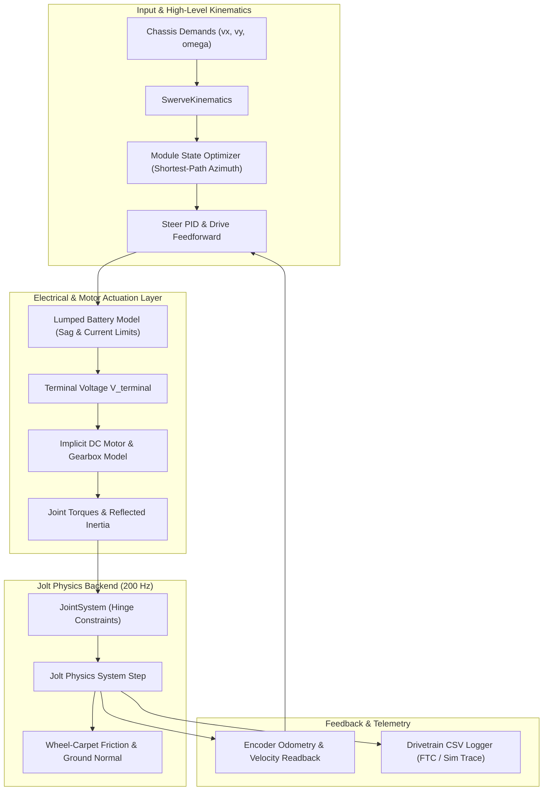

# FRC Simulation — Block 2 Detailed Implementation Plan
**Block 2: Motors, Battery, and Swerve (Oct 23 – Oct 29, 2026)**

---

## 1. Executive Summary & Objective

Block 2 transitions **FRCBananaSim** from an unactuated rigid-body simulation into a mechanically and electrically grounded FRC simulation core. Over the next 7 days, this block introduces the complete actuation stack: implicit DC motor dynamics, lumped battery voltage sag, 4-module swerve kinematics, and physical Jolt hinge constraints.

### Core Metrics & Gate Criteria

| Attribute | Specification |
|---|---|
| **Timeline** | Oct 23 – Oct 29, 2026 (7 Days) |
| **Prerequisites** | Block 1 complete (CMake skeleton, Jolt 200 Hz loop, `ParameterStore` with units, deterministic test harness) |
| **Primary Deliverables** | 1. Implicit DC motor model with reflected inertia & WPILib presets.<br>2. Lumped battery model with internal resistance, current limiting & voltage sag.<br>3. Jolt constraint & joint system (Hinge constraints for azimuth & drive).<br>4. 4-module swerve kinematics, azimuth optimization & closed-loop control.<br>5. Hand-written `robot_swerve.json` ingestion schema.<br>6. 60-second mass-ratio stress test (Gate 1 validation).<br>7. Telemetry & CSV logger matching the FTC home-data collection protocol. |
| **Gate 1 Acceptance Criteria** | 50 kg chassis resting on four 1 kg wheel assemblies driven under stall torque for 60 s simulated time without joint error exceeding **5 mm**, with zero energy explosion/jitter, and realistic voltage sag. |

---

## 2. Architecture & Data Flow



---

## 3. Mathematical & Physical Formulations

### A. Implicit DC Motor & Gearbox Model

Explicit forward-Euler integration of motor back-EMF at high gear ratios (e.g., $G = 21.43$ on steer, $G = 6.12$ on drive) is numerically stiff. A standard explicit step:
$$\tau = k_t \frac{V - k_v G \omega}{R}$$
causes rapid sign-alternating instability at $\Delta t = 5\text{ ms}$ ($200\text{ Hz}$) because the back-EMF damping $D = \frac{k_t k_v G^2}{R}$ satisfies:
$$\frac{D \Delta t}{J} > 1$$

#### Semi-Implicit Integration
We formulate the joint torque implicitly with respect to angular velocity at step $t + \Delta t$:
$$\tau^{t+\Delta t} = \frac{\tau_{\text{stall}} \frac{V}{V_{\text{nom}}} - D \omega^t}{1 + \frac{D \Delta t}{J_{\text{effective}}}}$$

where the reflected rotor inertia at the joint output is:
$$J_{\text{effective}} = J_{\text{rotor}} \cdot G^2 + J_{\text{load}}$$

#### WPILib-Aligned Motor Presets
*   **Kraken X60:** $V_{\text{nom}} = 12\text{V}$, $\tau_{\text{stall}} = 7.09\text{ N}\cdot\text{m}$, $I_{\text{stall}} = 366\text{A}$, $\omega_{\text{free}} = 6000\text{ RPM}$, $I_{\text{free}} = 2.0\text{A}$, $J_{\text{rotor}} = 5.6 \times 10^{-5}\text{ kg}\cdot\text{m}^2$
*   **Falcon 500:** $V_{\text{nom}} = 12\text{V}$, $\tau_{\text{stall}} = 4.69\text{ N}\cdot\text{m}$, $I_{\text{stall}} = 257\text{A}$, $\omega_{\text{free}} = 6380\text{ RPM}$, $I_{\text{free}} = 1.5\text{A}$, $J_{\text{rotor}} = 4.2 \times 10^{-5}\text{ kg}\cdot\text{m}^2$
*   **NEO (v1.1):** $V_{\text{nom}} = 12\text{V}$, $\tau_{\text{stall}} = 2.6\text{ N}\cdot\text{m}$, $I_{\text{stall}} = 105\text{A}$, $\omega_{\text{free}} = 5676\text{ RPM}$, $I_{\text{free}} = 1.8\text{A}$, $J_{\text{rotor}} = 1.8 \times 10^{-5}\text{ kg}\cdot\text{m}^2$
*   **goBILDA 5202 (FTC):** $V_{\text{nom}} = 12\text{V}$, $\tau_{\text{stall}} = 0.25\text{ N}\cdot\text{m}$, $I_{\text{stall}} = 9.2\text{A}$, $\omega_{\text{free}} = 6000\text{ RPM}$

---

### B. Lumped Battery & Electrical System

1.  **Open Circuit Voltage ($V_{\text{oc}}$):** $12.6\text{ V}$ nominal fully charged.
2.  **Internal Resistance ($R_{\text{bat}}$):** $0.018\ \Omega$ (battery) $+ 0.005\ \Omega$ (main breaker / wiring) $= 0.023\ \Omega$.
3.  **Total Current Consumption:**
    $$I_{\text{total}} = \sum_{m=1}^{8} |I_{\text{stator}, m}| \cdot \frac{|V_{\text{motor}, m}|}{V_{\text{terminal}}} + I_{\text{quiescent}}$$
    where $I_{\text{quiescent}} \approx 1.5\text{ A}$ accounts for roboRIO, coprocessors, and radio.
4.  **Voltage Sag Equation:**
    $$V_{\text{terminal}} = V_{\text{oc}} - I_{\text{total}} \cdot R_{\text{bat}}$$
5.  **Current Limiting:**
    *   **Stator current limit:** Clamps active winding current directly.
    *   **Supply current limit:** Throttles commanded voltage duty cycle:
        $$V_{\text{applied}} = \min\left(V_{\text{cmd}}, \frac{I_{\text{supply\_limit}} \cdot V_{\text{terminal}}}{I_{\text{stator}}}\right)$$
6.  **Brownout Protection:** If $V_{\text{terminal}} < 6.8\text{ V}$, reduce non-vital subsystem loads; if $< 6.3\text{ V}$, drop motor output to 0.

---

### C. Jolt Joint Constraints & Mass-Ratio Stability

*   **Chassis:** Single root dynamic body ($50\text{ kg}$).
*   **Steer Modules (4x):** Dynamic bodies ($0.4\text{ kg}$) connected to Chassis via `JPH::HingeConstraint` with vertical Y-axis. Limits disabled (continuous $360^\circ$ rotation) with motor in position mode.
*   **Wheel Cylinders (4x):** Dynamic cylinders ($0.6\text{ kg}$, $r = 0.0508\text{ m}$) connected to Steer bodies via `JPH::HingeConstraint` with horizontal axle axis. Driven via motor velocity/torque mode.
*   **Mass-Ratio Jitter Mitigation (50:1):**
    *   Override body inertia to account for reflected rotor inertia ($J_{\text{rotor}} \cdot G^2$).
    *   Position and velocity solver iterations configured in `PhysicsConfig.h` ($10$ velocity, $4$ position).
    *   Substep internal rate ($400\text{ Hz}$, 2 sub-steps) if joint separation approaches the $5\text{ mm}$ threshold.

---

## 4. Day-by-Day Implementation Roadmap


### Day 1 (Oct 23): Motor & Electrical Foundations
*   **Goal:** Standalone, deterministic mathematical motor and electrical models with zero physics engine dependencies.
*   **Key Deliverables:**
    *   `DCMotorModel.h` & `DCMotorModel.cpp`: Analytical back-EMF, reflected inertia, and presets (Kraken, Falcon, NEO, goBILDA).
    *   `BatteryModel.h` & `BatteryModel.cpp`: Lumped internal resistance, sag calculation, stator/supply current limiting, and brownout cutoffs.
    *   `Tests/MotorBatteryTest.cpp`: Unit test suite verifying torque curves, sag under load, and numerical stability at $G = 100$.

### Day 2 (Oct 24): Jolt Joint & Constraint System in ECS
*   **Goal:** ECS integration of Jolt physical hinge constraints with motors and limits.
*   **Key Deliverables:**
    *   `Physics/Components/JointComponent.h`: Defines joint type (Hinge, Slider, Fixed), parent/child entities, local anchors, rotation axes, limits, and motor settings.
    *   `Physics/Systems/JointSystem.h` & `JointSystem.cpp`: Instantiates `JPH::HingeConstraint`, adds them to Jolt's physics system, and syncs motor drives each `FixedUpdate`.
    *   `Tests/JointStabilityTest.cpp`: Isolated 2-body hinge test verifying rotational limits and motor position tracking.

### Day 3 (Oct 25): Swerve Kinematics & Controllers
*   **Goal:** 2D kinematics transforming $(v_x, v_y, \omega)$ into module vectors with continuous angle optimization.
*   **Key Deliverables:**
    *   `Drivetrain/SwerveKinematics.h` & `SwerveKinematics.cpp`: Forward and inverse kinematics matrix calculations.
    *   Continuous angle optimizer: Shortest-path azimuth logic ($|\Delta\theta| > 90^\circ \implies$ reverse wheel speed).
    *   `Drivetrain/SwerveModuleComponent.h` & `SwerveDriveSystem.h` / `.cpp`: Closed-loop steer PID and drive motor torque application.
    *   `Tests/SwerveKinematicsTest.cpp`: Unit tests verifying pure translation, pure spin, and diagonal travel.

### Day 4 (Oct 26): JSON Robot Loader & Visual Spawner
*   **Goal:** Load complete 4-module swerve robot from hand-written JSON configuration via `ParameterStore`.
*   **Key Deliverables:**
    *   `Resources/Robots/robot_swerve.json`: Configuration defining chassis mass/extents, module offsets, gear ratios, and battery specs.
    *   `Drivetrain/RobotSpawner.h` & `RobotSpawner.cpp`: Factory creating ECS entities, colliders, rigid bodies, joints, and visual primitive meshes.
    *   Collision group filtering: Disables collision between chassis and attached steer modules.

### Day 5 (Oct 27): 60-Second Mass-Ratio Stress Test (Gate 1)
*   **Goal:** Automated headless verification of Gate 1 acceptance criteria.
*   **Key Deliverables:**
    *   `Tests/SwerveMassRatioTest.h` & `SwerveMassRatioTest.cpp`:
        *   $50\text{ kg}$ chassis on four $1\text{ kg}$ wheel assemblies.
        *   Stall torque applied for 60 simulated seconds ($12,000$ steps at $200\text{ Hz}$).
        *   Measures joint deflection distance $\Delta d$: must stay strictly $< 5\text{ mm}$.
        *   Monitors kinetic energy: zero phantom energy growth or NaNs.
        *   Verifies battery terminal voltage drops realistically ($12.6\text{V} \to \sim 9.0\text{V}$).
    *   Integration into `ctest` suite.

### Day 6 (Oct 28): Interactive Driving & Telemetry UI
*   **Goal:** Real-time interactive driving and profiling visualizer.
*   **Key Deliverables:**
    *   Update `Main.cpp` to drive the simulated swerve robot using keyboard (WASD + QE).
    *   Add Drivetrain & Battery monitor pane to `TelemetryOverlay`:
        *   Live battery voltage bar (color-coded).
        *   Stator current consumption per module.
        *   Module azimuth orientation compasses and wheel velocity vectors.
        *   Physics step execution time (verifying $< 175\ \mu\text{s}$ budget).

### Day 7 (Oct 29): FTC Robot Calibration Protocol
*   **Goal:** CSV telemetry logger in-engine and real hardware testing protocol for the user's FTC robot at home.
*   **Key Deliverables:**
    *   `Telemetry/DrivetrainLogger.h` & `DrivetrainLogger.cpp`: Pre-allocated ring buffer dumping simulation traces to CSV.
    *   Hardware test execution protocol and CSV schema alignment for FTC robot data collection.

---

## 5. Hand-Written JSON Robot Specification Blueprint

Placed at `Resources/Robots/robot_swerve.json`:

```json
{
  "name": "FRC_Swerve_Reference_2026",
  "units": "SI",
  "electrical": {
    "nominalVoltage": { "value": 12.6, "unit": "V" },
    "internalResistance": { "value": 0.023, "unit": "ohm" },
    "quiescentCurrent": { "value": 1.5, "unit": "A" },
    "statorCurrentLimit": { "value": 60.0, "unit": "A" },
    "supplyCurrentLimit": { "value": 40.0, "unit": "A" },
    "brownoutVoltage": { "value": 6.8, "unit": "V" }
  },
  "chassis": {
    "totalMass": { "value": 48.0, "unit": "kg" },
    "size": { "x": 0.75, "y": 0.15, "z": 0.75, "unit": "m" },
    "centerOfMass": { "x": 0.0, "y": 0.04, "z": 0.0, "unit": "m" },
    "friction": 0.5,
    "restitution": 0.05
  },
  "swerve": {
    "wheelRadius": { "value": 0.0508, "unit": "m" },
    "wheelMass": { "value": 0.65, "unit": "kg" },
    "wheelFriction": 1.1,
    "steerModuleMass": { "value": 0.45, "unit": "kg" },
    "driveGearbox": {
      "motorType": "KrakenX60",
      "gearRatio": 6.12,
      "efficiency": 0.96
    },
    "steerGearbox": {
      "motorType": "Falcon500",
      "gearRatio": 21.43,
      "efficiency": 0.92,
      "kP": 32.0,
      "kI": 0.0,
      "kD": 1.2
    },
    "modules": [
      { "name": "FrontLeft",  "x":  0.28, "z":  0.28 },
      { "name": "FrontRight", "x":  0.28, "z": -0.28 },
      { "name": "BackLeft",   "x": -0.28, "z":  0.28 },
      { "name": "BackRight",  "x": -0.28, "z": -0.28 }
    ]
  }
}
```

---

## 6. FTC Robot Home Calibration Data Protocol

To prepare for parameter fitting in Block 7, run these three scripted tests on your FTC robot at home and record the CSV log:

### A. CSV Header Format (`ftc_drivetrain_log_01.csv`)
```csv
timestamp_s,commanded_volts,wheel_velocity_rad_s,battery_volts,current_draw_a
0.000,0.00,0.00,12.58,0.32
0.005,12.00,0.00,10.12,18.45
0.010,12.00,12.45,10.65,14.20
```

### B. Hardware Test Routines
1.  **Step-Response Acceleration Test (Inertia & Stall Fit):**
    *   Robot resting on carpet.
    *   Command an instantaneous voltage step from $0\text{ V} \to 12\text{ V}$ forward for $2.0\text{ s}$, then brake.
    *   *Captures:* Initial stall current spike, battery sag dip, and acceleration rise-time (identifies $J_{\text{eff}}$ and static friction $k_s$).
2.  **Steady-State Velocity Sweep (Viscous Friction & $k_v$ Fit):**
    *   Command steady voltages in steps: $2\text{V} \to 4\text{V} \to 6\text{V} \to 8\text{V} \to 10\text{V} \to 12\text{V}$, holding each step for $1.5\text{ s}$.
    *   *Captures:* Free velocity vs. voltage slope (identifies true velocity feedforward $k_v$ and mechanical viscous drag).
3.  **Spin / Yaw Scrub Test:**
    *   Command pure rotational spinning in place at maximum yaw rate for $3.0\text{ s}$.
    *   *Captures:* Lateral wheel scrub friction and turning resistance of the 4-wheel footprint.

---

## 7. File Architecture & Class Blueprint

All files strictly follow `GEMINI.md` architectural rules:

```
FRCBananaSim/
├── Resources/
│   └── Robots/
│       └── robot_swerve.json
├── Source/
│   ├── Actuation/
│   │   ├── DCMotorModel.h & .cpp
│   │   ├── BatteryModel.h & .cpp
│   │   └── Components/
│   │       ├── MotorComponent.h
│   │       └── BatteryComponent.h
│   ├── Drivetrain/
│   │   ├── SwerveKinematics.h & .cpp
│   │   ├── SwerveModuleComponent.h
│   │   ├── SwerveDriveSystem.h & .cpp
│   │   └── RobotSpawner.h & .cpp
│   ├── Physics/
│   │   ├── Components/
│   │   │   └── JointComponent.h
│   │   └── Systems/
│   │       └── JointSystem.h & .cpp
│   └── Telemetry/
│       └── DrivetrainLogger.h & .cpp
└── Tests/
    ├── MotorBatteryTest.h & .cpp
    ├── SwerveKinematicsTest.h & .cpp
    └── SwerveMassRatioTest.h & .cpp
```

---

## 8. Gate 1 Verification Checklist

- [ ] Motor models reproduce WPILib stall torque and free speed within 1%.
- [ ] Semi-implicit back-EMF is unconditionally stable at $G = 100$ and $\Delta t = 5\text{ ms}$.
- [ ] Battery terminal voltage correctly drops under current draw ($V_{\text{terminal}} = V_{\text{oc}} - I_{\text{total}} R_{\text{bat}}$).
- [ ] Jolt Hinge constraints keep $50\text{ kg} : 1\text{ kg}$ joint separation below $5\text{ mm}$ under full stall torque.
- [ ] 60-second headless simulation completes without energy explosion, velocity jitter, or NaNs.
- [ ] 4-module swerve drives, strafes, and rotates with continuous angle optimization.
- [ ] Telemetry logger exports clean CSV logs matching the FTC hardware schema.
