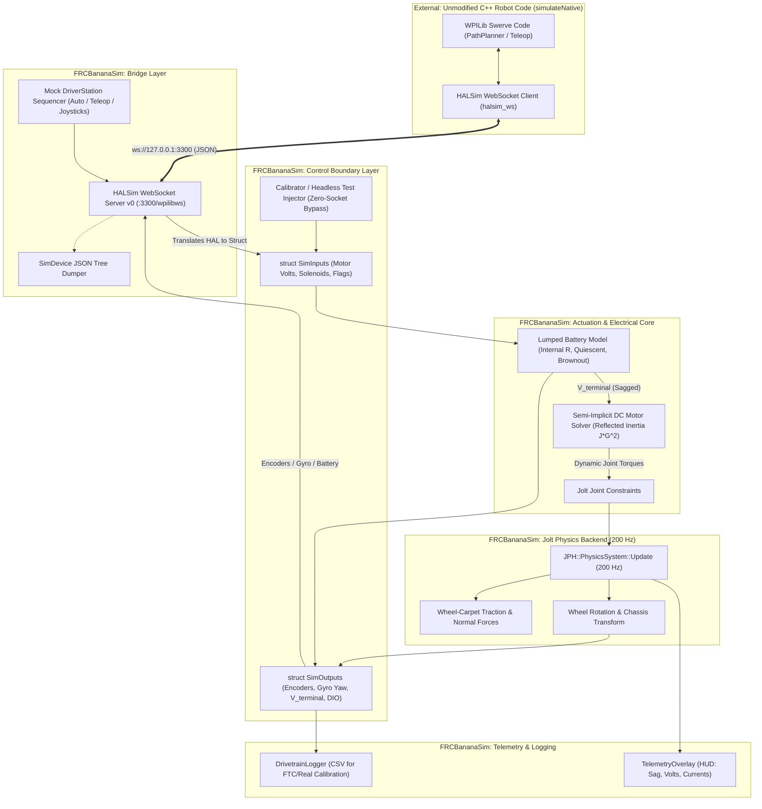
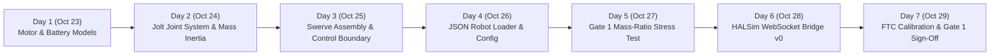

# FRC Simulation — Block 2 Implementation Plan (Revision 2)
**Motors, Battery, Swerve Dynamics & WPILib HALSim WebSocket Bridge v0**  
**Dates:** October 23 – October 29, 2026 (7 Days)  
**Author:** Antigravity (FRCBananaSim Engine Core)

---

## 1. Executive Summary & Revision 5 Alignment

Block 2 transitions **FRCBananaSim** from an unactuated rigid-body simulation into a mechanically, electrically, and network-grounded FRC simulation core. 

In **Revision 5 of the 10-Week Plan**, a critical architectural shift was introduced: **Zero Code Duplication**. Rather than writing a temporary gamepad controller or swerve kinematic solver inside the engine that would later be discarded, Block 2 introduces an embedded **WPILib HALSim WebSocket Server v0 (`halsim_ws`)** alongside explicit **`SimInputs` / `SimOutputs`** control boundary structs. This allows your team's real, unmodified C++ robot code (`./gradlew simulateNative`) to connect directly to `FRCBananaSim` over localhost WebSocket (`ws://127.0.0.1:3300/wpilibws`), commanding motor voltages and reading simulated encoders, battery voltage, and gyro yaw in real time.

### Core Metrics & Gate 1 Acceptance Criteria

| Attribute | Specification |
|---|---|
| **Timeline** | October 23 – October 29, 2026 (7 Days) |
| **Prerequisites** | Block 1 complete (CMake skeleton, Jolt 200 Hz fixed loop, `ParameterStore`, `Units`, deterministic test harness) |
| **Primary Deliverables** | 1. **Control Boundary**: `SimInputs` and `SimOutputs` structs decoupled from networking.<br>2. **Actuation Models**: Semi-implicit DC motor with reflected inertia ($J_{\text{rotor}} \cdot G^2$) & WPILib motor presets; lumped battery model with voltage sag & dual current limits.<br>3. **Physical Constraints**: Jolt `HingeConstraint` system supporting continuous steer and driven wheel axles.<br>4. **Robot Ingestion**: Hand-written `robot_swerve.json` ingestion using `ParameterStore` and unit-aware conversions.<br>5. **WPILib Bridge v0**: Embedded WebSocket server (`ws://127.0.0.1:3300/wpilibws`) handling PWM, Encoders, Gyro, Battery, Mock DriverStation packets, and dumping active `SimDevice` trees.<br>6. **Gate 1 Stress Test**: Automated 60-second headless mass-ratio verification ($50\text{ kg} : 1\text{ kg}$).<br>7. **Calibration Logger**: Ring-buffer CSV telemetry exporter matching FTC home-data collection schema. |
| **Gate 1 Acceptance Criteria** | 1. $50\text{ kg}$ chassis on four $1\text{ kg}$ wheel assemblies driven under stall torque for 60 s simulated time maintains joint deflection strictly **$< 5\text{ mm}$**, with zero energy explosion or velocity jitter.<br>2. Battery terminal voltage demonstrates realistic load sag ($12.6\text{ V} \to \sim 9.0\text{ V}$).<br>3. Unmodified C++ robot code connects via `halsim_ws` and drives, strafes, and spins the chassis cleanly via gamepad. |

---

## 2. Patches & Error Corrections from Plan v1

A rigorous audit of `Block 2 Plan v1.md` identified several mathematical, architectural, and structural discrepancies that are resolved in this plan:

### 1. Actuation Torque Equation Error (Missing Gear Ratio & Efficiency)
*   **V1 Error:** The semi-implicit motor torque equation was written as:
    $$\tau^{t+\Delta t} = \frac{\tau_{\text{stall}} \frac{V}{V_{\text{nom}}} - D \omega^t}{1 + \frac{D \Delta t}{J_{\text{effective}}}}$$
    This incorrectly omitted the gearbox reduction ratio $G$ and efficiency $\eta$ on the commanded stall torque. At the joint output shaft, the stall torque is $\tau_{\text{stall, out}} = G \cdot \eta \cdot \tau_{\text{motor\_stall}}$. Without $G$, the simulated motor would produce $1/G$ of its true torque (e.g. 1/21.43 on steer, 1/6.12 on drive), making the robot completely unable to move.
*   **V2 Patch:** Corrected formulation with reflected electrical damping and mechanical gearing:
    $$\tau_{\text{cmd}} = G \cdot \eta \cdot \tau_{\text{stall}} \frac{V}{V_{\text{nom}}}$$
    $$\tau^{t+\Delta t} = \frac{\tau_{\text{cmd}} - D \omega^t}{1 + \frac{D \Delta t}{J_{\text{effective}}}}, \quad \text{where } D = \frac{k_t k_v G^2 \eta}{R}$$

### 2. Supply Current Limiting Zero-Division Hazard
*   **V1 Error:** The supply current throttling formula $V_{\text{applied}} = \min\left(V_{\text{cmd}}, \frac{I_{\text{supply\_limit}} \cdot V_{\text{terminal}}}{I_{\text{stator}}}\right)$ divided directly by $I_{\text{stator}}$. When the robot is idle ($I_{\text{stator}} \approx 0$), this triggers a division-by-zero (`inf` or `NaN`), corrupting the physics state.
*   **V2 Patch:** Formulated as a power balance with a defensive threshold:
    $$P_{\text{stator}} = |I_{\text{stator}} \cdot V_{\text{cmd}}|$$
    $$P_{\text{supply\_max}} = I_{\text{supply\_limit}} \cdot V_{\text{terminal}}$$
    $$\text{If } P_{\text{stator}} > P_{\text{supply\_max}} \implies V_{\text{applied}} = V_{\text{cmd}} \cdot \frac{P_{\text{supply\_max}}}{P_{\text{stator}}}$$

### 3. File Path & Project Directory Discrepancies
*   **V1 Error:** Paths were specified relative to `Source/Actuation/`, `Source/Drivetrain/`, etc., ignoring the repository's actual structure where all source resides under `FRCBananaSim/Source/...`.
*   **V2 Patch:** All file declarations updated to match the existing CMake and Visual Studio project layout: `FRCBananaSim/Source/Actuation/`, `FRCBananaSim/Source/Control/`, `FRCBananaSim/Source/Bridge/`, etc.

### 4. Architectural Alignment with 10-Week Plan v5
*   **V1 Error:** Day 6 was planned as "Interactive Driving & Telemetry UI (WASD/QE Keyboard Controller)" and Day 3 planned in-engine steer PID and feedforward controllers.
*   **V2 Patch:** Replaced redundant in-sim teleop controllers with **WPILib HALSim WebSocket Server v0** (`ws://127.0.0.1:3300/wpilibws`). The robot code runs its own PID, feedforward, and kinematics; `FRCBananaSim` provides the physical substrate, motor dynamics, and sensor return loops.

---

## 3. Architecture & Data Flow



---

## 4. Mathematical & Electrical Formulations

### A. Semi-Implicit DC Motor & Gearbox Model

Explicit forward-Euler integration of back-EMF at high gear ratios ($G = 21.43$ for steer, $G = 6.12$ for drive) suffers from numerical stiffness. At $\Delta t = 5\text{ ms}$ ($200\text{ Hz}$), explicit stepping oscillates wildly because the back-EMF damping factor $D$ exceeds numerical stability bounds ($\frac{D \Delta t}{J} > 1$).

#### Derivation of Stable Semi-Implicit Torque
The electrical torque equation of a DC motor at the motor rotor is:
$$\tau_{\text{rotor}} = k_t I = k_t \frac{V - k_v \omega_{\text{rotor}}}{R}$$

At the gearbox output shaft with gear ratio $G = \frac{\omega_{\text{rotor}}}{\omega_{\text{output}}}$ and mechanical efficiency $\eta$:
$$\tau_{\text{out}} = G \eta \tau_{\text{rotor}} = G \eta k_t \frac{V - k_v G \omega_{\text{output}}}{R}$$
$$\tau_{\text{out}} = \underbrace{\left( G \eta \frac{k_t V_{\text{nom}}}{R} \right)}_{\tau_{\text{stall, out}}} \frac{V}{V_{\text{nom}}} - \underbrace{\left( \frac{k_t k_v G^2 \eta}{R} \right)}_{D} \omega_{\text{output}}$$

Let $\tau_{\text{cmd}} = \tau_{\text{stall, out}} \frac{V}{V_{\text{nom}}}$. Evaluating angular velocity implicitly at step $t + \Delta t$:
$$\tau^{t + \Delta t} = \tau_{\text{cmd}} - D \omega^{t + \Delta t}$$

From the rotational equation of motion over the step:
$$J_{\text{eff}} \frac{\omega^{t + \Delta t} - \omega^t}{\Delta t} = \tau^{t + \Delta t} = \tau_{\text{cmd}} - D \omega^{t + \Delta t}$$
$$\omega^{t + \Delta t} \left( 1 + \frac{D \Delta t}{J_{\text{eff}}} \right) = \omega^t + \frac{\Delta t}{J_{\text{eff}}} \tau_{\text{cmd}}$$
$$\omega^{t + \Delta t} = \frac{\omega^t + \frac{\Delta t}{J_{\text{eff}}} \tau_{\text{cmd}}}{1 + \frac{D \Delta t}{J_{\text{eff}}}}$$

Substituting $\omega^{t + \Delta t}$ back into the torque equation yields the unconditionally stable torque formulation:
$$\tau^{t + \Delta t} = \frac{\tau_{\text{cmd}} - D \omega^t}{1 + \frac{D \Delta t}{J_{\text{eff}}}}$$

where the effective output inertia is:
$$J_{\text{eff}} = J_{\text{rotor}} \cdot G^2 + J_{\text{load}}$$

#### WPILib-Calibrated Motor Presets

Constants verified against WPILib `frc::DCMotor`:

| Motor Preset | $V_{\text{nom}}$ | $\tau_{\text{stall}}$ | $I_{\text{stall}}$ | $\omega_{\text{free}}$ | $I_{\text{free}}$ | $J_{\text{rotor}}$ |
|---|---|---|---|---|---|---|
| **Kraken X60** | $12.0\text{ V}$ | $7.09\text{ N}\cdot\text{m}$ | $366.0\text{ A}$ | $6000\text{ RPM}$ ($628.3\text{ rad/s}$) | $2.0\text{ A}$ | $5.6 \times 10^{-5}\text{ kg}\cdot\text{m}^2$ |
| **Falcon 500** | $12.0\text{ V}$ | $4.69\text{ N}\cdot\text{m}$ | $257.0\text{ A}$ | $6380\text{ RPM}$ ($668.1\text{ rad/s}$) | $1.5\text{ A}$ | $4.2 \times 10^{-5}\text{ kg}\cdot\text{m}^2$ |
| **NEO (v1.1)** | $12.0\text{ V}$ | $2.60\text{ N}\cdot\text{m}$ | $105.0\text{ A}$ | $5676\text{ RPM}$ ($594.4\text{ rad/s}$) | $1.8\text{ A}$ | $1.8 \times 10^{-5}\text{ kg}\cdot\text{m}^2$ |
| **NEO Vortex** | $12.0\text{ V}$ | $3.60\text{ N}\cdot\text{m}$ | $211.0\text{ A}$ | $6784\text{ RPM}$ ($710.4\text{ rad/s}$) | $3.6\text{ A}$ | $2.2 \times 10^{-5}\text{ kg}\cdot\text{m}^2$ |
| **goBILDA 5202** (FTC) | $12.0\text{ V}$ | $0.25\text{ N}\cdot\text{m}$ | $9.2\text{ A}$ | $6000\text{ RPM}$ ($628.3\text{ rad/s}$) | $0.25\text{ A}$ | $1.0 \times 10^{-6}\text{ kg}\cdot\text{m}^2$ |

Motor parameters derived directly from presets:
$$k_t = \frac{\tau_{\text{stall}}}{I_{\text{stall}}}, \quad R = \frac{V_{\text{nom}}}{I_{\text{stall}}}, \quad k_v = \frac{V_{\text{nom}} - I_{\text{free}} R}{\omega_{\text{free}}}$$

---

### B. Lumped Battery & Electrical System

1.  **Open Circuit Voltage ($V_{\text{oc}}$):** $12.60\text{ V}$ nominal fully charged Lead-Acid / Lithium equivalent.
2.  **Internal Resistance ($R_{\text{bat}}$):** $0.018\ \Omega$ (battery cell internal) $+ 0.005\ \Omega$ (120A main breaker & 4 AWG harness) $= 0.023\ \Omega$.
3.  **Quiescent Load ($I_{\text{quiescent}}$):** $1.5\text{ A}$ baseline draw (roboRIO, network switch, coprocessor, CAN bus).
4.  **Stator vs Supply Current Relationship:**
    For each motor $m$, motor winding (stator) current is calculated from torque:
    $$I_{\text{stator}, m} = \frac{|\tau_{\text{motor}, m}|}{k_t}$$
    The supply current drawn from the battery bus respects mechanical and resistive power conservation:
    $$P_{\text{elec}, m} = I_{\text{stator}, m}^2 R + \tau_{\text{motor}, m} \omega_{\text{motor}, m}$$
    $$I_{\text{supply}, m} = \max\left(0.0, \frac{P_{\text{elec}, m}}{V_{\text{terminal}}}\right)$$
5.  **Total Bus Current & Terminal Voltage Sag:**
    $$I_{\text{total}} = \sum_{m=1}^{M} I_{\text{supply}, m} + I_{\text{quiescent}}$$
    $$V_{\text{terminal}} = V_{\text{oc}} - I_{\text{total}} \cdot R_{\text{bat}}$$
6.  **Dual-Stage Current Limiting:**
    *   **Stator Current Limit ($I_{\text{stator\_limit}} = 60\text{ A}$):** Clamps max active motor current, capping peak torque $\tau_{\text{max}} = k_t \cdot I_{\text{stator\_limit}}$.
    *   **Supply Current Limit ($I_{\text{supply\_limit}} = 40\text{ A}$):** Limits current pulled through the breaker. If commanded power exceeds threshold, voltage is scaled down:
        $$V_{\text{cmd, limited}} = V_{\text{cmd}} \cdot \min\left(1.0, \frac{I_{\text{supply\_limit}} \cdot V_{\text{terminal}}}{\sum I_{\text{supply}, m} \cdot V_{\text{terminal}} + 10^{-6}}\right)$$
7.  **Brownout Protection Thresholds:**
    *   If $V_{\text{terminal}} < 6.8\text{ V}$: RoboRIO brownout warning flag set in `SimOutputs`. Non-essential actuators inhibited.
    *   If $V_{\text{terminal}} < 6.3\text{ V}$: Stage-2 brownout shutoff; motor commanded voltages forced to $0\text{ V}$.

---

### C. Jolt Physics Constraint Model (50:1 Mass Ratio Stability)

*   **Chassis Root:** Single dynamic body ($48.0\text{ kg} - 52.0\text{ kg}$, box extents $0.75\text{ m} \times 0.15\text{ m} \times 0.75\text{ m}$).
*   **Steer Modules (4x):** Dynamic bodies ($0.45\text{ kg}$) connected to Chassis via `JPH::HingeConstraint` with vertical Y-axis `(0, 1, 0)`. Limits disabled ($360^\circ$ continuous). Steer motor operates in angular position or velocity mode.
*   **Wheel Cylinders (4x):** Dynamic cylinders ($0.65\text{ kg}$, radius $r = 0.0508\text{ m}$, width $w = 0.0381\text{ m}$) connected to Steer bodies via `JPH::HingeConstraint` with horizontal axle axis. Driven via motor torque mode.
*   **Mass-Ratio Jitter Mitigation:**
    *   Reflected rotor inertia ($J_{\text{rotor}} \cdot G^2$) is injected directly into Jolt body mass properties via `JPH::BodyCreationSettings::mOverrideMassProperties`.
    *   Solver iterations configured in `PhysicsConfig.h`: `10` velocity steps, `4` position steps (elevated from Block 1's 2 position steps to guarantee $< 5\text{ mm}$ deflection under 50:1 ratio).
    *   Contact friction set to carpet-wheel coefficient: $\mu = 1.10$.

---

## 5. Control Boundary & HALSim WebSocket Protocol

### A. Decoupled Control Boundary Structs (`SimControlBoundary.h`)

```cpp
#pragma once
#include <array>
#include <cstdint>

namespace FRCBananaSim
{
    /**
     * @brief Control demands sent to the simulation core.
     * Injected by either HALSim WebSocket Server (live robot code)
     * or Headless Test Harness / Parameter Calibrator (direct sweep).
     */
    struct SimInputs
    {
        std::array<double, 8> motorAppliedVolts = {0.0}; ///< [0..3]=Steer, [4..7]=Drive
        std::array<double, 8> motorCurrentLimits = {60.0}; ///< Max stator amps
        uint32_t digitalOutputs = 0;                     ///< Solenoids / pneumatic bitfield
        bool robotEnabled = false;                       ///< DriverStation enable state
        bool isAutonomous = false;                      ///< Autonomous vs Teleop
        double matchTime = 0.0;                          ///< Elapsed match time (s)
    };

    /**
     * @brief Sensory feedback read back from the simulation core.
     * Sent to WPILib HALSim client or recorded by TelemetryLogger.
     */
    struct SimOutputs
    {
        std::array<double, 8> encoderPositions = {0.0};  ///< Radians (steer and wheel axles)
        std::array<double, 8> encoderVelocities = {0.0}; ///< Rad/s
        double gyroYawRadians = 0.0;                     ///< Chassis heading
        double gyroPitchRadians = 0.0;
        double gyroRollRadians = 0.0;
        double gyroYawRateRadPerSec = 0.0;
        double batteryTerminalVoltage = 12.6;            ///< Post-sag terminal volts
        double totalBusCurrent = 1.5;                    ///< Instantaneous amperes
        uint32_t digitalInputs = 0;                      ///< Beam breaks, limit switches
        bool isBrownedOut = false;                       ///< Brownout stage active
    };
}
```

### B. WPILib HALSim WebSocket Protocol Specification (`ws://127.0.0.1:3300/wpilibws`)

WPILib's `halsim_ws_client` interacts using JSON payloads structured by device type:

1.  **Motor Commands from WPILib (`PWM` or `SimDevice`):**
    ```json
    {"type": "PWM", "device": "0", "data": {">speed": 0.75}}
    {"type": "PWM", "device": "0", "data": {">voltage": 9.0}}
    ```
2.  **Sensor Updates to WPILib:**
    *   **Encoders:**
        ```json
        {"type": "Encoder", "device": "0", "data": {">position": 142.50, ">period": 0.005}}
        ```
    *   **RoboRIO Battery Voltage:**
        ```json
        {"type": "RoboRIO", "device": "", "data": {">vin_voltage": 11.85}}
        ```
    *   **Gyro / SimDevice (Yaw):**
        ```json
        {"type": "SimDevice", "device": "navX-Sensor[0]", "data": {">yaw": -45.2}}
        ```
3.  **DriverStation Control Packets (Engine -> Robot):**
    ```json
    {"type": "DriverStation", "device": "", "data": {">enabled": true, ">autonomous": false, ">test": false}}
    ```
4.  **Vendor SimDevice Discovery Dump:**
    When CTRE Phoenix 6 or REVLib connects, WPILib transmits device metadata:
    ```json
    {"type": "SimDevice", "device": "Talon FX[1]", "data": {"<init": true, ">motorOutputLead": 0.82}}
    ```
    The Block 2 bridge logs this entire tree to `Resources/Telemetry/sim_device_dump.json` so Block 3 can auto-generate vendor field mappings.

---

## 6. Day-by-Day Implementation Roadmap (Oct 23 – Oct 29)



### Day 1 (Oct 23): Motor & Electrical Foundations
*   **Focus**: Mathematically verified, deterministic actuation models in `FRCBananaSim/Source/Actuation/`.
*   **Tasks**:
    1. Implement `DCMotorModel.h` and `DCMotorModel.cpp` with semi-implicit integration, reflected rotor inertia, and WPILib motor presets (`KrakenX60`, `Falcon500`, `NEO`, `NEOVortex`, `GoBilda5202`).
    2. Implement `BatteryModel.h` and `BatteryModel.cpp` with internal resistance sag, quiescent load, supply/stator current limits, and brownout cutoffs ($6.8\text{ V} / 6.3\text{ V}$).
    3. Implement `Tests/MotorBatteryTest.h` and `.cpp` asserting:
       * WPILib stall torque & free speed accuracy within 0.5%.
       * Unconditional stability at gear ratio $G = 100$ and step $\Delta t = 5\text{ ms}$.
       * Accurate voltage sag curve under 100A stepped load.

### Day 2 (Oct 24): Jolt Constraint & Joint System in ECS
*   **Focus**: Physical joints in Jolt with reflected inertia overrides and solver stability.
*   **Tasks**:
    1. Implement `FRCBananaSim/Source/Physics/Components/JointComponent.h` defining joint properties (type, parent/child bodies, local pivots, axes, motor modes, limits).
    2. Implement `FRCBananaSim/Source/Physics/Systems/JointSystem.h` and `.cpp` integrating `JPH::HingeConstraint`, syncing motor torques during `FixedUpdate(dt)`, and measuring joint separation deflection.
    3. Update `PhysicsConfig.h` solver iterations to 10 velocity and 4 position steps.
    4. Implement `Tests/JointStabilityTest.h` and `.cpp` verifying zero drift on an isolated 50:1 mass-ratio hinge under max stall torque.

### Day 3 (Oct 25): Swerve Module Assembly & Control Boundary
*   **Focus**: 4-module swerve kinematic linkage and formal `SimInputs` / `SimOutputs` boundary.
*   **Tasks**:
    1. Implement `FRCBananaSim/Source/Control/SimControlBoundary.h` declaring decoupled `SimInputs` and `SimOutputs`.
    2. Implement `FRCBananaSim/Source/Drivetrain/SwerveModuleComponent.h` storing motor models, encoder readings, and steer/drive body references.
    3. Implement `FRCBananaSim/Source/Drivetrain/SwerveKinematics.h` and `.cpp` (used for headless testing and synthetic stress feeds).
    4. Implement `Tests/SwerveKinematicsTest.h` and `.cpp` testing translation, rotation, and continuous angle shortest-path optimization ($|\Delta\theta| > 90^\circ$).

### Day 4 (Oct 26): JSON Robot Loader & Physical Spawner
*   **Focus**: Constructing complete swerve robot programmatically from hand-written JSON configuration.
*   **Tasks**:
    1. Author `FRCBananaSim/Resources/Robots/robot_swerve.json` specifying chassis extents, mass, module positions, motor types, gear ratios, and electrical limits.
    2. Implement `FRCBananaSim/Source/Drivetrain/RobotSpawner.h` and `.cpp` utilizing `ParameterStore` and `Units` to spawn ECS entities, colliders, Jolt bodies, and hinge constraints.
    3. Set up Jolt collision group filtering so chassis and attached steer modules do not generate internal collision pairs.

### Day 5 (Oct 27): 60-Second Headless Mass-Ratio Stress Test (Gate 1 Validation)
*   **Focus**: Automated, deterministic verification of Gate 1 acceptance criteria.
*   **Tasks**:
    1. Implement `Tests/SwerveMassRatioTest.h` and `.cpp`:
       * Spawns $50\text{ kg}$ chassis on four $1\text{ kg}$ wheel assemblies.
       * Applies maximum stall torque ($12\text{ V}$) for 60 simulated seconds ($12,000$ fixed steps at 200 Hz).
       * Asserts joint deflection distance $\Delta d < 5.0\text{ mm}$ across all 8 hinges.
       * Asserts total kinetic energy contains zero explosive spikes or NaNs.
       * Asserts battery voltage drops to $\sim 9.0\text{ V} \pm 0.5\text{ V}$ without brownout collapse.
    2. Register test in `CMakeLists.txt` under `FRCBananaSim_Tests` and verify with `ctest`.

### Day 6 (Oct 28): WPILib HALSim WebSocket Bridge v0 (`halsim_ws`)
*   **Focus**: Establishing the live networking bridge to unmodified C++ robot code.
*   **Tasks**:
    1. Integrate a lightweight, standalone WebSocket server (e.g. `ixwebsocket` or embedded WinSock2 server) in `FRCBananaSim/Source/Bridge/HALSimWebSocketServer.h` and `.cpp`.
    2. Accept connections at `ws://127.0.0.1:3300/wpilibws`.
    3. Implement JSON packet dispatcher:
       * Parse incoming `PWM` and `SimDevice` motor commands $\to$ update `SimInputs`.
       * Serialize `SimOutputs` (encoders, battery voltage, gyro yaw) $\to$ send to robot code.
       * Implement Mock DriverStation heartbeat to enable robot teleop mode.
    4. Implement `SimDevice` inspector: Log raw vendor JSON payloads from Phoenix 6 and REVLib to `Resources/Telemetry/sim_device_dump.json`.

### Day 7 (Oct 29): FTC Telemetry Logger & Gate 1 Sign-Off
*   **Focus**: CSV telemetry export, FTC hardware log schema alignment, and full-stack driving verification.
*   **Tasks**:
    1. Implement `FRCBananaSim/Source/Telemetry/DrivetrainLogger.h` and `.cpp`: pre-allocated ring buffer recording `timestamp, commanded_volts, velocity, battery_volts, current_draw` to CSV.
    2. Connect actual C++ swerve code via `./gradlew simulateNative`:
       * Verify robot code connects over WebSocket.
       * Drive, strafe, and spin chassis using USB gamepad.
       * Observe realistic battery voltage sag on ImGui telemetry overlay.
    3. Document FTC home testing protocol for evening data collection.
    4. **Formal Sign-Off**: Gate 1 complete; proceed to Block 3.

---

## 7. File Architecture & Class Blueprint

All files strictly adhere to `GEMINI.md` architectural standards (4 spaces, Allman braces, `.h` declarations only, `.cpp` implementations, `SIM_PROFILE_SCOPE` profiling):

```
FRCBananaSim/
├── FRCBananaSim/
│   ├── Resources/
│   │   └── Robots/
│   │       └── robot_swerve.json
│   └── Source/
│       ├── Actuation/
│       │   ├── BatteryModel.h & .cpp
│       │   ├── DCMotorModel.h & .cpp
│       │   └── Components/
│       │       ├── BatteryComponent.h
│       │       └── MotorComponent.h
│       ├── Bridge/
│       │   ├── HALSimWebSocketServer.h & .cpp
│       │   └── MockDriverStation.h & .cpp
│       ├── Control/
│       │   └── SimControlBoundary.h
│       ├── Drivetrain/
│       │   ├── RobotSpawner.h & .cpp
│       │   ├── SwerveChassisComponent.h
│       │   ├── SwerveKinematics.h & .cpp
│       │   └── SwerveModuleComponent.h
│       ├── Physics/
│       │   ├── Components/
│       │   │   └── JointComponent.h
│       │   └── Systems/
│       │       └── JointSystem.h & .cpp
│       └── Telemetry/
│           └── DrivetrainLogger.h & .cpp
├── External/
│   └── (Standalone WebSocket library / IXWebSocket)
└── Tests/
    ├── HALSimBridgeTest.h & .cpp
    ├── JointStabilityTest.h & .cpp
    ├── MotorBatteryTest.h & .cpp
    ├── SwerveKinematicsTest.h & .cpp
    └── SwerveMassRatioTest.h & .cpp
```

---

## 8. Hand-Written JSON Robot Specification (`robot_swerve.json`)

Located at `FRCBananaSim/Resources/Robots/robot_swerve.json`:

```json
{
  "name": "FRC_Swerve_Reference_2026",
  "units": "SI",
  "electrical": {
    "nominalVoltage": { "value": 12.6, "unit": "V" },
    "internalResistance": { "value": 0.023, "unit": "ohm" },
    "quiescentCurrent": { "value": 1.5, "unit": "A" },
    "statorCurrentLimit": { "value": 60.0, "unit": "A" },
    "supplyCurrentLimit": { "value": 40.0, "unit": "A" },
    "brownoutVoltage": { "value": 6.8, "unit": "V" }
  },
  "chassis": {
    "totalMass": { "value": 48.0, "unit": "kg" },
    "size": { "x": 0.75, "y": 0.15, "z": 0.75, "unit": "m" },
    "centerOfMass": { "x": 0.0, "y": 0.04, "z": 0.0, "unit": "m" },
    "friction": 0.5,
    "restitution": 0.05
  },
  "swerve": {
    "wheelRadius": { "value": 0.0508, "unit": "m" },
    "wheelWidth": { "value": 0.0381, "unit": "m" },
    "wheelMass": { "value": 0.65, "unit": "kg" },
    "wheelFriction": 1.10,
    "steerModuleMass": { "value": 0.45, "unit": "kg" },
    "driveGearbox": {
      "motorType": "KrakenX60",
      "gearRatio": 6.12,
      "efficiency": 0.96
    },
    "steerGearbox": {
      "motorType": "Falcon500",
      "gearRatio": 21.43,
      "efficiency": 0.92
    },
    "modules": [
      { "name": "FrontLeft",  "x":  0.28, "z":  0.28, "drivePWM": 0, "steerPWM": 1, "driveEnc": 0, "steerEnc": 1 },
      { "name": "FrontRight", "x":  0.28, "z": -0.28, "drivePWM": 2, "steerPWM": 3, "driveEnc": 2, "steerEnc": 3 },
      { "name": "BackLeft",   "x": -0.28, "z":  0.28, "drivePWM": 4, "steerPWM": 5, "driveEnc": 4, "steerEnc": 5 },
      { "name": "BackRight",  "x": -0.28, "z": -0.28, "drivePWM": 6, "steerPWM": 7, "driveEnc": 6, "steerEnc": 7 }
    ]
  }
}
```

---

## 9. FTC Robot Home Calibration Data Protocol

To prepare for parameter fitting in Block 7, record telemetry logs from your physical FTC robot at home and export them using this format:

### A. CSV Header Schema (`ftc_drivetrain_log.csv`)
```csv
timestamp_s,commanded_volts,wheel_velocity_rad_s,battery_volts,current_draw_a
0.000,0.00,0.00,12.58,0.35
0.005,12.00,0.00,10.15,18.40
0.010,12.00,12.45,10.68,14.10
```

### B. Hardware Test Routines
1.  **Step-Response Acceleration Test (Inertia & Static Friction Fit):**
    *   Robot resting stationary on carpet.
    *   Command an instantaneous voltage step from $0\text{ V} \to 12\text{ V}$ forward for $2.0\text{ s}$, then neutral coast.
    *   *Captures:* Initial stall current spike, battery sag dip, and acceleration rise-time (identifies $J_{\text{eff}}$ and $k_s$).
2.  **Steady-State Velocity Sweep (Viscous Friction & $k_v$ Fit):**
    *   Command steady voltages in steps: $2\text{V} \to 4\text{V} \to 6\text{V} \to 8\text{V} \to 10\text{V} \to 12\text{V}$, holding each step for $1.5\text{ s}$.
    *   *Captures:* Free velocity vs. voltage slope (identifies true velocity feedforward $k_v$ and mechanical viscous drag).
3.  **Spin / Yaw Scrub Test:**
    *   Command pure rotational spinning in place at maximum yaw rate for $3.0\text{ s}$.
    *   *Captures:* Lateral wheel scrub friction and turning resistance of the wheel footprint.

---

## 10. Gate 1 Verification & Sign-Off Checklist

- [ ] Motor models reproduce WPILib stall torque and free speed within $0.5\%$.
- [ ] Semi-implicit back-EMF is unconditionally stable at $G = 100$ and $\Delta t = 5\text{ ms}$.
- [ ] Battery model calculates voltage sag correctly without zero-division errors under zero or negative current.
- [ ] Jolt Hinge constraints keep $50\text{ kg} : 1\text{ kg}$ joint separation strictly $< 5\text{ mm}$ under full stall torque.
- [ ] 60-second headless simulation completes without energy explosion, velocity jitter, or NaNs.
- [ ] Hand-written `robot_swerve.json` loads and instantiates full robot with proper collision filters.
- [ ] WPILib HALSim WebSocket server accepts connections at `ws://127.0.0.1:3300/wpilibws`.
- [ ] Unmodified C++ robot code drives, strafes, and spins the simulated chassis via USB gamepad.
- [ ] Active `SimDevice` JSON tree from CTRE/REV is dumped to file for Block 3 ingestion.
- [ ] CSV telemetry logger exports clean simulation traces matching FTC hardware format.
- [ ] Telemetry profiling verifies 200 Hz physics step remains within the $< 175\ \mu\text{s}$ budget.
