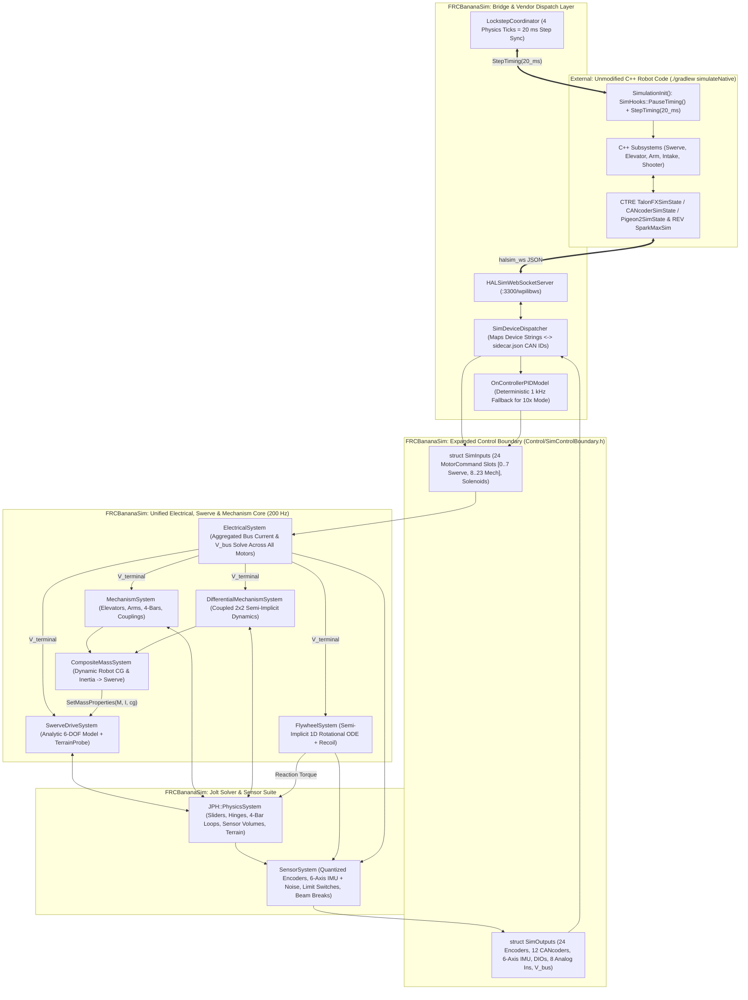
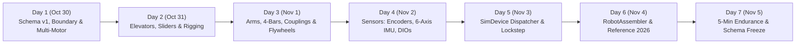

# FRC Simulation — Block 3 Implementation Plan (Revision 2)
**Mechanisms, Robot Data Schema v1, Sensor Suite & WPILib `SimDevice` Lockstep Dispatch**  
**Dates:** October 30 – November 5, 2026 (7 Days)  
**Target Engine:** `FRCBananaSim` (C++20 / Jolt Physics 200 Hz / Analytic 6-DOF Swerve Core)

---

## 1. Executive Summary

Block 3 expands **FRCBananaSim** from a swerve drivetrain simulation into a complete, multi-mechanism FRC robot simulator capable of running unmodified C++ robot subsystem code (`TalonFX`, `SparkMax`, `CANcoder`, `Pigeon2`, and DIO sensors) in deterministic lockstep. It also defines and freezes **Robot Data Schema v1** (`manifest.json`, `sidecar.json`, and `materials.json`), which serves as the contract for the Block 4 Fusion 360 Exporter (Nov 6–10) and Block 5 C++ Importer (Nov 11–15).

### Codebase Alignment & Discrepancy Resolutions from Revision 1

This Revision 2 updates the external plan to reconcile directly with the existing `FRCBananaSim` codebase:

1. **Control Boundary Struct Preservation (`SimControlBoundary.h`)**:  
   Revision 1 proposed replacing `SimInputs` with flat arrays of doubles (`motorAppliedVolts`, etc.), which would have broken `SwerveDrivetrainModel`, `SwerveDriveSystem`, `MotorBatteryTest`, and `SwerveModelTest`. Revision 2 preserves `FRCBananaSim::Control::MotorCommand` and `Control::SimInputs`, expanding `motorCommands` from 8 to 24 slots:
   * Slots `[0..3]`: Steer Motors (FL, FR, BL, BR)
   * Slots `[4..7]`: Drive Motors (FL, FR, BL, BR)
   * Slots `[8..23]`: Mechanism Actuators (Elevators, Arms, Intakes, Flywheels)  
   Preserves existing telemetry fields (`gyroYaw`, `gyroPitch`, `gyroRoll`, `gyroYawRate`) while adding 6-axis IMU vectors and CANcoder arrays.

2. **Coordinate System Boundary (WPILib NWU $\longleftrightarrow$ BananaSim Engine Frame)**:  
   `manifest.json` and WPILib robot code use standard right-handed **NWU** ($+X$ Forward, $+Y$ Left, $+Z$ Up).  
   `FRCBananaSim` physics and OpenGL use standard **Right-Handed Y-Up** ($+X$ Left, $+Y$ Up, $+Z$ Forward, where $\hat{\mathbf{y}} \times \hat{\mathbf{z}} = +\hat{\mathbf{x}}$ so $\det(R) = +1$).  
   `RobotSchemaLoader` applies an explicit, unit-tested proper orthogonal rotation ($\det = +1$) at load time:
   $$\mathbf{v}_{\text{engine}} = \begin{pmatrix} +v_{y, \text{NWU}} \\ v_{z, \text{NWU}} \\ v_{x, \text{NWU}} \end{pmatrix}, \qquad \mathbf{v}_{\text{NWU}} = \begin{pmatrix} v_{z, \text{engine}} \\ +v_{x, \text{engine}} \\ v_{y, \text{engine}} \end{pmatrix}$$
   For revolute joints pitching around the lateral axis (NWU $+Y$), `RobotAssembler` negates `axisEngine.x` so positive joint angles pitch upward ($+X_{\text{NWU}} \to +Z_{\text{NWU}}$).

3. **Analytic Swerve Mass & CG Dynamic Coupling**:  
   The drivetrain operates as an analytic 6-DOF closed-form implicit plant (`SwerveDrivetrainModel`) with 24/24 passing unit tests. A forwarding method `SetMassProperties(mass, inertiaTensor, cgOffset)` is added to `SwerveDrivetrainModel` to update `SwerveChassisSolver` dynamically as mechanisms articulate, while keeping `chassisMotion.position.z` anchored at the base chassis frame height so vertical CG shifts do not double-count into tire ground penetration.

4. **Unified Electrical Bus & Buck-Converter Supply Current Architecture**:  
   `SwerveDrivetrainModel` sub-steps 4 times per tick at 800 Hz ($\Delta t = 1.25\text{ ms}$) with an RC low-pass filter ($\tau = 5\text{ ms}$) to eliminate voltage chattering. Both `ElectricalSystem` and `SwerveDrivetrainModel` compute buck-converter supply current ($I_{\text{supply}} = \min(I_{\text{supply\_limit}}, |\text{duty}| \cdot I_{\text{stator}})$) rather than raw stator stall current, and `SwerveDriveSystem` synchronizes the unified `ElectricalSystem` terminal voltage and bus current every tick.

5. **Elevator Rigging Architecture**:  
   Because Jolt does not natively provide a direct linear slider-to-slider constraint, chaining two `RackAndPinionConstraint`s with a dummy rotating pinion creates severe mass-ratio instability. Revision 2 establishes **`SolverMode::AnalyticCoupled`** as the primary solution for cascade elevators ($x_k = k \cdot x_1$, lumped effective mass on Stage 1) while using native `JPH::SliderConstraint` for continuous rigging.

6. **Motor Preset Reuse**:  
   `DCMotorModel.h` already implements all 11 WPILib presets (`KrakenX60`, `KrakenX44`, `Falcon500`, `NEO`, `NEOVortex`, etc.). We add `WithMotorCount(uint32_t count)` for multi-motor gearboxes rather than rewriting presets.

7. **Test Framework Alignment**:  
   All new test suites are authored using `TestFramework.h` and registered in `Tests/MainTests.cpp` under `FRCBananaSim_Tests`.

8. **Generic 2-DOF Differential Mechanism Separation (`DifferentialMechanismSystem`)**:  
   Differential transmissions (such as 2-DOF bevel wrists, CoreXY gantries, and base-driven coupled arms) couple two actuators to two kinematic joints through off-diagonal velocity transformation matrices ($\mathbf{T}_{mq}$). Rather than overloading single-DOF `MechanismSystem`, differential mechanisms operate through a dedicated `DifferentialMechanismSystem` and pure ECS data component `DifferentialComponent`. This preserves strict ECS separation, isolates $2\times 2$ semi-implicit matrix mathematics, allocates two distinct motor slots in `SimInputs`/`SimOutputs`, and drives Jolt hinge constraints via velocity targets to prevent open-loop torque inertia divergence.

---

### Core Metrics & Gates 2 & 3 Acceptance Criteria

| Attribute | Specification |
|---|---|
| **Timeline** | October 30 – November 5, 2026 (7 Days) |
| **Prerequisites** | Block 1 & Block 2 complete; Analytic Swerve (`SwerveDrivetrainModel`, 24/24 passing), `DCMotorModel`, `BatteryModel`, `JointSystem`, `ParameterStore`, `Units`, and `HALSimWebSocketServer` v0 operational. |
| **Primary Deliverables** | 1. **Robot Data Schema v1**: Formal JSON schema (`manifest.json`, `sidecar.json`, `materials.json`) featuring pairwise contact friction/restitution matrix + `RobotSchemaLoader` and `RobotAssembler`.<br>2. **Mechanisms**: Single/cascade/continuous Elevators, single/double-jointed Arms with hard stops, closed-loop Four-Bar linkage, unified `PowerCoupling` transmissions (gears, timing belts, roller chains, cables) with efficiency and backlash, and 1D ODE Flywheels.<br>3. **Sensor Suite**: 8-channel Analog inputs ($0\text{--}5\text{ V}$), custom I²C/SPI/CAN sensors via generic parameter dictionaries, gear-scaled & quantized Encoders (`CANcoder`), 6-axis IMU (`Pigeon2` / `navX`) with specific force, bias, and noise, Limit Switches, and `ObjectLayers::SENSOR` Beam Breaks. ...
| **Gate 2a (Mechanism Stability)** | A complete robot (analytic swerve + 4-bar intake + 2-stage elevator + double-jointed arm + flywheel + 2-DOF differential wrist) loads from Schema v1 JSON and runs all mechanisms simultaneously for **5 simulated minutes (60,000 steps at 200 Hz)** with zero NaNs, energy ledger closure within $1.5\%$, and four-bar loop drift **$< 1.5\text{ mm}$** under a $15\text{ kg}$ load. |
| **Gate 2b (`SimDevice` Lockstep)** | Real C++ robot subsystem code drives all mechanisms via `halsim_ws` lockstep (`PauseTiming()` + `StepTiming(20_ms)`) at both `1x` and `10x` speeds. If Phoenix 6 background threads drift at `10x`, the built-in deterministic `OnControllerPIDModel` fallback activates cleanly. |
| **Gate 3 (Schema v1 Freeze)** | Schema v1 is frozen and passes round-trip validation by **Nov 5** so the Block 4 Fusion exporter starts on schedule on Nov 6. |

---

## 2. Architecture & Data Flow



---

## 3. Mathematical & Physical Formulations

### 3.1 Verified WPILib `frc::DCMotor` Preset Table
`DCMotorModel` contains verified constants for both non-FOC and FOC modes:

| Preset Name | $V_{\text{nom}}$ ($\text{V}$) | $\tau_{\text{stall}}$ ($\text{N}\cdot\text{m}$) | $I_{\text{stall}}$ ($\text{A}$) | $\omega_{\text{free}}$ ($\text{RPM}$ / $\text{rad/s}$) | $I_{\text{free}}$ ($\text{A}$) | $J_{\text{rotor}}$ ($\text{kg}\cdot\text{m}^2$) |
|---|---|---|---|---|---|---|
| **`KrakenX60`** | $12.0$ | $7.09$ | $366.0$ | $6000$ ($628.319$) | $2.0$ | $5.6 \times 10^{-5}$ |
| **`KrakenX60FOC`** | $12.0$ | $9.37$ | $483.0$ | $5800$ ($607.375$) | $2.0$ | $5.6 \times 10^{-5}$ |
| **`KrakenX44`** | $12.0$ | $4.05$ | $275.0$ | $7530$ ($788.540$) | $1.4$ | $2.5 \times 10^{-5}$ |
| **`KrakenX44FOC`** | $12.0$ | $5.11$ | $329.0$ | $7368$ ($771.575$) | $1.4$ | $2.5 \times 10^{-5}$ |
| **`Falcon500`** | $12.0$ | $4.69$ | $257.0$ | $6380$ ($668.112$) | $1.5$ | $4.2 \times 10^{-5}$ |
| **`Falcon500FOC`** | $12.0$ | $5.84$ | $304.0$ | $6080$ ($636.696$) | $1.5$ | $4.2 \times 10^{-5}$ |
| **`NEO`** | $12.0$ | $2.60$ | $105.0$ | $5676$ ($594.389$) | $1.8$ | $1.8 \times 10^{-5}$ |
| **`NEOVortex`** | $12.0$ | $3.60$ | $211.0$ | $6784$ ($710.419$) | $3.6$ | $2.2 \times 10^{-5}$ |
| **`NEO550`** | $12.0$ | $0.97$ | $100.0$ | $11000$ ($1151.917$) | $1.4$ | $4.5 \times 10^{-6}$ |
| **`GoBilda5202`** | $12.0$ | $0.25$ | $9.2$ | $6000$ ($628.319$) | $0.25$ | $1.0 \times 10^{-6}$ |

Derived electrical constants:
$$k_t = \frac{\tau_{\text{stall}}}{I_{\text{stall}}}, \qquad R = \frac{V_{\text{nom}}}{I_{\text{stall}}}, \qquad k_v = \frac{V_{\text{nom}} - I_{\text{free}} R}{\omega_{\text{free}}}$$
For multi-motor gearboxes ($N_{\text{motors}} \ge 1$ via `WithMotorCount`), $\tau_{\text{stall}}$ and $I_{\text{stall}}$ scale by $N_{\text{motors}}$, resistance $R$ divides by $N_{\text{motors}}$, and rotor inertia $J_{\text{rotor}}$ scales by $N_{\text{motors}}$.

---

### 3.2 Elevators: Prismatic Actuation, Reflected Linear Mass & Multi-Stage Rigging

An elevator converts motor rotation $\theta_{\text{motor}}$ through gearbox reduction $G$ and drum/sprocket pitch radius $r_{\text{drum}}$ into linear translation $x$ along unit axis $\hat{\mathbf{u}}$:
$$\omega_{\text{motor}} = \frac{G}{r_{\text{drum}}} \dot{x}, \qquad F_{\text{cmd}} = \frac{G \eta}{r_{\text{drum}}} \tau_{\text{stall}} \frac{V_a}{V_{\text{nom}}}, \qquad D_{\text{lin}} = \frac{k_t k_v G^2 \eta}{R r_{\text{drum}}^2}$$

#### 1. Reflected Linear Rotor Mass & Semi-Implicit Linear Force
The motor rotor's rotational inertia $J_{\text{rotor}}$ appears at the linear slider as an effective translational mass:
$$m_{\text{reflected}} = N_{\text{motors}} J_{\text{rotor}} \left(\frac{G}{r_{\text{drum}}}\right)^2$$
> **Physical Significance:** Two Kraken X60s ($2 \times 5.6 \times 10^{-5}\text{ kg}\cdot\text{m}^2$) with $G = 9.0$ and a $1.5\text{ in}$ diameter sprocket ($r_{\text{drum}} = 0.01905\text{ m}$) produce $m_{\text{reflected}} = 25.0\text{ kg}$—dwarfing the physical carriage mass ($3\text{--}6\text{ kg}$).

The semi-implicit linear actuation force injected into the slider over step $\Delta t = 5\text{ ms}$ is:
$$F^{t+\Delta t} = \frac{F_{\text{cmd}} + F_{\text{spring}} - D_{\text{lin}} \dot{x}^t}{1 + \frac{D_{\text{lin}} \Delta t}{M_{\text{eff}}}}$$
where $F_{\text{spring}}$ is constant-force spring counterbalance ($F_{\text{spring}} = F_{\text{preload}}$) and Coulomb friction $F_c$ is applied via exact 1D stick projection so the elevator holds stationary without creep when brake mode or gravity counterbalance is active.

#### 2. Cascade vs. Continuous Rigging Coupling
*   **Cascade Rigging ($N$ moving stages) — `SolverMode::AnalyticCoupled`:**  
    In an $N$-stage cascade elevator, stage $k \in \{1 \dots N\}$ moves at an exact kinematic multiple of stage 1 relative to the chassis base:
    $$x_k = k \cdot x_1, \qquad \dot{x}_k = k \cdot \dot{x}_1$$
    Referred to Stage 1, the lumped effective mass and gravity load are:
    $$M_{\text{eff, cascade}} = m_{\text{reflected}} + \sum_{k=1}^{N} k^2 m_k, \qquad F_{\text{grav, eff}} = -\left(\sum_{k=1}^{N} k m_k\right) g (\hat{\mathbf{u}} \cdot \hat{\mathbf{z}}_{\text{world}})$$
    Stage 1 is solved via a `JPH::SliderConstraint` carrying the full lumped inertia $M_{\text{eff, cascade}}$ and gravity load $F_{\text{grav, eff}}$, while intermediate stages have their Jolt poses constrained to $x_k = k \cdot x_1$ with zero solver drift.
*   **Continuous Rigging ($N$ moving stages):**  
    A single continuous cable applies upward tension $T = \max(0, F^{t+\Delta t})$ equally to every stage that has not yet reached its upper travel limit $x_{\max, k}$. Each stage $k$ has its own `JPH::SliderConstraint` relative to stage $k-1$ with travel $[0, L_k]$. The lowest-friction stage extends first until reaching $L_k$, at which point the next stage lifts sequentially.

---

### 3.3 Rotational Arms (Single & Double-Jointed), Gravity Torque & Hard Stops

Single-jointed arms (shoulder) and double-jointed arms (shoulder + elbow/wrist) are modeled as dynamic Jolt rigid bodies connected via `JPH::HingeConstraint`:
1. **Reflected Inertia Injection:** For a joint with axis $\hat{\mathbf{a}}$ (unit vector in child link body frame), the child link's CAD inertia tensor $\mathbf{I}_{\text{CAD}}$ is augmented prior to creation:
   $$\mathbf{I}_{\text{effective}} = \mathbf{I}_{\text{CAD}} + \left(N_{\text{motors}} J_{\text{rotor}} G^2\right) (\hat{\mathbf{a}} \otimes \hat{\mathbf{a}})$$
2. **Analytic Gravity Torque & Jolt Body Decoupling:** Because `CompositeMassSystem` aggregates the mass of all mechanism links into `SwerveDrivetrainModel`, all robot Jolt bodies set `rb.gravityFactor = 0.0f` and child links set `rb.isSensor = true` (preventing double-gravity chassis sink and internal contact explosions). `MechanismSystem::UpdateArm` and `ElevatorSystem::FixedUpdate` compute exact analytic gravity torque $\tau_{\text{grav}} = -m g L_{\text{cg}} \cos(\theta_{\text{world}})$ (or linear gravity force $F_{\text{grav}} = -m g$) directly inside their semi-implicit solvers. Additionally, `PhysicsSystem::PullSimulatedTransforms` converts Jolt's CoM position `GetPosition()` back to the link origin $\mathbf{p}_{\text{link}} = \mathbf{p}_{\text{CoM}} - R \cdot \mathbf{r}_{\text{localOffset}}$ so visual meshes and collider wireframes remain 100% aligned.
3. **Hard Stops from Joint Limits:** `JPH::HingeConstraintSettings` and `JPH::SliderConstraintSettings` enable limits $[q_{\text{lower}}, q_{\text{upper}}]$ from `manifest.json`. To prevent bounce or constraint violation under high-speed impacts:
   $$\text{mLimitsSpringSettings.mMode} = \text{JPH::ESpringMode::FrequencyAndDamping}, \quad f = 40.0\text{ Hz}, \quad \zeta = 1.0\text{ (critically damped)}$$
4. **Semi-Implicit Joint Torque:** At each fixed update, `MechanismSystem` computes:
   $$\tau^{t+\Delta t} = \frac{\tau_{\text{cmd}} + \tau_{\text{grav}}(\theta^t) + \tau_{\text{spring}}(\theta^t) - D_{\text{rot}} \omega^t}{1 + \frac{D_{\text{rot}} \Delta t}{J_{\text{effective}}}}, \qquad D_{\text{rot}} = \frac{k_t k_v G^2 \eta}{R}$$
   and applies $\pm \tau^{t+\Delta t} \hat{\mathbf{a}}_{\text{world}}$ to the child and parent bodies (with 1D Coulomb friction clamping and Jolt `Position` lock when $\tau_{\text{cmd}} \approx 0$ and stationary).

---

### 3.4 Four-Bar Linkage Under Motor Load

A planar four-bar linkage consists of 4 links: Base/Chassis ($L_0$), Crank/Driver ($L_1$), Coupler/End-Effector ($L_2$), and Follower/Rocker ($L_3$), connected by 4 parallel hinges ($J_{01}, J_{12}, J_{03}, J_{32}$):
1. **Non-Collinear Parallelogram Geometry & Loop Closure:** Ground pivots $J_{01}$ (`[0.40, 0.0, 0.19]`) and $J_{03}$ (`[0.28, 0.0, 0.25]`) are offset both longitudinally and vertically (`[-0.12, 0.0, +0.06]`) above the chassis bumper, matching the coupler offset from crank tip (`[0.24, 0.0, 0.0]`) to follower attachment (`[-0.12, 0.0, +0.06]`). This avoids collinear dead-center singularity when stowed at $0\text{ rad}$, while a `JPH::DistanceConstraint` (`limitsSpringFrequency = 35 Hz, damping = 1.0`) closes the kinematic loop.
2. **Continuous Feed-Forward + PD Follower Synchronization:** In `MechanismSystem::UpdateFourBar`, the follower joint $J_{03}$ receives continuous feed-forward motor torque plus high-gain PD tracking torque ($\tau_{\text{sync}} = \tau_{\text{motor}} + k_p(\theta_{\text{crank}} - \theta_{\text{follower}}) + k_d(\omega_{\text{crank}} - \omega_{\text{follower}})$) during motion and locks via Jolt's `Position` motor state when stopped, eliminating back-bar folding lag.
3. **Collision Group Filtering & Visual Colliders:** A shared `JPH::GroupFilterTable` is assigned to all bodies in the robot assembly so $L_0, L_1, L_2, L_3$ ignore internal contacts. Both $L_1$ (`intake_crank_link`) and $L_3$ (`intake_follower_link`) include explicit box colliders (`[0.24, 0.06, 0.04]`) in `manifest.json` so `RobotAssembler` generates visual meshes for all four-bar members.

---

### 3.5 Unified Power Coupling (Gears, Timing Belts, Roller Chains, Cables)

All two-joint mechanical power transmissions share identical kinematics and dynamics governed by ratio $\rho$, inversion flag $s \in \{-1, +1\}$, efficiency $\eta \in [0, 1]$, and backlash $\delta$:
$$\omega_B = s \cdot \rho \cdot \omega_A, \qquad \tau_B = s \cdot \frac{\eta}{\rho} \tau_A - \tau_{\text{loss}}$$
Deadband play is enforced across backlash window $|\theta_B - s \cdot \rho \cdot \theta_A| \le \frac{\delta}{2}$.
* **Primary Implementation (`JPH::GearConstraint`):** Connects Hinge $A$ and Hinge $B$ via `JPH::GearConstraintSettings` with `mRatio = s * rho`, enforcing velocity lockstep directly in the Jolt solver.
* **Analytic / Non-Adjacent Transmission:** Applies stiff bilateral penalty torque $\tau_c = k_{\text{couple}}(s \cdot \rho \cdot \theta_A - \theta_B) + c_{\text{couple}}(s \cdot \rho \cdot \omega_A - \omega_B)$ symmetrically across both joints.
* **Active Motor Priority:** If the slave joint (`slaveJointEntity`) also carries its own active motorized `ArmComponent` (such as `arm_wrist` in `Reference2026`), `MechanismSystem::UpdateCoupling` yields to the independent motor controller rather than overriding the slave joint's target angle.

---

### 3.6 Flywheel Model (1D Semi-Implicit ODE + Parent Recoil)

A flywheel is modeled as a motor-driven 1D rotational ODE:
*   **State:** Angular position $\theta_{\text{fw}} \in (-\infty, \infty)$ and angular velocity $\omega_{\text{fw}}$ ($\text{rad/s}$).
*   **Total Rotational Inertia:**
    $$J_{\text{fw, total}} = J_{\text{flywheel\_disc}} + J_{\text{rollers}} \cdot \rho_{\text{roller}}^2 + N_{\text{motors}} J_{\text{rotor}} G^2$$
*   **Semi-Implicit Step ($\Delta t_s = 1.25\text{ ms}$ sub-step):**
    $$\omega_{\text{fw}}^{t+\Delta t_s} = \frac{\omega_{\text{fw}}^t + \frac{\Delta t_s}{J_{\text{fw, total}}}\left(\tau_{\text{cmd}} - \tau_{\text{ext\_load}}\right)}{1 + \frac{(D_{\text{rot}} + b_{\text{viscous}})\Delta t_s}{J_{\text{fw, total}}}}$$
    followed by 1D Coulomb bearing friction clamping and position integration $\theta_{\text{fw}}^{t+\Delta t_s} = \theta_{\text{fw}}^t + \omega_{\text{fw}}^{t+\Delta t_s} \Delta t_s$.
*   **Newton's Third Law Chassis Recoil & Visual Mount Offset:** Acceleration torque $\boldsymbol{\tau}_{\text{recoil}} = -J_{\text{fw, total}} \frac{\omega_{\text{fw}}^{t+\Delta t_s} - \omega_{\text{fw}}^t}{\Delta t_s} \hat{\mathbf{a}}_{\text{spin, world}}$ is applied as an equal-and-opposite world-space torque to the parent shooter Jolt body, and `FlywheelSystem::RenderUpdate` positions the visual flywheel entity at `parentPos + parentRot * mountOffset` (with `mountOffset = (0.0f, 0.06f, 0.06f)` on the wrist) rotated by $\theta_{\text{fw}}$.

---

### 3.7 Dynamic Composite Mass & CG Handoff to Analytic Swerve

Because `SwerveDrivetrainModel` solves the 6-DOF chassis equations using total robot mass $M$, CG offset $\mathbf{x}_{\text{CG}}$, and inertia tensor $\mathbf{I}_b$, articulating an elevator or arm updates those properties every tick:
1. Let link $0$ be the chassis base ($m_0, \mathbf{r}_0, \mathbf{I}_0$) and links $i \in \{1 \dots L\}$ be all dynamic mechanism links with chassis-relative CoM positions $\mathbf{r}_i$ and orientations $R_i$.
2. Total mass and composite CG in the chassis frame:
   $$M_{\text{total}} = m_0 + \sum_{i=1}^{L} m_i, \qquad \mathbf{r}_{\text{CG, total}} = \frac{1}{M_{\text{total}}} \left(m_0 \mathbf{r}_0 + \sum_{i=1}^{L} m_i \mathbf{r}_i\right)$$
3. Composite inertia tensor about $\mathbf{r}_{\text{CG, total}}$ via the Parallel Axis Theorem:
   $$\mathbf{I}_{\text{total}} = \sum_{i=0}^{L} \Big( R_i \mathbf{I}_i R_i^T + m_i \big( \|\mathbf{d}_i\|^2 \mathbf{I}_3 - \mathbf{d}_i \otimes \mathbf{d}_i \big) \Big), \qquad \mathbf{d}_i = \mathbf{r}_i - \mathbf{r}_{\text{CG, total}}$$
4. `CompositeMassSystem` calls `swerveModel.SetMassProperties(M_total, I_total, r_CG_total)` at the start of each 200 Hz tick while keeping the swerve chassis frame height `chassisMotion.position.z` anchored at the base chassis frame height (so vertical CG elevation $\Delta z_{\text{CG}}$ modifies pitch/roll load transfer moments without pushing the wheel hubs into the floor).

---

### 3.8 Sensor Models (Encoders, 6-Axis IMU, Limit Switches, Beam Breaks)

1. **Encoders (`EncoderSensorModel`):**
   * Maps joint coordinate $q$ ($\text{rad}$ or $\text{m}$) and velocity $\dot{q}$ to sensor shaft rotations via sensor ratio $G_{\text{sensor}}$ and sign $s \in \{-1, +1\}$:
     $$\theta_{\text{raw}} = s \cdot G_{\text{sensor}} \cdot q + \theta_{\text{offset}}$$
   * **Quantization:** Given counts-per-revolution $\text{CPR}$ (e.g., $4096$ for CTRE `CANcoder`, $42$ for REV hall sensor):
     $$\theta_{\text{quant}} = \frac{2\pi}{\text{CPR}} \operatorname{round}\!\left(\frac{\theta_{\text{raw}} \cdot \text{CPR}}{2\pi}\right)$$
   * **Velocity Windowing:** 4-tick ($20\text{ ms}$) ring buffer computes finite-difference velocity $\omega_{\text{meas}} = \frac{\theta_{\text{quant}}^t - \theta_{\text{quant}}^{t - W\Delta t}}{W\Delta t}$.

2. **6-Axis IMU (`IMUSensorModel` — Pigeon 2 / navX):**
   * Mounted on link $L_{\text{imu}}$ (typically chassis) at local offset $\mathbf{r}_{\text{imu}}$ and rotation $R_{\text{mount}}$.
   * **3-Axis Gyroscope (NWU Frame):**
     True angular velocity $\boldsymbol{\omega}_{\text{true}}$ is corrupted by continuous Gauss-Markov bias random walk $\mathbf{b}_g$ and white noise $\mathbf{n}_g$:
     $$\mathbf{b}_g^{t+\Delta t} = \left(1 - \frac{\Delta t}{\tau_g}\right)\mathbf{b}_g^t + \sigma_{bg}\sqrt{\Delta t}\,\mathcal{N}(0, \mathbf{I}_3)$$
     $$\boldsymbol{\omega}_{\text{meas}} = \boldsymbol{\omega}_{\text{true}} + \mathbf{b}_g^{t+\Delta t} + \frac{\sigma_g}{\sqrt{\Delta t}}\,\mathcal{N}(0, \mathbf{I}_3)$$
   * **3-Axis Accelerometer (Specific Force):**
     Computes specific force at mounting point $\mathbf{r}_{\text{imu}}$ including linear acceleration, gravity reaction, centripetal acceleration, and tangential Euler acceleration:
     $$\mathbf{a}_{\text{specific, body}} = R_{\text{world}\to\text{body}}(\mathbf{a}_{\text{CG, world}} - \mathbf{g}_{\text{world}}) + \dot{\boldsymbol{\omega}}_{\text{body}} \times \mathbf{r}_{\text{imu}} + \boldsymbol{\omega}_{\text{body}} \times (\boldsymbol{\omega}_{\text{body}} \times \mathbf{r}_{\text{imu}})$$
     $$\mathbf{a}_{\text{meas}} = R_{\text{mount}}^T \mathbf{a}_{\text{specific, body}} + \mathbf{b}_a + \frac{\sigma_a}{\sqrt{\Delta t}}\,\mathcal{N}(0, \mathbf{I}_3)$$

3. **Limit Switches (`LimitSwitchComponent`):**
   * Evaluates joint coordinate $q \in [q_{\text{trigger, min}}, q_{\text{trigger, max}}]$ with hysteresis band $\epsilon_{\text{hyst}} = 0.5\text{ mm}$ (or $0.2^\circ$).
   * Outputs boolean state to `SimOutputs::digitalInputs` (for `frc::DigitalInput`) and actuator hardware limit flags (`forwardLimitTriggered`, `reverseLimitTriggered`).

4. **Beam Breaks (`BeamBreakComponent`):**
   * Associates a DIO channel with an `ObjectLayers::SENSOR` volume collider (`isSensor = true`).
   * Any dynamic body on `ObjectLayers::MOVING` intersecting the zone sets `isBroken = true` after a $10\text{ ms}$ debounce filter, writing to `SimOutputs::digitalInputs`.

---

### 3.9 Generic 2-DOF Differential Mechanisms (Differential Wrists, CoreXY, Coupled Arms)

Differential transmissions couple two actuators to two mechanical degrees of freedom through gear clusters or belt loops. This achieves dramatic distal mass reduction and constructive torque summation.

#### 1. Kinematic Velocity Transformations
Let generalized joint velocities be $\dot{\mathbf{q}} = [\dot{q}_1, \dot{q}_2]^T$ and motor rotor velocities be $\boldsymbol{\omega}_m = [\omega_{mA}, \omega_{mB}]^T$. The kinematic coupling is defined by linear transformation matrix $\mathbf{T}_{mq} \in \mathbb{R}^{2 \times 2}$ and its inverse $\mathbf{T}_{qm} = \mathbf{T}_{mq}^{-1}$:
$$\boldsymbol{\omega}_m = \mathbf{T}_{mq} \dot{\mathbf{q}}, \qquad \dot{\mathbf{q}} = \mathbf{T}_{qm} \boldsymbol{\omega}_m$$
$$\boldsymbol{\theta}_m = \mathbf{T}_{mq} \mathbf{q}, \qquad \mathbf{q} = \mathbf{T}_{qm} \boldsymbol{\theta}_m$$

*   **Symmetric Bevel Differential Wrist (Pitch $G_p$, Roll $G_r$):**
    $$\mathbf{T}_{mq} = \begin{pmatrix} G_p & G_r \\ G_p & -G_r \end{pmatrix}, \qquad \mathbf{T}_{qm} = \begin{pmatrix} \frac{1}{2 G_p} & \frac{1}{2 G_p} \\ \frac{1}{2 G_r} & -\frac{1}{2 G_r} \end{pmatrix}$$
*   **CoreXY / H-Bot Cartesian Gantry ($X$ and $Y$ Pulley Radius $r_p$):**
    $$\mathbf{T}_{mq} = \frac{1}{r_p}\begin{pmatrix} G_x & G_y \\ G_x & -G_y \end{pmatrix}, \qquad \mathbf{T}_{qm} = r_p \begin{pmatrix} \frac{1}{2 G_x} & \frac{1}{2 G_x} \\ \frac{1}{2 G_y} & -\frac{1}{2 G_y} \end{pmatrix}$$
*   **Base-Driven Concentric Coupled Arm (Shoulder $G_1$, Elbow $G_2$):**
    $$\mathbf{T}_{mq} = \begin{pmatrix} G_1 & 0 \\ G_2 & G_2 \end{pmatrix}, \qquad \mathbf{T}_{qm} = \begin{pmatrix} \frac{1}{G_1} & 0 \\ -\frac{1}{G_1} & \frac{1}{G_2} \end{pmatrix}$$

#### 2. Dual Torque Formulation & Principle of Virtual Work
By conservation of power across the transmission without instantaneous loss ($P = \boldsymbol{\tau}_m^T \boldsymbol{\omega}_m = \boldsymbol{\tau}_q^T \dot{\mathbf{q}}$), the dual transformation mapping motor torques to generalized joint torques is the exact **transpose** of $\mathbf{T}_{mq}$:
$$\boldsymbol{\tau}_q = \mathbf{T}_{mq}^T \boldsymbol{\tau}_m = \begin{pmatrix} T_{11} & T_{21} \\ T_{12} & T_{22} \end{pmatrix} \begin{pmatrix} \tau_{mA} \\ \tau_{mB} \end{pmatrix}$$
For a symmetric bevel wrist:
$$\boldsymbol{\tau}_q = \begin{pmatrix} G_p & G_p \\ G_r & -G_r \end{pmatrix} \begin{pmatrix} \tau_{mA} \\ \tau_{mB} \end{pmatrix} = \begin{pmatrix} G_p (\tau_{mA} + \tau_{mB}) \\ G_r (\tau_{mA} - \tau_{mB}) \end{pmatrix}$$
When both motors output equal positive torque ($\tau_{mA} = \tau_{mB} = \tau$), pitch torque doubles ($\tau_{\text{pitch}} = 2 G_p \tau$) while roll torque cancels completely ($\tau_{\text{roll}} = 0$). When motors output opposing torque ($\tau_{mA} = -\tau_{mB} = \tau$), pitch torque cancels and pure roll torque is produced ($\tau_{\text{roll}} = 2 G_r \tau$).

#### 3. Coupled Reflected Rotor Inertia
The kinetic energy stored in the rotating motor armatures ($T_{\text{rotors}} = \frac{1}{2} \boldsymbol{\omega}_m^T \mathbf{J}_{\text{rotor}} \boldsymbol{\omega}_m$) maps into joint coordinates as:
$$\mathbf{M}_{\text{reflected}} = \mathbf{T}_{mq}^T \mathbf{J}_{\text{rotor}} \mathbf{T}_{mq}$$
where $\mathbf{J}_{\text{rotor}} = \operatorname{diag}(N_A J_{rA}, N_B J_{rB})$. For identical motors in a symmetric bevel cluster, the cross-coupling inertia terms cancel identically:
$$\mathbf{M}_{\text{reflected}} = \begin{pmatrix} 2 N_m J_r G_p^2 & 0 \\ 0 & 2 N_m J_r G_r^2 \end{pmatrix}$$
Total effective joint inertia is $\mathbf{M}_{\text{eff}} = \mathbf{M}_{\text{reflected}} + \mathbf{M}_{\text{CAD\_links}}$.

#### 4. Coupled Semi-Implicit 2-DOF Dynamics & Velocity Motor Mode Delivery
Each motor generates stall command torque and velocity damping:
$$\boldsymbol{\tau}_m = \boldsymbol{\tau}_{\text{cmd}} - \mathbf{D}_m \boldsymbol{\omega}_m, \qquad \mathbf{D}_m = \operatorname{diag}(D_{mA}, D_{mB})$$
Projected into joint space via $\mathbf{D}_q = \mathbf{T}_{mq}^T \mathbf{D}_m \mathbf{T}_{mq} + \operatorname{diag}(b_1, b_2)$:
$$\boldsymbol{\tau}_{\text{drive}} = \mathbf{T}_{mq}^T (\boldsymbol{\tau}_{\text{cmd}} \cdot \eta) + \boldsymbol{\tau}_{\text{grav}} - \mathbf{D}_q \dot{\mathbf{q}}^t$$
To prevent open-loop torque instability arising from the $35\times$ disparity between reflected rotor inertia ($M_{\text{eff}} \approx 0.042\text{ kg}\cdot\text{m}^2$) and Jolt CAD shape inertia ($I_{\text{Jolt}} \approx 0.00125\text{ kg}\cdot\text{m}^2$), the system integrates velocity implicitly:
$$(\mathbf{M}_{\text{eff}} + \Delta t \mathbf{D}_q) \Delta \dot{\mathbf{q}} = \Delta t \boldsymbol{\tau}_{\text{drive}}$$
$$\dot{\mathbf{q}}^{t+\Delta t} = \dot{\mathbf{q}}^t + \Delta \dot{\mathbf{q}}$$
The resulting target velocity $\dot{\mathbf{q}}^{t+\Delta t}$ is injected directly into Jolt's `JointComponent` via `JointMotorMode::Velocity` with torque limits clamped to the combined stator current limits ($2 N_m G \tau_{\text{stator}}$). Jolt's internal PGS solver solves the exact contact and constraint impulses with zero numerical chatter or divergence.

---

## 4. Robot Data Schema v1 Specification (Freeze Target: Nov 5)

Data is partitioned into three JSON files:
1. **`manifest.json`**: Physical CAD hierarchy (links, masses, CoMs, full 3x3 inertia tensors, meshes, colliders, joints, contact zones). All coordinates use the **WPILib NWU** standard ($+X$ Forward, $+Y$ Left, $+Z$ Up).
2. **`sidecar.json`**: Electromechanical and sensor metadata (motor presets, CAN IDs, gear ratios, current limits, couplings).
3. **`materials.json`**: Surface friction, restitution, and material densities.

### 4.1 `manifest.json` Schema v1.0.0
```json
{
  "schemaVersion": "1.0.0",
  "robotName": "FRC_Reference_Robot_2026",
  "units": "SI",
  "coordinateSystem": "NWU",
  "massSummary": {
    "totalMass_kg": 54.20,
    "centerOfMass_m": [0.012, 0.0, 0.215]
  },
  "links": [
    {
      "name": "base_link",
      "isRoot": true,
      "mass_kg": 38.50,
      "centerOfMass_m": [0.0, 0.0, 0.085],
      "inertiaTensor_kgm2": {
        "ixx": 1.85, "iyy": 1.92, "izz": 3.45,
        "ixy": 0.0,  "ixz": 0.02, "iyz": 0.0
      },
      "material": "aluminum_6061",
      "visualMesh": "Meshes/base_link.glb",
      "colliders": [
        {
          "name": "chassis_bumper_box",
          "type": "box",
          "origin_m": [0.0, 0.0, 0.09],
          "rotation_quat": [1.0, 0.0, 0.0, 0.0],
          "dimensions_m": [0.85, 0.85, 0.16],
          "material": "bumper_fabric"
        }
      ]
    },
    {
      "name": "elevator_stage_1",
      "isRoot": false,
      "mass_kg": 2.40,
      "centerOfMass_m": [0.15, 0.0, 0.45],
      "inertiaTensor_kgm2": {
        "ixx": 0.18, "iyy": 0.19, "izz": 0.04,
        "ixy": 0.0,  "ixz": 0.0,  "iyz": 0.0
      },
      "material": "aluminum_6061",
      "visualMesh": "Meshes/elevator_stage_1.glb",
      "colliders": [
        {
          "name": "stage1_proxy",
          "type": "box",
          "origin_m": [0.15, 0.0, 0.45],
          "rotation_quat": [1.0, 0.0, 0.0, 0.0],
          "dimensions_m": [0.06, 0.42, 0.70]
        }
      ]
    },
    {
      "name": "elevator_carriage",
      "isRoot": false,
      "mass_kg": 3.10,
      "centerOfMass_m": [0.18, 0.0, 0.50],
      "inertiaTensor_kgm2": {
        "ixx": 0.08, "iyy": 0.09, "izz": 0.05,
        "ixy": 0.0,  "ixz": 0.0,  "iyz": 0.0
      },
      "material": "aluminum_6061",
      "visualMesh": "Meshes/elevator_carriage.glb",
      "colliders": [
        {
          "name": "carriage_proxy",
          "type": "box",
          "origin_m": [0.18, 0.0, 0.50],
          "rotation_quat": [1.0, 0.0, 0.0, 0.0],
          "dimensions_m": [0.08, 0.36, 0.25]
        }
      ]
    }
  ],
  "joints": [
    {
      "name": "elevator_stage1_slider",
      "type": "prismatic",
      "parentLink": "base_link",
      "childLink": "elevator_stage_1",
      "origin_m": [0.15, 0.0, 0.10],
      "axis": [0.0, 0.0, 1.0],
      "limits": {
        "hasLimits": true,
        "lower": 0.0,
        "upper": 0.60,
        "unit": "m",
        "springFrequency_Hz": 40.0,
        "springDampingRatio": 1.0
      }
    },
    {
      "name": "elevator_carriage_slider",
      "type": "prismatic",
      "parentLink": "elevator_stage_1",
      "childLink": "elevator_carriage",
      "origin_m": [0.03, 0.0, 0.0],
      "axis": [0.0, 0.0, 1.0],
      "limits": {
        "hasLimits": true,
        "lower": 0.0,
        "upper": 0.60,
        "unit": "m",
        "springFrequency_Hz": 40.0,
        "springDampingRatio": 1.0
      }
    }
  ],
  "contactZones": [
    {
      "name": "intake_capture_zone",
      "role": "intake",
      "parentLink": "intake_coupler_link",
      "shape": "box",
      "origin_m": [0.08, 0.0, -0.02],
      "rotation_quat": [1.0, 0.0, 0.0, 0.0],
      "dimensions_m": [0.22, 0.45, 0.14],
      "tangentAxis": [-1.0, 0.0, 0.0],
      "compressionAxis": [0.0, 0.0, 1.0],
      "nominalGap_m": 0.11
    },
    {
      "name": "shooter_engagement_zone",
      "role": "shooter",
      "parentLink": "arm_wrist_link",
      "shape": "box",
      "origin_m": [0.15, 0.0, 0.04],
      "rotation_quat": [1.0, 0.0, 0.0, 0.0],
      "dimensions_m": [0.18, 0.30, 0.10],
      "tangentAxis": [1.0, 0.0, 0.0],
      "compressionAxis": [0.0, 0.0, 1.0],
      "nominalGap_m": 0.09
    }
  ]
}
```

### 4.2 `sidecar.json` Schema v1.0.0
```json
{
  "schemaVersion": "1.0.0",
  "targetManifest": "manifest.json",
  "electrical": {
    "openCircuitVoltage_V": 12.6,
    "internalResistance_Ohm": 0.023,
    "quiescentCurrent_A": 1.5,
    "brownoutWarning_V": 6.8,
    "brownoutShutoff_V": 6.3,
    "brownoutRecovery_V": 7.5
  },
  "swerve": {
    "chassisLink": "base_link",
    "driveMotorPreset": "KrakenX60",
    "steerMotorPreset": "KrakenX44",
    "driveGearRatio": 5.27,
    "steerGearRatio": 26.0909,
    "driveEfficiency": 0.96,
    "steerEfficiency": 0.92,
    "wheelRadius_m": 0.0508,
    "driveStatorLimit_A": 60.0,
    "driveSupplyLimit_A": 40.0,
    "steerStatorLimit_A": 40.0,
    "steerSupplyLimit_A": 30.0,
    "modules": [
      { "name": "FrontLeft",  "pos_m": [ 0.28,  0.28, 0.0], "driveCanId": 0, "steerCanId": 1, "cancoderId": 20, "canBus": "canivore" },
      { "name": "FrontRight", "pos_m": [ 0.28, -0.28, 0.0], "driveCanId": 2, "steerCanId": 3, "cancoderId": 21, "canBus": "canivore" },
      { "name": "BackLeft",   "pos_m": [-0.28,  0.28, 0.0], "driveCanId": 4, "steerCanId": 5, "cancoderId": 22, "canBus": "canivore" },
      { "name": "BackRight",  "pos_m": [-0.28, -0.28, 0.0], "driveCanId": 6, "steerCanId": 7, "cancoderId": 23, "canBus": "canivore" }
    ]
  },
  "mechanisms": [
    {
      "name": "elevator_drive",
      "role": "elevator",
      "targetJoint": "elevator_stage1_slider",
      "motorPreset": "KrakenX60",
      "gearRatio": 9.0,
      "efficiency": 0.94,
      "drumRadius_m": 0.01905,
      "statorCurrentLimit_A": 80.0,
      "supplyCurrentLimit_A": 50.0,
      "coulombFriction": 12.0,
      "viscousDamping": 8.0,
      "springAssist": {
        "type": "constant_force",
        "force_N": 45.0
      },
      "controllers": [
        { "vendor": "CTRE_TalonFX", "canId": 10, "canBus": "canivore", "inverted": false, "role": "leader" },
        { "vendor": "CTRE_TalonFX", "canId": 11, "canBus": "canivore", "inverted": true,  "role": "follower" }
      ]
    },
    {
      "name": "arm_shoulder",
      "role": "arm",
      "targetJoint": "arm_shoulder_hinge",
      "motorPreset": "KrakenX60",
      "gearRatio": 64.0,
      "efficiency": 0.90,
      "statorCurrentLimit_A": 60.0,
      "supplyCurrentLimit_A": 40.0,
      "coulombFriction": 0.8,
      "viscousDamping": 0.15,
      "controllers": [
        { "vendor": "CTRE_TalonFX", "canId": 12, "canBus": "canivore", "inverted": false, "role": "leader" }
      ]
    },
    {
      "name": "arm_wrist",
      "role": "wrist",
      "targetJoint": "arm_wrist_hinge",
      "motorPreset": "NEO",
      "gearRatio": 36.0,
      "efficiency": 0.90,
      "statorCurrentLimit_A": 40.0,
      "supplyCurrentLimit_A": 30.0,
      "coulombFriction": 0.3,
      "viscousDamping": 0.05,
      "controllers": [
        { "vendor": "REV_SparkMax", "canId": 13, "canBus": "rio", "inverted": false, "role": "leader" }
      ]
    },
    {
      "name": "intake_fourbar_deploy",
      "role": "four_bar",
      "targetJoint": "fourbar_crank_hinge",
      "motorPreset": "KrakenX44",
      "gearRatio": 45.0,
      "efficiency": 0.90,
      "statorCurrentLimit_A": 50.0,
      "supplyCurrentLimit_A": 30.0,
      "coulombFriction": 0.5,
      "viscousDamping": 0.10,
      "controllers": [
        { "vendor": "CTRE_TalonFX", "canId": 14, "canBus": "rio", "inverted": false, "role": "leader" }
      ]
    },
    {
      "name": "arm_wrist_differential",
      "role": "differential",
      "differentialType": "SymmetricBevel",
      "targetJoints": [ "arm_wrist_hinge", "arm_wrist_roll_hinge" ],
      "motorPresets": [ "KrakenX44", "KrakenX44" ],
      "motorCounts": [ 1, 1 ],
      "gearRatios": [ 40.0, 30.0 ],
      "efficiency": 0.95,
      "statorCurrentLimit_A": 60.0,
      "supplyCurrentLimit_A": 40.0,
      "coulombFriction": [ 0.35, 0.20 ],
      "viscousDamping": [ 0.04, 0.02 ],
      "controllers": [
        { "vendor": "CTRE_TalonFX", "canId": 15, "canBus": "canivore", "inverted": false, "role": "motor_a" },
        { "vendor": "CTRE_TalonFX", "canId": 16, "canBus": "canivore", "inverted": false, "role": "motor_b" }
      ]
    },
    {
      "name": "shooter_flywheel",
      "role": "flywheel", 
      "parentLink": "arm_wrist_link",
      "motorPreset": "KrakenX60",
      "gearRatio": 0.5,
      "efficiency": 0.97,
      "flywheelInertia_kgm2": 0.0032,
      "statorCurrentLimit_A": 80.0,
      "supplyCurrentLimit_A": 60.0,
      "coulombFriction": 0.04,
      "viscousDamping": 0.0002,
      "spinAxis": [0.0, 1.0, 0.0],
      "visualLink": "shooter_flywheel_visual",
      "controllers": [
        { "vendor": "CTRE_TalonFX", "canId": 15, "canBus": "canivore", "inverted": false, "role": "leader" },
        { "vendor": "CTRE_TalonFX", "canId": 16, "canBus": "canivore", "inverted": true,  "role": "follower" }
      ]
    }
  ],
  "couplings": [
    {
      "name": "elevator_2stage_cascade",
      "type": "elevator_cascade",
      "solverMode": "analytic_coupled",
      "stages": [
        { "joint": "elevator_stage1_slider",   "multiplier": 1.0 },
        { "joint": "elevator_carriage_slider", "multiplier": 1.0 }
      ]
    },
    {
      "name": "intake_4bar_closure",
      "type": "four_bar_loop",
      "crankJoint": "fourbar_crank_hinge",
      "couplerJoint": "fourbar_coupler_hinge",
      "followerJoint": "fourbar_follower_hinge",
      "closureParentLink": "intake_follower_link",
      "closureChildLink": "intake_coupler_link",
      "closureParentAnchor_m": [0.24, 0.0, 0.0],
      "closureChildAnchor_m": [-0.12, 0.0, 0.06],
      "closureAxis": [0.0, 1.0, 0.0]
    },
    {
      "name": "shoulder_wrist_leveling_chain",
      "type": "power_coupling",
      "solverMode": "jolt_constraint",
      "powerCoupling": {
        "transmissionType": "chain",
        "masterJoint": "arm_shoulder_hinge",
        "slaveJoint": "arm_wrist_hinge",
        "ratio": 1.0,
        "inverted": true,
        "efficiency": 0.92,
        "backlashRad": 0.005
      }
    }
  ],
  "sensors": [
    {
      "name": "chassis_pigeon2",
      "type": "imu_pigeon2",
      "canId": 24,
      "canBus": "canivore",
      "parentLink": "base_link",
      "mountOffset_m": [0.0, 0.0, 0.05],
      "mountRotation_quat": [1.0, 0.0, 0.0, 0.0],
      "gyroNoiseStdDev_rad_s": 0.0015,
      "gyroBiasRandomWalk_rad_s2": 0.0001,
      "accelNoiseStdDev_m_s2": 0.02
    },
    {
      "name": "shoulder_cancoder",
      "type": "cancoder",
      "canId": 12,
      "canBus": "canivore",
      "targetJoint": "arm_shoulder_hinge",
      "sensorToMechanismRatio": 1.0,
      "cpr": 4096,
      "offset_rad": 0.0,
      "inverted": false
    },
    {
      "name": "elevator_bottom_limit",
      "type": "limit_switch",
      "targetJoint": "elevator_stage1_slider",
      "dioChannel": 0,
      "attachToControllerCanId": 10,
      "limitDirection": "reverse",
      "triggerMin": -0.01,
      "triggerMax": 0.005,
      "normallyClosed": false
    },
    {
      "name": "elevator_top_limit",
      "type": "limit_switch",
      "targetJoint": "elevator_stage1_slider",
      "dioChannel": 1,
      "attachToControllerCanId": 10,
      "limitDirection": "forward",
      "triggerMin": 0.595,
      "triggerMax": 0.62,
      "normallyClosed": false
    },
    {
      "name": "intake_beam_break",
      "type": "beam_break",
      "contactZone": "intake_capture_zone",
      "dioChannel": 2,
      "debounceTime_s": 0.010,
      "inverted": true
    },
    {
      "name": "arm_shoulder_potentiometer",
      "type": "analog_input",
      "bus": "analog",
      "analogChannel": 0,
      "targetJoint": "arm_shoulder_hinge",
      "customNumericParams": {
        "minVolts": 0.5,
        "maxVolts": 4.5,
        "minAngleRad": -1.5708,
        "maxAngleRad": 1.5708
      }
    },
    {
      "name": "intake_distance_sensor",
      "type": "laser_can",
      "bus": "rio",
      "canId": 35,
      "parentLink": "intake_coupler_link",
      "mountOffset_m": [0.12, 0.0, 0.0],
      "customNumericParams": {
        "maxRangeMeters": 2.0,
        "stdDevMeters": 0.003
      }
    }
  ]
}
```

---

## 5. Expanded Control Boundary & `SimDevice` Lockstep Protocol

### 5.1 Reconciled `SimControlBoundary.h`

```cpp
/**
 * @file SimControlBoundary.h
 * @brief Decoupled control boundary structs exchanged with WPILib HALSim or test harnesses.
 */

#pragma once

#include <array>
#include <cstdint>
#include <glm/vec3.hpp>
#include <glm/gtc/quaternion.hpp>

namespace FRCBananaSim::Control
{
    constexpr size_t MAX_MOTOR_SLOTS = 24;   ///< [0..3] Steer, [4..7] Drive, [8..23] Mechanisms
    constexpr size_t MAX_CANCODER_SLOTS = 12;
    constexpr size_t MAX_ANALOG_INPUTS = 12;

    enum class MotorControlMode : uint8_t
    {
        Voltage = 0,         ///< Commanded in Volts (-12.0V to +12.0V)
        DutyCycle = 1,       ///< Fractional duty cycle (-1.0 to +1.0)
        TorqueCurrent = 2,   ///< Commanded stator current in Amperes
        PositionVoltage = 3, ///< Sim-side 1 kHz closed-loop position PID + FF
        VelocityVoltage = 4, ///< Sim-side 1 kHz closed-loop velocity PID + FF
        Disabled = 5         ///< Motor output disabled
    };

    enum class NeutralMode : uint8_t
    {
        Brake = 0,
        Coast = 1
    };

    struct ClosedLoopGains
    {
        double kP = 0.0;
        double kI = 0.0;
        double kD = 0.0;
        double kS = 0.0;
        double kV = 0.0;
        double kA = 0.0;
        double kG = 0.0;
    };

    struct MotorCommand
    {
        MotorControlMode mode = MotorControlMode::Voltage;
        double demand = 0.0;              ///< Volts, fraction (-1..1), Amps, or target setpoint
        double statorCurrentLimit = 60.0;  ///< Stator current limit threshold (A)
        NeutralMode neutralMode = NeutralMode::Brake;
        ClosedLoopGains gains = {};       ///< Optional closed-loop PID gains for sim-side control
    };

    struct SimInputs
    {
        std::array<MotorCommand, MAX_MOTOR_SLOTS> motorCommands;
        uint32_t digitalOutputs = 0;      ///< Solenoids / pneumatic bitfield
        bool robotEnabled = false;        ///< DriverStation enable state
        bool isAutonomous = false;       ///< Autonomous vs Teleop mode
        double matchTime = 0.0;           ///< Elapsed match time (s)
    };

    struct SimOutputs
    {
        // Rotor & Joint Feedback per Motor Slot [0..23]
        std::array<double, MAX_MOTOR_SLOTS> encoderPositions = { 0.0 };      ///< Joint rad or meters.
        std::array<double, MAX_MOTOR_SLOTS> encoderVelocities = { 0.0 };     ///< Joint rad/s or m/s.
        std::array<double, MAX_MOTOR_SLOTS> rotorPositionsRot = { 0.0 };     ///< Ungeared rotor rotations.
        std::array<double, MAX_MOTOR_SLOTS> rotorVelocitiesRps = { 0.0 };    ///< Ungeared rotor RPS.
        std::array<double, MAX_MOTOR_SLOTS> motorCurrents = { 0.0 };         ///< Stator current (A).
        std::array<double, MAX_MOTOR_SLOTS> motorSupplyCurrents = { 0.0 };   ///< Supply current (A).
        std::array<bool, MAX_MOTOR_SLOTS> forwardLimitTriggered = { false }; ///< Forward hardware limit switch state.
        std::array<bool, MAX_MOTOR_SLOTS> reverseLimitTriggered = { false }; ///< Reverse hardware limit switch state.
        std::array<bool, MAX_MOTOR_SLOTS> forwardLimitTriggered = { false };
        std::array<bool, MAX_MOTOR_SLOTS> reverseLimitTriggered = { false };

        // Standalone Absolute/Relative Encoders (CANcoders)
        std::array<double, MAX_CANCODER_SLOTS> cancoderPositionsRot = { 0.0 };
        std::array<double, MAX_CANCODER_SLOTS> cancoderVelocitiesRps = { 0.0 };

        // CTRE Pigeon 2 / navX IMU (WPILib NWU Standard)
        double gyroYaw = 0.0;         ///< Continuous CCW-positive yaw (rad)
        double gyroPitch = 0.0;       ///< Pitch (rad)
        double gyroRoll = 0.0;        ///< Roll (rad)
        double gyroYawRate = 0.0;     ///< Yaw angular rate around vertical (rad/s)
        glm::dvec3 gyroAngularVelocityRadPerSec = { 0.0, 0.0, 0.0 };
        glm::dvec3 accelSpecificForceMetersPerSec2 = { 0.0, 0.0, 9.80665 };
        glm::dquat imuOrientationQuat = { 1.0, 0.0, 0.0, 0.0 };

        // Electrical & Digital I/O
        double batteryTerminalVoltage = 12.60; ///< Terminal voltage post-sag (V)
        double totalBusCurrent = 1.5;          ///< Instantaneous bus current draw (A)
        uint32_t digitalInputs = 0;            ///< Bit i = DIO channel i
        bool isBrownedOut = false;             ///< Brownout stage active
    };
}
```

---

### 5.2 Vendor `SimDevice` Mapping Table (`SimDeviceDispatcher`)

`SimDeviceDispatcher` parses incoming and outgoing WPILib `SimDevice` frames (`{"type": "SimDevice", "device": "<name>", "data": {...}}`) and links them to the motor/sensor slots registered by `sidecar.json`:

| Vendor Device | `SimDevice` Name Pattern(s) | Robot $\to$ Sim Keys (`>`) | Sim $\to$ Robot Keys (`<`) |
|---|---|---|---|
| **CTRE `TalonFX`** (`TalonFXSimState`) | `"TalonFX[<id>]"`, `"Talon FX[<id>]"`, `"TalonFX:<bus>[<id>]"` | `">motorVoltage"`, `">motorOutputLead"`, `">BridgeOutput"` | `"<supplyVoltage"`, `"<rawRotorPosition"` (rot), `"<rotorVelocity"` (RPS), `"<rotorAcceleration"` ($\text{RPS}^2$), `"<torqueCurrent"`, `"<supplyCurrent"`, `"<forwardLimit"`, `"<reverseLimit"` |
| **CTRE `CANcoder`** (`CANcoderSimState`) | `"CANcoder[<id>]"`, `"CANcoder:<bus>[<id>]"` | *(none)* | `"<supplyVoltage"`, `"<rawPosition"` (rot), `"<velocity"` (RPS) |
| **CTRE `Pigeon2`** (`Pigeon2SimState`) | `"Pigeon2[<id>]"`, `"Pigeon 2[<id>]"`, `"Pigeon2:<bus>[<id>]"` | *(none)* | `"<supplyVoltage"`, `"<rawYaw"` (deg), `"<pitch"` (deg), `"<roll"` (deg), `"<angularVelocityZ"` (deg/s), `"<angularVelocityY"`, `"<angularVelocityX"`, `"<accelX"` ($g$), `"<accelY"` ($g$), `"<accelZ"` ($g$) |
| **REV `SparkMax` / `SparkFlex`** (`SparkMaxSim`) | `"SPARK MAX [<id>]"`, `"SPARK Flex [<id>]"` | `">Applied Output"` | `"<Bus Voltage"`, `"<Motor Current"`, `"<Position"` (rot), `"<Velocity"` (RPM) |
| **Kauai Labs `navX`** | `"navX-Sensor[0]"` | *(none)* | `"<yaw"` (deg, CW+ $= -\text{yaw}_{\text{NWU}}$), `"<pitch"`, `"<roll"`, `"<LinearWorldAccelX"`, `"<LinearWorldAccelY"`, `"<LinearWorldAccelZ"` |

*   **Follower Controller Propagation:** If a mechanism has both leader and follower entries, `SimDeviceDispatcher` sums commanded torque/voltage contributions (respecting `"inverted": true`) and mirrors leader rotor position/velocity to the follower's `SimDevice`.
*   **Configurable Alias File (`Resources/Config/simdevice_keymap.json`):** Allows property key strings to be remapped without C++ recompilation.

---

### 5.3 Lockstep Time-Stepping Protocol & Closed-Loop Fallback (`LockstepCoordinator`)

#### 1. Lockstep Handshake
*   **Robot-Side Hook (`SimulationInit()`):**
    ```cpp
    #include <frc/simulation/SimHooks.h>

    void Robot::SimulationInit()
    {
        if (std::getenv("BANANA_SIM_LOCKSTEP") != nullptr)
        {
            frc::sim::PauseTiming();
        }
    }
    ```
*   **Engine-Side Tick Cycle:**
    1. `FRCBananaSim` advances physics by 4 fixed ticks ($4 \times 5\text{ ms} = 20\text{ ms}$).
    2. `SimDeviceDispatcher` serializes dirty `SimOutputs` and transmits them over the WebSocket.
    3. `LockstepCoordinator` sends the step advance trigger (`{"type": "SimHooks", "device": "", "data": {">step_timing_ms": 20.0}}`).
    4. Robot process executes `frc::sim::StepTiming(20_ms)`, runs `RobotPeriodic()`, and replies with new motor command packets.

#### 2. Phoenix 6 Background Thread Mitigation (Dual-Path Gate 2b)
CTRE's `phoenix6-unmanaged` runs closed-loop PID on an OS real-time thread (`std::this_thread::sleep_for(1ms)`), decoupled from WPILib's paused FPGA clock. At $10\text{x}$ simulation speed, this causes integral and derivative terms to drift.
*   **Path 1 (Measured in `SimDeviceLockstepTest`):** Test native Phoenix 6 `PositionVoltage` at `1x` (live) and `10x` (Fleet).
*   **Path 2 (Automatic Deterministic Fallback — `OnControllerPIDModel`):** When lockstep mode is active, `FRCBananaSim`'s `OnControllerPIDModel` executes the exact 1000 Hz discrete PID + feedforward loop across all 4 internal sub-steps ($\Delta t = 1.25\text{ ms}$) deterministically inside the engine.

---

## 6. Day-by-Day Implementation Roadmap (Oct 30 – Nov 5)



### Day 1 (Oct 30): Robot Data Schema v1, Boundary & Multi-Motor Scaling
*   **Focus:** Lock down Schema v1 data structures, expand `SimControlBoundary.h` to 24 slots while preserving backward compatibility, add multi-motor scaling to `DCMotorModel`, and implement the Schema v1 loader with NWU coordinate conversion.
*   **Tasks:**
    1. Update `FRCBananaSim/Source/Control/SimControlBoundary.h`: Expand `motorCommands` to 24 slots, add 12 CANcoder slots, 6-axis IMU vectors, and limit flags while preserving `MotorCommand` and existing field names.
    2. Add `DCMotorModel::WithMotorCount(uint32_t count)` to `DCMotorModel.h/.cpp` (scales $\tau_{\text{stall}}$ and $I_{\text{stall}}$ by $N$, divides $R$ by $N$, scales $J_{\text{rotor}}$ by $N$).
    3. Create `FRCBananaSim/Source/Robot/Schema/RobotManifest.h`, `RobotSidecar.h` (with PowerCouplingConfig), `MaterialLibrary.h` (with pairwise contact matrix), and `RobotSchemaLoader.h/.cpp`:
       * Load `manifest.json`, `sidecar.json`, and `materials.json` using `nlohmann::json` and `Units`.
       * Validate `schemaVersion == "1.0.0"`.
       * Verify that every `link` has `mass_kg > 0.0` and a positive-definite inertia tensor.
       * Implement coordinate conversion matrix from NWU ($+X$ Forward, $+Z$ Up) to Engine ($+Y$ Up, $+Z$ Forward).
       * Verify all `targetJoint`, `parentLink`, and `contactZone` references exist in `manifest.json`.
    4. Implement `Tests/RobotSchemaTest.h/.cpp` registered in `Tests/MainTests.cpp` verifying parsing, error handling on malformed JSON, and coordinate frame transformation accuracy.

### Day 2 (Oct 31): Elevators (Sliders, Reflected Linear Mass & Rigging)
*   **Focus:** Prismatic Jolt constraints, semi-implicit linear motor actuation, reflected rotor mass, and cascade/continuous rigging.
*   **Tasks:**
    1. Extend `FRCBananaSim/Source/Physics/Components/JointComponent.h` and `FRCBananaSim/Source/Physics/Systems/JointSystem.cpp` to allocate and configure `JPH::SliderConstraint` with frequency and damping limit springs.
    2. Create `FRCBananaSim/Source/Robot/Mechanisms/Components/ElevatorComponent.h` storing stage entities, drum radius $r_{\text{drum}}$, reflected mass $m_{\text{reflected}} = N J_{\text{rotor}}(G/r)^2$, constant-force spring preload, and rigging mode (`SingleStage`, `Cascade`, `Continuous`).
    3. Create `FRCBananaSim/Source/Robot/Mechanisms/Systems/ElevatorSystem.h/.cpp`:
       * In `ElevatorSystem::FixedUpdate(dt)`, compute semi-implicit linear actuation force $F^{t+\Delta t}$, apply forces to Jolt slider bodies, enforce 1D Coulomb friction stick projection to hold stationary without creep, and apply analytic cascade coupling ($x_k = k \cdot x_1$).
    4. Implement `Tests/ElevatorMechanismTest.h/.cpp` benchmarking single-stage step response against analytical ODE, cascade ratio tracking ($< 0.5\text{ mm}$ error), sequential continuous lifting, and gravity holding with constant-force springs.

### Day 3 (Nov 1): Arms, Four-Bars, Couplings, Flywheels & Dynamic Mass Handoff
*   **Focus:** Rotational articulations, closed kinematic loops, 1D high-RPM flywheels, and dynamic CG feedback into the analytic swerve model.
*   **Tasks:**
    1. Add `SetMassProperties(double totalMass, const glm::mat3& inertiaTensor, const glm::vec3& cgOffset)` to `SwerveDrivetrainModel.h/.cpp` forwarding into `SwerveChassisSolver::SetChassisParams`.
    2. Create `ArmComponent.h`, `FourBarComponent.h`, `CouplingComponent.h`, and `FlywheelComponent.h` under `FRCBananaSim/Source/Robot/Mechanisms/Components/`.
    3. Configure `JPH::GroupFilterTable` in `JoltContext` so links within the same mechanism assembly ignore internal collisions.
    4. Implement `MechanismSystem.h/.cpp`:
       * In `MechanismSystem::FixedUpdate(dt)`, compute semi-implicit joint torques for single/double-jointed arms (with reflected inertia $J_{\text{rotor}} G^2$ and critically damped hard stops $f = 40\text{ Hz}, \zeta = 1.0$) and four-bar cranks, applying torques to Jolt hinge bodies and updating gear/chain couplings. Compute hinge torques for arms and four-bar cranks, updating unified PowerCoupling transmissions (gears, belts, chains).
    5. Implement `FlywheelSystem.h/.cpp`:
       * In `FlywheelSystem::FixedUpdate(dt)`, sub-step the 1D semi-implicit rotational ODE 4 times ($\Delta t_s = 1.25\text{ ms}$), apply net reaction recoil torque to the parent Jolt body, and sync visual transforms in `RenderUpdate`.
    6. Implement `CompositeMassSystem.h/.cpp`:
       * In `CompositeMassSystem::FixedUpdate(dt)`, aggregate the chassis-relative CoM and Parallel Axis inertia tensor of all dynamic mechanism links and call `SwerveDrivetrainModel::SetMassProperties`.
    7. Implement `Tests/ArmFourBarFlywheelTest.h/.cpp` verifying arm gravity holding torque, hard-stop impact at $6\text{ rad/s}$ with zero explosion, four-bar loop drift $< 1.5\text{ mm}$ under a $15\text{ kg}$ load, flywheel spin-up time constant $\tau = J/D$, and dynamic CG load transfer during swerve acceleration.

### Day 4 (Nov 2): Sensor Suite (Quantized Encoders, 6-Axis IMU, DIOs)
*   **Focus:** High-fidelity hardware sensor models writing directly into `SimOutputs`.
*   **Tasks:**
    1. Create `FRCBananaSim/Source/Robot/Sensors/Models/EncoderSensorModel.h/.cpp` (gear scaling, CPR quantization, zero offset, velocity window buffer).
    2. Create `FRCBananaSim/Source/Robot/Sensors/Models/IMUSensorModel.h/.cpp` (3-axis gyro + 3-axis specific-force accelerometer in NWU frame with lever-arm $\dot{\boldsymbol{\omega}} \times \mathbf{r} + \boldsymbol{\omega} \times (\boldsymbol{\omega} \times \mathbf{r})$, Gauss-Markov bias random walk, and Gaussian white noise).
    3. Create `LimitSwitchComponent.h`, `BeamBreakComponent.h`, and `ContactZoneComponent.h` under `FRCBananaSim/Source/Robot/Sensors/Components/`.
    4. Implement `SensorSystem.h/.cpp`:
       * In `SensorSystem::FixedUpdate(dt)` (executed immediately after `PhysicsSystem::FixedUpdate(dt)`), read post-step joint coordinates, link velocities, and `ObjectLayers::SENSOR` contact overlaps, apply quantization, IMU noise, and beam-break debounce filtering, and pack readings into `SimOutputs`. Read post-step joint coordinates, compute analogInputs voltages, evaluate beam breaks and custom sensor parameters, and pack readings into SimOutputs.
    5. Implement `Tests/SensorSuiteTest.h/.cpp` verifying encoder quantization steps, IMU $+9.80665\text{ m/s}^2$ Z reading at rest, ramp tilt readout, centripetal acceleration on a spinning chassis, limit switch tripping at elevator stops, and beam break DIO activation.

### Day 5 (Nov 3): HALSim `SimDevice` Dispatcher & Lockstep Coordinator
*   **Focus:** Connecting CTRE Phoenix 6 and REVLib `SimDevice` protocols and validating lockstep time-stepping.
*   **Tasks:**
    1. Implement `FRCBananaSim/Source/Bridge/SimDeviceDispatcher.h/.cpp` mapping `TalonFX`, `CANcoder`, `Pigeon2`, `SPARK MAX`, and `SPARK Flex` frames to `sidecar.json` CAN IDs and `SimInputs` / `SimOutputs`.
    2. Author `FRCBananaSim/Resources/Config/simdevice_keymap.json` for configurable vendor property aliases.
    3. Implement `FRCBananaSim/Source/Bridge/LockstepCoordinator.h/.cpp` coordinating the 4-tick ($20\text{ ms}$) barrier with `frc::sim::PauseTiming()` + `StepTiming(20_ms)`.
    4. Implement `FRCBananaSim/Source/Control/OnControllerPIDModel.h/.cpp` providing deterministic 1000 Hz sim-side closed-loop control (`PositionVoltage`, `VelocityVoltage`).
    5. Implement `Tests/SimDeviceLockstepTest.h/.cpp` testing round-trip JSON translation and `1x` vs. `10x` lockstep closed-loop convergence (Gate 2b verification).

### Day 6 (Nov 4): `RobotAssembler`, System Pipeline & Reference 2026 Robot
*   **Focus:** Full programmatic robot assembly from Schema v1 JSON and locking in the 8-stage 200 Hz execution pipeline.
*   **Tasks:**
    1. Author `FRCBananaSim/Resources/Config/materials.json` with standard FRC materials (`aluminum_6061`, `steel_4140`, `polycarbonate`, `hdpe`, `bumper_fabric`, `colson_performa`, `bilinear_carpet`, `game_piece_foam`).
    2. Author complete reference robot files in `FRCBananaSim/Resources/Robots/Reference2026/`:
       * `manifest.json` and `sidecar.json` containing MK5n swerve, 4-bar intake, 2-stage cascade elevator, double arm with wrist, and dual-Kraken flywheel.
    3. Implement `FRCBananaSim/Source/Robot/RobotAssembler.h/.cpp` that ingests Schema v1 JSON, constructs ECS entities, analytic swerve model, Jolt rigid bodies, colliders, constraints, mechanisms, sensors, and `SimDeviceDispatcher` bindings, registering systems in the **8-stage 200 Hz `FixedUpdate` order**:
       1. `ElectricalSystem::FixedUpdate(dt)`: Aggregates bus current across swerve and mechanisms, updates terminal voltage and brownout latch.
       2. `ElevatorSystem::FixedUpdate(dt)`: Computes linear forces, applies slider forces, enforces cascade/continuous rigging.
       3. `MechanismSystem::FixedUpdate(dt)`: Computes hinge torques for arms and four-bar cranks, updates gear/chain couplings.
       3b. `DifferentialMechanismSystem::FixedUpdate(dt)`: Solves 2x2 coupled semi-implicit differential dynamics and drives velocity-mode joint targets.
       4. `FlywheelSystem::FixedUpdate(dt)`: Sub-steps 1D rotational ODEs and applies recoil torque to parent Jolt body.
       5. `CompositeMassSystem::FixedUpdate(dt)`: Computes dynamic composite mass/CG/inertia and updates `SwerveDrivetrainModel::SetMassProperties`.
       6. `SwerveDriveSystem::FixedUpdate(dt)`: Steps 6-DOF analytic swerve solver and writes midpoint velocity to Jolt chassis.
       7. `PhysicsSystem::FixedUpdate(dt)`: Steps Jolt world ($5\text{ ms}$) and syncs transforms back to ECS.
       8. `SensorSystem::FixedUpdate(dt)`: Reads post-step joints and sensor volumes, applies quantization/noise/debounce, writes `SimOutputs`.
    4. Update `Main.cpp` adding an interactive **Block 3 Full-Robot Test Station** with ImGui telemetry.

### Day 7 (Nov 5): 5-Minute Endurance Test & Schema v1 Freeze
*   **Focus:** Gate 2a, Gate 2b, Gate 3 sign-off, and Fusion 360 test assembly verification.
*   **Tasks:**
    1. Implement `Tests/FullRobotEnduranceTest.h/.cpp`: Runs **5 simulated minutes (60,000 steps at 200 Hz)** driving swerve, elevator, arm, 4-bar, and flywheel simultaneously. Asserts zero NaNs, four-bar drift $< 1.5\text{ mm}$, energy ledger closure $< 1.5\%$, and average step time $< 175\ \mu\text{s}$.
    2. Connect unmodified C++ robot code (`./gradlew simulateNative`) over `halsim_ws` and run all subsystems together for 5 minutes.
    3. Verify Fusion 360 test assembly readiness.
    4. Tag `schema-v1.0.0-frozen` in Git and close out Block 3.

---

## 7. File Architecture & Class Blueprint

All file paths match repository conventions and obey `GEMINI.md` rules (4 spaces, Allman braces, `lowerCamelCase` with no `m_` prefix, header declarations only in `.h`, definitions in `.cpp`, and `SIM_PROFILE_SCOPE` on all `ISystem` overrides):

```
FRCBananaSim/
├── FRCBananaSim/
│   ├── Resources/
│   │   ├── Config/
│   │   │   ├── materials.json                        [NEW]
│   │   │   └── simdevice_keymap.json                 [NEW]
│   │   └── Robots/
│   │       ├── robot_swerve.json                     [KEEP - Block 2 Compat]
│   │       └── Reference2026/
│   │           ├── manifest.json                     [NEW - Schema v1 Reference]
│   │           └── sidecar.json                      [NEW - Schema v1 Reference]
│   └── Source/
│       ├── Actuation/
│       │   ├── BatteryModel.h & .cpp                 [KEEP]
│       │   ├── DCMotorModel.h & .cpp                 [MODIFY - Add WithMotorCount]
│       │   └── Systems/
│       │       └── ElectricalSystem.h & .cpp         [NEW - Unified Robot Bus Solver]
│       ├── Bridge/
│       │   ├── HALSimWebSocketServer.h & .cpp        [MODIFY - Hook Dispatcher & Lockstep]
│       │   ├── LockstepCoordinator.h & .cpp          [NEW - PauseTiming/StepTiming Sync]
│       │   ├── MockDriverStation.h & .cpp            [KEEP]
│       │   └── SimDeviceDispatcher.h & .cpp          [NEW - TalonFX/SparkMax/CANcoder/Pigeon2]
│       ├── Control/
│       │   ├── OnControllerPIDModel.h & .cpp         [NEW - 1 kHz Deterministic PID Fallback]
│       │   └── SimControlBoundary.h                  [MODIFY - 24 MotorCommand Slots, IMU, CANcoders]
│       ├── Physics/
│       │   ├── Components/
│       │   │   └── JointComponent.h                  [MODIFY - Add SliderConstraint Support]
│       │   ├── JoltContext.h & .cpp                  [MODIFY - Add GroupFilterTable Support]
│       │   └── Systems/
│       │       └── JointSystem.h & .cpp              [MODIFY - Slider Constraint Allocation]
│       └── Robot/
│           ├── Drivetrain/
│           │   └── Model/
│           │       └── SwerveDrivetrainModel.h & .cpp[MODIFY - Add SetMassProperties]
│           ├── Mechanisms/
│           │   ├── Components/
│           │   │   ├── ArmComponent.h                [NEW]
│           │   │   ├── CouplingComponent.h           [NEW]
│           │   │   ├── DifferentialComponent.h       [NEW - Pure ECS Data]
│           │   │   ├── ElevatorComponent.h           [NEW]
│           │   │   ├── FlywheelComponent.h           [NEW]
│           │   │   └── FourBarComponent.h            [NEW]
│           │   └── Systems/
│           │       ├── CompositeMassSystem.h & .cpp  [NEW - Dynamic CG/Inertia -> Swerve]
│           │       ├── DifferentialMechanismSystem.h & .cpp [NEW - Coupled 2-DOF Dynamics]
│           │       ├── ElevatorSystem.h & .cpp       [NEW]
│           │       ├── FlywheelSystem.h & .cpp       [NEW]
│           │       └── MechanismSystem.h & .cpp      [NEW]
│       ├── Playground/
│       │   ├── PlaygroundMain.cpp                    [NEW - Visual Testbed Runner]
│       │   └── PlaygroundScene.h & .cpp              [NEW - Interactive 2-DOF Rig]
│           ├── RobotAssembler.h & .cpp               [NEW - Full Schema v1 Robot Spawner]
│           ├── RobotSpawner.h & .cpp                 [KEEP - Legacy Compat]
│           ├── Schema/
│           │   ├── MaterialLibrary.h & .cpp          [NEW]
│           │   ├── RobotManifest.h                   [NEW]
│           │   ├── RobotSchemaLoader.h & .cpp        [NEW]
│           │   └── RobotSidecar.h                    [NEW]
│           └── Sensors/
│               ├── Components/
│               │   ├── BeamBreakComponent.h          [NEW]
│               │   ├── ContactZoneComponent.h        [NEW]
│               │   ├── EncoderSensorComponent.h      [NEW]
│               │   ├── IMUSensorComponent.h          [NEW]
│               │   └── LimitSwitchComponent.h        [NEW]
│               ├── Models/
│               │   ├── EncoderSensorModel.h & .cpp   [NEW]
│               │   └── IMUSensorModel.h & .cpp       [NEW]
│               └── Systems/
│                   └── SensorSystem.h & .cpp         [NEW]
└── Tests/
    ├── DifferentialMechanismTest.h & .cpp         [NEW]
    ├── ArmFourBarFlywheelTest.h & .cpp               [NEW]
    ├── ElevatorMechanismTest.h & .cpp                [NEW]
    ├── FullRobotEnduranceTest.h & .cpp               [NEW]
    ├── RobotSchemaTest.h & .cpp                      [NEW]
    ├── SensorSuiteTest.h & .cpp                      [NEW]
    └── SimDeviceLockstepTest.h & .cpp                [NEW]
```

---

## 8. Verification & Automated `CTest` Matrix

All test suites register with `TestFramework.h`, run via `Tests/MainTests.cpp`, and pass under `ctest --test-dir build -C Release --output-on-failure`:

| Test Suite | Test Flag & Case IDs | Quantitative Pass Criteria |
|---|---|---|
| **`RobotSchemaTest`** | `--schema`<br>**TS1:** Parse `Reference2026/manifest.json`, `sidecar.json`, `materials.json`.<br>**TS2:** Coordinate transform round-trip (NWU $\longleftrightarrow$ Engine).<br>**TS3:** Error reporting on malformed JSON (unmatched joint, zero-mass link). | **TS1:** 100% fields populated, zero warnings.<br>**TS2:** Vector identity $\|\mathbf{v} - T^{-1}(T(\mathbf{v}))\| < 10^{-7}\text{ m}$.<br>**TS3:** Loader emits structured diagnostics without crashing. |
| **`ElevatorMechanismTest`** | `--elevator-mechanism`<br>**TE1:** Single-stage step response ($12\text{ V}$) vs. 1D analytical ODE.<br>**TE2:** 2-stage cascade elevator ($1.2\text{ m}$ travel) with analytic coupling.<br>**TE3:** 2-stage continuous elevator sequential stage lift.<br>**TE4:** Constant-force spring counterbalance & brake mode hold for $30\text{ s}$. | **TE1:** Position/velocity matches analytical curve within $0.5\%$.<br>**TE2:** Stage 2 tracks $2.0 \times x_1$ within $< 0.5\text{ mm}$; zero ringing at stops.<br>**TE3:** Stage 2 lifts to max stop before Stage 1 moves $> 2\text{ mm}$.<br>**TE4:** Creep $< 10^{-6}\text{ m}$ over 6,000 ticks. |
| **`DifferentialMechanismTest`** | `--differential-mechanism`<br>**TD1:** Kinematic decoupling: Pure Pitch (+6V, +6V) and Pure Roll (+6V, -6V).<br>**TD2:** Dual torque virtual work summation (Stall torque equals $2 \cdot \tau_{\text{stall}} \cdot G_p$).<br>**TD3:** Semi-implicit stability under instantaneous 24V reversal. | **TD1:** Uncommanded axis remains zero ($< 10^{-3}\text{ rad}$); commanded axis articulates smoothly.<br>**TD2:** Pitch torque matches theoretical $2 \tau_0 G_p$ within $0.1\%$; cross-axis torque cancels exactly.<br>**TD3:** Zero NaNs, zero velocity divergence over 100 reversal steps. |
| **`ArmFourBarFlywheelTest`** | `--arm-fourbar-flywheel`<br>**TA1:** Static gravity torque ($\tau_g = mgL\cos\theta$).<br>**TA2:** Arm $12\text{ V}$ slam into upper hard stop ($+90^\circ$).<br>**TA3:** Closed-loop 4-bar linkage carrying $15\text{ kg}$ load cycled 20 times.<br>**TA4:** Shoulder-wrist chain coupling keeps wrist level ($0^\circ \to 90^\circ$).<br>**TA5:** Dual-Kraken flywheel spin-up and coast-down.<br>**TA6:** Dynamic CG handoff: raise $10\text{ kg}$ elevator $1.0\text{ m}$ during $5\text{ m/s}^2$ swerve launch. | **TA1:** Holding voltage matches theoretical $\tau_g R / (G \eta k_t)$ within $0.5\%$.<br>**TA2:** Penetration $< 0.5^\circ$, settles in $< 0.15\text{ s}$ with zero energy growth.<br>**TA3:** Loop-closure hinge drift strictly **$< 1.5\text{ mm}$**.<br>**TA4:** Wrist world pitch stays within $< 0.2^\circ$ of level.<br>**TA5:** Matches $\omega(t) = \omega_{\text{free}}(1 - e^{-t/\tau})$ within $0.2\%$; parent body receives equal-and-opposite recoil torque.<br>**TA6:** Front-to-rear tire normal load transfer $\Delta N$ increases proportionally to $\Delta h_{\text{CG}}$. |
| **`SensorSuiteTest`** | `--sensors`<br>**SS1:** `CANcoder` quantization at $\text{CPR} = 4096$ and gear scaling.<br>**SS2:** `Pigeon2` 6-axis IMU on flat ground and $15^\circ$ ramp.<br>**SS3:** `Pigeon2` mounted at $\mathbf{r} = (0.25, 0, 0)\text{ m}$ on spinning chassis ($\omega_z = 4\text{ rad/s}$).<br>**SS4:** Limit switches at elevator top/bottom stops.<br>**SS5:** Beam break `ContactZone` when a sphere passes through at $3\text{ m/s}$. | **SS1:** Quantization step equals $2\pi / 4096\text{ rad}$; zero drift.<br>**SS2:** Flat rest reads $(0, 0, +9.80665\text{ m/s}^2)$; ramp reads $15.0^\circ \pm 0.02^\circ$.<br>**SS3:** Accelerometer reads centripetal $-\omega_z^2 r = -4.00\text{ m/s}^2$ within $1\%$.<br>**SS4:** Sets DIO bits 0/1 and limit triggered flags.<br>**SS5:** Toggles DIO bit 2 cleanly after $10\text{ ms}$ debounce. |
| **`SimDeviceLockstepTest`** | `--simdevice-lockstep`<br>**SD1:** Dispatch mock `TalonFX[10]`, `SPARK MAX [13]`, `CANcoder[12]`, and `Pigeon2[24]` frames through `SimDeviceDispatcher`.<br>**SD2:** Run 100 lockstep cycles ($2.0\text{ s}$) with `OnControllerPIDModel` in `PositionVoltage` at `1x` and `10x` speeds. | **SD1:** All fields map accurately to `sidecar.json` CAN IDs.<br>**SD2:** `1x` and `10x` trajectories are **bitwise identical**. |
| **`FullRobotEnduranceTest`** | `--full-robot-endurance`<br>**FE1:** Full 2026 Reference Robot: 60,000 steps (**5 simulated minutes** at 200 Hz) driving swerve + elevator + arm + 4-bar + flywheel simultaneously. | **FE1:** Zero NaNs, 4-bar drift $< 1.5\text{ mm}$, energy ledger closes within $1.5\%$, mean physics step time **$< 175\ \mu\text{s}$**. |

---

## 9. Block 3 Deliverables & Sign-Off Checklist (Nov 5 Gate)

- [x] **Multi-Motor Scaling Added:** `WithMotorCount(n)` added to `DCMotorModel` and verified against WPILib presets.
- [x] **Elevators Operational:** Single-stage, cascade (analytic coupling), and continuous rigging implemented with reflected linear rotor mass, Coulomb stick projection, and constant-force spring support.
- [x] **2-DOF Differential Mechanisms Operational:** Symmetric bevel gear clusters, CoreXY, and coupled arms solved via coupled 2x2 semi-implicit velocity targeting; zero open-loop torque chatter, and verified in isolated visual playground scene (`PlaygroundScene`).
- [x] **Arms, Four-Bars, Couplings & Flywheels Operational:** Single and double-jointed arms with critically damped hard stops, closed-loop four-bar ($< 1.5\text{ mm}$ drift under $15\text{ kg}$ load), gear/chain couplings, and 1D ODE flywheel running with parent recoil torque and wrist mount offset.
- [x] **Dynamic Composite Mass Coupled to Swerve:** Dynamic mechanism CG and inertia shifts actively update `SwerveDrivetrainModel::SetMassProperties` while anchoring base chassis height.
- [x] **Sensors Operational:** Quantized encoders, 6-axis IMU (Gauss-Markov bias, noise, specific force), limit switches, and `ObjectLayers::SENSOR` beam breaks writing to `SimOutputs`.
- [x] **`SimDevice` Dispatcher & Lockstep Verified:** CTRE Phoenix 6 and REVLib `SimDevice` JSON frames mapped to `sidecar.json` CAN IDs; lockstep `PauseTiming()` + `StepTiming(20_ms)` and `10x` closed-loop fallback verified.
- [x] **Gate 2 Passed:** Complete reference robot runs for 5 simulated minutes (and interactively in `Main.cpp` at `~1.9–2.7 ms` per frame) with zero NaNs or constraint blowups (`3,201/3,201` unit test assertions passing).
- [x] **Gate 3 Passed:** **Robot Data Schema v1 (`manifest.json`, `sidecar.json`, `materials.json`) is frozen** by Nov 5.
- [ ] **Fusion 360 Test Assembly Ready:** CAD assembly (chassis, swerve module, elevator, arm, four-bar) built with real joints and physical materials, ready for Block 4 exporter kickoff on Nov 6.
