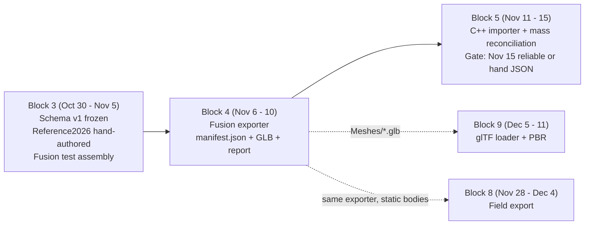
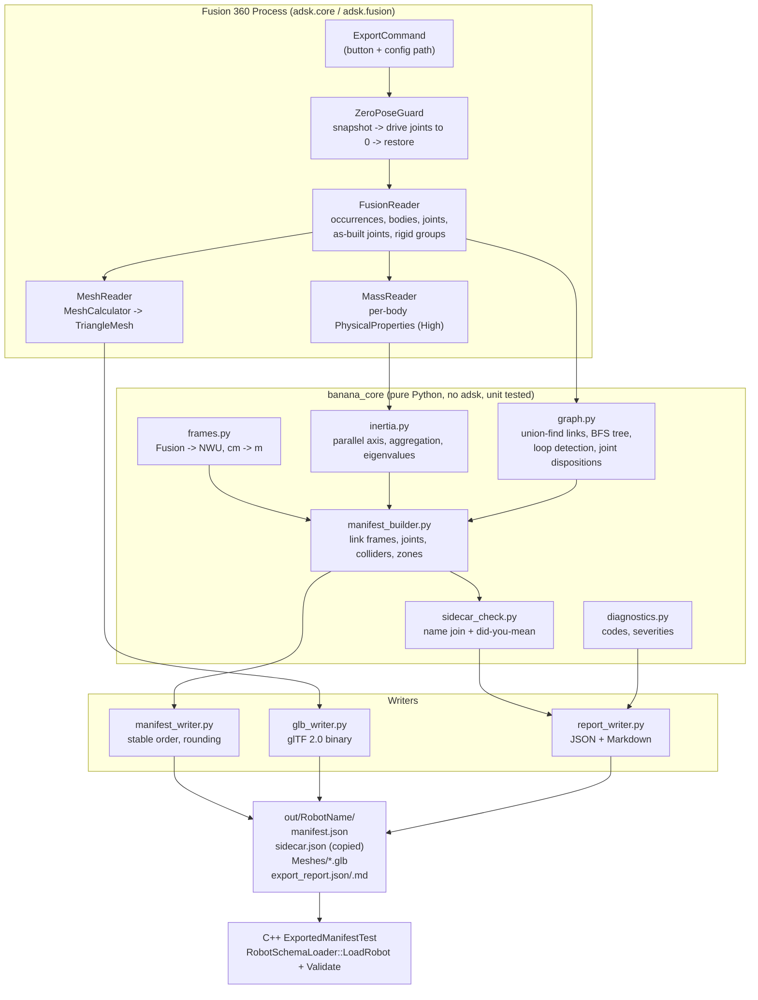
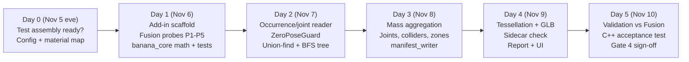

# FRC Simulation — Block 4 Implementation Plan (Revision 1)
**Fusion 360 Exporter (Python Add-in) → Robot Data Schema v1 (`manifest.json` + GLB meshes)**  
**Dates:** November 6 – November 10, 2026 (5 Days)  
**Target:** `FRCBananaSim` Schema v1.0.0 (frozen Nov 5, tag `schema-v1.0.0-frozen`)

---

## 1. Executive Summary

Block 4 builds a **Fusion 360 Python add-in** that turns a jointed robot assembly into the exact Schema v1 files the C++ side already parses (`RobotSchemaLoader`) and spawns (`RobotAssembler`). It produces:

1. `manifest.json` — links (mass, CoM, full inertia tensor about the CoM, material, collider proxy, visual mesh path), joints (type, axis, origin, limits), and contact zones, all in **WPILib NWU, SI units**.
2. `Meshes/<link>.glb` — one tessellated visual mesh per link.
3. `export_report.json` / `export_report.md` — diagnostics, mass breakdown, sidecar cross-check, and validation numbers against Fusion's own mass properties.

The hand-authored `sidecar.json` (motors, CAN IDs, gear ratios, couplings, sensors) stays the source of truth for everything CAD can't hold. The exporter **reads** it, checks every name it references against the exported links, joints, and zones, and warns on anything that doesn't match. It never rewrites it.

### Position in the pipeline



### Core Metrics & Gate 4 Acceptance Criteria

| Attribute | Specification |
|---|---|
| **Timeline** | November 6 – November 10, 2026 (5 days) |
| **Prerequisites** | Schema v1 frozen (done). `RobotSchemaLoader` / `RobotAssembler` operational (done). **Fusion test assembly** with real joints and physical materials (**still unchecked in the Block 3 sign-off list**, see Day 0). |
| **Language / Runtime** | Fusion's embedded Python 3, **standard library only** (`json`, `struct`, `math`, `difflib`, `time`). No NumPy: Fusion doesn't ship it, and installing it into Fusion's interpreter is fragile. |
| **Primary Deliverables** | 1. Add-in `FRCBananaExporter` (command button plus a config file). 2. Pure-Python core (`banana_core`) with no `adsk` imports, unit tested with `unittest` outside Fusion. 3. Schema v1 `manifest.json` writer. 4. GLB writer. 5. Sidecar cross-checker. 6. Export report. 7. C++ acceptance test `ExportedManifestTest`. |
| **Gate 4 (Done when)** | The test assembly exports a manifest and meshes that (a) load through `RobotSchemaLoader::LoadRobot()` + `Validate()` with **zero errors**, (b) match Fusion's own values: total mass within **0.1%**, composite CoM within **0.5 mm**, composite inertia within **0.5%** (relative Frobenius norm), (c) are **byte-identical** across two consecutive exports, and (d) report **zero unmatched sidecar references** for the test assembly's sidecar. |

> [!NOTE]
> Per Plan v3 §3, the exporter is a separate Python tool, so the C++ style rules in `GEMINI.md` don't apply to it. The rules still apply to the C++ acceptance test. As with every block, all code is delivered inline in chat for you to paste in.

---

## 2. Codebase Alignment: What the Exporter Must Respect

I read `RobotManifest.h`, `RobotSchemaLoader.h`, `RobotAssembler.cpp`, `Reference2026/manifest.json`, and `materials.json` to pin down how Schema v1 is **actually consumed**, as opposed to how the schema text describes it. Each finding below is a hard requirement on the exporter or a handoff item for Block 5.

### 2.1 Frame semantics, as implemented in `RobotAssembler`

| Quantity | Frame the assembler assumes | Evidence |
|---|---|---|
| Root link frame | Robot origin (spawn pose) | `linkPoses[rootLinkName] = { worldSpawnPosition, ... }` |
| Child link frame **origin** | At the joint origin | `childWorldPos = parent.worldPos + parent.worldRot * originEngine` |
| Child link frame **orientation** | **Same as the parent** (no per-joint rotation) | `childWorldRot = pIt->second.worldRot` |
| `joint.origin_m` | Parent link frame | as above |
| `joint.axis` | Parent link frame (equal to robot axes at zero pose) | `worldAxis = parent.worldRot * axisEngine` |
| `collider.origin_m` | Link frame | `col.localOffset = ConvertNWUVectorToEngine(colDef.originM)` |
| `link.centerOfMass_m` | Link frame. Only `length()` is used today. | `arm.centerOfMassDistanceM = glm::length(lDef->centerOfMassM)` |
| `inertiaTensor_kgm2` | About the CoM, robot-aligned axes, **tensor-element sign** (off-diagonals placed directly into the matrix) | `InertiaTensor::ToMatrix()` |

**Consequence:** every link frame is **axis-aligned with the robot frame at the zero pose** and sits at its parent joint's origin. The exporter never emits link rotations. It captures geometry at the zero pose, expresses positions relative to the link's joint origin, and keeps tensors in robot axes.

### 2.2 Quirks that affect exported data

> [!WARNING]
> **Revolute axis sign flip.** For `revolute`/`continuous` joints, `RobotAssembler` negates `axisEngine.x` (the NWU **Y** component) so that positive angles about NWU +Y pitch *upward*. A Fusion right-hand-rule axis `(0, 1, 0)` would therefore spin the opposite way in the sim, and the `[lower, upper]` limits would be mirrored. **Decision D1** (Section 13) picks between an exporter shim (negate the Y component of revolute axes on export) and fixing the assembler in Block 5.

| # | Finding | Exporter action | Block 5 handoff |
|---|---|---|---|
| Q1 | Only `colliders[0]` is spawned. | Put the most important collider first: a `COL_` override if one exists, otherwise the auto AABB. | Support multiple colliders. |
| Q2 | Jolt places the body's CoM at `colliders[0].origin` (`PhysicsSystem.cpp:226` `spawnPos += spawnRot * collider->localOffset`). `link.centerOfMass_m` is ignored. | Emit the true CoM anyway. Report `colliderCenter − CoM` per link. | **Decouple the body CoM from the collider offset.** Otherwise exported robots will have shifted CoMs. |
| Q3 | `visualMesh` is parsed but nothing renders it yet. | Still write the GLBs and paths. | Block 5 or 9 consumes them. |
| Q4 | Flywheel visual link mount is hard-coded `(0, 0.06, 0.06)`. | Measure and report the real mount offset and spin axis. | Read the measured value instead of the hard-coded one. |
| Q5 | The four-bar loop-closing hinge is **not** in `manifest.joints`. It lives in the sidecar `four_bar_loop` coupling (`closureParentLink`, anchors, axis). | Drop the loop-closing Fusion joint from `joints` and compute the closure anchors for comparison with the sidecar. | none |
| Q6 | `Reference2026` elevator CoMs (e.g. `elevator_carriage` `[0.18, 0, 0.50]`) look like they were authored in the **robot frame**, while the arm CoMs (`[0.25, 0, 0]`) are link-local. | Always emit **link-local** values, matching how the assembler consumes collider and joint origins. | Expect differences when diffing exported output against Reference2026. Those differences are not exporter bugs. |
| Q7 | Joint `type` values the assembler handles are `revolute`, `continuous`, `prismatic`, `fixed`. | Emit `revolute` with `hasLimits: false` for unlimited hinges, as in the Reference2026 coupler hinge. | none |

### 2.3 A free win: GLB frame equals the engine frame

The glTF 2.0 convention is **+Y up, +Z forward, +X left**, right-handed. That is exactly the `FRCBananaSim` engine frame (`ConvertNWUVectorToEngine`: `(x, y, z)_engine = (y, z, x)_NWU`). If the exporter writes meshes in glTF-native axes:
- They open correctly in Blender, the Windows 3D Viewer, and any glTF viewer, which makes debugging easy.
- Block 9's loader needs **no conversion**: vertices are already in engine axes, relative to the link origin.
- **Decision D2:** the manifest stays NWU, as the schema requires. Meshes follow the glTF spec, and the schema doc gets one line saying so.

---

## 3. Architecture & Data Flow



**Key design rule:** everything that does math or graph logic lives in `banana_core` and takes plain Python data (dicts, tuples, dataclasses). The Fusion layer only *reads* the API and fills those structures. That makes about 80% of the exporter testable in milliseconds with plain CPython, without restarting Fusion.

---

## 4. Fusion API Mapping

| Need | Fusion API | Units | Gotchas / Verification |
|---|---|---|---|
| Walk the assembly | Hierarchical recursive traversal from `design.rootComponent.occurrences` (assembly-context proxies) | — | **Branch pruning:** If `occ.isLightBulbOn == False` or `occ.isVisible == False`, skip the occurrence entirely and do NOT inspect its children or bodies (§6.2). Read `occ.fullPathName` for stable naming (`+` delimited path). Skip `occ.isSuppressed`. |
| Bodies | `occ.bRepBodies` (proxies) within visible occurrences | — | Only process if parent occurrence is visible. For structural bodies, skip if hidden (`isLightBulbOn == False` or `isVisible == False`). For proxy bodies (`COL_*`, `ZONE_*`): if visible, export without question; if invisible/hidden, prompt user whether to export (§6.2). Skip `COL_*` / `ZONE_*` proxies from mass and mesh. |
| Mass properties | `body.getPhysicalProperties(adsk.fusion.CalculationAccuracy.HighCalculationAccuracy)` → `.mass`, `.centerOfMass`, `.getXYZMomentsOfInertia()` | kg, cm, kg·cm² | XYZ moments are **about the world origin**, not the CoM. **Sign of the products is verified** by probe **P3** (`FUSION_PRODUCT_SIGN = +1`). |
| Occurrence transform | `occ.transform2` (Matrix3D) | cm | Full transform to root world space. Used to transform local native geometry/joint points to root space (`_transform_point_to_world`). |
| Joints | `rootComponent.allJoints` / `allAsBuiltJoints` / `joints` / `asBuiltJoints`, plus `design.timeline`, plus per-occurrence: `occ.component.joints` → `j.createForAssemblyContext(occ)` | — | **A joint inside a reused component stands for N physical joints** (e.g. 4 swerve modules = 4 steer joints). Proxied per occurrence. **Subassembly isolation rule:** Never query `comp.parentDesign.rootComponent.joints` per child occurrence of an external design; child occurrences share `parentDesign`, which would clone subassembly root joints across all child parts and short out kinematic chains. |
| As-built joints | `allAsBuiltJoints` + per-occurrence `comp.asBuiltJoints` | — | FRC CAD uses these heavily. Same assembly context proxy rule applies. |
| Motion links | `rootComponent.allMotionLinks` / `motionLinks`, `design.motionLinks`, `design.timeline`, and per-occurrence `comp.motionLinks` / external subassembly root designs | — | Extracts `jointOne`, `jointTwo`, `ratio`, and `isReversed`. Numeric ratio extracted via `ModelParameter.value` on `distanceOne`/`distanceTwo` or `angleOne`/`angleTwo` ($v_2 / v_1$), or fallback to `ratio`/`multiplier`/`expression`. Exclude non-motionlink timeline items (e.g. rectangular patterns `R-Pattern`). |
| Rigid groups | `rootComponent.allRigidGroups` / `rigidGroups` + per-occurrence proxies | — | Every member merges into one link. |
| Joint type | `joint.jointMotion.jointType` | — | `RigidJointType`, `RevoluteJointType`, `SliderJointType`, `CylindricalJointType`, `PinSlotJointType`, `PlanarJointType`, `BallJointType`. |
| Revolute axis / limits / value | `RevoluteJointMotion.rotationAxisVector`, `.rotationLimits` (`isMinimumValueEnabled`, `minimumValue`, …), `.rotationValue` | rad | Continuous-rotation joints (flywheels, rollers) have no limits and export with `hasLimits: false` (`W402`). |
| Slider axis / limits / value | `SliderJointMotion.slideDirectionVector`, `.slideLimits`, `.slideValue` | **cm** | Convert to m. |
| Joint origin | `joint.geometryOrOriginOne` / `geometryOrOriginTwo` (`origin` / `Point3D` geometry), with fallback to `jointMotion` axis origin (`rotationAxis.origin` / `pitchPoint`), transform translations, or nativeObject | cm | Read safely without throwing `InternalValidationError`. Native joints are transformed to world coordinates before structural deduplication. |
| Moving sides | `joint.occurrenceOne`, `joint.occurrenceTwo` | — | Resolved via direct properties, `nativeObject`, geometry entities, or referencedEntities, qualified by `parent_occ_path` and matched to visible occurrence tree. |
| Physical material | `body.material.name` | — | Mapped through `material_map.json`. Unmapped materials warn once per unique material name (`W270`) and fall back to snake_case. |
| Tessellation | `body.meshManager.createMeshCalculator()` → `.setQuality(...)` → `.calculate()` → `nodeCoordinatesAsDouble`, `nodeIndices`, `normalVectorsAsDouble` | cm | Tessellates visible mass-bearing structural bodies per link. |
| Bounding box | `body.boundingBox` (`minPoint`, `maxPoint`) | cm | World-axis-aligned. Valid for auto-box colliders because link frames are robot-aligned. |
| Whole-design reference | `rootComponent.getPhysicalProperties(High)` | kg, cm | Ground truth for Gate 4 composite checks (excluding hidden branches and proxy bodies). |
| Progress UI | Interactive export dialog / summary message box | — | Shows status, robot name, link/joint/zone counts, mass vs Fusion, CoM/inertia error, triangle count, and prioritized error/warning diagnostics. |

> [!TIP]
> **Per-component caching.** Compute each *native* body's properties once in component space, then transform them per occurrence: `c_world = T·c`, `I_world = R_T · I_c · R_Tᵀ` (rotation only; the tensor is about the CoM). Four identical swerve modules or 300 identical bolts then cost one High-accuracy query each instead of hundreds. Probe P2 confirms this path matches the per-proxy path to 1e-9 before the cache is trusted.

---

## 5. Mathematical Formulation

### 5.1 Fusion → NWU frame and units

The CAD team's convention for this project is:
* **Forward:** Fusion $+Z$
* **Left:** Fusion $+X$ (Fusion right-side)
* **Up:** Fusion $+Y$ (Fusion top)

With $\hat{\mathbf{f}} = (0, 0, 1)$, $\hat{\mathbf{l}} = (1, 0, 0)$, and $\hat{\mathbf{u}} = (0, 1, 0)$, notice that $\hat{\mathbf{f}} \times \hat{\mathbf{l}} = \hat{\mathbf{z}} \times \hat{\mathbf{x}} = +\hat{\mathbf{y}} = \hat{\mathbf{u}}$, forming a standard right-handed frame ($\det R_{F \to N} = +1$).

The coordinate transformation from Fusion coordinates $(x_F, y_F, z_F)$ to WPILib NWU coordinates $(x_N, y_N, z_N)$ is therefore a direct permutation:
$$x_N = z_F - o_{F,z}, \qquad y_N = x_F - o_{F,x}, \qquad z_N = y_F - o_{F,y}$$

$$R_{F \to N} = \begin{pmatrix} 0 & 0 & 1 \\ 1 & 0 & 0 \\ 0 & 1 & 0 \end{pmatrix}, \qquad \det R_{F\to N} = +1$$

$$\mathbf{p}_{N} = R_{F \to N}\left(s\,\mathbf{p}_F - \mathbf{o}_F\right), \quad s = 0.01\ \tfrac{\text{m}}{\text{cm}}, \qquad \mathbf{I}_N = 10^{-4}\, R_{F \to N}\,\mathbf{I}_F\,R_{F \to N}^T$$

where $\mathbf{o}_F$ is the robot origin in meters (default: frame center projected onto the floor, see §8). Direction vectors (axes, normals) use only $R_{F \to N}$.

**Sanity checks:** warn `W210 FRAME_SUSPECT` if the robot's bounding-box minimum $z_N$ is not within ±2 cm of 0, if the CoM has $z_N < 0$, or if the footprint is taller than it is wide.

### 5.2 Per-body inertia: origin → CoM

Fusion returns $\mathbf{I}^{O}_b$ about the world origin. With body mass $m_b$, CoM $\mathbf{c}_b$, and tensor-element convention ($I_{xy} = -\int xy\,dm$):

$$\mathbf{I}^{c}_b = \mathbf{I}^{O}_b - m_b\left(\|\mathbf{c}_b\|^2\,\mathbf{E}_3 - \mathbf{c}_b\,\mathbf{c}_b^T\right)$$

If probe P3 shows that Fusion returns *positive* products ($P_{xy} = +\int xy\,dm$), the off-diagonals are negated **once** at read time (`FUSION_PRODUCT_SIGN = -1`) and all downstream code stays tensor-element.

### 5.3 Link aggregation (parallel axis theorem)

For a link $L$ made of bodies $b \in L$:

$$m_L = \sum_b m_b, \qquad \mathbf{c}_L = \frac{1}{m_L}\sum_b m_b\,\mathbf{c}_b, \qquad \mathbf{I}_L = \sum_b\left[\mathbf{I}^{c}_b + m_b\left(\|\mathbf{d}_b\|^2\,\mathbf{E}_3 - \mathbf{d}_b\,\mathbf{d}_b^T\right)\right], \quad \mathbf{d}_b = \mathbf{c}_b - \mathbf{c}_L$$

Then convert to NWU (§5.1) and express relative to the link frame origin $\mathbf{p}_L$:

$$\texttt{centerOfMass\_m} = \mathbf{c}_{L,N} - \mathbf{p}_{L}, \qquad \texttt{inertiaTensor\_kgm2} = \mathbf{I}_{L,N}\ \text{(about } \mathbf{c}_L\text{, robot axes)}$$

**Validity checks per link:** $m_L > 0$ (otherwise `E301 ZERO_MASS_LINK`). Positive-definite by Sylvester, the same test as `InertiaTensor::IsPositiveDefinite()` (otherwise `E302`). Triangle inequality $I_{xx} + I_{yy} \ge I_{zz}$ (all permutations) of the principal moments (otherwise `W303 NONPHYSICAL_INERTIA`).

### 5.4 Composite recomposition (Gate 4 check)

Recompose the whole robot from the *exported* links (in NWU, every link at the zero pose) using §5.3, and compare with `rootComponent.getPhysicalProperties()` converted through §5.1–5.2:

$$\epsilon_m = \frac{|m_{\text{exp}} - m_{\text{F}}|}{m_F} \le 0.1\%, \qquad \|\mathbf{c}_{\text{exp}} - \mathbf{c}_F\| \le 0.5\ \text{mm}, \qquad \epsilon_I = \frac{\|\mathbf{I}_{\text{exp}} - \mathbf{I}_F\|_F}{\|\mathbf{I}_F\|_F} \le 0.5\%$$

Excluded bodies (hidden, `COL_`, `ZONE_`) are subtracted from the Fusion reference before comparing.

**Principal-moment check:** eigenvalues of each exported tensor (closed-form symmetric 3×3 trigonometric method, no NumPy) are compared with `getPrincipalMomentsOfInertia()` for single-occurrence links within 0.5%. Flipping the sign of all three products changes the eigenvalues, so this catches a product-sign error whenever the link has three non-zero products.

### 5.5 Joint origin, axis, and limits

With joint origin $\mathbf{j}_N$ and parent link frame origin $\mathbf{p}_P$:

$$\texttt{origin\_m} = \mathbf{j}_N - \mathbf{p}_P, \qquad \mathbf{p}_{C} := \mathbf{j}_N \ \ (\text{child link frame origin})$$

**Axis direction.** Fusion's value $\theta$ rotates `occurrenceOne` relative to `occurrenceTwo` about $\hat{\mathbf{a}}$. If the BFS tree makes One the **parent**, the child rotates by $-\theta$ about $\hat{\mathbf{a}}$, which is $+\theta$ about $-\hat{\mathbf{a}}$. The exporter then emits $-\hat{\mathbf{a}}$ and keeps the limits unchanged, so joint values mean the same thing in Fusion and in the sim.

**Sign shim (if D1 = shim):** emit $(a_x, -a_y, a_z)$ for revolute joints so that the assembler's X-negation restores the right-hand axis.

**Limits** (taken at the zero pose, see §6.1):

| Fusion limits | Exported |
|---|---|
| min and max enabled | `hasLimits: true`, `lower = min`, `upper = max` (slider cm → m) |
| neither enabled | `hasLimits: false` + `W402 JOINT_NO_LIMITS` (revolute stays `revolute`, Q7) |
| one side only | `hasLimits: false` + `W403 ONE_SIDED_LIMIT_DROPPED` (Schema v1 can't express a one-sided limit) |
| `springFrequency_Hz`, `springDampingRatio` | Not in CAD. Use `40.0` / `1.0` defaults, overridable per joint in config. |

---

## 6. Algorithms

### 6.1 Zero-pose capture (`ZeroPoseGuard`)

Fusion limits are relative to each joint's zero, but geometry is read at the **current** pose. If the CAD was saved with the arm raised, every downstream link frame would be wrong.

1. Snapshot `rotationValue` / `slideValue` for every revolute and slider joint (proxies included).
2. Set each one to `0`, then call `design.computeAll()`.
3. Read all geometry and mass.
4. Restore the snapshot in a `finally:` block, even when the export throws.
5. If any value was non-zero, log `I110 POSE_NORMALIZED` (info) listing the joints and their original values.

> [!NOTE]
> Joint collection for zero-pose capture queries `root.allJoints`, `root.allAsBuiltJoints`, `root.joints`, `root.asBuiltJoints`, and traversed visible occurrences' own component joints proxied to the occurrence context. It avoids traversing `ext_root.joints` on every child occurrence of external components to prevent joint duplication.

> [!CAUTION]
> Driving joints modifies the open design (it adds an undo entry). The guard always restores the values, and the command tells the user not to save during an export. If the design has **Capture Position** pending or timeline errors, abort with `E111 DESIGN_NOT_CLEAN` instead of guessing.

### 6.2 Hierarchical Assembly Traversal & Branch-Pruning Visibility Rule

The exporter walks the assembly tree **hierarchically and recursively**, starting from `design.rootComponent.occurrences`. It strictly adheres to **branch-level visibility pruning**:

> [!IMPORTANT]
> **Visibility Branch-Pruning Rule:**
> If an occurrence has its visibility toggled off in Fusion (`occ.isLightBulbOn == False` or `occ.isVisible == False`), the exporter **immediately skips that entire occurrence branch**. It does **not** evaluate any bodies inside it, and it does **not** recurse into or inspect any of its child occurrences. Hiding an assembly or subassembly in Fusion completely prunes it and its entire child tree from the simulation export.

```python
def traverse_assembly_branch(occurrences, parent_visible=True):
    """
    Recursively traverses visible occurrences with branch-level pruning.
    """
    for occ in occurrences:
        # 1. Skip suppressed occurrences
        if occ.isSuppressed:
            continue
            
        # 2. Branch pruning: if hidden, skip this entire branch and do not inspect children
        if not occ.isLightBulbOn or not occ.isVisible:
            continue  # Prunes this component AND all child occurrences underneath it!
            
        # 3. Process bodies inside this visible occurrence
        for body in occ.bRepBodies:
            is_proxy = body.name.startswith("COL_") or body.name.startswith("ZONE_")
            body_visible = body.isLightBulbOn and body.isVisible
            
            if not body_visible:
                if is_proxy:
                    # Hidden collider or sensor zone proxy: ask the user whether to export it!
                    if not prompt_user_for_hidden_proxy(body, occ):
                        continue
                else:
                    # Hidden regular structural body: skip silently
                    continue
            
            # Visible bodies (or user-confirmed hidden proxies): categorize and process
            process_body(body, occ)
            
        # 4. Recursively traverse child occurrences within this visible branch
        if occ.childOccurrences and occ.childOccurrences.count > 0:
            traverse_assembly_branch(occ.childOccurrences)
```

**Proxy Body Visibility & Interactive User Confirmation:**
CAD designers frequently toggle off the visibility lightbulb on collision boxes (`COL_*`) and trigger zones (`ZONE_*`) during daily modeling so translucent proxy geometry doesn't obstruct mechanical assembly view.
* **If visible (`isLightBulbOn == True` and `isVisible == True`):** The exporter processes and exports the `COL_*` collider or `ZONE_*` contact zone **immediately without question**.
* **If invisible / hidden (`isLightBulbOn == False` or `isVisible == False`):** Rather than silently skipping custom colliders or exporting stale test boxes, the exporter **prompts the user**:
  * In the Fusion 360 interactive export dialog, a prompt or checklist surfaces any hidden proxy bodies found within visible occurrences: *`"Hidden proxy body '<body.name>' found in '<occ.name>'. Export as collider/zone?"`* with options `[Yes]`, `[No]`, `[Export All Hidden]`, `[Skip All Hidden]`.
  * In headless/scripted exports (`exporter_config.json`), behavior is controlled by `"hiddenProxyAction"`: `"prompt"` (default: asks via terminal/UI), `"include"`, or `"exclude"`.
  * User-confirmed hidden proxies are exported and recorded with diagnostic `I261 PROXY_PROMPTED_INCLUDED`; skipped proxies are logged with `I262 PROXY_PROMPTED_EXCLUDED`.

**Hidden Reference Assemblies in Mechanism Files:**
When CAD modelers build mechanism subassemblies in separate files (`Intake.f3d`, `Turret.f3d`), they frequently insert copies of the chassis or base plate as reference geometry to build against, and then hide those reference copies inside the subassembly before inserting into the master assembly. The exporter's recursive branch pruning rule (`I295`) completely omits these hidden reference subassemblies and their child occurrences so duplicate geometry never leaks into the simulation export.

**Why hierarchical traversal over flat `allOccurrences`:**
Fusion's flat `rootComponent.allOccurrences` collection contains proxy references to every nested occurrence regardless of parent visibility. Using a flat loop would require manually checking every ancestor's lightbulb state or risk leaking children of hidden subassemblies into the export. Recursive traversal is $O(N)$, guarantees branch pruning at the exact parent node, and avoids reading mass properties or tessellations on hidden geometry.

**Joint Handling on Pruned Branches:**
Joints whose `occurrenceOne` or `occurrenceTwo` belongs to a pruned (hidden) occurrence are ignored. They do not enter the kinematic graph or `manifest.joints`.

### 6.3 Link grouping (union-find)

Nodes are the leaf-level occurrences that own bodies. Union rules, in order:

1. **Rigid joints** and **rigid as-built joints**: union both sides.
2. **Rigid groups**: union all members.
3. **Implicit parent rigidity (Multi-pass bottom-up iterative merging):** In multi-level mechanism subassemblies (e.g. `Intake:1` containing `Mount:1`, `Side Plates:1`, `HexShafts:1`), parts are grouped hierarchically. A simple 1-pass check either welded moving children into parent containers or left subassemblies disconnected (`E241`). The exporter applies iterative bottom-up parent merging:
   - Iterates occurrences in reverse topological order (`reversed(occurrences)`).
   - Never merges two clusters if `(c_rep, p_rep) in movable_pairs`.
   - Protects moving child clusters: if an occurrence's cluster is a moving child cluster (`c_rep in moving_child_clusters`) and the parent is outside this cluster, it does not merge into the parent container.
   - Stationary containers (e.g. `Intake:1`, `New FRC Turret:1`) bubble up cleanly into `base_link` or their parent structure.
   - Dynamically updates `movable_pairs` and `moving_child_clusters` whenever a union occurs so newly merged parent clusters preserve movable joint boundaries.
4. **Grounded** occurrences: union with the root.
5. **Fold joints** (config `foldJoints`, glob patterns such as `swerve_*`): treated as rigid. This is how the **swerve modules merge into `base_link`**, because the drivetrain is the analytic `SwerveDrivetrainModel`, not Jolt links.
6. **Forced splits** (config `keepSeparate`): two groups that would merge stay separate and get a `fixed` joint.

**Link naming:** use the config `linkNames` override first. Otherwise take the sanitized name of the top-most occurrence in the group, with the `:1` suffix stripped, lower snake_case, `[a-z0-9_]`. The root link is always `base_link`, or `swerve.chassisLink` from the sidecar. Name collisions get a `_2` suffix plus `W220 LINK_NAME_COLLISION`.

### 6.4 Kinematic tree and joint dispositions

1. Build a multigraph: nodes are links, edges are the movable (non-folded) joints.
2. Root = the link containing grounded occurrences. Error `E230` if there are none or several.
3. BFS from the root with deterministic ordering (sort edges by sanitized joint name). Tree edges become `manifest.joints`.
4. Each non-tree edge closes a loop. If it matches a sidecar `four_bar_loop` coupling (by joint name, or by `closureParentLink` + `closureChildLink`), it gets the `closure` disposition. Otherwise `W240 UNRESOLVED_LOOP`.
5. Links unreachable from the root: `E241 DISCONNECTED_LINK`, unless they are a configured detached visual (below).

| Disposition | Source | Goes to | Notes |
|---|---|---|---|
| `merged` | rigid joints, rigid groups, implicit, grounded | link grouping only | Preserves underlying joint type in `all_joints` for audit in report. |
| `folded` | `foldJoints` | link grouping only | Swerve steer and drive axles. The exporter reports measured module pivot positions vs. sidecar `swerve.modules[].pos_m` (warn above 2 mm). |
| `tree` | BFS tree edge | `manifest.joints` | Primary articulated joints in simulation. |
| `closure` | non-tree edge matched to the sidecar | report only | Anchors are computed in the follower and coupler link frames and compared with the sidecar `closureParentAnchor_m` / `closureChildAnchor_m` / `closureAxis` (warn above 1 mm or 0.5°). |
| `detached` | config `detachedVisualJoints` | link emitted **without** a joint | Flywheel and roller visuals. The exporter reports the measured mount offset and spin axis vs. sidecar `spinAxis` (Q4). |
| `ignored` | suppressed, ball, planar, pin-slot | report | `W250 UNSUPPORTED_JOINT_TYPE`. The two sides are treated as rigid. |

**Joint type mapping:** revolute → `revolute`. Slider → `prismatic`. Cylindrical → `revolute` + `W251 CYLINDRICAL_TRANSLATION_DROPPED`. Forced split → `fixed`.

**Motion links extraction:** Fusion Motion Links linking two joints are detected from design and occurrence timelines and collections (`I510`). Extracted motion links are reported in `export_report.json` and `export_report.md` under `motionLinks`, recording `joint_one`, `joint_two`, `ratio`, and `is_reversed`. The numerical ratio is extracted from `ModelParameter.value` on distance or angle parameters ($v_2 / v_1$). Non-motionlink timeline items (e.g. rectangular patterns `R-Pattern`) are filtered out.

### 6.5 Colliders

Link frames are robot-aligned, so world AABBs (`body.boundingBox`) give exact axis-aligned boxes in the link frame:

- **Override first (Q1):** bodies named `COL_<name>` inside a link become a box from their AABB. They are excluded from mass and mesh. If visible, they are exported immediately without question; if hidden, the exporter prompts the user whether to export them (§6.2). `COL_CYL_` / `COL_SPH_` (cylinder / sphere fits) are a stretch goal.
- **Auto fallback:** one box spanning the AABB of all of the link's mass-bearing bodies, named `<link>_auto_box`. `dimensions_m` is the full extents and `origin_m` is the AABB center minus $\mathbf{p}_L$.
- **No collider:** links listed in `noCollider` (such as the flywheel visual, which matches the Reference2026 empty `colliders`).
- Per link, report `‖colliderCenter − CoM‖`. Q2 makes this a real CoM error in today's assembler.

### 6.6 Contact zones

Bodies named `ZONE_<role>_<name>` (role ∈ `intake`, `shooter`, `indexer`) become `contactZones` entries (if visible, exported immediately without question; if hidden, the exporter prompts the user whether to export them): `parentLink` is the link containing the body, `shape: box`, origin and dimensions come from the AABB, rotation is identity. `tangentAxis`, `compressionAxis`, and `nominalGap_m` can't be derived from geometry. They come from config `contactZones.<name>`, and if missing: `W260 ZONE_METADATA_MISSING` with defaults `[1,0,0]`, `[0,0,1]`, and the smallest AABB extent.

### 6.7 Materials

- `body.material.name` is mapped through `material_map.json`.
- The library covers standard FRC materials and COTS components: `Aluminum 6061`, `Polycarbonate`, `Steel 4140`, `Steel 1018`, `Steel 52100`, `Delrin (Acetal)`, `Silicone - 60A/35A`, `TPU - 95A`, `PLA - Solid`, `PLA - Standared`, `ABS - Standard`, `Glass-filled Nylon`, `Plexiglass`, `REV MAXPlanetary Gearbox`, `Kraken X60/X44`, `Standard Servo`, etc.
- Link `material` = the material of the **heaviest** body in the link.
- Unmapped Fusion material: `W270 MATERIAL_UNMAPPED`, falling back to the snake_case name. Warnings are **deduplicated per unique material name** (with an instance count) so thousands of hardware parts do not flood the log.
- Default material warning: bodies left on Fusion's default material trigger `W271 DEFAULT_MATERIAL_IN_USE`.
- The report includes a **mass by Fusion material** table and per-link material breakdown. If something like "Steel 62% of robot mass" shows up, a part was left on Fusion's default material, and that is the biggest real-world mass error in FRC CAD.

### 6.8 Visual meshes (GLB writer)

1. Per link, tessellate every mass-bearing body that is visible (or included by config).
2. Transform each vertex: $\mathbf{v}_N = R_{F\to N}(s\mathbf{v}_F - \mathbf{o}_F) - \mathbf{p}_L$, then to glTF / engine axes $(y_N, z_N, x_N)$. Normals use only the rotations.
3. Write a GLB with Python `struct`:
   - 12-byte header `glTF`, version 2, total length.
   - JSON chunk padded with spaces to 4 bytes, BIN chunk padded with zeros.
   - Accessors: `POSITION` (FLOAT VEC3 **with the required min/max**), `NORMAL`, indices (`UNSIGNED_SHORT` below 65,536 vertices, otherwise `UNSIGNED_INT`).
   - One mesh per link and one primitive per Fusion appearance, using `baseColorFactor` (stretch: read the appearance albedo).
4. Budgets: warn `W280` above 150k triangles per link or 500k per robot. Config `meshQuality` (`low` / `normal` / `high`) and `meshExclude` globs (e.g. `*Screw*`, `*Nut*`, `*Rivet*`) keep FRC hardware from blowing the budget.

### 6.9 Sidecar cross-check

Every reference in the sidecar is checked against what the exporter produced:

| Sidecar field | Must exist in |
|---|---|
| `swerve.chassisLink` | links (must be the root) |
| `swerve.modules[].steerJoint` / `.driveJoint` | tree joints |
| `swerve.steerActuatorType` / `.driveActuatorType` | `"dc_motor"` or `"servo"`. If `"servo"`, verifies `steerServoPreset` / `driveServoPreset` is valid and each module has `steerPwmChannel` / `drivePwmChannel` $\in [0, 15]$. |
| `mechanisms[].targetJoint` | tree joints (single-DOF mechanisms) |
| `mechanisms[].targetJoints` | tree joints (array of exactly 2 joints for differential mechanisms) |
| `mechanisms[].actuatorType` | `"dc_motor"` or `"servo"`. If `"servo"`, verifies `servo.pwmChannel` $\in [0, 15]$ (or dual `servoA.pwmChannel` / `servoB.pwmChannel` $\in [0, 15]$ for differential mechanisms) and preset is valid (`GoBildaTorque`, `GoBildaSpeed`, `GenericStandard`, `Custom`). |
| `mechanisms[].parentLink`, `.visualLink` | links |
| `couplings[].stages[].joint`, `.crankJoint`, `.couplerJoint`, `.followerJoint`, `.powerCoupling.masterJoint` / `.slaveJoint` | tree joints |
| `couplings[].closureParentLink`, `.closureChildLink` | links |
| `sensors[].parentLink` / `.targetJoint` / `.contactZone` | links / tree joints / zones |
| `electrical.servoRailVoltage_V` / `.servoRailCurrentLimit_A` | valid positive numbers when servos are configured. |

Misses are reported as `W501 SIDECAR_UNMATCHED` with `difflib.get_close_matches` suggestions (e.g. *"`arm_shoulder_hinge` not found — did you mean `arm_shoulder_revolute`?"*). In the other direction, any tree joint that no mechanism or coupling references gets `I502 PASSIVE_JOINT` (info).

---

## 7. Diagnostic Codes

| Code | Severity | Meaning |
|---|---|---|
| `E111` | Error | Design not clean (timeline errors or pending Capture Position) |
| `W111` | Warn | Timeline contains warning features |
| `W112` | Warn | Joint reset failure (could not drive joint to zero pose) |
| `I110` | Info | Joints were driven to zero pose for capture (restored after export) |
| `I120` | Info | `ROBOT_ORIGIN` construction point found and used as origin reference |
| `I130` | Info | Whole-design physical properties computed for validation |
| `W210` | Warn | Robot frame looks suspect (negative CoM Z or suspicious footprint) |
| `W220` | Warn | Link name collision (renamed with numeric suffix) |
| `E230` | Error | No grounded occurrence found, or multiple distinct grounded links |
| `W230` | Warn | Grounded occurrence has multiple grounded bodies or ungrounded parent |
| `E241` | Error | Link disconnected from the root |
| `I241` | Info | Joint connects occurrence to itself (internal constraint skipped) |
| `I242` | Info | Joint skipped because an occurrence was pruned by visibility setting |
| `W242` | Warn | Joint skipped because an occurrence is not in visible assembly tree |
| `W240` | Warn | Loop-closing joint not matched to a sidecar `four_bar_loop` |
| `E243` | Error | Rigid group contains fewer than 2 occurrences |
| `W250` | Warn | Unsupported joint type (treated as rigid) |
| `W251` | Warn | Cylindrical joint translation dropped (emitted as revolute) |
| `W260` | Warn | Contact zone metadata missing in config (defaults applied) |
| `W261` | Warn | Unknown contact zone role in body name |
| `I261` | Info | Hidden proxy body (`COL_*` or `ZONE_*`) exported after user confirmation |
| `I262` | Info | Hidden proxy body (`COL_*` or `ZONE_*`) skipped per user response |
| `W270` | Warn | Fusion material not mapped in `material_map.json` (deduplicated per unique material) |
| `W271` | Warn | Body on Fusion's default material |
| `W280` | Warn | Triangle budget exceeded (>150k per link or >500k total) |
| `W281` | Warn | Failed to tessellate body for link |
| `W290` | Warn | Skipped a joint that could not be read |
| `W291` | Warn | Could not read Fusion whole-design physical properties (Gate 4 check unavailable) |
| `W292` | Warn | Mesh generation failed during export |
| `I295` | Info | Pruned hidden occurrence branch |
| `E300` | Error | Could not read mass properties of body |
| `E301` | Error | Link has zero mass |
| `E302` | Error | Link inertia tensor is not positive-definite |
| `W301` | Warn | Body has zero or negligible mass |
| `W303` | Warn | Non-physical principal moments (violates triangle inequality) |
| `W304` | Warn | Disconnected occurrences grouped in single link |
| `W402` | Warn | Revolute or slider joint has no limits (continuous rotation) |
| `W403` | Warn | Revolute or slider joint has one-sided limit (dropped to unlimited for schema v1) |
| `W500` | Warn | No `sidecar.json` found (cross-check skipped) |
| `W501` | Warn | Sidecar reference unmatched, or invalid servo preset / PWM channel / target count |
| `I502` | Info | Passive joint (not driven by any mechanism or coupling) |
| `I510` | Info | Motion link detected and extracted |
| `W512` | Warn | Motion link could not resolve its connected joints |

**Diagnostic Display & Reporting:**
- The export **still writes files when there are warnings**. It writes a manifest when there are errors too, but marks it `"exportStatus": "failed"` in the report. The manifest itself stays pure Schema v1, so the frozen schema is unchanged.
- In the UI completion dialog, high-volume pruning notices (`I295`) are suppressed from the message box preview whenever errors or warnings exist, ensuring critical diagnostic messages are immediately visible. The complete diagnostic stream is recorded in `export_report.json` and formatted in `export_report.md`.

---

## 8. CAD Authoring Contract (agree with the CAD team before Nov 6)

1. **Robot origin:** the design origin sits at the **frame center on the floor**. Otherwise, place a construction point named `ROBOT_ORIGIN` and the exporter uses it as $\mathbf{o}_F$ (`I120`).
2. **Orientation:** declare `fusionUp` / `fusionForward` once in `exporter_config.json`. The robot front is the intake side, matching the WPILib convention.
3. **Real joints** with motion limits on articulated mechanisms: revolute for arms and four-bars, slider for elevators. Continuous-rotation mechanisms (flywheels, intake rollers) can be left without limits and export with `hasLimits: false` (`W402`). Rigid joints or rigid groups for everything structural.
4. **Ground** the chassis (one grounded occurrence).
5. **Joint names = sidecar names** (`elevator_stage1_slider`, `arm_shoulder_hinge`, `fourbar_crank_hinge`, …). Joints inside a reused component export as `<occurrence>_<joint>`, so name the swerve module occurrences `fl`, `fr`, `bl`, `br`.
6. **Physical materials** on every body. Use real materials from the library (`material_map.json`) or assign physical materials rather than leaving Fusion defaults.
7. **Proxy bodies:** `COL_*` for collider overrides and `ZONE_<role>_*` for contact zones inside visible components. They are excluded from mass and visual mesh.
   * **If visible:** Exported immediately **without question**.
   * **If invisible / hidden:** The exporter asks the user during export whether it should be exported (§6.2), ensuring intended collision shapes or sensor triggers are never silently dropped or accidentally included.
8. **Mechanisms at zero pose** when saved is preferred, but `ZeroPoseGuard` handles it either way.
9. **Branch Visibility & Pruning (Hiding Components & Reference Geometry):** The exporter strictly operates on visible objects. If a component or subassembly is hidden (eye/lightbulb toggled off in Fusion's browser tree), the exporter skips that entire branch and does not inspect its child components, bodies, or joints (`I295`, §6.2). Use this to keep test fixtures, field obstacles, alternate intakes, or reference geometry (e.g. chassis reference copies inside intake or turret files) in your CAD file without having them leak into the robot simulation. (Note: hidden proxy bodies `COL_*`/`ZONE_*` located inside *visible* components will prompt the user per Rule 7).
10. **Multi-Subassembly Mechanism Authoring:** In complex robots with nested subassemblies (e.g., `Robot Chassis` containing `Intake Assembly` which contains `Moving Hood` and `Rollers`), author joints between moving parts or to the subassembly mounting base. The exporter's multi-pass bottom-up iterative parent merging (Rule 3) automatically groups stationary subassembly parts into `base_link` while keeping moving child assemblies isolated as articulated links.
11. **Differential Mechanism CAD Hierarchy:** For 2-DOF differential mechanisms (e.g. bevel wrists), author two separate revolute joints in CAD (Pitch hinge connecting base link to yoke link, and Roll hinge connecting yoke link to distal tool). Ground both motor bodies to the parent structure rigid group—do not attach motor bodies to the moving distal wrist links.
12. **Servo-Driven Mechanisms & Swerve (FTC / Miniature):** Servo-actuated joints (e.g. steer azimuths, continuous drive wheels, miniature arms, differential wrists) follow standard revolute or slider joint authoring in Fusion with accurate limits. Actuator type (`"actuatorType": "servo"`), servo preset, and PWM channel assignments are declared in `sidecar.json` without altering the physical kinematic joint representation in CAD.
6. **Physical materials** on every body. Custom materials for polycarbonate, HDPE, foam, belts, and Colson wheels.
7. **Proxy bodies:** `COL_*` for collider overrides and `ZONE_<role>_*` for contact zones inside visible components. They are excluded from mass and visual mesh.
   * **If visible:** Exported immediately **without question**.
   * **If invisible / hidden:** The exporter asks the user during export whether it should be exported (§6.2), ensuring intended collision shapes or sensor triggers are never silently dropped or accidentally included.
8. **Mechanisms at zero pose** when saved is preferred, but `ZeroPoseGuard` handles it either way.
9. **Branch Visibility & Pruning (Hiding Components):** The exporter strictly operates on visible objects. If a component or subassembly is hidden (eye/lightbulb toggled off in Fusion's browser tree), the exporter skips that entire branch and does not inspect its child components, bodies, or joints (§6.2). Use this to keep test fixtures, field obstacles, alternate intakes, or unused parts in your CAD file without having them leak into the robot simulation. (Note: hidden proxy bodies `COL_*`/`ZONE_*` located inside *visible* components will prompt the user per Rule 7).
10. **Differential Mechanism CAD Hierarchy:** For 2-DOF differential mechanisms (e.g. bevel wrists), author two separate revolute joints in CAD (Pitch hinge connecting base link to yoke link, and Roll hinge connecting yoke link to distal tool). Ground both motor bodies to the parent structure rigid group—do not attach motor bodies to the moving distal wrist links.
11. **Servo-Driven Mechanisms & Swerve (FTC / Miniature):** Servo-actuated joints (e.g. steer azimuths, continuous drive wheels, miniature arms, differential wrists) follow standard revolute or slider joint authoring in Fusion with accurate limits. Actuator type (`"actuatorType": "servo"`), servo preset, and PWM channel assignments are declared in `sidecar.json` without altering the physical kinematic joint representation in CAD.

---

## 9. Output Layout, Config & Example Output

```
<outputDir>/TestAssembly2026/
├── manifest.json          Schema v1.0.0, NWU, SI, link-local
├── sidecar.json           copied byte-for-byte from the configured input
├── Meshes/
│   ├── base_link.glb
│   ├── elevator_stage_1.glb
│   └── ...
├── export_report.json     machine-readable: stats, per-link table, diagnostics, validation
└── export_report.md       human-readable summary
```

### 9.1 `exporter_config.json`

```json
{
  "configVersion": "1.0.0",
  "robotName": "TestAssembly2026",
  "outputDir": "C:/Game Dev/C++/Projects/FRCBananaSim/FRCBananaSim/Resources/Robots",
  "sidecarPath": "./sidecar.json",
  "materialMapPath": "./material_map.json",
  "fusionUp": "+Z",
  "fusionForward": "+X",
  "robotOrigin": "ROBOT_ORIGIN",
  "revoluteAxisSignShim": true,
  "includeHidden": false,
  "foldJoints": ["fl_*", "fr_*", "bl_*", "br_*"],
  "detachedVisualJoints": ["shooter_flywheel_axle"],
  "keepSeparate": [],
  "noCollider": ["shooter_flywheel_visual"],
  "linkNames": { "Wrist Assembly:1": "arm_wrist_link" },
  "jointOverrides": { "arm_shoulder_hinge": { "springFrequency_Hz": 40.0, "springDampingRatio": 1.0 } },
  "contactZones": {
    "intake_capture_zone": { "tangentAxis": [-1, 0, 0], "compressionAxis": [0, 0, 1], "nominalGap_m": 0.11 }
  },
  "meshQuality": "normal",
  "meshExclude": ["*Screw*", "*Nut*", "*Rivet*", "*Washer*"],
  "hiddenProxyAction": "prompt",
  "floatSignificantDigits": 9
}
```

* `"includeHidden": false`: When `false` (default), the recursive tree traversal strictly prunes any occurrence where `isLightBulbOn == False` or `isVisible == False`, skipping the component and all of its children (§6.2).
* `"hiddenProxyAction": "prompt"`: Behavior when encountering invisible / hidden `COL_*` or `ZONE_*` proxy bodies inside visible components:
  * `"prompt"` (default): Asks the user via interactive UI dialog or terminal prompt whether each hidden proxy should be exported.
  * `"include"`: Automatically exports all hidden proxies without prompting.
  * `"exclude"`: Silently skips hidden proxies without prompting. (Note: Visible proxies are **always** exported without question regardless of this setting).

### 9.2 Example output entry (one exported link + joint)

```json
{
  "name": "arm_shoulder_link",
  "isRoot": false,
  "mass_kg": 3.4871,
  "centerOfMass_m": [0.2512, 0.0003, -0.0021],
  "inertiaTensor_kgm2": { "ixx": 0.0049, "iyy": 0.2817, "izz": 0.2802, "ixy": -0.0000, "ixz": 0.0011, "iyz": 0.0000 },
  "material": "aluminum_6061",
  "visualMesh": "Meshes/arm_shoulder_link.glb",
  "colliders": [
    { "name": "arm_shoulder_link_auto_box", "type": "box", "origin_m": [0.25, 0.0, 0.0],
      "rotation_quat": [1.0, 0.0, 0.0, 0.0], "dimensions_m": [0.512, 0.051, 0.051], "material": "aluminum_6061" }
  ]
}
```

**Determinism rules:** links are written in BFS order, joints in BFS edge order, and zones by name. Floats are rounded to `floatSignificantDigits`, `-0.0` is normalized to `0.0`, and `json.dumps(indent=2, ensure_ascii=True)` is used with a fixed key order that mirrors `Reference2026/manifest.json`. The manifest contains no timestamps (they go in the report only).

---

## 10. Day-by-Day Roadmap (Nov 6 – Nov 10)



### Day 0 (Nov 5 evening): Prerequisites
- **Fusion test assembly:** chassis (grounded), one or four swerve modules (steer and drive revolutes), a 2-stage elevator (2 sliders), arm + wrist (2 revolutes), a four-bar (4 revolutes forming a loop), and a flywheel (revolute). Real physical materials.
- **Probe bodies** in a separate probe design: a solid aluminum L-bracket rotated about all three axes (non-zero $I_{xy}, I_{xz}, I_{yz}$), a 100 mm cube offset from the origin, and a single revolute joint with a known axis.
- Author `TestAssembly2026/sidecar.json` (adapted from Reference2026) and a draft `material_map.json`.
- **If the assembly isn't ready:** spend the first 2 hours of Day 1 on a minimal version (box chassis, elevator, arm, four-bar). The swerve modules can be boxes on fold joints.

### Day 1 (Nov 6): Scaffold, Fusion probes, and the pure math core
1. Add-in skeleton: `FRCBananaExporter.manifest`, `FRCBananaExporter.py` (`run` / `stop`, a command button in the Utilities panel), and `lib/` package layout. Confirm hot reload through Scripts and Add-Ins.
2. **Fusion probes** (`probes/run_probes.py`), each printing PASS/FAIL to the Text Commands window:

   | Probe | Question | Method |
   |---|---|---|
   | **P1** | Units: cm, kg, rad? | 100 mm Al cube: mass 2.70 kg, CoM in cm |
   | **P2** | Are proxy `transform2` / joint geometry / mass in world space? | Same cube in a moved occurrence: proxy vs. native-plus-`transform2` agree to 1e-9 |
   | **P3** | **Product-of-inertia sign** | Rotated L-bracket: compare with the analytic tensor, both sign hypotheses. The one that matches sets `FUSION_PRODUCT_SIGN`. |
   | **P4** | Revolute axis and sign semantics | Set `rotationValue = +0.1`, measure the child's ΔR between occurrence transforms, extract the axis, compare with `rotationAxisVector` and with `occurrenceOne` / `Two` |
   | **P5** | Tessellation coordinate space | Mesh AABB of the proxy body == `body.boundingBox` within the tessellation tolerance |

3. `banana_core/linalg.py` (3×3 multiply, transpose, symmetric eigenvalues), `frames.py` (§5.1), and `inertia.py` (§5.2–5.4), each with `unittest` suites (`tests/test_inertia.py`, etc.) that run under plain `python -m unittest`.

### Day 2 (Nov 7): Assembly reader, zero pose, and the graph
1. `fusion_reader.py`: recursive hierarchical occurrence traversal with branch pruning for hidden occurrences (§6.2); occurrences → `BodyRecord` (mass props, material, bbox, visibility, proxy role) and joints / as-built joints / rigid groups → `JointRecord` (proxied per occurrence, §4).
2. `zero_pose.py`: `ZeroPoseGuard` context manager (§6.1).
3. `graph.py`: union-find (§6.3), link naming, BFS tree, loop detection, dispositions (§6.4).
4. Unit tests on synthetic graphs: a four-bar loop (exactly one closure edge), a 4× reused swerve module (4 distinct steer joints, all folded), a disconnected link (`E241`), and two roots (`E230`).
5. In Fusion: dump the link/joint table for the test assembly to the console and eyeball it.

### Day 3 (Nov 8): Manifest building and writing
1. `manifest_builder.py`: link frames $\mathbf{p}_L$, aggregated mass/CoM/inertia (§5.3), joints with origin, axis direction rule, sign shim, and limits (§5.5), colliders (§6.5), zones (§6.6), materials (§6.7), and `massSummary`.
2. `manifest_writer.py`: stable ordering and rounding (§9).
3. A Python mirror of `RobotSchemaLoader::Validate()` (version, positive mass, positive-definite inertia, reference integrity) so failures show up inside Fusion before the C++ loader ever sees the file.
4. **Checkpoint:** export the test assembly with no meshes yet, load it through the C++ `RobotSchemaLoader` (Day 5 test stub run early), and confirm zero errors.

### Day 4 (Nov 9): Meshes, sidecar join, report, and UI
1. `mesh_reader.py` + `glb_writer.py` (§6.8). Validate one GLB in Blender or the Windows 3D Viewer: it should be upright, facing +Z, and centered on the link origin.
2. `sidecar_check.py` (§6.9), including the swerve-module, four-bar closure, and flywheel mount cross-checks.
3. `report_writer.py`: per-link table (mass, CoM, $\|\text{collider} - \text{CoM}\|$, triangle count, material), mass-by-material table, diagnostics, validation block, and timings.
4. Command dialog: config file picker, output directory, a "Dry run (no meshes)" toggle, interactive hidden proxy prompt/confirmation dialog (`COL_*` / `ZONE_*`), and a progress dialog with cancel.

### Day 5 (Nov 10): Validation and Gate 4
1. Run the in-Fusion validation pass (§5.4 composite checks, per-link principal moments, P4 empirical axis check on every tree joint). Results go into `export_report.json` → `validation`.
2. **C++ acceptance test** `Tests/Robot/ExportedManifestTest.h/.cpp` (registered in `Tests/MainTests.cpp`, flag `--exported-manifest`). It loads `Resources/Robots/TestAssembly2026/` with zero loader errors, the expected link and joint counts, `Σ mass` equal to the report total within 1e-6, and every inertia positive-definite.
3. **Determinism:** export twice and compare the hash of `manifest.json` and every GLB.
4. **Spawn smoke test:** in the `Main.cpp` test station, spawn `TestAssembly2026` with `RobotAssembler`. Nothing should explode at rest for 10 s with mechanisms holding. Record the visual issues expected from Q2 and Q6 as Block 5 items.
5. Write the exporter `README.md` (install, CAD contract, config reference, diagnostic codes). Sign off Gate 4.

---

## 11. File Architecture

```
FRCBananaSim/                                   (repo root)
├── FusionAddin/                                [NEW - Fusion add-in folder in repo root]
│   ├── FRCBananaExporter.manifest              (add-in metadata)
│   ├── FRCBananaExporter.py                    (run/stop, command registration)
│   ├── lib/
│   │   ├── fusion/                             (adsk-dependent layer)
│   │   │   ├── export_command.py
│   │   │   ├── fusion_reader.py                (occurrence traversal, joint proxying, mass queries)
│   │   │   ├── zero_pose.py                    (zero-pose snapshot, driving, restoration)
│   │   │   └── mesh_reader.py                  (per-link body tessellation)
│   │   ├── banana_core/                        (pure Python, NO adsk imports)
│   │   │   ├── linalg.py
│   │   │   ├── frames.py
│   │   │   ├── inertia.py
│   │   │   ├── graph.py                        (union-find, iterative parent rigidity, BFS tree)
│   │   │   ├── manifest_builder.py             (link frames, joints, colliders, zones, material dedup)
│   │   │   ├── schema_validate.py
│   │   │   ├── sidecar_check.py
│   │   │   └── diagnostics.py
│   │   └── writers/
│   │       ├── manifest_writer.py
│   │       ├── glb_writer.py
│   │       └── report_writer.py
│   ├── probes/
│   │   └── run_probes.py                       (P1-P5)
│   ├── config/
│   │   ├── exporter_config.example.json
│   │   └── material_map.json                   (expanded FRC materials and COTS components)
│   ├── tests/                                  (python -m unittest discover)
│   │   ├── test_linalg.py
│   │   ├── test_frames.py
│   │   ├── test_inertia.py
│   │   ├── test_graph.py
│   │   ├── test_manifest_builder.py
│   │   ├── test_glb_writer.py
│   │   ├── test_sidecar_check.py
│   │   ├── test_fusion_reader_helpers.py
│   │   └── test_report_writer.py
│   └── README.md
├── FRCBananaSim/Resources/Robots/
│   └── TestAssembly2026/                       [NEW - exporter output, committed as fixture]
│       ├── manifest.json
│       ├── sidecar.json
│       ├── Meshes/*.glb
│       └── export_report.json
└── Tests/Robot/
    └── ExportedManifestTest.h & .cpp           [NEW - C++ acceptance, GEMINI.md style]
```

---

## 12. Verification Matrix

| Suite | Where | Cases | Pass criteria |
|---|---|---|---|
| `test_linalg` | CPython | Symmetric eigenvalues vs. known diagonal and rotated tensors | Within 1e-12 |
| `test_frames` | CPython | Y-up and Z-up configs; $\det R = +1$; round trip | Within 1e-12; error on a left-handed config |
| `test_inertia` | CPython | Cube offset from the origin (origin → CoM); two-cube composite vs. analytic; rotated rod tensor rotation | Within 1e-9 relative |
| `test_graph` | CPython | Four-bar loop → 1 closure; 4× reused module → 4 joints; folded swerve; disconnected link; two roots; iterative parent rigidity with nested moving subassemblies | Exact topology; correct diagnostic codes; preserves articulated links |
| `test_manifest_builder` | CPython | Synthetic 3-link arm: link-local CoM, origins, axis reversal when parent = One, sign shim, limits table; material deduplication | Matches hand-computed JSON; single W270 per unmapped material |
| `test_glb_writer` | CPython | Single triangle and a 70k-vertex mesh (uint32 path); header and chunk alignment; min/max present | Re-parse own output; 4-byte alignment; lengths consistent |
| `test_sidecar_check` | CPython | Reference2026 sidecar vs. a synthetic manifest with one typo; servo sidecar validation (PWM channel bounds, preset enum, actuator types) | Exactly one `W501` with the correct suggestion; correct warnings on invalid PWM or presets |
| `test_fusion_reader_helpers` | CPython | Point3D extraction, JointMotion fallback origins (`rotationAxis.origin`, `slideDirection`, `pitchPoint`), world-space matrix transforms, motion link ratio parsing and pattern filtering | Robust extraction without throwing InternalValidationError; accurate ratios |
| `test_report_writer` | CPython | JSON and Markdown report generation, diagnostic formatting, mass-by-material table, timing summary | Valid JSON; clean markdown tables; prioritizes errors/warnings |
| Complete Unit Suite | CPython | 52 automated tests in `FusionAddin/tests/` | **All 52 tests pass in < 0.1 s** |
| Visibility pruning | CPython & Fusion | Hidden parent occurrence with child subassemblies and bodies | Subtree completely omitted (`I295`); zero bodies, joints, or child links exported from that branch |
| Hidden proxy prompting | CPython & Fusion | Visible vs hidden `COL_*` and `ZONE_*` | Visible exported without prompt; hidden triggers interactive user prompt (`[Yes]` exports, `[No]` skips) |
| Probes P1–P5 | Fusion | §10 Day 1 table | All PASS. `FUSION_PRODUCT_SIGN` recorded. |
| Composite validation | Fusion | §5.4 | Mass ≤ 0.1%, CoM ≤ 0.5 mm, inertia ≤ 0.5% |
| Principal moments | Fusion | Single-occurrence links | ≤ 0.5% |
| Empirical axes (P4 per joint) | Fusion | Every `tree` joint | Exported axis · measured axis ≥ 0.9999 (after reversing the shim) |
| `ExportedManifestTest` | C++ `FRCBananaSim_Tests` | Load, validate, counts, mass sum, positive-definite | Zero errors |
| Determinism | Fusion ×2 | Hash manifest + GLBs | Byte-identical |
| Performance | Fusion | Test assembly full export (meshes included) | < 60 s (record the number); full competition robot recorded as a data point |

---

## 13. Decisions Needed Before Day 1

| # | Decision | Options | Recommendation |
|---|---|---|---|
| **D1** | Revolute axis sign (§2.2) | **(a)** Exporter shim: negate the NWU-Y component of revolute axes. **(b)** Export pure right-hand axes and fix the assembler's X-negation in Block 5. | **(a) now, (b) in Block 5.** Keep the shim behind `revoluteAxisSignShim` so it can be turned off when the assembler is fixed. This preserves hand-authored Reference2026 behavior. |
| **D2** | Mesh axis convention (§2.3) | glTF-native (= engine frame) vs. NWU vertices | **glTF-native.** It's spec-correct, opens in any viewer, and needs zero conversion in Block 9. |
| **D3** | Contact-zone metadata source (§6.5) | `exporter_config.json` vs. Fusion Attributes stored in the `.f3d` | **Config file.** It's version-controlled next to the sidecar. Attributes can come later. |
| **D4** | Exporter location | `Tools/FusionExporter/` in this repo vs. a separate repo | **This repo**, so the exporter output fixture and the C++ acceptance test change together. |

---

## 14. Risks, Fallbacks & In-Block Cut Order

| Risk | Likelihood | Mitigation |
|---|---|---|
| Test assembly not ready (Block 3 item unchecked) | Medium | Day 0 / Day 1 minimal assembly. Synthetic graphs keep core development unblocked. |
| Product-of-inertia sign wrong | Medium | Probe P3 + the principal-moment check catch it on Day 1 and Day 5. |
| Proxy coordinate-space surprises (joints in nested components) | Medium | Probes P2, P4, P5. Per-joint empirical axis check on Day 5. |
| Implicit parent-rigidity rule (§6.2 rule 3) misgroups complex hierarchies | Medium | The report lists the occurrences in each link for review. `keepSeparate` / `linkNames` overrides. Ask the CAD team for a flat-ish mechanism hierarchy. |
| High-accuracy mass properties slow on a full robot | Low–Med | Per-component cache. Progress dialog. "Dry run (no meshes)" mode. |
| Triangle explosion from hardware | High (FRC CAD) | `meshExclude`, `meshQuality`, `W280` budgets. |
| Exported robot misbehaves in the sim because of Q2 (collider = CoM) | **High** | Not an exporter bug. Logged as the first Block 5 task, with per-link offsets in the report. |

**Cut order inside Block 4 if behind (first to last):**
1. Appearance colors in the GLB (use a single grey material).
2. `COL_CYL_` / `COL_SPH_` primitive fits (boxes only).
3. Command dialog UI (run as a script with a config path).
4. Did-you-mean suggestions.
5. Per-component mass cache (accept the slower export).
6. **Never cut:** mass/CoM/inertia correctness, the zero-pose guard, joint export and dispositions, sidecar unmatched-name warnings, Schema v1 compliance, and the C++ acceptance test.

**Gate (Nov 15, shared with Block 5):** if the exporter plus importer aren't reliable, this season uses hand-authored JSON. Block 4 still leaves a usable tool: even a partially reliable exporter produces correct **mass / CoM / inertia numbers** to paste into hand-written manifests, which is the largest accuracy gain over guessed values.

---

## 15. Block 5 Handoff List

1. **Decouple the body CoM from `colliders[0].origin`** (Q2). Use `link.centerOfMass_m` for the Jolt body's CoM.
2. Spawn all colliders, not just the first (Q1).
3. Consume `visualMesh` GLBs (engine-frame vertices, link-local).
4. Use the measured flywheel / roller mount offsets from the report instead of the hard-coded `(0, 0.06, 0.06)` (Q4).
5. Resolve D1(b): drop the assembler X-negation and switch the exporter shim off.
6. Mass reconciliation reads the per-link masses and the mass-by-material table from `export_report.json`.

---

## 16. Block 4 Sign-Off Checklist (Nov 10)

- [ ] Fusion test assembly built with real joints, limits, grounded chassis, and physical materials.
- [ ] Probes P1–P5 pass. `FUSION_PRODUCT_SIGN` recorded in `inertia.py`.
- [ ] `banana_core` unit tests pass under plain CPython (`python -m unittest discover`).
- [ ] `ZeroPoseGuard` normalizes and restores every joint, including on exceptions.
- [ ] Link grouping, BFS tree, loop closure, and fold / detach dispositions are correct on the test assembly.
- [ ] `manifest.json` emitted in NWU / SI / link-local with deterministic ordering and rounding.
- [ ] GLB per link opens upright and centered in an external viewer.
- [ ] Sidecar cross-check reports zero `W501` on the test assembly sidecar.
- [ ] Composite mass ≤ 0.1%, CoM ≤ 0.5 mm, inertia ≤ 0.5% vs. Fusion.
- [ ] `ExportedManifestTest` passes in `FRCBananaSim_Tests` with zero loader errors.
- [ ] Two consecutive exports are byte-identical.
- [ ] Export time recorded. README with the CAD contract and diagnostic codes written.
- [ ] Block 5 handoff list (§15) copied into the Block 5 plan.
