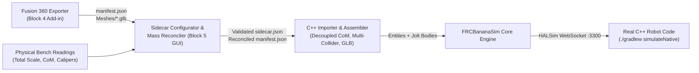

# FRC Simulation — Block 5 Implementation Plan (Revision 2)
**Sidecar Configurator GUI, C++ Importer & Mass Reconciliation Pipeline**  
**Dates:** November 8 – November 15, 2026 (8 Days)  
**Target:** `FRCBananaSim` Schema v1.0.0 Ingestion Suite & Physics Importer

---

## 1. Executive Summary

Block 5 bridges the gap between raw CAD exports (Block 4) and full-robot multi-body physics simulation (Block 3). 

While the Fusion 360 exporter generates physical CAD hierarchy (`manifest.json`) and 3D visual geometry (`Meshes/*.glb`), real FRC and FTC robots require electromechanical metadata that CAD cannot store: motor models, gear ratios, CAN IDs, CAN buses, current limits, differential transmissions (rotational bevels and linear rack-and-pinions), elevator cascade rigging, and sensor calibrations.

Block 5 combines **two core deliverables into a unified 8-day ingestion suite**:
1. **The C++ Physics Importer & Mass Reconciliation Engine:** Spawns multi-collider Jolt bodies decoupled from geometric collision origins, binds visual GLB meshes, looks up interfacial contact materials in `materials.json`, and applies scale/ballast calibrations.
2. **`SidecarConfigurator` C++ GUI:** A native Dear ImGui / OpenGL 3.3 desktop tool that loads the exported CAD folder, displays an interactive 3D preview and kinematic tree, allows users to configure swerve, mechanisms, differentials, and sensors via dropdowns populated directly from CAD joint names, validates CAN/PWM topologies in real time, and writes validated `sidecar.json` and reconciled `manifest.json` files.



### Core Metrics & Gate 5 Acceptance Criteria

| Attribute | Specification |
|---|---|
| **Timeline** | November 8 – November 15, 2026 (8 days) |
| **Prerequisites** | Block 3 Schema v1 runtime operational; Block 4 Fusion Exporter producing valid `manifest.json`. |
| **Tech Stack** | C++20, GLFW, GLAD, OpenGL 3.3 Core, Dear ImGui, `nlohmann::json`, GLM, Jolt Physics. |
| **Primary Deliverables** | 1. `RobotSidecarSerializer` & `RobotManifestSerializer` (complete C++ JSON round-trip serialization).<br>2. C++ Importer upgrades (multi-collider Jolt spawning, true link CoM decoupling, `materials.json` lookup).<br>3. `SidecarConfigurator` standalone executable & Visual Studio project.<br>4. Dual-pane GUI: 3D CAD Preview Viewport + Electromechanical Inspector.<br>5. Swerve, 1-DOF Mechanism, 2-DOF Differential (Rotational & Linear Rack-and-Pinion), Coupling, and Sensor configuration modules.<br>6. Mass Reconciliation tool with automated ballast / scaling distribution.<br>7. Live Schema Linter (flags duplicate CAN IDs, orphan joints, differential compatibility warnings).<br>8. End-to-end integration test (`RoundTripPipelineTest`). |
| **Gate 5 (Done when)** | A CAD export from the Fusion 360 test assembly can be loaded into `SidecarConfigurator`, configured with swerve, elevator, arm, differential wrist/gantry, four-bar, and sensors, reconciled against bench weights, saved to disk, and executed in `FRCBananaSim` via unmodified C++ robot code in **under 15 minutes** without opening a text editor. |

---

## 2. Architecture & Data Flow

```
┌────────────────────────────────────────────────────────────────────────────┐
│                       Block 5 Unified Ingestion Suite                      │
└─────────────────────────────────────┬──────────────────────────────────────┘
                                      │
         ┌────────────────────────────┴────────────────────────────┐
         ▼                                                         ▼
┌─────────────────────────────────┐       ┌──────────────────────────────────┐
│    1. Document & Serializer     │       │     2. Importer & Physics Core   │
│  - RobotSchemaLoader (Ingest)   │       │  - RobotAssembler / Spawner      │
│  - RobotSidecarSerializer (Emit)│◄─────►│  - Multi-Collider Jolt Bodies    │
│  - RobotManifestSerializer(Emit)│       │  - Decoupled CoM / Body Offsets  │
│  - SchemaLinter (Diagnostics)   │       │  - MaterialLibrary Interfacial   │
└────────────────┬────────────────┘       └────────────────┬─────────────────┘
                 │                                         │
                 ├─────────────────────────────────────────┘
                 ▼
┌────────────────────────────────────────────────────────────────────────────┐
│                       3. SidecarConfigurator GUI Tool                      │
│  ┌─────────────────────────────┐       ┌────────────────────────────────┐  │
│  │ CAD Hierarchy Tree View     │       │ Electromechanical Inspectors   │  │
│  │ • Links & Rigid Groups      │       │ • Swerve Drivetrain Panel      │  │
│  │ • Joints (Hinge, Slider)    │       │ • 1-DOF Mechanisms (Arm/Elev)  │  │
│  │ • Contact Zones (Intake/Sho)│       │ • 2-DOF Differentials (Rev/Pris│  │
│  └──────────────┬──────────────┘       │ • Couplings & Four-Bar Loops   │  │
│                 │                      │ • Sensors & CAN/PWM Keymap     │  │
│                 ▼                      │ • Mass Reconciliation Tool     │  │
│  ┌─────────────────────────────┐       └────────────────────────────────┘  │
│  │ 3D CAD Preview Viewport     │       ┌────────────────────────────────┐  │
│  │ • Zero-Pose Mesh & Wireframe│       │ Live Schema Linter Bottom Dock │  │
│  │ • Joint Pivot / Travel Arcs │       │ • CAN/PWM Collision Detection  │  │
│  │ • Gold Selected Highlight   │       │ • Differential Compatibility   │  │
│  └─────────────────────────────┘       └────────────────────────────────┘  │
└────────────────────────────────────────────────────────────────────────────┘
```

---

## 3. UI Layout & Workspace Design

The `SidecarConfigurator` application utilizes an intuitive dockable layout:

```
┌──────────────────────────────────────────────────────────────────────────────────────────────┐
│ [File: Open CAD Folder | Save Sidecar | Reconcile & Save Manifest | Launch Test Sim]         │
├──────────────────────┬────────────────────────────────────────┬──────────────────────────────┤
│ CAD Hierarchy        │ 3D CAD Preview Viewport                │ Subsystem Inspector          │
│                      │                                        │                              │
│ ▼ base_link (Root)   │        [ 3D Render of CAD Links ]      │ [Mechanism: Arm Shoulder]    │
│   ├─ COL_bumper_box  │                                        │ Role: Arm                    │
│   ├─ swerve_fl       │          (Selected Joint              │ Target Joint: arm_shoulder   │
│   └─ swerve_fr       │            Highlighted in Gold)        │ Actuator: DC Motor           │
│ ▼ arm_link           │                                        │ Preset: KrakenX60            │
│   └─ arm_shoulder    │        Axis: +Y (Green Arrow)          │ Gear Ratio: 65.0             │
│ ▼ wrist_link         │                                        │ Efficiency: 0.95             │
│   └─ wrist_pitch     │                                        │ Stator Limit: 60.0 A         │
│                      │                                        │ Controllers:                 │
│                      │                                        │  [0] TalonFX, CAN 12, Rio    │
├──────────────────────┴────────────────────────────────────────┴──────────────────────────────┤
│ Diagnostics & Schema Linter: [OK] Schema v1.0.0 Valid | 0 Errors | 1 Warning (Check Limits)   │
└──────────────────────────────────────────────────────────────────────────────────────────────┘
```

### 3.1 Panels Breakdown
1. **CAD Hierarchy Tree (Left Pane):** Shows all links, collision proxies, joints (with physical limits), and sensor zones discovered in `manifest.json`. Clicking any joint or link automatically focuses and highlights it in the 3D viewport.
2. **3D Preview Viewport (Center Pane):** Renders the robot at zero pose using existing `Renderer` mesh/wireframe shaders. Orbit with RMB, pan with MMB, zoom with Scroll. Selected joints display coordinate frames and travel limit arcs/extents.
3. **Subsystem Inspector (Right Pane):** Tabbed or accordion form interface for editing electromechanical properties. All joint selectors are dropdowns populated strictly from the loaded manifest.
4. **Diagnostics & Schema Linter (Bottom Dock):** Live compilation of configuration warnings and errors. Prevents saving invalid configurations.

---

## 4. Detailed Functional Modules

### 4.1 Swerve Drivetrain Panel
* **Chassis Link Picker:** Dropdown of all links in `manifest.json` (defaults to root link / `base_link`).
* **Actuation Topology:** Toggle between `"motor"` (CAN Motor) and `"servo"` (PWM Servo).
* **Presets:** Dropdowns for Drive and Steer motors (`KrakenX60`, `Falcon500`, `NEO`, `NEO_Vortex`, `Minion`, `KrakenX44`, `GoBildaSpeed`, `GoBildaTorque`).
* **Gear Ratios & Wheel Specs:** Inputs for Drive/Steer reductions, mechanical efficiency, stator/supply current limits, and wheel radius (with Caliper wear calculator).
* **Module Matrix:** Table for 4 modules (`FrontLeft`, `FrontRight`, `BackLeft`, `BackRight`):
  * Coordinates $(X, Y)$ auto-extracted from CAD module component instances or manually editable.
  * CAN ID assignments: Drive CAN, Steer CAN, CANcoder CAN, CAN Bus (`rio` vs `canivore`).
  * PWM channel assignments for FTC/hybrid servo swerve.

### 4.2 Mechanisms & Actuators Panel
Supports adding, removing, and configuring an arbitrary number of robot mechanisms:
* **Role Selection:** `elevator`, `arm`, `wrist`, `flywheel`, `intake`, `differential`.
* **Joint Dropdown:** Dynamically lists all joints from `manifest.json` matching the mechanism degree of freedom (`prismatic` for elevators, `revolute` for arms/wrists).
* **Actuation Type:**
  * **DC Motor:** Select vendor preset, gear ratio, efficiency, stator/supply limits, friction ($\tau_{\text{coulomb}}, b_{\text{viscous}}$).
  * **PWM Servo:** Select servo preset, control mode (`positional` vs `continuous`), PWM channel (`0..15`), travel range, and 6V rail parameters.
* **Role-Specific Parameters:**
  * **Elevator:** Spool drum radius ($r_{\text{drum}}$), spring assist constant force ($F_{\text{spring}}$).
  * **Flywheel:** Flywheel rotor inertia ($J_{\text{flywheel}}$), spin axis vector, visual mesh link selector.
  * **2-DOF Differential Mechanisms (Rotational & Linear):**
    * Mode: `symmetric_bevel` or `custom_matrix`.
    * Target Joints: 2 dropdowns (`Joint 1`, `Joint 2`).
    * Kinematic Compatibility: Supports **Revolute Wrists** (Pitch & Roll) as well as **Linear Rack-and-Pinion / CoreXY Gantries** (Prismatic $X$ & $Y$, or differential carriage lift & tilt).
    * Differential Gear Ratios: $[G_1, G_2]$ (or rack pitch radius / lead for linear conversions).
    * Controllers: Dual controller slots (`Motor A`, `Motor B`).
* **Hardware Controller List:** Dynamic table to add leader and follower controllers (TalonFX, SparkMax) with CAN ID, CAN bus, and inversion flags.

### 4.3 Couplings & Kinematic Linkages Panel
* **Power Couplings:** Connect two independent joints (e.g. left and right intake pivots). Select Master Joint, Slave Joint, transmission type (`gear`, `belt`, `chain`), velocity ratio, inversion, and backlash.
* **Cascade Elevator Stages:** Configure multi-stage cascading lifts ($x_k = k \cdot x_1$) with stage joint pickers and ratio multipliers.
* **Four-Bar Linkage Closures:** Bind crank, coupler, and follower joints; calculate or override loop-closure anchor coordinates on parent and child links.

### 4.4 Sensor Suite & SimDevice Keymapping
* **Transducer Registry:** Add sensors with type selection:
  * `imu_pigeon2`, `imu_navx`, `cancoder`, `limit_switch`, `beam_break`, `analog_input`.
* **Hardware Channel Mapping:** CAN IDs, DIO channels (`0..31`), Analog channels (`0..7`).
* **Kinematic Binding:** Bind encoders and limit switches to specific CAD joints or contact zones (`ZONE_*`).
* **Limit Switch Configuration:** Normally open vs normally closed, forward vs reverse limit direction, debounce time, and direct motor controller binding.

### 4.5 Mass Reconciliation & Ballast Calibration Tool
CAD models often underestimate total robot weight due to unmodeled wiring, pneumatics, fasteners, or grease:
1. **Scale Delta Calculation:** User inputs the true physical bench scale reading (e.g. $118.5\text{ lbs}$ / $53.75\text{ kg}$) and measured Center of Mass.
2. **Reconciliation Modes:**
   * **Proportional Link Mass Scaling:** Scales all structural link masses uniformly to match bench weight while preserving relative mass distribution.
   * **Unmodeled Ballast Injection:** Automatically adds a virtual ballast collider/mass entity to `base_link` at an offset $(X, Y, Z)$ calculated to shift the CAD Center of Mass to the exact measured workbench CoM.
3. **One-Click Export:** Writes the reconciled values directly into `manifest.json`.

---

## 5. Live Schema Validation & Diagnostics (The Linter)

The configurator runs a continuous background validation pass on every UI interaction:

| Check | Severity | Condition | Fix / Guidance |
|---|---|---|---|
| **CAN ID Collision** | **Error** | Multiple controllers or sensors share the same `(canId, canBus)`. | Highlights conflicting rows in red. Auto-assigns next free CAN ID. |
| **PWM Channel Collision** | **Error** | Multiple servos share the same PWM channel on `rio`. | Auto-suggests next free channel `0..15`. |
| **Orphan Joint Reference** | **Error** | Sidecar references a joint name not present in `manifest.json`. | Displays fuzzy-match dropdown ("Did you mean `arm_shoulder_hinge`?"). |
| **Dual Motor Conflict** | **Error** | A joint is claimed by more than one active mechanism without a differential. | Warns user of physical conflict. |
| **Differential Joint Type** | **Warning** | Differential target joints have mismatched types (e.g. one `revolute` and one `prismatic`). | **Allows 2x Revolute (wrists) or 2x Prismatic (rack-and-pinion / CoreXY).** Warns only if types are mixed or unconstrained. |
| **Missing Joint Limits** | **Warning** | An arm or elevator joint has `hasLimits: false` in CAD. | Suggests setting software limits in sidecar. |
| **High Bus Current** | **Warning** | Aggregate stator limits exceed battery peak rating (> 400A). | Suggests tuning supply current limits. |

---

## 6. Day-by-Day Implementation Breakdown (Nov 8 – Nov 15)

### Day 1 (Nov 8): Schema Serialization & Application Core Skeleton
* **`RobotSidecarSerializer`:** Implement C++ serializer converting `RobotSidecar` structs into formatted `nlohmann::json`.
* **`RobotManifestSerializer`:** Implement serialization for reconciled `RobotManifest`.
* **Unit Tests:** `SchemaSerializationTest` verifying 100% round-trip fidelity (`Deserialize -> Serialize -> Deserialize == Identity`) against `Reference2026/sidecar.json`.
* **Application Shell:** Set up `SidecarConfigurator` standalone project (GLFW window, GLAD, ImGui docking, file open dialog).

### Day 2 (Nov 9): C++ Importer Enhancements & Physics Reconciliation Core
* **Multi-Collider Jolt Spawning (Block 4 Q1 Handoff):** Extend `RobotAssembler` to create compound Jolt shapes supporting all colliders in `link.colliders[]` (box, cylinder, sphere, capsule, convex hull).
* **Decoupled Link CoM (Block 4 Q2 Handoff):** Decouple Jolt rigid body center of mass from `collider[0].origin`. Correctly position Jolt body CoM at `link.centerOfMass_m` with local shape offsets.
* **Material Interfacial Assignment:** Link collider materials to `MaterialLibrary` to load calibrated surface friction and restitution from `materials.json`.

### Day 3 (Nov 10): CAD Ingestion, Hierarchy Tree View & 3D Viewport
* **CAD Ingestion Pipeline:** Integrate `RobotSchemaLoader` to open exported folders (`manifest.json`, `materials.json`, and `Meshes/*.glb`).
* **CAD Hierarchy Panel:** Tree view of links, colliders, joints, limits, and mass properties.
* **3D CAD Preview Viewport:** Embed existing OpenGL 3.3 camera and renderer into an ImGui framebuffer texture. Render link colliders and zero-pose GLB meshes. Draw joint axes and travel arcs with gold selection highlighting.

### Day 4 (Nov 11): Swerve Drivetrain Panel & Mass Reconciliation Tool
* **Swerve Drivetrain Editor:** Complete UI for chassis links, module locations, motor/servo presets, gear ratios, CAN/PWM mappings, and current limits.
* **Mass Reconciliation Tool:** Bench weight vs CAD weight comparator, proportional scaling calculator, and unmodeled ballast generator. Write reconciled values back to `manifest.json`.

### Day 5 (Nov 12): 1-DOF Mechanisms & Actuation Form Editors
* **Mechanism Editor:** Add/remove mechanism cards (Arm, Elevator, Flywheel, Intake) with dynamic CAD joint dropdowns.
* **Actuation Topologies:** Select DC Motor vs PWM Servo with full preset dictionaries (`KrakenX60`, `Falcon500`, `NEO`, `GoBildaSpeed`, `GoBildaTorque`).
* **Gearbox & Current Limits:** Configurable reductions, efficiencies, and stator/supply current limits.

### Day 6 (Nov 13): 2-DOF Differentials (Rotational & Prismatic), Couplings & Linkages
* **2-DOF Differential Mechanisms:**
  * Support for **Rotational Wrists** (symmetric bevel gear clusters: Pitch & Roll).
  * Support for **Linear Rack-and-Pinion / CoreXY Gantries** (dual prismatic joints with pitch radius / lead conversion).
* **Couplings Editor:** Cascade elevator multipliers ($x_k = k \cdot x_1$), four-bar closures, and mechanical power couplings.

### Day 7 (Nov 14): Sensor Suite & Live Schema Linter
* **Sensor Suite Panel:** Transducer configuration (Pigeon 2, navX, CANcoders, DIO beam breaks, analog inputs) with CAD link/joint bindings.
* **Live Linter Engine:** Implement collision, reference validation, and differential joint compatibility warning rules with bottom dock diagnostic output.

### Day 8 (Nov 15): End-to-End Pipeline Round Trip & Gate 5 Sign-Off
* **Integration Round Trip:**
  1. Export raw `manifest.json` and meshes from the Block 4 Fusion 360 test assembly.
  2. Open in `SidecarConfigurator`.
  3. Author complete sidecar configuration using UI dropdowns (Swerve, Elevator, Arm, Differential Wrist/Gantry, Sensors).
  4. Perform mass reconciliation against mock bench weight.
  5. Save `sidecar.json` and updated `manifest.json`.
  6. Launch `FRCBananaSim` and verify robot spawns and drives via `RobotAssembler::AssembleFromFiles`.
* **C++ Automated Test:** `RoundTripPipelineTest` asserting that the saved configuration loads without warnings and steps for 60 simulated seconds under real C++ robot code over HALSim WebSockets.
* **Gate 5 Formal Review.**

---

## 7. Deliverables & Gate 5 Acceptance Verification

### Expected Artifacts
1. `FRCBananaSim/Source/Robot/Schema/RobotSidecarSerializer.h` & `.cpp`
2. `FRCBananaSim/Source/Robot/Schema/RobotManifestSerializer.h` & `.cpp`
3. `FRCBananaSim/Source/Robot/RobotAssembler.cpp` (Multi-collider compound Jolt bodies & decoupled CoM)
4. `FRCBananaSim/Source/Tools/Configurator/SidecarConfiguratorApplication.cpp`
5. `FRCBananaSim/Source/Tools/Configurator/Panels/*.cpp` (SwervePanel, MechanismPanel, DifferentialPanel, SensorPanel, ViewportPanel, LinterPanel)
6. `FRCBananaSim/SidecarConfigurator.vcxproj`
7. `Tests/RoundTripPipelineTest.cpp`

### Gate 5 Checklist
- [ ] `RobotSidecarSerializer` achieves 100% round-trip fidelity on `Reference2026/sidecar.json`.
- [ ] `RobotAssembler` correctly decouples rigid body CoM from collider local offsets and spawns compound colliders.
- [ ] `SidecarConfigurator` launches on Windows x64 with zero DLL or path issues.
- [ ] Opening any valid `manifest.json` populates the CAD hierarchy and all joint dropdowns.
- [ ] Differentials accept both 2x Revolute (wrists) and 2x Prismatic (rack-and-pinions / CoreXY).
- [ ] Duplicate CAN ID detection flags conflicts in real time.
- [ ] 3D viewport renders links, highlights selected joints, and supports orbit/pan/zoom.
- [ ] Mass reconciliation accurately distributes ballast or applies scaling.
- [ ] Generated `sidecar.json` loads directly into `RobotAssembler` and runs under real C++ robot code.
