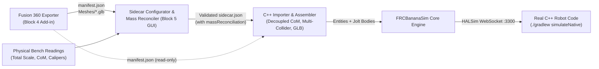

# FRC Simulation — Block 5 Implementation Plan (Revision 4)
**Sidecar Configurator GUI, C++ Importer & Mass Reconciliation Pipeline**  
**Dates:** November 8 – November 15, 2026 (8 Days)  
**Target:** `FRCBananaSim` Schema v1.0.0 Ingestion Suite & Physics Importer

---

## 1. Executive Summary

Block 5 bridges the gap between raw CAD exports (Block 4) and full-robot multi-body physics simulation (Block 3). 

While the Fusion 360 exporter generates physical CAD hierarchy (`manifest.json`) and 3D visual geometry (`Meshes/*.glb`), real FRC and FTC robots require electromechanical metadata that CAD cannot store: motor models, gear ratios, CAN IDs, CAN buses, current limits, differential wrist transmissions, elevator cascade rigging, and sensor calibrations.

Block 5 combines **two core deliverables into a unified 8-day ingestion suite**:
1. **The C++ Physics Importer & Mass Reconciliation Engine:** Spawns multi-collider Jolt bodies decoupled from geometric collision origins, binds visual GLB meshes, looks up interfacial contact materials in `materials.json`, eliminates hardcoded mechanism offsets (Q4), and applies scale/ballast calibrations stored in `sidecar.json`.
2. **`SidecarConfigurator` C++ GUI:** A native Dear ImGui / OpenGL 3.3 desktop tool that loads the exported CAD folder, displays an interactive 3D preview and kinematic tree, allows users to configure swerve, mechanisms, differentials, and sensors via dropdowns populated directly from CAD joint names, validates CAN/PWM topologies in real time, and writes validated `sidecar.json` configurations.



### Core Metrics & Gate 5 Acceptance Criteria

| Attribute | Specification |
|---|---|
| **Timeline** | November 8 – November 15, 2026 (8 days) |
| **Prerequisites** | Block 3 Schema v1 runtime operational; Block 4 Fusion Exporter producing valid `manifest.json`. (Fallback to `Reference2026` if CAD export is delayed). |
| **Tech Stack** | C++20, GLFW, GLAD, OpenGL 3.3 Core, Dear ImGui (standard fixed/child layout), `nlohmann::json`, GLM, Jolt Physics. |
| **Primary Deliverables** | 1. `RobotSidecarSerializer` (complete C++ JSON serialization for `RobotSidecar`).<br>2. C++ Importer upgrades (multi-collider Jolt spawning, true link CoM decoupling, `materials.json` lookup, **Q4 dynamic flywheel offset fix**, D1 robot-code direction preservation).<br>3. `SidecarConfigurator` standalone executable & Visual Studio project.<br>4. Dual-pane GUI: 3D CAD Preview Viewport + Electromechanical Inspector.<br>5. "Auto-Generate Starter Sidecar" bootstrap tool for 1-click robot setup.<br>6. Swerve, 1-DOF Mechanism, 2-DOF Differential Wrist, Coupling, and Sensor configuration modules.<br>7. Mass Reconciliation tool with automated ballast / scaling written into `sidecar.json`.<br>8. Live Schema Linter (flags duplicate CAN IDs, orphan joints, differential wrist joint type errors).<br>9. End-to-end integration test (`RoundTripPipelineTest`). |
| **Gate 5 (Done when)** | A CAD export from the Fusion 360 test assembly can be loaded into `SidecarConfigurator`, configured with swerve, elevator, arm, differential wrist, four-bar, and sensors, reconciled against bench weights, saved to disk, and executed in `FRCBananaSim` via unmodified C++ robot code in **under 15 minutes** without opening a text editor. |

---

## 2. Architecture & Data Flow

```
┌────────────────────────────────────────────────────────────────────────────┐
│                       Block 5 Unified Ingestion Suite                      │
└─────────────────────────────────────┬──────────────────────────────────────┘
                                      │
         ┌────────────────────────────┴────────────────────────────┐
         ▼                                                         ▼
┌─────────────────────────────────┐       ┌──────────────────────────────────┐
│    1. Document & Serializer     │       │     2. Importer & Physics Core   │
│  - RobotSchemaLoader (Ingest)   │       │  - RobotAssembler / Spawner      │
│  - RobotSidecarSerializer (Emit)│◄─────►│  - Multi-Collider Compound Jolt  │
│  - MassReconciler (Sidecar Ball)│       │  - Decoupled CoM / Body Offsets  │
│  - SchemaLinter (Diagnostics)   │       │  - Dynamic Mount Offsets (Q4)    │
│                                 │       │  - MaterialLibrary Interfacial   │
└────────────────┬────────────────┘       └────────────────┬─────────────────┘
                 │                                         │
                 ├─────────────────────────────────────────┘
                 ▼
┌────────────────────────────────────────────────────────────────────────────┐
│                       3. SidecarConfigurator GUI Tool                      │
│  ┌─────────────────────────────┐       ┌────────────────────────────────┐  │
│  │ CAD Hierarchy Tree View     │       │ Electromechanical Inspectors   │  │
│  │ • Links & Rigid Groups      │       │ • Swerve Drivetrain Panel      │  │
│  │ • Joints (Hinge, Slider)    │       │ • 1-DOF Mechanisms (Arm/Elev)  │  │
│  │ • Contact Zones (Intake/Sho)│       │ • 2-DOF Differential Wrists    │  │
│  │ • [Auto-Generate Starter]   │       │ • Couplings & Four-Bar Loops   │  │
│  └──────────────┬──────────────┘       │ • Sensors & CAN/PWM Keymap     │  │
│                 │                      │ • Mass Reconciliation Panel    │  │
│                 ▼                      └────────────────────────────────┘  │
│  ┌─────────────────────────────┐       ┌────────────────────────────────┐  │
│  │ 3D CAD Preview Viewport     │       │ Live Schema Linter Bottom Dock │  │
│  │ • Zero-Pose Mesh & Wireframe│       │ • CAN/PWM Collision Detection  │  │
│  │ • Joint Pivot / Travel Arcs │       │ • Orphan Joint Check (Errors)  │  │
│  │ • Gold Selected Highlight   │       │ • Differential Wrist Rev Check │  │
│  └─────────────────────────────┘       └────────────────────────────────┘  │
└────────────────────────────────────────────────────────────────────────────┘
```

---

## 3. UI Layout & Workspace Design

Because standard repository ImGui (`External/imgui`) does not include the experimental docking branch, `SidecarConfigurator` uses a clean, robust fixed multi-panel layout with child windows (`ImGui::BeginChild`), ensuring 100% build compatibility on any vanilla ImGui version:

```
┌──────────────────────────────────────────────────────────────────────────────────────────────┐
│ [Toolbar: Open CAD Folder | Auto-Generate Starter | Save Sidecar | Launch Test Simulation]   │
├──────────────────────┬────────────────────────────────────────┬──────────────────────────────┤
│ CAD Hierarchy        │ 3D CAD Preview Viewport                │ Subsystem Inspector          │
│                      │                                        │                              │
│ [Auto-Generate]      │        [ 3D Render of CAD Links ]      │ [Mechanism: Arm Shoulder]    │
│ ▼ base_link (Root)   │                                        │ Role: Arm                    │
│   ├─ COL_bumper_box  │          (Selected Joint              │ Target Joint: arm_shoulder   │
│   ├─ swerve_fl       │            Highlighted in Gold)        │ Actuator: DC Motor           │
│   └─ swerve_fr       │                                        │ Preset: KrakenX60            │
│ ▼ arm_link           │        Axis: +Y (Green Arrow)          │ Gear Ratio: 65.0             │
│   └─ arm_shoulder    │        Limits: [-10°, +95°]            │ Efficiency: 0.95             │
│ ▼ wrist_link         │                                        │ Stator Limit: 60.0 A         │
│   └─ wrist_pitch     │                                        │ Controllers:                 │
│                      │                                        │  [0] TalonFX, CAN 12, Rio    │
├──────────────────────┴────────────────────────────────────────┴──────────────────────────────┤
│ Diagnostics & Schema Linter: [OK] Schema v1.0.0 Valid | 0 Errors | 0 Warnings                 │
└──────────────────────────────────────────────────────────────────────────────────────────────┘
```

### 3.1 Bootstrap Feature: "Auto-Generate Starter Sidecar"
To hit the 15-minute complete robot configuration gate without repetitive form filling:
* The user clicks **Auto-Generate Starter Sidecar**.
* The tool inspects `manifest.json`:
  * Detects components named `fl`, `fr`, `bl`, `br` (or similar) and seeds a complete 4-module Swerve configuration with default Kraken X60 / Kraken X44 presets and CAN IDs `0..7` / `20..23`.
  * For every remaining `revolute` joint, seeds an `arm` mechanism card with a Kraken X60 preset.
  * For every remaining `prismatic` joint, seeds an `elevator` mechanism card.
  * Detects Pigeon / IMU and seeds a default CAN 24 sensor.
* The user only needs to adjust gear ratios, current limits, and specific CAN IDs.

---

## 4. Detailed Functional Modules

### 4.1 Swerve Drivetrain Panel
* **Chassis Link Picker:** Dropdown of all links in `manifest.json` (defaults to root link / `base_link`).
* **Actuation Topology:** Toggle between `"motor"` (CAN Motor) and `"servo"` (PWM Servo).
* **Presets:** Dropdowns for Drive and Steer motors (`KrakenX60`, `Falcon500`, `NEO`, `NEO_Vortex`, `Minion`, `KrakenX44`, `GoBildaSpeed`, `GoBildaTorque`).
* **Gear Ratios & Wheel Specs:** Inputs for Drive/Steer reductions, mechanical efficiency, stator/supply current limits, and wheel radius (with Caliper wear calculator).
* **Module Matrix:** Table for 4 modules (`FrontLeft`, `FrontRight`, `BackLeft`, `BackRight`):
  * Coordinates $(X, Y)$ auto-extracted from CAD module component instances or manually editable.
  * CAN ID assignments: Drive CAN, Steer CAN, CANcoder CAN, CAN Bus (`rio` vs `canivore`).
  * PWM channel assignments for FTC/hybrid servo swerve.

### 4.2 Mechanisms & Actuators Panel
Supports adding, removing, and configuring an arbitrary number of robot mechanisms:
* **Role Selection:** `elevator`, `arm`, `wrist`, `flywheel`, `intake`, `differential`.
* **Joint Dropdown:** Dynamically lists all joints from `manifest.json` matching the mechanism degree of freedom (`prismatic` for elevators, `revolute` for arms/wrists).
* **Direction Convention (D1 Alignment):** Retains the engine's revolute axis convention (`axisEngine.x = -axisNWU.y`) specifically preserving alignment with how the team's C++ robot code commands motor directions.
* **Actuation Type:**
  * **DC Motor:** Select vendor preset, gear ratio, efficiency, stator/supply limits, friction ($\tau_{\text{coulomb}}, b_{\text{viscous}}$).
  * **PWM Servo:** Select servo preset, control mode (`positional` vs `continuous`), PWM channel (`0..15`), travel range, and 6V rail parameters.
* **Role-Specific Parameters:**
  * **Elevator:** Spool drum radius ($r_{\text{drum}}$), spring assist constant force ($F_{\text{spring}}$).
  * **Flywheel (Fixing Q4):**
    > [!IMPORTANT]
    > **Fixing Q4:** In Block 3, `RobotAssembler.cpp` hardcoded the flywheel visual mesh position to `glm::vec3(0.0f, 0.06f, 0.06f)`. In Block 5, this is completely replaced by reading the true CAD joint/link origin and an optional user-defined `mountOffsetM` from `sidecar.json`.
    Flywheel rotor inertia ($J_{\text{flywheel}}$), spin axis vector, and visual mesh link selector.
  * **2-DOF Differential Wrist:**
    * Mode: `symmetric_bevel` or `custom_matrix`.
    * Target Joints: Exactly 2 dropdowns (`Pitch Joint`, `Roll Joint`) strictly populated with `revolute` joints.
    * Differential Gear Ratios: $[G_{\text{pitch}}, G_{\text{roll}}]$.
    * Controllers: Dual controller slots (`Motor A`, `Motor B`).
* **Hardware Controller List:** Dynamic table to add leader and follower controllers (TalonFX, SparkMax) with CAN ID, CAN bus, and inversion flags.

### 4.3 Couplings & Kinematic Linkages Panel
* **Power Couplings:** Connect two independent joints (e.g. left and right intake pivots). Select Master Joint, Slave Joint, transmission type (`gear`, `belt`, `chain`), velocity ratio, inversion, and backlash.
* **Cascade Elevator Stages:** Configure multi-stage cascading lifts ($x_k = k \cdot x_1$) with stage joint pickers and ratio multipliers.
* **Four-Bar Linkage Closures:** Bind crank, coupler, and follower joints; calculate or override loop-closure anchor coordinates on parent and child links.

### 4.4 Sensor Suite & SimDevice Keymapping
* **Transducer Registry:** Add sensors with type selection:
  * `imu_pigeon2`, `imu_navx`, `cancoder`, `limit_switch`, `beam_break`, `analog_input`.
* **Hardware Channel Mapping:** CAN IDs, DIO channels (`0..31`), Analog channels (`0..7`).
* **Kinematic Binding:** Bind encoders and limit switches to specific CAD joints or contact zones (`ZONE_*`).
* **Limit Switch Configuration:** Normally open vs normally closed, forward vs reverse limit direction, debounce time, and direct motor controller binding.

### 4.5 Mass Reconciliation & Ballast Tool (Preserves CAD Manifest Integrity)
To ensure that re-exporting CAD from Fusion 360 never wipes calibrated physical measurements:
1. **Manifest Immutability:** `manifest.json` is treated as a clean CAD export output and is **not overwritten**.
2. **Reconciliation Storage in `sidecar.json`:**
   Calibrated values are saved directly under the `"massReconciliation"` object in `sidecar.json`:
   ```json
   "massReconciliation": {
     "linkMassMultiplier": 1.042,
     "unmodeledBallast": {
       "targetLink": "base_link",
       "mass_kg": 4.25,
       "offset_m": [ 0.02, 0.0, -0.05 ]
     }
   }
   ```
3. **No Phantom Collisions:** Unmodeled ballast is injected purely as an inertial point-mass offset into the rigid body dynamics of `base_link` during assembly. **No physics collider is spawned for ballast**, completely preventing spurious collision snagging.

---

## 5. Live Schema Validation & Diagnostics (The Linter)

The configurator runs a continuous background validation pass on every UI interaction:

| Check | Severity | Condition | Fix / Guidance |
|---|---|---|---|
| **CAN ID Collision** | **Error** | Multiple controllers or sensors share the same `(canId, canBus)`. | Highlights conflicting rows in red. Auto-assigns next free CAN ID. |
| **PWM Channel Collision** | **Error** | Multiple servos share the same PWM channel on `rio`. | Auto-suggests next free channel `0..15`. |
| **Orphan Joint Reference** | **Error** | Sidecar references a joint name not present in `manifest.json`. | Displays fuzzy-match dropdown ("Did you mean `arm_shoulder_hinge`?"). |
| **Dual Motor Conflict** | **Error** | A joint is claimed by more than one active mechanism without a differential. | Warns user of physical conflict. |
| **Differential Joint Type** | **Error** | Differential wrist target joints are not both `revolute`. | **Requires two revolute joints.** |
| **Missing Joint Limits** | **Warning** | An arm or elevator joint has `hasLimits: false` in CAD. | Suggests setting software limits in sidecar. |
| **High Bus Current** | **Warning** | Aggregate stator limits exceed battery peak rating (> 400A). | Suggests tuning supply current limits. |

---

## 6. Day-by-Day Implementation Breakdown (Nov 8 – Nov 15)

### Day 1 (Nov 8): Schema Serialization & Application Core Skeleton
* **`RobotSidecarSerializer`:** Implement C++ serializer converting `RobotSidecar` structs into formatted `nlohmann::json`.
* **JSON Round-Trip Unit Tests:** `SchemaSerializationTest` verifying 100% round-trip fidelity against `Reference2026/sidecar.json` by comparing serialized JSON outputs (`jsonA == jsonB`).
* **Application Shell:** Set up `SidecarConfigurator` standalone executable project (`SidecarConfigurator.vcxproj`) with GLFW window, GLAD, and fixed-panel Dear ImGui child layouts.

### Day 2 (Nov 9): Importer Core Upgrades & Block 4 Handoffs
* **Multi-Collider Jolt Spawning (Block 4 Q1):** Extend `RobotAssembler` to create compound Jolt shapes supporting all colliders in `link.colliders[]` (box, cylinder, sphere, capsule, convex hull).
* **Decoupled Link CoM (Block 4 Q2):** Decouple Jolt rigid body center of mass from `collider[0].origin`. Correctly position Jolt body CoM at `link.centerOfMass_m` with local shape offsets.
* **Direction Convention Preservation (D1):** Preserve the engine's revolute axis sign convention (`axisEngine.x = -axisNWU.y`) to strictly honor how the team's C++ robot code commands motor directions.
* **Dynamic Flywheel Mount Offset (Fixing Q4):** Eliminate hardcoded `glm::vec3(0.0f, 0.06f, 0.06f)` in `RobotAssembler.cpp` lines 141 and 530. Read true CAD joint origin / sidecar `mountOffsetM`.
* **Link-Local Coordinate Verification (Block 4 Q6):** Ensure `RobotSchemaLoader` and `RobotAssembler` consistently consume link-local relative origins for all moving joints and CoMs.
* **Material Interfacial Assignment:** Link collider materials to `MaterialLibrary` to load calibrated surface friction and restitution from `materials.json`.

### Day 3 (Nov 10): CAD Ingestion, Hierarchy Tree View & 3D Viewport
* **CAD Ingestion Pipeline:** Integrate `RobotSchemaLoader` to open exported folders (`manifest.json`, `materials.json`, and `Meshes/*.glb`).
* **"Auto-Generate Starter Sidecar":** Implement one-click bootstrap detecting `fl/fr/bl/br` modules and revolute/prismatic joints to pre-seed the configuration.
* **CAD Hierarchy Panel:** Tree view of links, colliders, joints, limits, and mass properties.
* **3D CAD Preview Viewport:** Embed OpenGL 3.3 camera and renderer into an ImGui framebuffer texture. Render link colliders and zero-pose GLB meshes. Draw joint axes and travel arcs with gold selection highlighting.

### Day 4 (Nov 11): Swerve Drivetrain Panel & Mass Reconciliation Tool
* **Swerve Drivetrain Editor:** Complete UI for chassis links, module locations, motor/servo presets, gear ratios, CAN/PWM mappings, and current limits.
* **Mass Reconciliation Tool:** Bench weight vs CAD weight comparator, proportional scaling calculator, and unmodeled ballast generator saving into `sidecar.json`.

### Day 5 (Nov 12): 1-DOF Mechanisms & Actuation Form Editors
* **Mechanism Editor:** Add/remove mechanism cards (Arm, Elevator, Flywheel, Intake) with dynamic CAD joint dropdowns.
* **Actuation Topologies:** Select DC Motor vs PWM Servo with full preset dictionaries (`KrakenX60`, `Falcon500`, `NEO`, `GoBildaSpeed`, `GoBildaTorque`).
* **Gearbox & Current Limits:** Configurable reductions, efficiencies, and stator/supply current limits.

### Day 6 (Nov 13): 2-DOF Differential Wrists, Couplings & Linkages
* **2-DOF Differential Wrists:** Form editor for `symmetric_bevel` and `custom_matrix` wrists with dual-controller bindings and strictly revolute joint pickers.
* **Couplings Editor:** Cascade elevator multipliers ($x_k = k \cdot x_1$), four-bar closures, and mechanical power couplings.

### Day 7 (Nov 14): Sensor Suite & Live Schema Linter
* **Sensor Suite Panel:** Transducer configuration (Pigeon 2, navX, CANcoders, DIO beam breaks, analog inputs) with CAD link/joint bindings.
* **Live Linter Engine:** Implement collision, reference validation, and differential wrist joint type rules with bottom dock diagnostic output.

### Day 8 (Nov 15): End-to-End Pipeline Round Trip & Gate 5 Sign-Off
* **Integration Round Trip:**
  1. Open CAD export (or `Reference2026` fallback) in `SidecarConfigurator`.
  2. Author complete sidecar configuration using UI dropdowns (Swerve, Elevator, Arm, Differential Wrist, Sensors).
  3. Perform mass reconciliation against mock bench weight.
  4. Save `sidecar.json`.
  5. Launch `FRCBananaSim` and verify robot spawns and drives via `RobotAssembler::AssembleFromFiles`.
* **C++ Automated Test:** `RoundTripPipelineTest` asserting that the saved configuration loads without warnings and steps for 60 simulated seconds under real C++ robot code over HALSim WebSockets.
* **Gate 5 Formal Review.**

---

## 7. Deliverables & Gate 5 Acceptance Verification

### Expected Artifacts
1. `FRCBananaSim/Source/Robot/Schema/RobotSidecarSerializer.h` & `.cpp`
2. `FRCBananaSim/Source/Robot/RobotAssembler.cpp` (Multi-collider compound Jolt bodies, decoupled CoM, preserved D1 robot-code sign convention, Q4 dynamic flywheel offset, sidecar mass reconciliation)
3. `FRCBananaSim/Source/Tools/Configurator/SidecarConfiguratorApplication.cpp`
4. `FRCBananaSim/Source/Tools/Configurator/Panels/*.cpp` (SwervePanel, MechanismPanel, DifferentialPanel, SensorPanel, ViewportPanel, LinterPanel)
5. `FRCBananaSim/SidecarConfigurator.vcxproj`
6. `Tests/RoundTripPipelineTest.cpp`

### Gate 5 Checklist
- [ ] `RobotSidecarSerializer` achieves 100% round-trip fidelity on `Reference2026/sidecar.json`.
- [ ] `RobotAssembler` correctly decouples rigid body CoM from collider local offsets and spawns compound colliders.
- [ ] Hardcoded `(0.0f, 0.06f, 0.06f)` flywheel offset in `RobotAssembler.cpp` (Q4) is replaced with dynamic CAD joint/link offset.
- [ ] `SidecarConfigurator` launches on Windows x64 with zero DLL or path issues.
- [ ] Opening any valid `manifest.json` populates the CAD hierarchy and all joint dropdowns.
- [ ] "Auto-Generate Starter Sidecar" pre-populates swerve and mechanisms with one click.
- [ ] Differentials strictly enforce 2x Revolute joints.
- [ ] Duplicate CAN ID detection flags conflicts in real time.
- [ ] 3D viewport renders links, highlights selected joints, and supports orbit/pan/zoom.
- [ ] Mass reconciliation saves ballast and scaling to `sidecar.json` without modifying `manifest.json`.
- [ ] Generated `sidecar.json` loads directly into `RobotAssembler` and runs under real C++ robot code.
