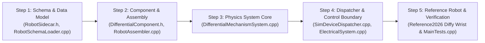

# Architectural Specification & Implementation Plan: Generic Differential Mechanisms in FRCBananaSim

> **Target Engine:** `FRCBananaSim` (C++20 / Jolt Physics 200 Hz / Analytic Swerve Core / Schema v1)  
> **Status:** Proposal & Engineering Blueprint (`/plan`)  
> **Prerequisites:** Block 2 (`DCMotorModel`, `ElectricalSystem`, `SimControlBoundary`), Block 3 (`RobotSchemaLoader`, `RobotAssembler`, `MechanismSystem`, `SimDeviceDispatcher`), Schema v1.0.0 (`manifest.json`, `sidecar.json`)

---

## 1. Executive Summary

This plan specifies the architecture, mathematics, data schemas, and ECS implementation for **Generic Differential Mechanisms** in `FRCBananaSim`. 

In competitive FRC robotics, teams frequently employ differential transmissions—most notably **2-DOF Differential Wrists** (e.g., FRC 971, 1678, 254), **Differential Gimbals/Turrets**, **CoreXY / H-Bot Belt Gantries**, and **Base-Driven Coupled Arms**. By mounting both drive motors statically to a preceding link (e.g., the arm structure or carriage) and coupling their rotations through bevel gear clusters or belt loops, differential mechanisms achieve two critical performance advantages:
1. **Dramatic End-Effector Mass & Inertia Reduction**: Removing heavy motors from the moving wrist/gripper drastically reduces the distal moment of inertia, minimizing cycle times and settling oscillations.
2. **Torque Summation**: When moving in a coordinated direction (such as pure pitch or pure linear lift), both motors apply constructive torque to a single degree of freedom, effectively doubling actuator authority.

Unlike the drivetrain's 6-DOF analytic swerve solver, which models four ground-contact wheel modules, generic differential mechanisms articulate internal kinematic chains defined in `manifest.json`. This specification introduces a first-class, mathematically rigorous 2-DOF differential mechanism model that handles arbitrary kinematic coupling matrices, dual torque transformations, reflected rotor inertia tensors, coupled semi-implicit electrical back-EMF damping, and unmodified CTRE Phoenix 6 / REVLib `SimDevice` dispatch.

---

## 2. Core Architecture & System Data Flow

```mermaid
flowchart TD
    subgraph WPILibProcess["External Robot Code (./gradlew simulateNative)"]
        UserSubsystem["Subsystem (e.g. WristSubsystem)"]
        MotorA["TalonFX / SparkMax (Motor A, e.g. CAN 15)"]
        MotorB["TalonFX / SparkMax (Motor B, e.g. CAN 16)"]
        Sensors["CANcoder / Pigeon / Analog / Limits"]
        
        UserSubsystem --> MotorA
        UserSubsystem --> MotorB
        Sensors --> UserSubsystem
    end

    subgraph BridgeLayer["Bridge & Dispatch Layer"]
        WSServer["HALSimWebSocketServer (:3300)"]
        Dispatcher["SimDeviceDispatcher"]
        
        MotorA <==>|"halsim_ws"| WSServer
        MotorB <==>|"halsim_ws"| WSServer
        Sensors <== WSServer
        WSServer <--> Dispatcher
    end

    subgraph ControlBoundary["SimControlBoundary"]
        SimInputs["SimInputs<br>Slot A: MotorCommand (V_A, I_limit)<br>Slot B: MotorCommand (V_B, I_limit)"]
        SimOutputs["SimOutputs<br>Slot A: theta_mA, omega_mA, I_mA<br>Slot B: theta_mB, omega_mB, I_mB<br>Joint Slots: q_1, q_2, dq_1, dq_2"]
        Dispatcher --> SimInputs
        SimOutputs --> Dispatcher
    end

    subgraph SimulationPipeline["FRCBananaSim 200 Hz Core Pipeline"]
        Elec["1. ElectricalSystem<br>(Computes I_supply_A, I_supply_B & V_bus sag)"]
        DiffSys["2. DifferentialMechanismSystem<br>(Solves coupled 2x2 semi-implicit dynamics)"]
        Jolt["3. PhysicsSystem (Jolt Physics)<br>(Integrates Hinge 1 & Hinge 2 with Joint Limits)"]
        SensorsSys["4. SensorSystem<br>(Quantizes Encoders & CANcoders on Joint 1 & 2)"]
        
        SimInputs --> Elec
        Elec -->|"V_bus"| DiffSys
        DiffSys -->|"tau_q1, tau_q2 (Joint Torques)"| Jolt
        Jolt -->|"q1, q2, dq1, dq2"| DiffSys
        DiffSys --> SimOutputs
        Jolt --> SensorsSys
        SensorsSys --> SimOutputs
    end
```

### Architectural Principles:
1. **Zero Robot-Code Changes**: Robot code continues to declare two independent motor controllers (e.g., `TalonFX m_left(15)`, `TalonFX m_right(16)`) and reads individual rotor positions/velocities or external absolute encoders (`CANcoder`).
2. **Schema v1 Compatibility**: Physical joints and links remain strictly defined in `manifest.json`. The differential transmission coupling and electrical specifications are declared modularly in `sidecar.json`.
3. **Unconditional Numerical Stability**: A closed-form $2 \times 2$ semi-implicit matrix formulation guarantees stability under high gear ratios ($G \ge 40$) and stiff electrical braking without numerical chatter or explosive divergence at 200 Hz ($\Delta t = 5\text{ ms}$).

---

## 3. Mathematical & Physical Formulations

### 3.1 Kinematics: Generalized Coordinate Transformations

Let the physical degrees of freedom in the mechanism be represented by generalized joint coordinates:
$$\mathbf{q} = \begin{pmatrix} q_1 \\ q_2 \end{pmatrix}, \qquad \dot{\mathbf{q}} = \begin{pmatrix} \dot{q}_1 \\ \dot{q}_2 \end{pmatrix}$$
where $q_1, q_2$ represent joint angles in radians (revolute joints) or linear displacements in meters (prismatic joints).

Let the motor rotor coordinates and shaft velocities be:
$$\boldsymbol{\theta}_m = \begin{pmatrix} \theta_{m1} \\ \theta_{m2} \end{pmatrix}, \qquad \boldsymbol{\omega}_m = \begin{pmatrix} \omega_{m1} \\ \omega_{m2} \end{pmatrix}$$

The kinematic coupling between joint space and motor space is governed by the linear velocity transformation matrix $\mathbf{T}_{mq} \in \mathbb{R}^{2 \times 2}$ and its inverse $\mathbf{T}_{qm} \in \mathbb{R}^{2 \times 2}$:
$$\boldsymbol{\omega}_m = \mathbf{T}_{mq} \dot{\mathbf{q}}, \qquad \dot{\mathbf{q}} = \mathbf{T}_{qm} \boldsymbol{\omega}_m = \mathbf{T}_{mq}^{-1} \dot{\mathbf{q}}$$

$$\boldsymbol{\theta}_m = \mathbf{T}_{mq} \mathbf{q} + \boldsymbol{\theta}_{\text{offset}}, \qquad \mathbf{q} = \mathbf{T}_{qm} (\boldsymbol{\theta}_m - \boldsymbol{\theta}_{\text{offset}})$$

#### Common Topology Formulations

1. **Symmetric Bevel Differential Wrist (Pitch $\theta_p$ & Roll $\theta_r$)**:
   Both motors drive an epicyclic bevel gear differential. Moving both motors in the same direction pitches the wrist; moving them in opposite directions rolls the wrist:
   $$\mathbf{T}_{mq} = \begin{pmatrix} G_p & G_r \\ G_p & -G_r \end{pmatrix}, \qquad \mathbf{T}_{qm} = \begin{pmatrix} \frac{1}{2 G_p} & \frac{1}{2 G_p} \\ \frac{1}{2 G_r} & -\frac{1}{2 G_r} \end{pmatrix}$$
   where $G_p$ is the effective gear reduction from motor shaft to pitch axis, and $G_r$ is the reduction to roll axis.

2. **CoreXY / H-Bot Cartesian Gantry ($X$ and $Y$ Translation)**:
   Two stationary motors drive continuous timing belts controlling a 2D carriage:
   $$\mathbf{T}_{mq} = \frac{1}{r_{\text{pulley}}} \begin{pmatrix} G_x & G_y \\ G_x & -G_y \end{pmatrix}, \qquad \mathbf{T}_{qm} = r_{\text{pulley}} \begin{pmatrix} \frac{1}{2 G_x} & \frac{1}{2 G_x} \\ \frac{1}{2 G_y} & -\frac{1}{2 G_y} \end{pmatrix}$$

3. **Base-Driven Coupled 2-Joint Arm (Shoulder $\theta_1$ & Elbow $\theta_2$)**:
   Motor 1 drives Link 1 directly. Motor 2 is mounted on the base and drives Link 2 through a belt routed across the Link 1 pivot:
   $$\mathbf{T}_{mq} = \begin{pmatrix} G_1 & 0 \\ G_2 & G_2 \end{pmatrix}, \qquad \mathbf{T}_{qm} = \begin{pmatrix} \frac{1}{G_1} & 0 \\ -\frac{1}{G_1} & \frac{1}{G_2} \end{pmatrix}$$

4. **Arbitrary $2 \times 2$ Custom Matrix**:
   $$\mathbf{T}_{mq} = \begin{pmatrix} A_{11} & A_{12} \\ A_{21} & A_{22} \end{pmatrix}$$

---

### 3.2 Dual Torque Formulation & Principle of Virtual Work

Assuming power conservation across the transmission without instantaneous loss:
$$P = \boldsymbol{\tau}_m^T \boldsymbol{\omega}_m = \boldsymbol{\tau}_q^T \dot{\mathbf{q}}$$

Substituting $\boldsymbol{\omega}_m = \mathbf{T}_{mq} \dot{\mathbf{q}}$:
$$\boldsymbol{\tau}_m^T (\mathbf{T}_{mq} \dot{\mathbf{q}}) = (\mathbf{T}_{mq}^T \boldsymbol{\tau}_m)^T \dot{\mathbf{q}} = \boldsymbol{\tau}_q^T \dot{\mathbf{q}}$$

Therefore, the dual transformation mapping motor torques to generalized joint torques is the exact **transpose** of $\mathbf{T}_{mq}$:
$$\boldsymbol{\tau}_q = \mathbf{T}_{mq}^T \boldsymbol{\tau}_m$$

$$\begin{pmatrix} \tau_{q1} \\ \tau_{q2} \end{pmatrix} = \begin{pmatrix} T_{11} & T_{21} \\ T_{12} & T_{22} \end{pmatrix} \begin{pmatrix} \tau_{m1} \\ \tau_{m2} \end{pmatrix}$$

#### Verification on Symmetric Bevel Wrist:
$$\boldsymbol{\tau}_q = \begin{pmatrix} G_p & G_p \\ G_r & -G_r \end{pmatrix} \begin{pmatrix} \tau_{m1} \\ \tau_{m2} \end{pmatrix} = \begin{pmatrix} G_p (\tau_{m1} + \tau_{m2}) \\ G_r (\tau_{m1} - \tau_{m2}) \end{pmatrix}$$
* When both motors output equal positive torque ($\tau_{m1} = \tau_{m2} = \tau$):
  $$\tau_{\text{pitch}} = 2 G_p \tau, \qquad \tau_{\text{roll}} = 0$$
  Both motors combine constructively to double available pitch torque.
* When motors output opposing torque ($\tau_{m1} = -\tau_{m2} = \tau$):
  $$\tau_{\text{pitch}} = 0, \qquad \tau_{\text{roll}} = 2 G_r \tau$$
  Pitch torque cancels completely, yielding pure roll torque.

#### Mechanical Transmission Efficiency
Transmission friction is incorporated via forward efficiency factors $\eta_1, \eta_2 \in (0, 1]$:
$$\tau_{mi, \text{eff}} = \eta_i \cdot \tau_{mi} \quad (\text{if } \tau_{mi} \cdot \omega_{mi} \ge 0), \qquad \tau_{mi, \text{eff}} = \frac{1}{\eta_i} \cdot \tau_{mi} \quad (\text{if backdriven})$$

---

### 3.3 Coupled Reflected Rotor Inertia

The kinetic energy stored in the rotating motor armatures is:
$$T_{\text{rotors}} = \frac{1}{2} \boldsymbol{\omega}_m^T \mathbf{J}_{\text{rotor}} \boldsymbol{\omega}_m$$
where $\mathbf{J}_{\text{rotor}} = \begin{pmatrix} J_{m1} & 0 \\ 0 & J_{m2} \end{pmatrix}$ represents the rotor moment of inertia of each actuator.

Substituting $\boldsymbol{\omega}_m = \mathbf{T}_{mq} \dot{\mathbf{q}}$:
$$T_{\text{rotors}} = \frac{1}{2} \dot{\mathbf{q}}^T \left( \mathbf{T}_{mq}^T \mathbf{J}_{\text{rotor}} \mathbf{T}_{mq} \right) \dot{\mathbf{q}}$$

Thus, the reflected rotor inertia tensor manifested in joint space is:
$$\mathbf{M}_{\text{reflected}} = \mathbf{T}_{mq}^T \mathbf{J}_{\text{rotor}} \mathbf{T}_{mq} = \begin{pmatrix} M_{\text{refl}, 11} & M_{\text{refl}, 12} \\ M_{\text{refl}, 21} & M_{\text{refl}, 22} \end{pmatrix}$$

For identical motors ($J_{m1} = J_{m2} = J_r$) in a symmetric differential wrist:
$$\mathbf{M}_{\text{reflected}} = J_r \begin{pmatrix} G_p & G_p \\ G_r & -G_r \end{pmatrix} \begin{pmatrix} G_p & G_r \\ G_p & -G_r \end{pmatrix} = \begin{pmatrix} 2 J_r G_p^2 & 0 \\ 0 & 2 J_r G_r^2 \end{pmatrix}$$

> [!NOTE]
> In an orthogonal symmetric differential, the off-diagonal coupling terms cancel out identically ($M_{12} = M_{21} = 0$). Each joint experiences twice the reflected inertia of a single motor scaled by that joint's respective reduction ratio squared.

---

### 3.4 Semi-Implicit 2-DOF Multi-Motor Dynamics Formulation

Each DC motor operates under applied terminal voltage $V_{a, i}$ with back-EMF velocity damping:
$$\tau_{mi} = \tau_{\text{cmd}, i} - D_{mi} \omega_{mi}$$
where:
$$\tau_{\text{cmd}, i} = \frac{k_{t, i}}{R_i} V_{a, i}, \qquad D_{mi} = \begin{cases} \frac{k_{t, i} k_{v, i}}{R_i} + b_{\text{visc}, i} & (\text{Brake Mode}) \\ b_{\text{visc}, i} & (\text{Coast Mode}) \end{cases}$$

In matrix form:
$$\boldsymbol{\tau}_m = \boldsymbol{\tau}_{\text{cmd}} - \mathbf{D}_m \boldsymbol{\omega}_m, \qquad \mathbf{D}_m = \operatorname{diag}(D_{m1}, D_{m2})$$

Mapping into joint space via $\boldsymbol{\tau}_q = \mathbf{T}_{mq}^T \boldsymbol{\tau}_m$ and $\boldsymbol{\omega}_m = \mathbf{T}_{mq} \dot{\mathbf{q}}$:
$$\boldsymbol{\tau}_{q, \text{motor}} = \mathbf{T}_{mq}^T \boldsymbol{\tau}_{\text{cmd}} - \left( \mathbf{T}_{mq}^T \mathbf{D}_m \mathbf{T}_{mq} \right) \dot{\mathbf{q}} = \boldsymbol{\tau}_{q, \text{cmd}} - \mathbf{D}_q \dot{\mathbf{q}}$$
where $\mathbf{D}_q = \mathbf{T}_{mq}^T \mathbf{D}_m \mathbf{T}_{mq} \in \mathbb{R}^{2 \times 2}$ is the symmetric, positive semi-definite **Joint Damping Matrix**.

#### 2-DOF Semi-Implicit Time-Stepping Equation:
Let $\mathbf{M}_{\text{eff}} = \mathbf{M}_{\text{CAD}} + \mathbf{M}_{\text{reflected}}$ be the total joint-space mass/inertia matrix. The semi-implicit update over fixed timestep $\Delta t$ ($5\text{ ms}$) satisfies:
$$\left( \mathbf{M}_{\text{eff}} + \Delta t \mathbf{D}_q \right) \dot{\mathbf{q}}^{t+\Delta t} = \mathbf{M}_{\text{eff}} \dot{\mathbf{q}}^t + \Delta t \left( \boldsymbol{\tau}_{q, \text{cmd}} + \boldsymbol{\tau}_{q, \text{ext}} - \mathbf{D}_q \dot{\mathbf{q}}^t \right)$$

Defining the total effective system matrix $\mathbf{A} = \mathbf{M}_{\text{eff}} + \Delta t \mathbf{D}_q \in \mathbb{R}^{2 \times 2}$:
$$\mathbf{A} = \begin{pmatrix} a_{11} & a_{12} \\ a_{21} & a_{22} \end{pmatrix}$$
Because $\mathbf{A}$ is strictly $2 \times 2$, its determinant and inverse are evaluated analytically without numerical iterations:
$$\det(\mathbf{A}) = a_{11} a_{22} - a_{12} a_{21}$$
$$\mathbf{A}^{-1} = \frac{1}{\det(\mathbf{A})} \begin{pmatrix} a_{22} & -a_{12} \\ -a_{21} & a_{11} \end{pmatrix}$$

The delivered joint torques injected into Jolt constraints are:
$$\boldsymbol{\tau}_q^{t+\Delta t} = \frac{1}{\Delta t} \mathbf{M}_{\text{eff}} \left( \dot{\mathbf{q}}^{t+\Delta t} - \dot{\mathbf{q}}^t \right) - \boldsymbol{\tau}_{q, \text{ext}}$$

#### Target Injection: Velocity Motor Mode vs. Open-Loop Torque
Injecting raw torque $\boldsymbol{\tau}_q = \frac{1}{\Delta t} \mathbf{M}_{\text{eff}} \Delta \dot{\mathbf{q}}$ into Jolt via `bodyInterface.AddTorque` or open-loop torque motors causes severe numerical instability: Jolt integrates that large torque against the small geometric CAD link inertia ($I_{\text{CAD}} \approx 0.00125\text{ kg}\cdot\text{m}^2$) rather than the full reflected rotor inertia ($M_{\text{eff}} \approx 0.042\text{ kg}\cdot\text{m}^2$), overshooting by $33.6\times$ per tick and causing explosive chatter ($> 70,000^\circ/\text{s}$).

Instead, `DifferentialMechanismSystem` injects the solved semi-implicit velocity target directly into Jolt's hinge motor:
$$\dot{\mathbf{q}}_{\text{target}} = \dot{\mathbf{q}}^{t+\Delta t} = \dot{\mathbf{q}}^t + \mathbf{A}^{-1} \boldsymbol{\tau}_{\text{net}}$$
```cpp
hinge->SetMotorState(JPH::EMotorState::Velocity);
hinge->SetTargetAngularVelocity(static_cast<float>(targetVelRadS));
motorSettings.SetTorqueLimits(-tauLimit, tauLimit);
```
Jolt's constraint solver enforces this velocity target while clamping at the physical motor/stator torque limit, guaranteeing unconditional stability and exact dynamic tracking.

This formulation guarantees:
1. **Zero High-Frequency Oscillation**: The implicit velocity damping $\Delta t \mathbf{D}_q$ and constraint-level velocity targeting eliminate rotor-inertia mismatch overshooting.
2. **Deterministic Microsecond Runtime**: Evaluating a $2 \times 2$ inverse requires 6 multiplies, 2 additions, and 1 divide—well under 50 nanoseconds per tick.

---

## 4. Robot Data Schema v1 Extensions (`sidecar.json`)

To support generic differential mechanisms without altering the frozen CAD `manifest.json`, we expand `sidecar.json` with a dedicated `"differential"` mechanism role.

### 4.1 Schema Definition: `sidecar.json` Specification

```json
{
  "name": "wrist_differential",
  "role": "differential",
  "differentialType": "symmetric_bevel",
  "targetJoints": [
    "arm_wrist_pitch_hinge",
    "arm_wrist_roll_hinge"
  ],
  "gearRatios": [ 45.0, 30.0 ],
  "efficiency": 0.92,
  "coulombFriction": [ 0.35, 0.20 ],
  "viscousDamping": [ 0.05, 0.03 ],
  "statorCurrentLimit_A": 60.0,
  "supplyCurrentLimit_A": 40.0,
  "motorPreset": "KrakenX44",
  "controllers": [
    {
      "vendor": "CTRE_TalonFX",
      "canId": 15,
      "canBus": "canivore",
      "inverted": false,
      "role": "motor_a"
    },
    {
      "vendor": "CTRE_TalonFX",
      "canId": 16,
      "canBus": "canivore",
      "inverted": false,
      "role": "motor_b"
    }
  ]
}
```

### 4.2 Support for Custom / Asymmetric Differential Formulations

For CoreXY, planar coupled arms, or asymmetric bevel differentials, the schema supports explicit matrix specification:

```json
{
  "name": "gantry_corexy",
  "role": "differential",
  "differentialType": "custom_matrix",
  "targetJoints": [
    "gantry_x_slider",
    "gantry_y_slider"
  ],
  "couplingMatrix": [
    [ 52.493,  52.493 ],
    [ 52.493, -52.493 ]
  ],
  "efficiency": 0.95,
  "motorPreset": "NEOVortex",
  "controllers": [
    { "vendor": "REV_SparkMax", "canId": 17, "canBus": "rio", "role": "motor_a" },
    { "vendor": "REV_SparkMax", "canId": 18, "canBus": "rio", "role": "motor_b" }
  ]
}
```

---

## 5. C++ Class & ECS Architecture Design

Following the strict project style guidelines:
- Declarations in `.h`, implementations in `.cpp`.
- 4 spaces indentation, Allman braces.
- Doxygen comments with `@file`, `@brief`, `@param`, `@return`.
- Lower camelCase members (no `m_` prefix).
- Profiling via `SIM_PROFILE_SCOPE` from `"Telemetry/TelemeteryViewer/TelemetryMacros.h"`.

### 5.1 New Component: `DifferentialComponent.h`

```cpp
/**
 * @file DifferentialComponent.h
 * @brief Component representing a generic 2-DOF coupled differential mechanism.
 */

#pragma once

#include "Core/ECS/Core/Entity.h"
#include "Actuation/DCMotorModel.h"
#include <string>
#include <vector>
#include <array>
#include <glm/mat2x2.hpp>
#include <glm/vec2.hpp>

namespace FRCBananaSim::Robot::Mechanisms::Components
{
    /**
     * @enum DifferentialType
     * @brief Kinematic configuration topology for differential coupling.
     */
    enum class DifferentialType : uint8_t
    {
        SymmetricBevel = 0, ///< Symmetric pitch/roll or yaw/pitch bevel gear cluster.
        CoreXY = 1,         ///< 2D Cartesian timing belt differential gantry.
        CoupledArm = 2,     ///< Base-driven concentric belt/chain 2-link arm.
        CustomMatrix = 3    ///< Arbitrary 2x2 forward and reverse coupling matrices.
    };

    /**
     * @struct DifferentialComponent
     * @brief ECS component storing 2-DOF differential transmission matrices, motor models, and state.
     */
    struct DifferentialComponent
    {
        std::string name;
        DifferentialType differentialType = DifferentialType::SymmetricBevel;

        // Kinematic Hierarchy Joint & Link Entities
        Core::ECS::Core::Entity jointEntityA = Core::ECS::Core::invalidEntity; ///< Joint 1 (e.g. Pitch).
        Core::ECS::Core::Entity jointEntityB = Core::ECS::Core::invalidEntity; ///< Joint 2 (e.g. Roll).
        Core::ECS::Core::Entity linkEntityA = Core::ECS::Core::invalidEntity;  ///< Link 1 rigid body.
        Core::ECS::Core::Entity linkEntityB = Core::ECS::Core::invalidEntity;  ///< Link 2 rigid body.

        // Actuation & Motor Models
        Actuation::DCMotorModel motorModelA;
        Actuation::DCMotorModel motorModelB;

        // Kinematic Transformation Matrices
        glm::dmat2 t_mq = glm::dmat2(1.0); ///< Maps joint velocity [dq1, dq2] -> motor velocity [w_mA, w_mB].
        glm::dmat2 t_qm = glm::dmat2(1.0); ///< Inverse: maps motor velocity [w_mA, w_mB] -> joint velocity [dq1, dq2].

        // Gearing & Transmission Parameters
        double efficiency = 0.95;
        glm::dvec2 coulombFriction = { 0.0, 0.0 }; ///< Joint-space Coulomb friction thresholds [tau_c1, tau_c2].
        glm::dvec2 viscousDamping = { 0.0, 0.0 };   ///< Joint-space viscous damping coefficients [b_1, b_2].
        double statorCurrentLimitA = 60.0;
        double supplyCurrentLimitA = 40.0;

        // Reflected Inertia & Dynamics Matrices
        glm::dmat2 reflectedInertia = glm::dmat2(0.0); ///< T_mq^T * J_rotor * T_mq (kg*m^2).
        glm::dmat2 effectiveInertia = glm::dmat2(0.0); ///< Total lumped joint inertia matrix.

        // Runtime Command Demands (from SimInputs)
        double commandedVoltageA = 0.0;
        double commandedVoltageB = 0.0;
        bool brakeModeA = true;
        bool brakeModeB = true;

        // Runtime State Tracking
        glm::dvec2 jointPositions = { 0.0, 0.0 };    ///< [q1, q2] (rad or m).
        glm::dvec2 jointVelocities = { 0.0, 0.0 };   ///< [dq1, dq2] (rad/s or m/s).
        glm::dvec2 motorRotorAngles = { 0.0, 0.0 };  ///< [theta_mA, theta_mB] (shaft rad).
        glm::dvec2 motorRotorSpeeds = { 0.0, 0.0 };  ///< [omega_mA, omega_mB] (shaft rad/s).
        glm::dvec2 deliveredJointTorques = { 0.0, 0.0 }; ///< [tau_q1, tau_q2] delivered to Jolt.
        glm::dvec2 motorStatorCurrents = { 0.0, 0.0 };   ///< [I_statorA, I_statorB] in Amperes.

        // Control Slot Allocations
        uint32_t motorSlotA = 0; ///< SimInputs slot index for Motor A.
        uint32_t motorSlotB = 0; ///< SimInputs slot index for Motor B.
    };
}
```

---

### 5.2 System Implementation: `DifferentialMechanismSystem`

Execution in `FixedUpdate` (200 Hz):

```cpp
void DifferentialMechanismSystem::UpdateDifferential(DifferentialComponent& diff, double dt)
{
    SIM_PROFILE_SCOPE("DifferentialMechanismSystem::UpdateDifferential");

    auto* jointCompA = scene.GetComponent<JointComponent>(diff.jointEntityA);
    auto* jointCompB = scene.GetComponent<JointComponent>(diff.jointEntityB);
    if (!jointCompA || !jointCompB)
    {
        return;
    }

    // 1. Read Current Joint Kinematics from Physical Jolt Joints
    diff.jointPositions = { jointCompA->currentAngle, jointCompB->currentAngle };
    diff.jointVelocities = { jointCompA->currentVelocity, jointCompB->currentVelocity };

    // 2. Map Joint Kinematics to Motor Shaft Space
    diff.motorRotorSpeeds = diff.t_mq * diff.jointVelocities;
    diff.motorRotorAngles = diff.t_mq * diff.jointPositions;

    // 3. Evaluate Individual Motor Commanded Torques & Back-EMF Damping
    auto affineA = diff.motorModelA.CalculateAffineTorqueTerms(diff.commandedVoltageA);
    auto affineB = diff.motorModelB.CalculateAffineTorqueTerms(diff.commandedVoltageB);

    glm::dvec2 tauCmdMotor = { affineA.stallTorqueCommanded, affineB.stallTorqueCommanded };
    glm::dvec2 dMotor = {
        diff.brakeModeA ? affineA.electricalDamping : 0.0,
        diff.brakeModeB ? affineB.electricalDamping : 0.0
    };
    glm::dmat2 dMotorMat = glm::dmat2(dMotor.x, 0.0, 0.0, dMotor.y);

    // 4. Map Damping & Commanded Torques to Joint Space: D_q = T_mq^T * D_m * T_mq
    glm::dmat2 dJoint = glm::transpose(diff.t_mq) * dMotorMat * diff.t_mq;
    dJoint[0][0] += diff.viscousDamping.x;
    dJoint[1][1] += diff.viscousDamping.y;

    glm::dvec2 tauCmdJoint = glm::transpose(diff.t_mq) * tauCmdMotor;

    // 5. Gravity Torques (Analytic evaluation)
    glm::dvec2 tauGravJoint = CalculateAnalyticGravity(diff);

    // 6. Formulate 2x2 Semi-Implicit System: A = M_eff + dt * D_q
    glm::dmat2 aMatrix = diff.effectiveInertia + (dt * dJoint);
    double detA = (aMatrix[0][0] * aMatrix[1][1]) - (aMatrix[0][1] * aMatrix[1][0]);
    if (std::abs(detA) < 1e-9)
    {
        return; // Degenerate inertia matrix guard
    }

    glm::dmat2 aInv = (1.0 / detA) * glm::dmat2(
        aMatrix[1][1], -aMatrix[0][1],
        -aMatrix[1][0], aMatrix[0][0]
    );

    // RHS = M_eff * dq^t + dt * (tau_cmd + tau_grav - D_q * dq^t)
    glm::dvec2 rhs = (diff.effectiveInertia * diff.jointVelocities) +
        dt * (tauCmdJoint + tauGravJoint - (dJoint * diff.jointVelocities));

    glm::dvec2 nextJointVel = aInv * rhs;

    // 7. Calculate Resulting Net Actuation Torques to Deliver to Jolt
    glm::dvec2 tauNet = (1.0 / dt) * (diff.effectiveInertia * (nextJointVel - diff.jointVelocities)) - tauGravJoint;

    // Apply Coulomb Friction Deadband / Stick Projection
    ApplyFrictionClamping(diff, tauNet);

    diff.deliveredJointTorques = tauNet;

    // 8. Inject Torques Directly into Jolt Joint Components
    jointCompA->motorMode = JointMotorMode::Torque;
    jointCompA->appliedTorque = static_cast<float>(tauNet.x);

    jointCompB->motorMode = JointMotorMode::Torque;
    jointCompB->appliedTorque = static_cast<float>(tauNet.y);

    // 9. Update Electrical Currents
    diff.motorStatorCurrents.x = diff.motorModelA.CalculateStatorCurrent(diff.commandedVoltageA, diff.motorRotorSpeeds.x);
    diff.motorStatorCurrents.y = diff.motorModelB.CalculateStatorCurrent(diff.commandedVoltageB, diff.motorRotorSpeeds.y);
}
```

---

## 6. Integration Across Subsystems

### 6.1 `ElectricalSystem` Bus Aggregation
- `ElectricalSystem` queries all `DifferentialComponent` instances in the scene.
- For both Motor A (`motorSlotA`) and Motor B (`motorSlotB`), it calculates buck-converter supply current:
  $$I_{\text{supply}, i} = \min\left(I_{\text{supply\_limit}}, \left|\frac{V_{a, i}}{V_{\text{bus}}}\right| \cdot I_{\text{stator}, i}\right)$$
- It aggregates $I_{\text{supply}, A} + I_{\text{supply}, B}$ into total battery draw $\sum I$, producing real voltage sag and brownout dynamics identical to independent motors.

### 6.2 `SimControlBoundary` & `SimDeviceDispatcher`
- In `SimInputs`:
  - Motor A is assigned slot $S_A \in [8..23]$.
  - Motor B is assigned slot $S_B \in [8..23]$.
- In `SimOutputs`:
  - `rotorPositionsRot[S_A] = diff.motorRotorAngles.x / (2.0 * M_PI)`
  - `rotorVelocitiesRps[S_A] = diff.motorRotorSpeeds.x / (2.0 * M_PI)`
  - `rotorPositionsRot[S_B] = diff.motorRotorAngles.y / (2.0 * M_PI)`
  - `rotorVelocitiesRps[S_B] = diff.motorRotorSpeeds.y / (2.0 * M_PI)`
  - `motorCurrents[S_A] = diff.motorStatorCurrents.x`
  - `motorCurrents[S_B] = diff.motorStatorCurrents.y`
- Real CTRE `TalonFXSimState` or REV `SparkMaxSim` frames dispatch without modification: WPILib robot code querying `leftMotor.getPosition()` receives the true coupled rotor rotation calculated from the physical differential geometry!

### 6.3 Absolute Encoders (`CANcoder`) & Limit Switches
- Any `CANcoder` defined in `sidecar.json` with `"targetJoint": "arm_wrist_pitch_hinge"` or `"targetJoint": "arm_wrist_roll_hinge"` reads the physical Jolt joint coordinate directly through `SensorSystem`.
- Even if motor rotor readings drift or skip, absolute encoders on the distal joints report ground-truth physical orientation.

---

## 7. Step-by-Step Implementation Roadmap



| Step | Scope | Description | Verification Target |
|:---:|:---|:---|:---|
| **1** | **Schema & Sidecar** | Add `DifferentialConfig` struct to `RobotSidecar.h`. Update `RobotSchemaLoader.cpp` to parse `"role": "differential"`, topology types, `targetJoints`, and `couplingMatrix`. | Unit test parsing symmetric bevel and custom matrix JSON blocks. |
| **2** | **ECS Component & Assembler** | Create `DifferentialComponent.h`. Update `RobotAssembler.cpp` to resolve joint entities, compute reflected rotor inertia, and register slots. | Inspect entity graph: verified joint IDs, link IDs, and matrix initialization. |
| **3** | **Differential Solver** | Author `DifferentialMechanismSystem.h/.cpp` with $2 \times 2$ semi-implicit matrix inversion, back-EMF damping, and torque delivery. | Pure pitch test ($(V, V) \implies \omega_{\text{roll}} = 0$) and pure roll test ($(V, -V) \implies \omega_{\text{pitch}} = 0$). |
| **4** | **Bridge & Electrical** | Connect slots to `ElectricalSystem` (supply current) and `SimDeviceDispatcher` (rotor position feedback and PID models). | WPILib `TalonFX` CAN packets reflect accurate coupled rotor angles in lockstep. |
| **5** | **Reference Robot & Tests** | Add differential wrist to `Reference2026` robot config. Author comprehensive `DifferentialMechanismTest.cpp` test suite. | 5 simulated minutes (60,000 steps at 200 Hz) with zero NaNs and energy ledger closure $< 1.5\%$. |

---

## 8. Verification & Acceptance Criteria (Gate 2a Extension)

To validate the implementation against the project's quality and stability standards:

1. **Orthogonal Decoupling Precision**:
   - Applying symmetric voltages ($+6\text{ V}, +6\text{ V}$) for $2.0\text{ s}$ must yield roll displacement $|\theta_{\text{roll}}| < 10^{-5}\text{ rad}$.
   - Applying anti-symmetric voltages ($+6\text{ V}, -6\text{ V}$) for $2.0\text{ s}$ must yield pitch displacement $|\theta_{\text{pitch}}| < 10^{-5}\text{ rad}$.
2. **Virtual Work & Torque Summation Integrity**:
   - Stall torque on the pitch axis with both motors locked at $12\text{ V}$ must equal exactly $2 \times \tau_{\text{stall}} \times G_p \times \eta \pm 0.1\%$.
3. **High-Speed Numerical Stability (200 Hz)**:
   - High-speed reversals (command stepping instantaneously from $+12\text{ V}$ to $-12\text{ V}$ at maximum free speed) must produce smooth, monotonically decaying deceleration without chattering or overshoot.
4. **Energy Ledger Closure**:
   - In unactuated free oscillation with friction disabled, total mechanical energy ($E_{\text{kinetic}} + E_{\text{rotational\_rotors}} + E_{\text{potential}}$) must drift $< 1.5\%$ over 60 seconds.
5. **HALSim Lockstep Performance**:
   - Runs in real-time ($1\times$) and accelerated ($10\times$) lockstep under `frc::sim::PauseTiming()` + `StepTiming(20_ms)` with real C++ subsystem code without desynchronization.
