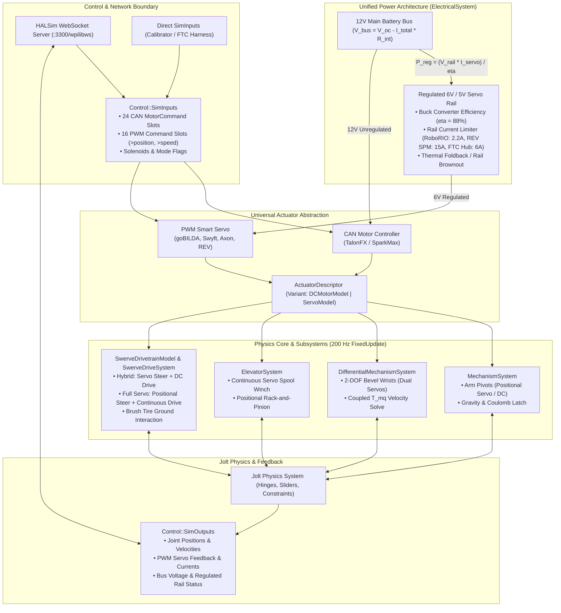

# Comprehensive Implementation Plan: Universal Servo Support (FRC & FTC)
**Target Engine:** `FRCBananaSim` (C++20 / Jolt Physics 200 Hz / Analytic 6-DOF Swerve Core)  
**Target Applications:** High-Power FRC Subsystems + FTC Dual-Mode Robotics (18" Chassis, Micro-Swerve, Dual-Servo Bevel Wrists, Miniature Slides)

> [!NOTE]
> **Locked Architectural Decisions:**
> 1. **Unified Bridge:** Both FRC and FTC use the identical HALSim WebSocket bridge (`/wpilibws`) into the simulation core.
> 2. **Default Electrical Rail:** Defaults 100% to FRC RoboRIO (6.0V nominal, 2.2A trip limit), with configurable overrides for REV Servo Power Module (15.0A) or FTC Control Hub (6.0A) via `sidecar.json`.


This plan provides the complete architecture and phased roadmap to elevate servos from an isolated mathematical model ([`ServoModel.h`](file:///C:/Game%20Dev/C++/Projects/FRCBananaSim/FRCBananaSim/Source/Actuation/ServoModel.h)) into a **first-class, fully integrated actuator type** throughout `FRCBananaSim`.

Because the simulator will be used for **FTC (FIRST Tech Challenge)** alongside **FRC**, the actuator architecture must seamlessly accommodate both high-power 12V brushless DC motors (Kraken X60, Falcon 500, NEO) and 5V/6V smart/hobby servos (goBILDA 2000 Series, Swyft, Axon, REV Smart Servos). 

Crucially, **all four major kinematic subsystems**—Arm Pivots, 2-DOF Differential Wrists, Elevators, and Swerve Drivetrains—will support being powered by either CAN DC motors or PWM Servos (including hybrid configurations such as a servo-steered, DC-motor-driven swerve module).

---

## 2. Architecture & Data Flow



---

## 3. Subsystem Technical Designs

### 3.1 Arm Pivots (`MechanismSystem`)
* **Operating Principle:** Arm pivots (e.g. intake deploy, camera tilt, shooter hood) can be configured with either a `DCMotorModel` or a `ServoModel`.
* **Dynamics:**
  1. For `ServoModel` in `ServoMode::Positional`:
     $$\tau_{\text{actuator}} = \text{servo.CalculateTorque}(\theta_{\text{joint}}, \omega_{\text{joint}}, J_{\text{effective}}, \Delta t)$$
  2. Total driving torque:
     $$\tau_{\text{net}} = \tau_{\text{actuator}} + \tau_{\text{grav}}(\theta) + \tau_{\text{spring}}(\theta) - \tau_{\text{fric}}$$
  3. Where $\tau_{\text{grav}} = -m g L_{\text{cg}} \cos\theta$.
  4. The calculated torque is applied directly across the Jolt `HingeConstraint`. The servo's built-in slew limiter, deadband, and PD profile naturally hold position against gravity and external impacts.

### 3.2 2-DOF Differential Wrists (`DifferentialMechanismSystem`)
* **Operating Principle:** Dual-servo bevel gear clusters are the standard in modern FTC robots (e.g. Axon or goBILDA servos driving pitch and roll of an intake claw).
* **Kinematics & Dual Torques:**
  1. Let the two servo channels have target angles $\theta_{\text{target}, A}$ and $\theta_{\text{target}, B}$ from PWM channels $A$ and $B$.
  2. Motor-space velocities and angles are related to joint coordinates ($q_1$ Pitch, $q_2$ Roll) by the transformation matrix $\mathbf{T}_{mq}$:
     $$\boldsymbol{\theta}_m = \mathbf{T}_{mq} \mathbf{q}, \qquad \boldsymbol{\omega}_m = \mathbf{T}_{mq} \dot{\mathbf{q}}$$
  3. Each servo independently evaluates its internal PD profile in motor space:
     $$\tau_{mA} = \text{servoA.CalculateTorque}(\theta_{mA}, \omega_{mA}, J_{\text{eff}, A}, \Delta t)$$
     $$\tau_{mB} = \text{servoB.CalculateTorque}(\theta_{mB}, \omega_{mB}, J_{\text{eff}, B}, \Delta t)$$
  4. Torques are projected onto the physical joint axes via the transpose matrix $\mathbf{T}_{mq}^T$:
     $$\boldsymbol{\tau}_q = \mathbf{T}_{mq}^T \begin{pmatrix} \tau_{mA} \\ \tau_{mB} \end{pmatrix}$$
  5. The existing $2 \times 2$ semi-implicit velocity solver in `DifferentialMechanismSystem` injects joint velocities $\dot{\mathbf{q}}^{t+\Delta t}$ directly into Jolt's constraints via `JointMotorMode::Velocity` with torque limits clamped to the servos' combined stall capacities.

### 3.3 Elevators & Linear Slides (`ElevatorSystem`)
* **Two Operating Modes:**
  1. **Continuous Rotation Servo (Winch / Drum):**
     * Driven by normalized PWM speed $(-1.0 \text{ to } +1.0)$.
     * Generates driving force:
       $$F_{\text{lin}} = \frac{\tau_{\text{servo}} \cdot G \cdot \eta}{r_{\text{drum}}}$$
     * Combined with reflected linear mass $m_{\text{reflected}} = J_{\text{servo}} (G / r_{\text{drum}})^2$ and gravity $F_{\text{grav}} = -m_{\text{carriage}} g$.
  2. **Positional Servo (Rack-and-Pinion / Linkage Lift):**
     * Driven by normalized PWM position $(0.0 \text{ to } 1.0)$.
     * Maps travel $x = \theta \cdot r_{\text{pinion}} / G$.
     * Servo delivers linear force along the `SliderConstraint` matching the position error profile.

### 3.4 Swerve Drivetrain (`SwerveDrivetrainModel` & `SwerveModuleModel`)
* **Dual Configurations Supported:**
  * **Configuration A: Hybrid Swerve (Servo Steer + DC Motor Drive)**  
    *Standard FTC Micro-Swerve:* Steer azimuth is driven by a 300° or continuous positional smart servo (goBILDA / Axon), while drive is powered by an FTC gearmotor (goBILDA 5202 YellowJacket, REV UltraPlanetary, or NeveRest).
  * **Configuration B: Full-Servo Swerve (Servo Steer + Continuous Servo Drive)**  
    *Ultralight Miniature Testbeds:* Steer is a positional servo; drive is a continuous-rotation servo.
* **Steer Azimuth Dynamics (`StepSteer`):**
  * When steer is a `ServoModel`:
    1. Steer command provides target heading $\theta_{\text{target}}$ (or PWM fraction mapped across $[-\pi, +\pi]$).
    2. Servo calculates azimuth torque:
       $$\tau_{\text{steer}} = \text{steerServo.CalculateTorque}(\theta_{\text{steer}}, \omega_{\text{steer}}, J_{\text{housing}}, \Delta t)$$
    3. Net torque accelerates azimuth housing against Coulomb bearing friction:
       $$(J_{\text{housing}} + J_{\text{rotor}} G^2) \dot{\omega}_{\text{steer}} = \tau_{\text{steer}} - \tau_{\text{friction}} - \tau_{\text{chassis\_reaction}}$$
    4. Azimuth angle $\theta_{\text{steer}}$ updates smoothly with true servo slew-rate limiting (e.g. $0.06\text{--}0.20\text{ s} / 60^\circ$).
* **Drive Wheel Integration (`ComputeTangentialStiffness` & `FinalizeDriveStep`):**
  * Continuous servos wrap an internal `DCMotorModel`.
  * The internal motor constants ($k_t, k_v, R$) scaled to the 6V supply rail are forwarded to `ComputeTangentialStiffness`, maintaining 100% compatibility with our 6-DOF analytic chassis solver and brush tire contact model.

---

## 4. Regulated Power Rail Architecture (`ElectricalSystem`)

High-power CAN motors pull directly from the unregulated 12V bus (battery sag), but servos draw from a **regulated 5V / 6V power rail**.

```
[12V Battery Bus] ──► [DC-DC Buck Regulator] ──► [6V Regulated Rail (V_rail)]
      │                      │                                │
      ▼                      ▼                                ▼
[CAN Motors]           Efficiency (88%)               [All Active Servos]
(12V Sag Math)     I_bus = (V_rail * I_rail) / (V_bus * eta)    (Current Draw)
```

1. **Rail Voltage:** Defaults to $6.0\text{ V}$ (configurable: $4.8\text{ V}$, $5.0\text{ V}$, $6.0\text{ V}$, or $7.4\text{ V}$).
2. **Current Limits by Hardware Ecosystem:**
   * **RoboRIO Internal Rail:** Max $2.2\text{ A}$ continuous (browns out at $> 2.5\text{ A}$).
   * **REV Servo Power Module (FRC):** Max $15.0\text{ A}$ continuous ($90\text{ W}$).
   * **REV Control Hub (FTC):** Max $6.0\text{ A}$ across all 6 servo ports.
   * **Custom / Direct Battery:** Unlimited.
3. **Brownout & Voltage Droop:**
   * When total servo demand exceeds the regulator trip limit, rail voltage droops:
     $$V_{\text{actual}} = V_{\text{nominal}} \cdot \frac{I_{\text{limit}}}{I_{\text{demand}}}$$
   * `ServoModel::SetSupplyVoltage(V_actual)` scales down available stall torque and free speed physically in real time.
4. **Primary Battery Reflection:**
   * Power consumed on the 6V rail is reflected back onto the 12V main battery bus:
     $$I_{\text{12V, servo}} = \frac{V_{\text{rail}} \cdot I_{\text{servo, total}}}{V_{\text{bus}} \cdot \eta_{\text{regulator}}}$$

---

## 5. Control Boundary & Protocol Integration

### 5.1 Updates to `SimControlBoundary.h`
```cpp
namespace FRCBananaSim::Control
{
    constexpr size_t MAX_PWM_CHANNELS = 16; ///< Supports RoboRIO (10) and FTC Hubs (up to 12-16)

    struct PwmCommand
    {
        double position = 0.5;        ///< Normalized 0.0 to 1.0 (for positional servos)
        double speed = 0.0;           ///< Normalized -1.0 to +1.0 (for continuous servos / PWM ESCs)
        double pulseWidthUs = 1500.0; ///< Raw PWM pulse width in microseconds (500 to 2500 us)
        bool isServo = true;          ///< True if channel operates in servo mode
    };

    struct PwmFeedback
    {
        double physicalAngleRad = 0.0; ///< Current physical joint angle
        double angularVelocityRadS = 0.0;
        double currentDrawA = 0.0;     ///< Instantaneous servo current draw
        double deliveredTorqueNm = 0.0;
    };

    // Extended SimInputs:
    struct SimInputs
    {
        std::array<MotorCommand, MAX_MOTOR_SLOTS> motorCommands;
        std::array<PwmCommand, MAX_PWM_CHANNELS> pwmCommands; // NEW: Dedicated PWM / Servo slot array
        uint32_t digitalOutputs = 0;
        bool robotEnabled = false;
        bool isAutonomous = false;
        double matchTime = 0.0;
    };

    // Extended SimOutputs:
    struct SimOutputs
    {
        // Existing motor, encoder, IMU fields...
        std::array<PwmFeedback, MAX_PWM_CHANNELS> pwmFeedbacks; // NEW
        double regulatedRailVoltageV = 6.0;                    // NEW
        double regulatedRailCurrentA = 0.0;                    // NEW
        bool regulatedRailBrownout = false;                    // NEW
    };
}
```

### 5.2 Updates to `HALSimWebSocketServer.cpp`
Support WPILib `frc::Servo` and continuous `frc::PWM` protocol packets:
```json
{"type": "PWM", "device": "2", "data": {">position": 0.75}}
```
* Parse `>position` ($0.0 \dots 1.0$) $\to$ `currentInputs.pwmCommands[ch].position`.
* Parse `>speed` ($-1.0 \dots 1.0$) $\to$ `currentInputs.pwmCommands[ch].speed`.
* Parse `>raw` / `>pulse` ($500 \dots 2500\ \mu\text{s}$) $\to$ `currentInputs.pwmCommands[ch].pulseWidthUs`.

---

## 6. Schema v1.1 Specification (`sidecar.json`)

### 6.1 Servo Mechanism Definition
```json
{
  "name": "intake_deploy_pivot",
  "role": "arm",
  "targetJoint": "intake_pivot_hinge",
  "actuator": {
    "type": "servo",
    "preset": "GoBildaTorque",
    "mode": "positional",
    "pwmChannel": 0,
    "supplyVoltage": 6.0,
    "travelRange_deg": 300.0
  }
}
```

### 6.2 Dual-Servo Differential Wrist Definition
```json
{
  "name": "claw_differential_wrist",
  "role": "differential",
  "differentialType": "SymmetricBevel",
  "actuator": {
    "type": "servo",
    "presets": [ "GoBildaTorque", "GoBildaTorque" ],
    "modes": [ "positional", "positional" ],
    "pwmChannels": [ 1, 2 ],
    "supplyVoltage": 6.0
  },
  "targetJoints": [ "wrist_pitch_hinge", "wrist_roll_hinge" ],
  "gearRatios": [ 1.0, 1.0 ],
  "efficiency": 0.95
}
```

### 6.3 Hybrid / Full-Servo Swerve Module Definition
```json
{
  "swerve": {
    "chassisLink": "base_link",
    "driveActuatorType": "motor",
    "driveMotorPreset": "GoBilda5202_312RPM",
    "steerActuatorType": "servo",
    "steerServoPreset": "GoBildaTorque",
    "steerServoMode": "positional",
    "modules": [
      { "name": "FrontLeft",  "pos_m": [ 0.18,  0.18, 0.0], "driveCanId": 1, "steerPwmChannel": 0 },
      { "name": "FrontRight", "pos_m": [ 0.18, -0.18, 0.0], "driveCanId": 2, "steerPwmChannel": 1 },
      { "name": "BackLeft",   "pos_m": [-0.18,  0.18, 0.0], "driveCanId": 3, "steerPwmChannel": 2 },
      { "name": "BackRight",  "pos_m": [-0.18, -0.18, 0.0], "driveCanId": 4, "steerPwmChannel": 3 }
    ]
  }
}
```

---

## 7. Implementation Roadmap & Milestones

The implementation is broken down into **5 clear, verifiable phases**:

```
┌────────────────────────────────────────────────────────────────────────────┐
│ Phase 1: Control Boundary, HALSim Bridge & Regulated Rail (Day 1)          │
│ • Extend SimControlBoundary.h with PwmCommand & PwmFeedback                │
│ • Update HALSimWebSocketServer.cpp to parse >position, >speed, >raw        │
│ • Add RegulatedRailConfig & current/brownout accounting in ElectricalSystem │
└─────────────────────────────────────┬──────────────────────────────────────┘
                                      │
┌─────────────────────────────────────▼──────────────────────────────────────┐
│ Phase 2: Schema v1.1 Ingestion & Assembler Factory (Day 2)                 │
│ • Update RobotSidecar.h & RobotSchemaLoader.cpp with ActuatorConfig        │
│ • Refactor RobotAssembler.cpp to construct either CAN motors or Servos     │
│ • Implement ActuatorDescriptor variant container                           │
└─────────────────────────────────────┬──────────────────────────────────────┘
                                      │
┌─────────────────────────────────────▼──────────────────────────────────────┐
│ Phase 3: Mechanism Systems Integration (Days 3-4)                          │
│ • Update MechanismSystem::UpdateArm to solve ServoModel torque & friction  │
│ • Update DifferentialMechanismSystem to solve dual-servo virtual work      │
│ • Update ElevatorSystem to support continuous & positional servo winches   │
└─────────────────────────────────────┬──────────────────────────────────────┘
                                      │
┌─────────────────────────────────────▼──────────────────────────────────────┐
│ Phase 4: Swerve Drivetrain Hybrid & Full-Servo Integration (Days 5-6)      │
│ • Update SwerveParams.h with SteerActuator / DriveActuator options         │
│ • Update SwerveModuleModel::StepSteer with servo azimuth PD & slew profile │
│ • Forward continuous servo motor parameters to ComputeTangentialStiffness  │
└─────────────────────────────────────┬──────────────────────────────────────┘
                                      │
┌─────────────────────────────────────▼──────────────────────────────────────┐
│ Phase 5: Verification, Benchmarking & Acceptance Suite (Day 7)             │
│ • Author Tests/Robot/ServoMechanismTest.cpp (Arm, Diff Wrist, Elevator)   │
│ • Author Tests/Robot/FTCSwerveTest.cpp (Hybrid & Full-Servo Micro-Swerve)  │
│ • Verify 60s endurance, 0 NaNs, energy balance, and WPILib lockstep        │
└────────────────────────────────────────────────────────────────────────────┘
```

---

## 8. Verification & Acceptance Criteria

To ensure the new servo capabilities do not destabilize the existing 200 Hz physics engine or analytic swerve solver, the following acceptance criteria must be satisfied:

1. **Arm Pivot Verification:**
   * A $2.0\text{ kg}$ arm link driven by a `GoBildaTorque` servo moves from $0^\circ$ to $90^\circ$ without overshoot exceeding $1.0^\circ$.
   * Holds stationary at $45^\circ$ against gravity with zero creep and current draw within $10\%$ of theoretical holding current.
2. **2-DOF Differential Wrist Verification:**
   * Symmetric pitch/roll bevel wrist driven by two `GoBildaTorque` servos demonstrates independent pitch and roll articulation.
   * Commanding pure pitch ($+45^\circ, +45^\circ$) produces zero roll drift ($< 0.2^\circ$).
   * Commanding pure roll ($+45^\circ, -45^\circ$) produces zero pitch drift ($< 0.2^\circ$).
3. **Elevator Verification:**
   * Continuous-rotation servo drives a $1.5\text{ kg}$ slide to full extension, stops on travel limits, and holds without numerical oscillation.
4. **FTC Hybrid Swerve Verification:**
   * 4-module FTC swerve chassis ($15\text{ kg}$, $0.36\text{ m}$ wheelbase) with servo steer and DC gearmotor drive executes translation and spin.
   * Steer azimuth tracks commanded angles at the catalog speed ($0.20\text{ s} / 60^\circ$).
   * Runs for 60 simulated seconds at 200 Hz with zero NaNs and continuous carpet traction.
5. **Electrical & Brownout Verification:**
   * Stalling 4 servos simultaneously against hard stops triggers the regulated rail current limit ($6.0\text{ A}$ on FTC Hub or $2.2\text{ A}$ on RoboRIO), resulting in realistic voltage droop and proportionally reduced stall torque.

---

## 9. Implementation & Verification Status

> [!NOTE]
> **Status:** **COMPLETE & VERIFIED** across all subsystems and test suites.

- **Phase 1 (Control & Power Foundation):** Complete.
  - `SimControlBoundary.h`: 16 PWM command channels (`>position`, `>speed`, `>raw`), 16 PWM feedback channels, 6.0V regulated power rail telemetry.
  - `HALSimWebSocketServer.cpp`: Ingests WPILib HALSim PWM channel frames 0..15.
  - `ElectricalSystem.cpp`: Computes aggregate servo power draw on the 6.0V regulated rail, calculates thermal foldback / voltage droop under overload (> 2.2A), and reflects buck converter power draw ($P_{12V} = P_{\text{rail}} / \eta$) to the battery bus.
- **Phase 2 (Schema Ingestion & RobotAssembler):** Complete.
  - `RobotSidecar.h` & `RobotSchemaLoader.cpp`: Loads `ActuatorType::Servo`, `ServoConfig`, swerve steer/drive actuator types, presets, and module PWM channels.
  - `RobotAssembler.cpp`: Assembles servo components on elevators, arms, differentials, and swerve modules; adds `ApplyInputs` dispatcher for CAN and PWM commands.
- **Phase 3 (Mechanism Systems):** Complete.
  - `MechanismSystem.cpp`: Arm pivot servo branch with internal PD torque, gravity holding, and joint torque limits.
  - `DifferentialMechanismSystem.cpp`: Dual-servo evaluation projected through $\mathbf{T}_{mq}^T$ into the 2x2 semi-implicit velocity solver.
  - `ElevatorSystem.cpp`: Linear servo conversion with winch drum radius and force transmission into Jolt sliders.
- **Phase 4 (Swerve Azimuth & Drive):** Complete.
  - `SwerveModuleModel.cpp`: StepSteer servo mode with internal PD torque calculation, bearing friction, Coulomb stick deadband, and continuous unwrapped angle integration. Drive servo branch forwards internal motor parameters and supply voltage.
  - `SwerveDrivetrainModel.cpp`: Dispatches PWM commands to steer and drive servos, computes servo supply currents.
- **Phase 5 (Verification & Test Suite):** Complete.
  - Test Suite `Tests/Robot/ServoMechanismTest.cpp` covering:
    1. Arm servo angular tracking & gravity holding under load.
    2. Differential wrist dual-servo decoupled pitch and roll actuation.
    3. Elevator linear servo lifting and position holding.
    4. Swerve module servo steer azimuth tracking and unwrapped angle integration.
    5. Electrical regulated rail overload, voltage droop, and recovery.
  - All 18 Headless Test Suites Passing: **3,240 Passed, 0 Failed**.
  - Full Robot 5-Minute 60,000-Step Endurance Test (`--full-robot-endurance`): **Passed** with 0 NaNs, $0.054\text{ mm}$ max 4-bar drift, and $\sim 1.03\text{ ms/step}$ physics execution speed.
