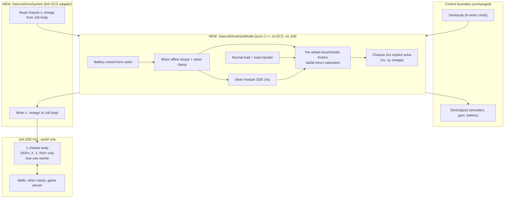

# Swerve Drivetrain Replacement Plan: Analytic Model Instead of Solver Contacts

**Scope:** Replace the joint-and-contact swerve in `FRCBananaSim` (2 Jolt bodies + 2 `HingeConstraint`s per module, wheel-carpet friction solved by Jolt) with a **closed-form, implicitly-integrated drivetrain model**. The model has per-wheel tire friction, slip, load transfer, motor/battery coupling, steer dynamics and robot mass properties. Jolt keeps only what it is good at: walls, other robots and game pieces.

**Status:** Plan only. No files were modified. Per `GEMINI.md`, all code will be delivered inline in chat, phase by phase, for you to paste.

> [!IMPORTANT]
> Your diagnosis is right in spirit. The 10-week plan v5 already puts "4-Module Vector Squeeze / Slip" in the *math* layer, but its "Solver Scope" line gives *wheel-to-carpet traction* to Jolt. That contradiction is the root of the jitter. This plan resolves it in favour of the math layer.

---

## 1. Audit: what the code does today (read from source, not run)

| # | Finding | Where | Consequence |
|---|---|---|---|
| F1 | Each module is 2 dynamic Jolt bodies (0.45 kg, 0.65 kg) chained to a 50 kg chassis by 2 hinges. The wheel is a *sphere* collider touching carpet. | [RobotSpawner.cpp](file:///c:/Game%20Dev/C++/Projects/FRCBananaSim/FRCBananaSim/Source/Robot/RobotSpawner.cpp#L246-L306) | The ratio is about 77:1 through a 3-link chain. Traction is an iterative friction impulse constraint, with warm-starting and sleeping, on the lightest body. Residual error feeds back every step. |
| F2 | Motor torque is applied with `AddTorque` to both bodies before Jolt steps. Reflected inertia has no single owner: steer torque is scaled by `J_housing / J_eff`, drive torque is not. Drive uses a hard-coded `chassisLoadInertia = 0.00084 + 12.5 r²`. | [SwerveDriveSystem.cpp](file:///c:/Game%20Dev/C++/Projects/FRCBananaSim/FRCBananaSim/Source/Robot/Drivetrain/Systems/SwerveDriveSystem.cpp#L112-L258) | The `M/4` load assumption ignores real robot state: slip, load transfer and yaw coupling. |
| F3 | Brownout hysteresis is lost every step. `batteryModel = batteryComp->batteryModel;` copies the model, and the mutable `isBrownedOutState` is only ever written on the copy. | [SwerveDriveSystem.cpp](file:///c:/Game%20Dev/C++/Projects/FRCBananaSim/FRCBananaSim/Source/Robot/Drivetrain/Systems/SwerveDriveSystem.cpp#L59-L82) | Fix 4 in the SWERVE STUFF doc is not actually effective at runtime. |
| F4 | The battery-motor algebraic loop is broken with a one-step lag (`lastTotalBusCurrent`). | same, L75 / L334 | Under duty-cycle control or supply limiting the lag is a source of 200 Hz oscillation. Section 3.8 gives a closed-form solve with no lag. |
| F5 | The tests do not exercise the failure mode. Drive test §2 floats the robot with no ground. §6 only asserts `vz > 0.5`. The mass-ratio test pins the chassis `Kinematic`. | [SwervePhysicalDriveTest.cpp](file:///c:/Game%20Dev/C++/Projects/FRCBananaSim/Tests/SwervePhysicalDriveTest.cpp#L357-L513), [SwerveMassRatioTest.cpp](file:///c:/Game%20Dev/C++/Projects/FRCBananaSim/Tests/SwerveMassRatioTest.cpp) | Gate 1 can pass while driving on carpet still jitters. |
| F6 | Steer sign: the hinge is about `+Y`, which is **clockwise from above**. WPILib module angle is CCW-positive. | [SwerveDriveSystem.cpp](file:///c:/Game%20Dev/C++/Projects/FRCBananaSim/FRCBananaSim/Source/Robot/Drivetrain/Systems/SwerveDriveSystem.cpp#L264-L297) | The Day 6 bridge would silently need a flip. The new model is CCW-positive at its boundary. |
| F7 | Doc drift. Block 2 v2 JSON is nested `{value,unit}` but the real file is flat `*_m`. FR module `z` is −0.28 in the doc and +0.28 in the file. The steer motor is Falcon500 in the doc and KrakenX44 in the file. Paths say `Source/Drivetrain/` but the real path is `Source/Robot/Drivetrain/`. | Block 2 v2 §8 vs [robot_swerve.json](file:///c:/Game%20Dev/C++/Projects/FRCBananaSim/FRCBananaSim/Resources/Robots/robot_swerve.json) | Fixed in the Phase 5 doc pass. |

**Blast radius** (references to swerve entities or joints): `Main.cpp` (27), `SwervePhysicalDriveTest.cpp` (33), `SwerveDriveSystem.cpp` (15), `SwerveMassRatioTest.cpp` (12), `RobotSpawnerTest.cpp` (9), `RobotSpawner.cpp/.h` (12), and the two component headers. `SimInputs` / `SimOutputs`, `DCMotorModel`, `JointSystem` and `ParameterStore` survive.

---

## 2. Target architecture

**Principle:** the drivetrain is a pure-math plant. Jolt sees *one* 3-DOF box.

**Why this removes the jitter by construction**

1. **No hinges.** There are no joints, so there is no mass ratio, no joint drift and no `Baumgarte` or position-iteration tuning.
2. **Friction is a state, not a constraint.** The contact patch is an elastic bristle (spring-damper state per wheel) integrated with backward Euler, with a radial-return cap at $\mu N$. A stuck wheel is a spring in equilibrium. There is no warm-start, no iteration count and no sleeping.
3. **Exactly one linear solve per sub-step.** It is a 3×3 SPD system solved in closed form. The saturation loop is at most 3 passes on that same 3×3.
4. **Implicit everywhere stiff.** Back-EMF damping, bristle stiffness and the wheel-slip coupling are all treated implicitly. For example, the steer time constant is about 5 ms (§4), which is stiff at a 5 ms step.
5. **Deterministic POD state.** Fixed operation order and no threads give bit-identical runs. State is `memcpy`-snapshotable, which is exactly what the Block 8 Fleet `reset(seed)` needs.
6. **Real collisions stay real.** Walls, bumpers, pushing matches and game pieces are still Jolt. The tire friction limit makes pushing force physical (it cannot exceed $\mu \sum N$).

**Single source of truth for pose:** the Jolt body. Pushes and wall impacts therefore feed back into the model on the next sub-step. The model also has a standalone mode (it integrates pose itself) for the Calibrator and headless sweeps. That fits v5's "Calibrator bypasses HALSim, 175 µs step budget" requirement.

---

## 3. Mathematics

### 3.0 Frames and conventions

The model works internally in the **WPILib NWU planar frame**: $x$ forward, $y$ left, yaw $\theta$ CCW-positive. This makes the code comparable line by line to WPILib's `SwerveDriveKinematics` and removes the sign traps in your SWERVE STUFF doc §1.4. The adapter converts at the Jolt boundary:

$$x_{nwu}=z_{eng},\quad y_{nwu}=-x_{eng},\quad \omega_{nwu}=-\omega_{y,eng}$$

Module positions in NWU are $\mathbf r_i$ relative to the **CG** (not the geometric centre). The steer angle $\delta_i$ is CCW-positive. The wheel heading is $\varphi_i=\theta+\delta_i$.

Rolling and lateral unit vectors:

$$\mathbf e_{x,i}=(\cos\varphi_i,\sin\varphi_i),\quad \mathbf e_{y,i}=(-\sin\varphi_i,\cos\varphi_i)$$

### 3.1 Contact-patch kinematics

With $\boldsymbol\rho_i=R(\theta)\mathbf r_i$ and $\boldsymbol\rho^{\perp}=(-\rho_y,\rho_x)$:

$$\mathbf v_i=\mathbf v+\omega\,\boldsymbol\rho_i^{\perp}=P_i\,V,\qquad P_i=[\,I_2\;|\;\boldsymbol\rho_i^{\perp}\,],\quad V=(v_x,v_y,\omega)^T$$

$$u_i=\mathbf v_i\cdot\mathbf e_{x,i},\qquad w_i=\mathbf v_i\cdot\mathbf e_{y,i}$$

Slip velocities, with $\Omega_i>0$ meaning forward-rolling and $R_e$ the effective rolling radius:

$$s_{x}=u-R_e\Omega,\qquad s_{y}=w$$

### 3.2 Normal loads and load transfer

Take moments about the CG with CG height $h$ and body-frame chassis acceleration $\mathbf a$ (from the previous sub-step):

$$\sum N_i=Mg,\qquad \sum x_iN_i=-hMa_x,\qquad \sum y_iN_i=-hMa_y$$

Assume a rigid chassis on four equal contact springs. The solution is the least-squares plane $N_i=\bar N+\alpha x_i+\beta y_i$. For a symmetric square layout with half-wheelbase $L/2$:

$$\Delta N_{\text{axle}}=\mp\frac{M a_x h}{L}$$

Handling of special cases:

- **Wheel lift:** if any $N_i<0$, clamp it to 0 and re-solve the remaining three (statically determinate).
- **Tip flag:** raised if no feasible distribution exists.
- **Lag:** $N$ uses the previous sub-step's acceleration plus a first-order filter $\tau_N\approx10\text{–}20$ ms (calibratable). This is the Tier-1 stand-in for chassis tilt compliance. Tier 3 replaces it with real pitch/roll DOFs.
- **Load sensitivity (Tier 2):** $\mu(N)=\mu_0(N/N_{ref})^{-\beta}$.

### 3.3 Tire friction: bristle state with radial return

Each wheel has a 2D bristle deflection $\mathbf z_i$ in the **wheel frame**. It is rotated by $-\Delta\varphi$ each sub-step so it follows steering. The stiffness comes from a pre-slide displacement $z_{max}\approx$ 0.5–2 mm:

$$k=\frac{\mu N}{z_{max}},\qquad c=2\zeta\sqrt{k\,m_{eff}},\qquad k_{eff}=k\,\Delta t+c$$

Backward Euler (force on the robot, wheel frame):

$$\mathbf z'=\mathbf z+\Delta t\,\mathbf s',\qquad \mathbf F=-(k\mathbf z+k_{eff}\mathbf s')$$

Friction limit is an **ellipse** (carpet nap anisotropy; set $\mu_x=\mu_y$ for a circle). With the Stribeck term $\mu(s)=\mu_k+(\mu_s-\mu_k)e^{-(|s|/v_S)^2}$ (Tier 2):

$$n=\sqrt{\left(\tfrac{F_x}{\mu_xN}\right)^2+\left(\tfrac{F_y}{\mu_yN}\right)^2}$$

If $n>1$, apply **radial return**: $\mathbf F\leftarrow\mathbf F/n$ and $\mathbf z\leftarrow-(\mathbf F+c\mathbf s')/k$. This is the same return map used in plasticity: exact for stick, dissipative for slip, and unconditionally stable.

### 3.4 Drive wheel and motor, eliminated analytically

The DC motor is affine in wheel speed: $\tau_m=\tau_0-D\Omega$, with $\tau_0=G\eta\tau_{stall}V_a/V_{nom}$ and $D=k_tk_eG^2\eta/R_m$ (already in [DCMotorModel.cpp](file:///c:/Game%20Dev/C++/Projects/FRCBananaSim/FRCBananaSim/Source/Actuation/DCMotorModel.cpp)). Wheel plus reflected rotor inertia is $J_w=J_{wheel}+J_{rotor}G^2$. Ground traction reacts on the wheel as $-R_eF_x$, so:

$$J_w\frac{\Omega'-\Omega}{\Delta t}=\tau_0-D\Omega'+R_ek_{eff}(u-R_e\Omega')+R_ek\,z_x$$

Solving for $\Omega'$ gives the affine map $\Omega'=a+b\,u$ with $\Lambda=J_w/\Delta t+D+R_e^2k_{eff}$ and $b=R_ek_{eff}/\Lambda$. Substituting back gives an **effective longitudinal stiffness** that already includes wheel inertia and back-EMF:

$$F_x=-K_x u+f_{0x},\quad K_x=k_{eff}\frac{J_w/\Delta t+D}{\Lambda},\quad f_{0x}=k_{eff}R_ea-kz_x$$

$$F_y=-K_y w+f_{0y},\quad K_y=k_{eff},\quad f_{0y}=-kz_y$$

There is no hard-coded "reflected chassis inertia". It emerges from the coupled solve.

### 3.5 Chassis: one 3×3 implicit solve

Let $G_i=R(\varphi_i)\,\mathrm{diag}(K_x,K_y)\,R(\varphi_i)^T$ and $\mathbb M=\mathrm{diag}(M,M,I_z)$. Then:

$$\Big(\tfrac{\mathbb M}{\Delta t}+\sum_iP_i^TG_iP_i\Big)V'=\tfrac{\mathbb M}{\Delta t}V+\sum_iP_i^TR(\varphi_i)\,\mathbf f_{0,i}$$

This is symmetric positive-definite, so it is solved by closed-form Cholesky or Cramer. Radial return (§3.3) is applied by scaling each saturated wheel's $(K_i,\mathbf f_{0,i})$ by $1/n_i$ and re-solving, **at most 3 passes**. Finally:

- Recompute $\Omega'$ from the final $F_x$.
- Update $\mathbf z_i$ for the wheels that saturated.

### 3.6 Steer module (4×)

Steer states are $\delta,\dot\delta$. The module inertia about the steer axis is $J_s=J_{housing}+J_{wheel,yaw}+J_{rotor}G_s^2$. Torques:

- Affine motor torque $\tau_0-D_s\dot\delta$, with the stator clamp applied as a torque bound.
- Patch **scrub moment**: a torsional bristle with $M_{z,max}=\mu N r_{patch}$ (Tier 2).
- Bearing viscous and gearbox Coulomb friction, via **exact 1D stick projection**: if $|J\dot\delta_{free}/\Delta t|\le\tau_c$, set $\dot\delta'=0$, otherwise subtract $\tau_c\Delta t/J$. This gives no creep and no chatter at rest.

Chassis reaction torque is fed back with a one-sub-step lag. The coupling ratio $J_s/I_z\sim10^{-3}$, so this is stable. Wheel bearing and rolling resistance ($C_{rr}N R_e$) use the same stick projection.

### 3.7 Neutral mode

- **Brake:** $\tau_0=0$, leaving only $-D\Omega$ (shorted windings).
- **Coast:** $\tau=0$.
- Disabled robot, brownout and neutral behaviour all route through this one path.

### 3.8 Battery: closed form, no lag

Treat the motors as constant-power loads on a Thevenin source. With $B=V_{oc}-R_{bat}I_q$ and $P=\sum_mV_{a,m}(V_{a,m}-e_m)/R_m$ (back-EMF $e_m$ from the previous sub-step's wheel speeds):

$$V_{bus}=\tfrac12\Big(B+\sqrt{B^2-4R_{bat}P}\Big)$$

- **Negative discriminant:** the power demand exceeds what the battery can deliver. This is a true brownout, and it trips the hysteresis latch.
- **Regen:** negative $P$ is handled automatically.
- **Duty cap:** if any $V_a>V_{bus}$, clamp that motor and re-solve (at most 2 passes).
- **Supply limit:** scale $P$ per motor, replacing the current `ApplySupplyCurrentLimit` approximation.
- **Brownout latch:** moved into persistent chassis state, which fixes F3 and F4.

### 3.9 Sub-stepping and ledger

- 200 Hz physics tick, **4 internal sub-steps** (800 Hz, $\Delta t_m$ = 1.25 ms). This keeps $\omega_n\Delta t\approx0.1$ for the bristle stick dynamics.
- Every tick accumulates an **energy ledger**: battery energy out, I²R loss, friction dissipation, KE change. Tests demand closure within 1%.

### 3.10 Sensors

- **Wheel encoders:** accumulated $\Omega_i\,dt$. They therefore see slip, so odometry error under slip is realistic.
- **Steer encoder:** unwrapped $\delta_i$.
- **Gyro:** $\theta,\dot\theta$.
- **Motor current:** stator current from the solved $\Omega'$.
- Noise, quantization and latency belong to Block 3 sensors.

---

## 4. Worked numbers from your current JSON

All values below follow from constants already in `robot_swerve.json` and `DCMotorModel.cpp`. The CG height $h=0.20$ m is an **assumption** (it must be measured).

| Quantity | Value | Why it matters |
|---|---|---|
| Wheel stall torque ($G\eta\tau_s$) | 41.65 N·m | Matches the SWERVE STUFF doc |
| Wheel torque at 60 A stator | $6.12\cdot0.96\cdot0.01937\cdot60$ = 6.83 N·m (134 N per wheel) | Motor-limited force 538 N, so $a\approx$ **10.75 m/s²** |
| Traction ceiling ($\mu g$, $\mu$ = 1.2) | **11.77 m/s²** | The 60 A limit sits just under it, so slip behaviour is first-order |
| Load transfer at $a$ = 10.75, $h$ = 0.2 m | $\Delta N_{axle}=Mah/L\approx$ 192 N vs 245 N static per axle | Front axle load collapses to about 53 N |
| Self-consistent accel with equal wheel torque | $a\approx$ **7.9 m/s²** (front wheels slip) | About 27% below the naive figure. A model without load transfer would be wrong on every autonomous path |
| Steer time constant $J_{eff}/D$ | $\approx$ 0.0105 / 2.1 = **about 5 ms** | Equal to the 5 ms step. This is stiff and needs the implicit treatment |
| Drive time constant with robot load | $\approx$ 87 ms (wheel alone is 7 ms) | Consistent with free speed 5.2 m/s over stall accel 65 m/s² |

---

## 5. File-by-file change list

All new files follow `GEMINI.md`: declarations only in `.h`, Allman braces, no `m_` prefix, Doxygen on everything, `@file`/`@brief` headers, `SIM_PROFILE_SCOPE` on `ISystem` overrides and on `SwerveDrivetrainModel::Step`.

| Action | File | Purpose |
|---|---|---|
| **Create** | `Robot/Drivetrain/Model/SwerveParams.h/.cpp` | Plain-data parameter structs (chassis, tire, carpet, module, steer) and JSON/`ParameterStore` loader |
| **Create** | `Robot/Drivetrain/Model/TireContactModel.h/.cpp` | Bristle state, return map, ellipse, Stribeck, load sensitivity |
| **Create** | `Robot/Drivetrain/Model/SwerveModuleModel.h/.cpp` | Steer ODE, wheel-spin elimination, 1D stick projection, current/torque telemetry |
| **Create** | `Robot/Drivetrain/Model/SwerveChassisSolver.h/.cpp` | Load transfer, 3×3 assembly and solve, radial-return loop |
| **Create** | `Robot/Drivetrain/Model/SwerveDrivetrainModel.h/.cpp` | Facade: `Step(dt, inputs, chassisState)`. Sub-stepping, ledger, snapshot/restore |
| **Rewrite** | `Robot/Drivetrain/Systems/SwerveDriveSystem.h/.cpp` | Adapter: Jolt body to model to Jolt body, outputs, visual sync (`FixedUpdate` + `RenderUpdate`) |
| **Trim** | `Robot/Drivetrain/Components/SwerveModuleComponent.h` | Remove joint and rigid-body entity refs. Keep model state and visual entity refs |
| **Trim** | `Robot/Drivetrain/Components/SwerveChassisComponent.h` | Hold the model instance and truth-telemetry struct |
| **Modify** | `Actuation/DCMotorModel.h/.cpp` | Add `GetAffineTorqueTerms(V) -> (tau0, D)` and `GetStatorTorqueLimit(I)`. Existing API stays |
| **Modify** | `Actuation/BatteryModel.h/.cpp` | Add `SolveBusVoltage(motorPowerTerms)`. Latch state becomes non-mutable and owned by the model state (fix F3) |
| **Modify** | `Physics/Components/RigidBodyComponent.h` + `PhysicsSystem.cpp` | Add `allowedDOFs`, `inertiaOverride`, `allowSleeping` so the chassis can be `TranslationX \| TranslationZ \| RotationY` with true yaw inertia |
| **Modify** | `Robot/RobotSpawner.h/.cpp` | Spawn 1 chassis body plus a visual hierarchy (chassis, steer, wheel via `HierarchyComponent`). No joints and no wheel bodies. `SpawnedRobot` loses joint arrays |
| **Modify** | `Resources/Robots/robot_swerve.json` | Schema v2: adds `yawInertia_kgm2`, `cgHeight_m`, `cgOffset_m`, `tire{}`, `carpet{}`, `steerModule{}`. Existing keys remain readable with defaults |
| **Modify** | `Main.cpp` (Station 5) | Rewire UI and demo to the new outputs; drop joint-deflection readouts |
| **Modify** | `CMakeLists.txt` | Add the new `.cpp` files to `ENGINE_SOURCES` and `TEST_SOURCES`. Register new tests |
| **Keep** | `JointSystem`, `JointComponent`, `SimControlBoundary.h` | `JointSystem` is still used by Block 3 mechanisms. Control boundary is unchanged |
| **Retire** | `SwerveMassRatioTest` (becomes `SwerveStressTest`) | The mass ratio no longer exists |

> [!NOTE]
> `JointSystem` stays because Block 3 mechanisms (elevators, arms, four-bars) still use Jolt hinges and sliders. The same solver-compounding issue may show up there. The tests in §7 and the principle "don't let the solver own what math can own" should guide those too. That is outside this plan, but worth deciding early.

---

## 6. Step algorithm (one 200 Hz tick)

1. **Adapter reads** the chassis body: `v`, `omega`, pose (converted to NWU).
2. **Adapter reads** `SimInputs` (`motorCommands[8]`, enabled flag, neutral modes).
3. **For each of 4 sub-steps:**
   1. Normal loads $N_i$ (lagged accel, filter, clamps).
   2. Motors: $V_{cmd}\to V_a$ via the closed-form battery solve → $(\tau_0, D)$ per motor, plus stator torque bound.
   3. Tire parameters $k_i, c_i, k_{eff,i}$; eliminate wheel spin → $(K_i,\mathbf f_{0,i})$.
   4. Assemble and solve the 3×3 → $V'$; radial-return passes (≤3).
   5. Update bristle states, wheel spins (with 1D stick), steer states (with unwrap).
   6. Accumulate encoders, currents, energy ledger. Standalone mode also integrates pose.
4. **Adapter writes** `v'`, `omega'` to Jolt (`SetLinearAndAngularVelocity`, Y locked), fills `SimOutputs`.
5. **Jolt `Step()`** integrates pose and resolves walls, robots and pieces.
6. **`RenderUpdate`** sets steer and wheel visual transforms from model state.

System registration order stays "drivetrain adapter, then `PhysicsSystem`", as `JointSystem` is today.

---

## 7. Tests and gates (closed-form expected values)

New suite `SwerveModelTest` (pure model, headless, fast) plus `SwerveAdapterTest` (Jolt walls). Every test has a number it must hit.

| ID | Test | Expected / pass criterion |
|---|---|---|
| T1 | **Kinematics consistency**: steady-state at all-equal commands | Chassis speed matches WPILib `SwerveDriveKinematics` inverse within 0.5%. Free speed ≈ $\omega_{free}R_e/G$ |
| T2 | **Traction cap**: over-driven with $\mu$ = 0.3 | $a\to\mu g$ = 2.94 m/s² within 1% (load transfer off) |
| T3 | **Load transfer**: $a$ = 5 m/s² | $N_{front}-N_{rear}$ equals $2Mah/L$ within $10^{-6}$ relative |
| T4 | **Brake distance** from 4 m/s, wheels locked/neutral | $v^2/(2\mu g)$ within 2% |
| T5 | **Rest stability**: zero command, 60 s, 12,000 ticks | $\lVert V\rVert<10^{-9}$ throughout and zero pose drift |
| T6 | **Steer step response**: 12 V | First-order response with $T=J_{eff}/D$ within 2% |
| T7 | **Yaw spin-up**, X-pattern | Max yaw rate matches the analytic wheel-speed / ($d\sqrt2$) bound. Scrub torque visible |
| T8 | **Energy closure**: random command fuzz, $10^6$ steps | Battery energy ≈ KE + friction + I²R within 1%. No NaNs |
| T9 | **Battery**: brownout latch persists across steps, hysteresis 6.3 → 7.5 V, closed-form matches iterated solve | Regression test for F3 and F4 |
| T10 | **Stability sweep**: $\Delta t\in\{1,5\}$ ms, $G$ up to 100 | No NaN and no energy growth |
| T11 | **Determinism and snapshot**: two runs bit-identical; snapshot/restore mid-run | Identical state hash |
| T12 | **Wall push (adapter)**: full power into wall, 10 s | Wheel forces ≤ $\mu\sum N$, no penetration chatter, $\lVert V\rVert<10^{-3}$ m/s after settle |
| T13 | **Gate 1 stress (adapter)**: 60 s all motors 12 V, spinning and driving | No NaN or spike. Battery sags to about 9.0 V ± 0.5 V without brownout collapse |

**Gate 1 criteria changes** (Block 2 v2 §1 and 10-week plan v5 §4): "joint deflection < 5 mm" becomes "no joints; chassis planar residual is exactly 0; energy ledger closes within 1%; zero drift at rest." The 9 V sag criterion is unchanged.

---

## 8. Phased execution and schedule

Total about 12–15 focused hours, which is roughly Day 5 plus half of Day 6. After each phase you build and run `ctest -C Release` before moving on.

| Phase | Work | Est. | Exit gate |
|---|---|---|---|
| 0 | Commit and tag current state (`swerve-joint-v1`). Nothing is deleted yet | 15 min | Tag exists |
| 1 | Pure math core: params, tire model, module model, chassis solver, facade, battery closed form + latch fix, `DCMotorModel` additions | 4–5 h | T1–T4, T6–T11 green |
| 2 | JSON schema v2, params loader, spawner (1 body + visual hierarchy), `RigidBodyComponent` / `PhysicsSystem` flags | 2 h | `RobotSpawnerTest` updated and green |
| 3 | New `SwerveDriveSystem` adapter, Jolt coupling, wall test | 2–3 h | T5, T12, T13 green |
| 4 | `Main.cpp` Station 5 rewire, visuals, ImGui readouts (slip, N, bristle force) | 1–2 h | Drive by eye, no jitter |
| 5 | Delete dead joint-swerve code, update tests/CMake, update docs (§9) | 1 h | Full `ctest` green |
| 6 | Calibration hooks and CSV logger fields (can slip to Day 7) | 1 h | Log schema matches Block 2 §9 |

**Schedule impact:** Day 5 absorbs Phases 0–3. Day 6 morning is Phases 4–5, and Day 6 afternoon starts the HALSim bridge. The bridge and FTC logger compress into Day 6 PM–Day 7. v5 says "there is no slack", so the cut order below applies if you fall behind.

**Cut order (first to go):**
1. Tier 3 tilt DOFs and ramps
2. Carpet anisotropy ($\mu_x\ne\mu_y$)
3. Stribeck curve and load sensitivity
4. Steer scrub moment
5. Standalone-mode extras

Never cut: bristle friction, load transfer, implicit motor/steer coupling, closed-form battery, energy-closure test.

---

## 9. Documentation fixes

- **Block 2 v2, Day 5:** replace "50:1 mass-ratio stress test" with T5 / T13 plus energy-closure test. Fix F7 drift (JSON schema, FR sign, steer motor, paths).
- **SWERVE STUFF doc:** mark superseded for the drivetrain. Fixes 2–5 are reimplemented in the model. Fix 1 and Fix 3 become structural.
- **10-week plan v5:** Layer 3 and the "Solver Scope" line (Jolt owns wheel-to-carpet traction becomes Jolt owns walls, robots and pieces). Replace the "Swerve joint error under 5 mm" gate with the new Gate 1 wording. Add the energy-closure gate.
- **Block 3 plan:** add a note that mechanisms may need the same test-first treatment if hinge/slider jitter appears.

---

## 10. Parameters to fit later (Block 7 hooks)

All defaults are **placeholders until measured** (unverified): $\mu_s,\mu_k$, $z_{max}$, $C_{rr}$, $\zeta$, $\tau_N$, $r_{patch}$, steer Coulomb friction, $I_z$, $h$, $R_e$, gearbox $\eta$, $R_{bat}$.

| Parameter group | Fit with (Block 2 §9 protocol) |
|---|---|
| $\mu$, $z_{max}$, $C_{rr}$ | Step-response acceleration test |
| $J_{eff}$, $k_v$, viscous drag | Steady-state velocity sweep |
| Scrub, $I_z$ | Spin / yaw scrub test |
| $h$, $\tau_N$ | Tilt-table measurement, then hard-acceleration pitch if an IMU is available |
| $R_{bat}$, sag | FTC voltage log, later FRC |

Mass properties come from CAD in Block 5. The model exposes `SetMassProperties(M, Iz, cg)` so a held game piece can change them at runtime (Block 6).

---

## 11. Risks and unverified items

- **Planar assumption.** The model is planar by design. If your target game has ramps, bumps or climbing, you need the Tier 3 height-field and tilt extension. Decide now.
- **Jolt flags (verify at compile).** `mAllowedDOFs` accepts custom combinations like `TranslationX | TranslationZ | RotationY` (the header defines the bits, but I did not confirm the `operator|` form in v5.6.0). The same applies to `EOverrideMassProperties::MassAndInertiaProvided`.
- **Cost estimate.** About 5 µs per 200 Hz tick (4 sub-steps × ~2000 flops) is a back-of-envelope figure, not a measurement. It will be profiled with `SIM_PROFILE_SCOPE`.
- **Load-transfer lag.** The one-sub-step lag plus the $\tau_N$ filter can in principle limit-cycle near the traction threshold. T4 and T8 are designed to catch it. The fallback is a 2-pass Picard iteration.
- **Friction defaults.** $\mu\approx1.2$, $z_{max}$ = 1 mm and the others are placeholders. Real carpet and tread values are unmeasured.
- **Phoenix closed-loop modes** (Block 3). This plan only guarantees correct *voltage in, current/encoder out*.
- **Visual interpolation.** Visual wheels and steer housings are driven from the 200 Hz state, not interpolated between ticks. This may look steppy until a render-interpolation pass.

---

## 12. Open questions for you

1. **Terrain:** do you need ramps, bumps or tilt (Tier 3), or is a flat carpet field enough for Block 2?
2. **Robot numbers:** do you have measured $M$, $I_z$, CG height and module type (MK4i L3?) for the real robot? If not, I will use the JSON values plus the box-derived $I_z$ = 4.08 kg·m² and flag them as placeholders.
3. **Schedule:** are you OK with Day 5 + half of Day 6 for this, with the HALSim bridge compressed into Day 6 PM–Day 7?
4. **Method:** I surveyed the codebase directly (about 20 files) rather than delegating. If you want a second independent review of the §3 math or a subagent pass on the test plan, say so before Phase 1.
