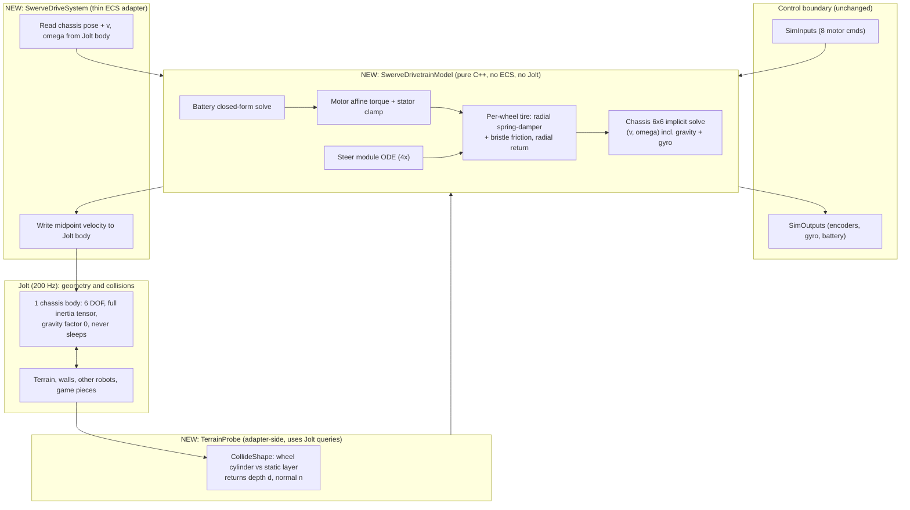

# Swerve Drivetrain Replacement Plan v2: Analytic, Terrain-Aware, Oracle-Validated

**Scope:** Replace the joint-and-contact swerve in `FRCBananaSim` (2 Jolt bodies + 2 `HingeConstraint`s per module, wheel-carpet friction solved by Jolt) with a **closed-form, implicitly-integrated 6-DOF drivetrain model**. The model has per-wheel tire friction and slip, tire radial compliance, ramps and bumps, motor/battery coupling, steer dynamics and full robot mass properties. Jolt keeps what it is good at: static geometry for terrain queries, walls, other robots and game pieces.

**Status:** Plan only. No files were modified. Per `GEMINI.md`, all code is delivered inline in chat, phase by phase, for you to paste.

**Changes from v1** (per your answers):
- The unknown game means ramps and bumps are **in scope from the start**. The model is now 6-DOF instead of planar (§2, §3).
- Hardware is fixed to **SDS MK5n R3, Kraken X60 (drive), Kraken X44 (steer)** (§4, §10).
- **No schedule constraint.** The cut-order table is gone, and every phase has a hard exit gate instead (§8).
- The quality bar is "best possible", so a **reference-oracle validation ladder** (§7) and a **fidelity ladder** (§9) are added.

> [!IMPORTANT]
> The 10-week plan v5 puts "4-Module Vector Squeeze / Slip" in the *math* layer, but its "Solver Scope" line gives *wheel-to-carpet traction* to Jolt. That contradiction is the root of the jitter. This plan resolves it in favour of the math layer.

---

## 1. Audit: what the code does today (read from source, not run)

| # | Finding | Where | Consequence |
|---|---|---|---|
| F1 | Each module is 2 dynamic Jolt bodies (0.45 kg, 0.65 kg) chained to a 50 kg chassis by 2 hinges. The wheel is a *sphere* collider touching carpet. | [RobotSpawner.cpp](file:///c:/Game%20Dev/C++/Projects/FRCBananaSim/FRCBananaSim/Source/Robot/RobotSpawner.cpp#L246-L306) | The ratio is about 77:1 through a 3-link chain. Traction is an iterative friction impulse constraint with warm-starting and sleeping, on the lightest body. Residual error feeds back every step. |
| F2 | Motor torque is applied with `AddTorque` to both bodies before Jolt steps. Reflected inertia has no single owner: steer torque is scaled by `J_housing / J_eff`, drive torque is not. Drive uses a hard-coded `chassisLoadInertia = 0.00084 + 12.5 r²`. | [SwerveDriveSystem.cpp](file:///c:/Game%20Dev/C++/Projects/FRCBananaSim/FRCBananaSim/Source/Robot/Drivetrain/Systems/SwerveDriveSystem.cpp#L112-L258) | The `M/4` assumption ignores real robot state: slip, load transfer and yaw coupling. |
| F3 | Brownout hysteresis is lost every step. `batteryModel = batteryComp->batteryModel;` copies the model, and the mutable `isBrownedOutState` is only ever written on the copy. | [SwerveDriveSystem.cpp](file:///c:/Game%20Dev/C++/Projects/FRCBananaSim/FRCBananaSim/Source/Robot/Drivetrain/Systems/SwerveDriveSystem.cpp#L59-L82) | Fix 4 in the SWERVE STUFF doc is not actually effective at runtime. |
| F4 | The battery-motor algebraic loop is broken with a one-step lag (`lastTotalBusCurrent`). | same, L75 / L334 | Under duty-cycle control or supply limiting the lag is a source of 200 Hz oscillation. §3.9 gives a closed-form solve with no lag. |
| F5 | The tests do not exercise the failure mode. Drive test §2 floats the robot with no ground. §6 only asserts `vz > 0.5`. The mass-ratio test pins the chassis `Kinematic`. | [SwervePhysicalDriveTest.cpp](file:///c:/Game%20Dev/C++/Projects/FRCBananaSim/Tests/SwervePhysicalDriveTest.cpp#L357-L513), [SwerveMassRatioTest.cpp](file:///c:/Game%20Dev/C++/Projects/FRCBananaSim/Tests/SwerveMassRatioTest.cpp) | Gate 1 can pass while driving on carpet still jitters. |
| F6 | Steer sign: the hinge is about `+Y`, which is **clockwise from above**. WPILib module angle is CCW-positive. | [SwerveDriveSystem.cpp](file:///c:/Game%20Dev/C++/Projects/FRCBananaSim/FRCBananaSim/Source/Robot/Drivetrain/Systems/SwerveDriveSystem.cpp#L264-L297) | The Day 6 bridge would silently need a flip. The new model is CCW-positive at its boundary. |
| F7 | Doc drift. Block 2 v2 JSON is nested `{value,unit}` but the real file is flat `*_m`. FR module `z` is −0.28 in the doc and +0.28 in the file. The steer motor is Falcon500 in the doc and KrakenX44 in the file. Paths say `Source/Drivetrain/` but the real path is `Source/Robot/Drivetrain/`. The JSON gear ratios (6.12 / 21.43) are the MK4i L3 values, not MK5n. | Block 2 v2 §8 vs [robot_swerve.json](file:///c:/Game%20Dev/C++/Projects/FRCBananaSim/FRCBananaSim/Resources/Robots/robot_swerve.json) | Fixed in the Phase 5 doc pass. |
| F8 | Chassis `y` and gravity are owned by Jolt contact today. Any terrain would be sampled through sphere-vs-mesh solver contacts on a 0.65 kg body. | `RobotSpawner.cpp` | Ramps and bumps would be *worse* than flat carpet under the current design. |

**Blast radius** (references to swerve entities or joints): `Main.cpp` (27), `SwervePhysicalDriveTest.cpp` (33), `SwerveDriveSystem.cpp` (15), `SwerveMassRatioTest.cpp` (12), `RobotSpawnerTest.cpp` (9), `RobotSpawner.cpp/.h` (12), and the two component headers. `SimInputs` / `SimOutputs`, `DCMotorModel`, `JointSystem` and `ParameterStore` survive.

---

## 2. Target architecture

**Principle:** the drivetrain is a pure-math plant. Jolt owns *geometry* (terrain, walls, bumpers) and answers queries. The math owns every force between wheels and ground.

**Why this removes the jitter by construction**

1. **No hinges.** There are no joints, so there is no mass ratio, no joint drift and no `Baumgarte` or position-iteration tuning.
2. **Contact is a state, not a constraint.** Each wheel is a radial spring-damper (normal) plus an elastic bristle (tangential) with a radial-return cap at $\mu N$, all integrated with backward Euler. A stuck wheel is a spring in equilibrium. There is no warm-start, no iteration count and no sleeping.
3. **Exactly one small linear solve per sub-step.** It is a 6×6 SPD system solved with closed-form Cholesky. The saturation and lift-off loops are at most 3 passes on that same 6×6.
4. **Implicit everywhere stiff.** Back-EMF damping, tire stiffness and the wheel-slip coupling are all implicit. For example the steer time constant is about 5 ms (§4), which is stiff at a 5 ms step.
5. **Deterministic POD state.** Fixed operation order and no threads give bit-identical runs. State is `memcpy`-snapshotable, which the Block 8 Fleet `reset(seed)` needs.
6. **Load transfer, pitch, roll, wheelies, lift-off and landing are emergent.** They come from the 6-DOF body sitting on four tire springs, with no plane-fit or lag-filter hacks.
7. **Collisions stay real.** Walls, bumpers, pushing matches and game pieces are still Jolt. The tire friction limit makes pushing force physical (it cannot exceed $\mu\sum N$).

**Single source of truth for pose:** the Jolt body. Pushes and wall impacts feed back into the model on the next tick. The model also has a standalone mode (it integrates pose itself, with analytic terrain) for the Calibrator and headless sweeps, which fits v5's "Calibrator bypasses HALSim, 175 µs step budget".

**Midpoint velocity handoff (accuracy detail).** Writing $V'$ into Jolt and letting it integrate position gives a symplectic-Euler bias of $\tfrac12 a\,\Delta t\,t$. At 200 Hz that is about 1.5 cm per full acceleration to 6 m/s, which would corrupt odometry comparisons. Instead:

- Write $\bar V=(V+V')/2$ to Jolt for position and rotation integration.
- Keep $\Delta=V'-\bar V$ in model state.
- After Jolt's `Step()`, read back $V'_{post}=v_{Jolt}+\Delta$, so any collision impulse is folded in.

Test T15 requires position error under 0.1 mm against $\tfrac12at^2$.

---

## 3. Mathematics

### 3.0 Frames and conventions

The model works internally in the **WPILib NWU frame**: $x$ forward, $y$ left, $z$ up, yaw CCW-positive. This makes the code comparable line by line to WPILib's `SwerveDriveKinematics` and removes the sign traps in SWERVE STUFF §1.4. The adapter converts at the Jolt boundary:

$$(x,y,z)_{nwu}=(z_{eng},\,-x_{eng},\,y_{eng}),\qquad \omega_{nwu}=(\omega_{z,eng},\,-\omega_{x,eng},\,\omega_{y,eng})$$

Orientation is converted with the same basis change on the quaternion. Pigeon yaw, pitch and roll are then extracted in NWU ZYX order.

Per module $i$: chassis-frame position $\mathbf p_i$, steer angle $\delta_i$ (CCW-positive about the chassis up axis $\hat{\mathbf u}_c$), wheel axle $\hat{\mathbf a}_i=R_c\,R_z(\delta_i)\hat{\mathbf y}$, rolling direction $\hat{\mathbf x}_{w,i}=R_c\,R_z(\delta_i)\hat{\mathbf x}$.

State: $V=(\mathbf v,\boldsymbol\omega)\in\mathbb R^6$ in the world frame, mass matrix $\mathbb M=\mathrm{diag}(M\,I_3,\;I_w)$ with $I_w=R_cI_bR_c^T$ from the **full inertia tensor** (CG-relative).

### 3.1 Terrain probe and contact geometry

Each wheel is a short cylinder (radius $R$, width $w$, small convex radius) queried against the **static terrain layer only** with Jolt `CollideShape`. Using `mMaxSeparationDistance` of a few mm, the query returns signed compression $d$ (positive = penetration) and a contact normal $\mathbf n$. The contact point is placed on the wheel mid-plane (this removes the arbitrary lateral position a line contact would give):

$$\mathbf c=\mathbf h-\mathbf n\,(R-d),\qquad \mathbf r=\mathbf c-\mathbf x_{CG},\qquad \boldsymbol\rho_c=\mathbf c-\mathbf h$$

Where $\mathbf h$ is the hub position. For flat ground this reduces to a point $R-d$ below the hub. For an edge or a ramp face the normal tilts and $\mathbf c$ moves along the wheel circle, so bump geometry is captured with no special cases.

Contact frame: $\mathbf e_x=\widehat{\hat{\mathbf x}_w-(\hat{\mathbf x}_w\!\cdot\!\mathbf n)\mathbf n}$, $\mathbf e_y=\mathbf n\times\mathbf e_x$.

**Query scheduling (cost control).** Baseline is one probe per wheel at tick start plus one look-ahead probe at the predicted end-of-tick pose. $(\mathbf n,d)$ is interpolated across sub-steps. If the two disagree (an edge lies inside the tick), bisect with up to 4 extra probes. A config switch lets the model tick at 1 kHz instead. Cost is **unmeasured** and gets profiled (§11).

### 3.2 Wheel-material velocity and slip

The velocity of the wheel material at the contact point, with ground static:

$$\mathbf v_w=\mathbf v+\boldsymbol\omega\times\mathbf r+\dot\delta\,(\hat{\mathbf u}_c\times\boldsymbol\rho_c)+\Omega\,(\hat{\mathbf a}\times\boldsymbol\rho_c)$$

Contact-frame components:

$$\mathbf s=(\mathbf e_x\!\cdot\!\mathbf v_w,\;\mathbf e_y\!\cdot\!\mathbf v_w,\;\mathbf n\!\cdot\!\mathbf v_w)=J\,V+\mathbf q\,\Omega+(\text{steer-rate term})$$

$$J=\begin{bmatrix}\mathbf e_x^T&(\mathbf r\times\mathbf e_x)^T\\\mathbf e_y^T&(\mathbf r\times\mathbf e_y)^T\\\mathbf n^T&(\mathbf r\times\mathbf n)^T\end{bmatrix}$$

$\Omega>0$ means forward-rolling. For flat ground $\mathbf q=(-R_e,0,0)$, so $s_x=u-R_e\Omega$. The steer-rate term vanishes when the steer axis passes through the patch, and is otherwise treated with the previous sub-step's $\dot\delta$ (the steer module is processed first, §3.7).

### 3.3 Normal channel: tire radial spring-damper

Tire radial stiffness $k_t$ and damping $c_t$ (placeholders; see §10). Compression along $\mathbf n$ advances as $d'=d-\Delta t\,s_n'$. Implicitly:

$$N'=\max\!\big(0,\;k_td-K_n\,s_n'\big),\qquad K_n=k_t\Delta t+c_t$$

The `max(0, ...)` is a unilateral **active set**: a wheel with $N'<0$ drops out of the system (no normal force, no friction) and the system is re-solved (at most 3 passes). This one mechanism gives wheel lift-off, wheelies, bump hops and landings. Static load transfer, tilt on ramps and pitch/roll frequency all emerge from the same springs. There is no separate load-transfer model.

### 3.4 Tire friction: bristle state with radial return

Each wheel keeps a 2D bristle deflection $\mathbf z$ in the contact frame. It is rotated into the new contact frame each sub-step and re-projected to the tangent plane. The stiffness comes from a pre-slide displacement $z_{max}\approx$ 0.5–2 mm:

$$k=\frac{\mu N}{z_{max}},\qquad c=2\zeta\sqrt{k\,m_{eff}},\qquad k_{eff}=k\,\Delta t+c$$

Backward Euler (force on the robot, contact frame):

$$\mathbf z'=\mathbf z+\Delta t\,\mathbf s_t',\qquad \mathbf F_t=-(k\mathbf z+k_{eff}\mathbf s_t')$$

The friction limit is an **ellipse** (carpet nap anisotropy; set $\mu_x=\mu_y$ for a circle). Include the Stribeck term $\mu(s)=\mu_k+(\mu_s-\mu_k)e^{-(|s|/v_S)^2}$ and load sensitivity $\mu(N)=\mu_0(N/N_{ref})^{-\beta}$.

$$n=\sqrt{\left(\tfrac{F_x}{\mu_xN}\right)^2+\left(\tfrac{F_y}{\mu_yN}\right)^2}$$

If $n>1$, apply **radial return**: $\mathbf F_t\leftarrow\mathbf F_t/n$ and $\mathbf z\leftarrow-(\mathbf F_t+c\,\mathbf s_t')/k$. This is the return map used in plasticity: exact for stick, dissipative for slip, unconditionally stable.

### 3.5 Drive wheel and motor, eliminated analytically

The DC motor is affine in wheel speed: $\tau_m=\tau_0-D\Omega$, with $\tau_0=G\eta\tau_{stall}V_a/V_{nom}$ and $D=k_tk_eG^2\eta/R_m$ (already in [DCMotorModel.cpp](file:///c:/Game%20Dev/C++/Projects/FRCBananaSim/FRCBananaSim/Source/Actuation/DCMotorModel.cpp)). Wheel plus reflected rotor inertia is $J_w=J_{wheel}+J_{rotor}G^2$. Ground traction reacts on the wheel as $\mathbf q^T\mathbf F_t$. Writing $\mathbf j V$ for the tangential rows of $JV$:

$$J_w\frac{\Omega'-\Omega}{\Delta t}=\tau_0-D\Omega'+\mathbf q^T\mathbf F_t$$

Solving for $\Omega'$, with $\Lambda=J_w/\Delta t+D+k_{eff}|\mathbf q|^2$:

$$\Omega'=a-\tfrac{k_{eff}}{\Lambda}\,\mathbf q^T(\mathbf jV),\qquad a=\frac{J_w\Omega/\Delta t+\tau_0-k\,\mathbf q^T\mathbf z}{\Lambda}$$

Substituting back gives an **effective tangential stiffness** that already includes wheel inertia and back-EMF:

$$\mathbf F_t=-K_t\,(\mathbf jV)+\mathbf f_{0t},\quad K_t=k_{eff}\Big(I-\tfrac{k_{eff}}{\Lambda}\mathbf q\mathbf q^T\Big),\quad \mathbf f_{0t}=-k_{eff}\,\mathbf q\,a-k\mathbf z$$

For flat ground this collapses to the planar result: $K_x=k_{eff}\frac{J_w/\Delta t+D}{\Lambda}$ and $f_{0x}=k_{eff}R_ea-kz_x$. There is no hard-coded "reflected chassis inertia". It emerges from the coupled solve.

### 3.6 Chassis: one 6×6 implicit solve

Per wheel, $\mathbf f=(F_x,F_y,N)$ in the contact frame, $K_i=\mathrm{diag}(K_t,\,K_n)$ and $\mathbf f_{0}=(\mathbf f_{0t},\,k_td)$. With gravity $\mathbf g$ and gyroscopic term $\mathbf g_\omega=-\boldsymbol\omega\times I_w\boldsymbol\omega$:

$$\Big(\tfrac{\mathbb M}{\Delta t}+\sum_iJ_i^TK_iJ_i\Big)V'=\tfrac{\mathbb M}{\Delta t}V+\begin{pmatrix}M\mathbf g\\\mathbf g_\omega\end{pmatrix}+\sum_iJ_i^T\mathbf f_{0,i}$$

This is symmetric positive-definite, solved by closed-form Cholesky. Saturated wheels have $(K_i,\mathbf f_{0,i})$ tangential parts scaled by $1/n_i$ (radial return) and the system is re-solved, **at most 3 passes combined with the lift-off active set**. Finally:

- Recompute $\Omega'$ from the final $\mathbf F_t$.
- Update $\mathbf z_i$ for the wheels that saturated.
- Integrate orientation with the quaternion exponential map $q'=\exp(\boldsymbol\omega'\Delta t/2)\,q$.

Gravity is **inside** this solve, so resting contact equilibrates exactly. The Jolt body gets `mGravityFactor = 0` to avoid double gravity.

### 3.7 Steer module (4×)

Steer states are $\delta,\dot\delta$. The module inertia about the steer axis is $J_s=J_{housing}+J_{wheel,yaw}+J_{rotor}G_s^2$. Torques:

- Affine motor torque $\tau_0-D_s\dot\delta$, with the stator clamp applied as a torque bound.
- Patch **scrub moment**: a torsional bristle with $M_{z,max}=\mu N r_{patch}$.
- Bearing viscous and gearbox Coulomb friction, via **exact 1D stick projection**: if $|J\dot\delta_{free}/\Delta t|\le\tau_c$, set $\dot\delta'=0$, otherwise subtract $\tau_c\Delta t/J$. This gives no creep and no chatter at rest.
- Optional gear-train backlash and compliance (Tier 2).

Chassis reaction torque is fed back with a one-sub-step lag. The coupling ratio $J_s/I_z\sim10^{-3}$, so this is stable. Wheel bearing and rolling resistance ($C_{rr}N R_e$) use the same stick projection.

### 3.8 Neutral mode

- **Brake:** $\tau_0=0$, leaving only $-D\Omega$ (shorted windings).
- **Coast:** $\tau=0$.
- Disabled robot, brownout and neutral behaviour all route through this one path.

### 3.9 Battery: closed form, no lag

Treat the motors as constant-power loads on a Thevenin source. With $B=V_{oc}-R_{bat}I_q$ and $P=\sum_mV_{a,m}(V_{a,m}-e_m)/R_m$ (back-EMF $e_m$ from the previous sub-step's wheel speeds):

$$V_{bus}=\tfrac12\Big(B+\sqrt{B^2-4R_{bat}P}\Big)$$

- **Negative discriminant:** the power demand exceeds what the battery can deliver. This is a true brownout, and it trips the hysteresis latch.
- **Regen:** negative $P$ is handled automatically.
- **Duty cap:** if any $V_a>V_{bus}$, clamp that motor and re-solve (at most 2 passes).
- **Supply limit:** scale $P$ per motor, replacing the current `ApplySupplyCurrentLimit` approximation.
- **Brownout latch:** moved into persistent model state, which fixes F3 and F4.

### 3.10 Sub-stepping and ledger

- 200 Hz physics tick, **4 internal sub-steps** (800 Hz, $\Delta t_m$ = 1.25 ms). For tire stiffness around $10^5$ N/m the highest chassis mode has $\omega\Delta t_m\approx0.15$.
- A **fidelity oracle** (§7) re-runs the same model at 20 kHz to measure the discretisation error. Sub-step count is chosen from that data, not from guesswork.
- Every tick accumulates an **energy ledger**: battery energy out, I²R loss, friction dissipation, tire damping loss, KE, PE. Tests demand closure within 1%.

### 3.11 Sensors, airborne and tip cases

- **Wheel encoders:** accumulated $\Omega_i\,dt$. They therefore see slip, so odometry error under slip is realistic.
- **Steer encoder:** unwrapped $\delta_i$.
- **Gyro:** full orientation and body rates, in NWU.
- **Motor current:** stator current from the solved $\Omega'$.
- **Accelerometer (specific force):** $\sum\mathbf F_{contact}/M$, available for Block 3 sensors.
- **All wheels airborne:** the active set empties and the body falls ballistically under gravity, with the gyroscopic term kept.
- **Frame high-centering and tip-over:** the chassis collider is a Jolt body, so the frame resting on a ramp crest is a Jolt contact on one body (not a chain). Tip-over comes out of the 6-DOF dynamics.
- Noise, quantization and latency belong to Block 3 sensors.

---

## 4. Worked numbers: MK5n R3, Kraken X60 drive, Kraken X44 steer

**Module data used** (from two web searches; **secondary sources, verify against the SDS spec sheet and your module's actual pinion**): MK5n R3 drive ratio 5.27:1, steer ratio 287/11 ≈ 26.09:1, 4" wheel. The $\eta$ values (0.96 drive, 0.92 steer) are placeholders. The CG height $h=0.20$ m is an **assumption** (it must be measured). Motors use the `DCMotorModel` presets (non-FOC X60: 7.09 N·m, 366 A, 6000 rpm).

| Quantity | Value | Why it matters |
|---|---|---|
| Wheel stall torque ($G\eta\tau_s$) | $5.27\cdot0.96\cdot7.09$ = **35.9 N·m** | New drivetrain-level limit (the MK4i numbers in the JSON give 41.65) |
| Theoretical free speed (12 V, $\eta$ = 1) | $628.3/5.27\cdot0.0508$ = **6.06 m/s** | A secondary source quotes ≈ 5.86 m/s real. The model should land between, depending on $\eta$ and sag |
| Wheel torque at 60 A stator | $5.27\cdot0.96\cdot0.01937\cdot60$ = 5.88 N·m (**115.8 N per wheel**) | Motor-limited force 463 N, so $a\approx$ **9.26 m/s²** (50 kg) |
| Traction ceiling ($\mu g$, $\mu$ = 1.2) | **11.77 m/s²** | The 60 A limit sits below it, but load transfer changes that picture |
| Load transfer at $h$ = 0.2 m, $L$ = 0.56 m | $\Delta N_{axle}=Mah/L$; front axle load collapses | Front wheels slip |
| Self-consistent accel, equal wheel torque | $a\approx$ **7.4 m/s²** (front wheels slip, rear grips) | About 20% below the naive 9.26. A model without load transfer is wrong on every autonomous path |
| Steer time constant $J_{eff}/D$ | $J_{eff}\approx0.0151$ (rotor reflected 0.0143 + load 0.0009), $D\approx3.13$ → **≈ 4.8 ms** | Equal to the 5 ms step. This is stiff and needs the implicit treatment |
| Drive time constant | wheel alone ≈ 8 ms. With robot load ($MR^2/4$) ≈ **115 ms** | Consistent with free speed 6.06 m/s over stall accel 56.5 m/s² |
| Heave mode, $k_t=10^5$ N/m (placeholder) | $\omega=\sqrt{4k_t/M}\approx$ 89 rad/s (14 Hz) | Sets the sub-step count; $k_t$ must be calibrated |

> [!NOTE]
> **FOC variants.** If your robot code uses Phoenix Pro FOC control, the Kraken X60 stall torque and current are higher (from memory about 9.37 N·m / 483 A, 5800 rpm; **not verified**). The plan adds `motorPreset` options `KrakenX60` and `KrakenX60FOC` (same for X44) so the JSON can select, and the numbers get checked against WPILib's `DCMotor` before use.

---

## 5. File-by-file change list

All new files follow `GEMINI.md`: declarations only in `.h`, Allman braces, no `m_` prefix, Doxygen on everything, `@file`/`@brief` headers, `SIM_PROFILE_SCOPE` on `ISystem` overrides and on `SwerveDrivetrainModel::Step` and the terrain probe.

| Action | File | Purpose |
|---|---|---|
| **Create** | `Robot/Drivetrain/Model/SwerveParams.h/.cpp` | Plain-data parameter structs (chassis incl. full inertia tensor, tire, carpet, module, steer) and JSON/`ParameterStore` loader |
| **Create** | `Robot/Drivetrain/Model/TireContactModel.h/.cpp` | Radial spring-damper, bristle state, return map, ellipse, Stribeck, load sensitivity |
| **Create** | `Robot/Drivetrain/Model/SwerveModuleModel.h/.cpp` | Steer ODE, wheel-spin elimination, 1D stick projection, current/torque telemetry |
| **Create** | `Robot/Drivetrain/Model/SwerveChassisSolver.h/.cpp` | 6×6 assembly and Cholesky, active set (lift-off and saturation), orientation integration |
| **Create** | `Robot/Drivetrain/Model/SwerveDrivetrainModel.h/.cpp` | Facade: `Step(dt, inputs, chassisState, terrain)`. Sub-stepping, ledger, snapshot/restore, midpoint handoff |
| **Create** | `Robot/Drivetrain/Model/TerrainProvider.h` | Interface returning `(normal, depth)` per wheel. Implemented by the Jolt probe and by an analytic test terrain |
| **Create** | `Robot/Drivetrain/Systems/SwerveTerrainProbe.h/.cpp` | Jolt `CollideShape` implementation: static layer filter, cylinder wheel shape, scheduling and look-ahead |
| **Create** | `Tests/Support/TestTerrain.h/.cpp` | Analytic flat plane, tilted plane, step and half-cylinder bump terrains (shared by model tests and the oracle) |
| **Rewrite** | `Robot/Drivetrain/Systems/SwerveDriveSystem.h/.cpp` | Adapter: Jolt body to model to Jolt body, outputs, visual sync (`FixedUpdate` + `RenderUpdate`) |
| **Trim** | `Robot/Drivetrain/Components/SwerveModuleComponent.h` | Remove joint and rigid-body entity refs. Keep model state and visual entity refs |
| **Trim** | `Robot/Drivetrain/Components/SwerveChassisComponent.h` | Hold the model instance and truth-telemetry struct |
| **Modify** | `Actuation/DCMotorModel.h/.cpp` | Add `GetAffineTorqueTerms(V) -> (tau0, D)`, `GetStatorTorqueLimit(I)`, FOC presets. Existing API stays |
| **Modify** | `Actuation/BatteryModel.h/.cpp` | Add `SolveBusVoltage(motorPowerTerms)`. Latch state becomes owned by the model state (fix F3) |
| **Modify** | `Physics/Components/RigidBodyComponent.h` + `PhysicsSystem.cpp` | Add `gravityFactor`, `inertiaTensorOverride`, `allowSleeping` (chassis: factor 0, full inertia, never sleeps) |
| **Modify** | `Robot/RobotSpawner.h/.cpp` | Spawn 1 chassis body plus a visual hierarchy (chassis, steer, wheel via `HierarchyComponent`). No joints and no wheel bodies. `SpawnedRobot` loses joint arrays |
| **Modify** | `Resources/Robots/robot_swerve.json` | Schema v2 (see §10): MK5n R3 gearing, inertia tensor, CG, tire, carpet, steer module |
| **Modify** | `Main.cpp` (Station 5) | Rewire UI and demo to the new outputs. Add a ramp and bump test bench. Drop joint-deflection readouts |
| **Modify** | `CMakeLists.txt` | Add the new `.cpp` files to `ENGINE_SOURCES` and `TEST_SOURCES`. Register new tests |
| **Keep** | `JointSystem`, `JointComponent`, `SimControlBoundary.h` | `JointSystem` is still used by Block 3 mechanisms. Control boundary is unchanged |
| **Retire** | `SwerveMassRatioTest` (becomes `SwerveStressTest`) | The mass ratio no longer exists |

> [!NOTE]
> `JointSystem` stays because Block 3 mechanisms (elevators, arms, four-bars) still use Jolt hinges and sliders. The same solver-compounding issue may appear there. The oracle-plus-energy-ledger test pattern in §7 and the principle "don't let the solver own what math can own" should guide those too. That is outside this plan, but worth deciding early.

---

## 6. Step algorithm (one 200 Hz tick)

1. **Adapter reads** chassis pose, `v`, `omega` from Jolt, restores $V=v_{Jolt}+\Delta$ (§2), and converts to NWU.
2. **Adapter reads** `SimInputs` (`motorCommands[8]`, enabled flag, neutral modes).
3. **Terrain probe** runs per wheel (tick start and look-ahead; bisect if they disagree).
4. **For each of 4 sub-steps:**
   1. Steer modules advance (previous-sub-step chassis rate).
   2. Motors: $V_{cmd}\to V_a$ via the closed-form battery solve → $(\tau_0, D)$ per motor, plus stator torque bound.
   3. Interpolate $(\mathbf n,d)$, form contact frames, tire parameters, eliminate wheel spin → $(K_i,\mathbf f_{0,i})$.
   4. Assemble and solve the 6×6; active-set passes (≤3) for lift-off and radial return.
   5. Update bristle states, wheel spins (with 1D stick), orientation, local pose.
   6. Accumulate encoders, currents, energy ledger. Standalone mode also hands the pose to its own integrator.
5. **Adapter writes** the midpoint velocity $\bar V$ to Jolt (`SetLinearAndAngularVelocity`), stores $\Delta$, fills `SimOutputs`.
6. **Jolt `Step()`** integrates pose and resolves walls, robots, pieces and frame-vs-terrain contact.
7. **`RenderUpdate`** sets steer and wheel visual transforms from model state.

System registration order stays "drivetrain adapter, then `PhysicsSystem`", as `JointSystem` is today.

---

## 7. Validation ladder and tests

There is no schedule pressure, so the goal is correctness you can defend. Four rungs:

| Rung | What | Pass condition |
|---|---|---|
| **L1** | Closed-form unit tests (table below) | Each number hit within its tolerance |
| **L2** | **Oracle**: same model at $\Delta t$ = 50 µs (about 100 sub-steps per tick). The 200 Hz production run is compared against it on scripted manoeuvres (launch, brake, spin, strafe, bump) | Position error < 1 mm over 5 s, velocity < 0.5%, yaw < 0.1° |
| **L3** | **Convergence study**: error vs sub-step count (1, 2, 4, 8) and probe rate | Chosen defaults sit on the flat part of the curve |
| **L4** | **Real-robot validation** (Block 7): your robot's logs for step accel, spin, ramp/bump | Fit residuals reported. Parameters promoted from placeholder to measured |

**L1 tests** (new suite `SwerveModelTest` for the pure model, plus `SwerveAdapterTest` with Jolt):

| ID | Test | Expected / pass criterion |
|---|---|---|
| T1 | **Kinematics consistency**: steady state at all-equal commands | Chassis speed matches WPILib `SwerveDriveKinematics` inverse within 0.5%. Free speed ≈ $\omega_{free}R_e/G$ (6.06 m/s at $\eta$ = 1) |
| T2 | **Traction cap**: over-driven with $\mu$ = 0.3 on flat | $a\to\mu g$ = 2.94 m/s² within 1% |
| T3 | **Load transfer**: steady $a$ = 5 m/s² | $N_{front}-N_{rear}$ equals $2Mah/L$ within 0.5% after the transient decays |
| T4 | **Brake distance** from 4 m/s, wheels locked/neutral | $v^2/(2\mu g)$ within 2% |
| T5 | **Rest stability**: zero command, 60 s, 12,000 ticks | $\lVert V\rVert<10^{-9}$ throughout and zero pose drift |
| T6 | **Steer step response**: 12 V | First-order response with $T=J_{eff}/D$ within 2% |
| T7 | **Yaw spin-up**, X-pattern | Max yaw rate matches the analytic wheel-speed / ($d\sqrt2$) bound. Scrub torque visible |
| T8 | **Energy closure**: random command fuzz, $10^6$ steps, incl. bumps | Battery energy ≈ KE + PE + friction + tire damping + I²R within 1%. No NaNs |
| T9 | **Battery**: latch persists across steps, hysteresis 6.3 → 7.5 V, closed form matches iterated solve | Regression test for F3 and F4 |
| T10 | **Stability sweep**: $\Delta t\in\{0.5,1,5\}$ ms, $G$ up to 100, $k_t$ up to $10^6$ N/m | No NaN and no energy growth |
| T11 | **Determinism and snapshot**: two runs bit-identical; snapshot/restore mid-run | Identical state hash |
| T12 | **Wall push (adapter)**: full power into a wall, 10 s | Wheel forces ≤ $\mu\sum N$, no penetration chatter, $\lVert V\rVert<10^{-3}$ m/s after settle |
| T13 | **Gate 1 stress (adapter)**: 60 s all motors 12 V, spinning and driving | No NaN or spike. Battery sags to about 9.0 V ± 0.5 V without brownout collapse |
| T14 | **Static ramp, μ > tanθ** (15°) | Holds with zero creep. $\sum N=Mg\cos\theta$ within 0.5%. IMU pitch equals ramp angle within 0.01° |
| T15 | **Midpoint handoff**: constant accel in Jolt | Position error vs $\tfrac12at^2$ under 0.1 mm |
| T16 | **Slide, μ < tanθ** | $a=g(\sin\theta-\mu\cos\theta)$ within 2% |
| T17 | **Step/bump crossing** at 1, 3, 5 m/s (2 cm and 6 cm steps) | Within oracle tolerance L2. No normal-force spike beyond the oracle's bound. Frame never penetrates |
| T18 | **Pitch/heave small-signal frequency** | Matches $\sqrt{k_t\sum x^2/I_p}$ and $\sqrt{4k_t/M}$ within 3% |
| T19 | **Free-fall landing**: drop from 5 cm and 30 cm | Energy accounted for; rebound consistent with $c_t$. Ledger closes |
| T20 | **Tip-over onset**: tilt ramp until tip | Static tip angle matches $\arctan(L/2h)$ within 2% |
| T21 | **Terrain-probe fidelity**: cylinder vs step edge, vs analytic circle-on-edge solution | $(\mathbf n,d)$ within 0.1 mm / 1° (validates Jolt EPA output and convex radius) |

**Gate 1 criteria changes** (Block 2 v2 §1 and 10-week plan v5 §4): "joint deflection < 5 mm" becomes "no joints; energy ledger closes within 1%; zero drift at rest; oracle agreement per L2." The 9 V sag criterion is unchanged.

---

## 8. Phased execution

Quality-first. Each phase has a hard exit gate and no phase starts until the previous one is green. After each you build and run `ctest -C Release`.

| Phase | Work | Exit gate |
|---|---|---|
| 0 | Commit and tag the current state (`swerve-joint-v1`). Nothing is deleted yet | Tag exists |
| 1 | **Pure math core**, flat analytic terrain first: params, tire (normal + friction), module model, 6×6 chassis solver, facade, battery closed form + latch fix, `DCMotorModel` additions, `TestTerrain` | T1–T11 and T14–T16, T18–T20 green on analytic terrain |
| 2 | **Oracle and convergence** (L2, L3): high-rate reference runs, choose sub-step defaults | Oracle error within L2 tolerance |
| 3 | JSON schema v2, params loader, spawner (1 body + visual hierarchy), `RigidBodyComponent` / `PhysicsSystem` flags | `RobotSpawnerTest` updated and green |
| 4 | **Jolt adapter and terrain probe**, midpoint handoff, wall test, probe fidelity | T12, T13, T15, T17, T21 green |
| 5 | `Main.cpp` Station 5 rewire, ramp and bump bench, ImGui readouts (slip, N per wheel, bristle force, IMU), delete dead joint-swerve code, update tests/CMake and docs (§9) | Drive by eye with no jitter. Full `ctest` green |
| 6 | Calibration hooks and CSV logger fields (Block 2 §9 schema) | Log schema matches |

---

## 9. Fidelity ladder (all in scope; each item gated by a test)

| Tier | Feature | Gated by |
|---|---|---|
| 1 (core) | 6-DOF body on four tire springs, bristle friction with radial return, implicit motor/steer coupling, closed-form battery, energy ledger | T1–T11 |
| 2 | Stribeck, load-sensitive $\mu$, anisotropic carpet ($\mu_x\ne\mu_y$), steer scrub moment, rolling resistance, steer backlash/compliance, effective rolling radius under load | T2, T7, T17 |
| 3 (terrain) | Probe-based ramps and bumps, lift-off/landing, tip-over, frame high-centering via Jolt | T14–T21 |
| 4 (stretch) | Motor winding thermal model ($R$ rises with temperature, derating), battery state of charge and temperature, kinematic wheel proxies in Jolt so game pieces can collide with wheels, bumper compliance | Own tests, added after Tiers 1–3 pass |

---

## 10. Parameters

All defaults are **placeholders until measured** (unverified) unless the source is stated.

**Proposed `robot_swerve.json` v2 values (hardware, from your answers and the searches in §4):**

| Key | Value | Source |
|---|---|---|
| drive motor | `KrakenX60` (option `KrakenX60FOC`) | you |
| steer motor | `KrakenX44` | you |
| drive gear ratio | **5.27** (MK5n R3) | secondary web sources, verify |
| steer gear ratio | **287/11 = 26.09** | secondary web sources, verify |
| wheel radius | 0.0508 m (4") | secondary web sources, verify |
| efficiencies | drive 0.96, steer 0.92 | placeholders |

New schema sections: `chassis.inertiaTensor_kgm2` (3×3 or diagonal), `chassis.cgOffset_m`, `chassis.cgHeight_m`, `tire{radialStiffness, radialDamping, preSlide_m, mu_static, mu_kinetic, stribeckVelocity, loadSensitivity, rollingResistance}`, `carpet{muRatioLateral}`, `steerModule{inertia, coulombFriction, viscousDamping, backlash}`, `terrain{probeRateHz, maxSeparation_m}`. Existing flat keys stay readable with defaults so older tests keep loading.

**Placeholders:** $\mu_s,\mu_k$, $z_{max}$, $k_t$, $c_t$ ($\zeta_t$), $C_{rr}$, $\zeta$, $r_{patch}$, steer friction, inertia tensor (default from the 0.7 × 0.15 × 0.7 m, 50 kg box: $I_y$ = 4.08 kg·m² yaw, 2.1 kg·m² pitch/roll), CG height, $R_e$, gearbox $\eta$, $R_{bat}$.

| Parameter group | Fit with (Block 2 §9 protocol + additions) |
|---|---|
| $\mu$, $z_{max}$, $C_{rr}$ | Step-response acceleration test |
| $J_{eff}$, $k_v$, viscous drag | Steady-state velocity sweep |
| Scrub, yaw inertia | Spin / yaw scrub test |
| CG height, pitch inertia, $k_t$, $c_t$ | Tilt-table or pendulum measurement, ride-height under load, hard-acceleration pitch from the IMU |
| Bump response | Drive over a known ramp or cable protector with logging |
| $R_{bat}$, sag | FTC voltage log, later FRC |

Mass properties come from CAD in Block 5. The model exposes `SetMassProperties(M, I, cg)` so a held game piece can change them at runtime (Block 6).

---

## 11. Risks and unverified items

- **Jolt query quality.** `CollideShape` depth and normal quality at edges (EPA), the effect of the cylinder's convex radius, and determinism of the query results are unverified. T21 is the gate. Fallback: analytic primitives for common field features (planes, boxes, half-cylinders) with Jolt only for arbitrary meshes.
- **Probe cost.** 8 queries per tick (plus bisection) is unmeasured against the 175 µs budget. Fallbacks are lower probe rate and flat-terrain early-out. It gets profiled with `SIM_PROFILE_SCOPE`.
- **Jolt API details (verify at compile).** `mGravityFactor`, `EOverrideMassProperties::MassAndInertiaProvided` for the full tensor, `SetLinearAndAngularVelocity` semantics and `mAllowSleeping` are all in v5.6.0 headers as far as I know, but the exact enum/operator forms were not compiled.
- **Tire stiffness is a guess.** Heave and pitch frequencies, bump response and landing behaviour scale with $k_t$ and $c_t$. Steady-state load transfer does not. L4 calibration is required before trusting bump transients.
- **Wheel geometry on edges.** The mid-plane contact point and radial-normal assumption ignore the wheel's finite width and side-edge contacts. T17 and T21 bound the error.
- **MK5n data.** Gear ratios and wheel size come from secondary web sources, and efficiencies are placeholders.
- **Phoenix closed-loop modes** (Block 3). This plan only guarantees correct *voltage in, current/encoder out*.
- **Visual interpolation.** Visual wheels and steer housings are driven from the 200 Hz state, not interpolated between ticks. This may look steppy until a render-interpolation pass.

---

## 12. Decisions log and remaining inputs

**Decisions locked (from you):**
1. Ramps and bumps are in scope now: 6-DOF model with Jolt terrain probes.
2. Hardware: SDS MK5n R3, Kraken X60 drive, Kraken X44 steer.
3. No schedule constraint: quality-first phases with hard gates, plus the L1–L4 validation ladder.
4. I surveyed the codebase directly, and no separate math review is requested.

**Inputs that will upgrade placeholders to measured values (none block Phase 1):**
- Robot mass, CG height and yaw/pitch inertia (CAD export is fine).
- Whether your robot code uses FOC control (selects the motor preset).
- Wheel/tread type and a rough carpet friction number (a simple ramp-slide test gives $\mu$).
- A short log of a straight-line launch and a spin test from the real robot, for L4.
